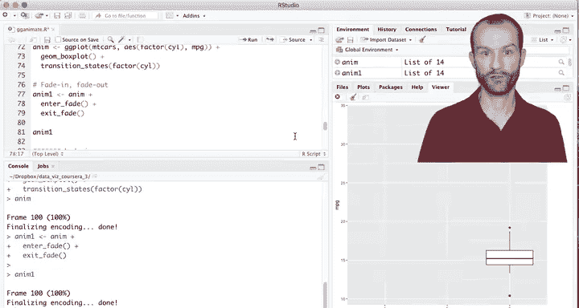
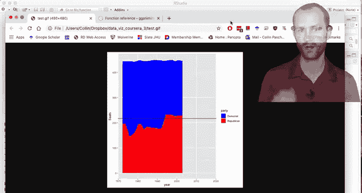

# 043：gganimate 第3部分 🎬

在本节课中，我们将继续学习 `gganimate` 包的高级功能，重点介绍如何通过控制图形元素的进入/退出效果和添加阴影来增强动画的视觉效果，并学习如何将动画导出为文件。

## 概述


上一节我们介绍了 `gganimate` 的基本用法和不同的过渡函数。本节中，我们来看看如何通过 `enter`/`exit` 函数和 `shadowing` 技术来精细控制动画的视觉效果，并最终将动画导出为可分享的文件。

## 控制元素的进入与退出效果

除了过渡函数，你还可以控制动画中图形标记（geoms）在过渡期间出现和消失的方式，这通过 `enter` 和 `exit` 函数实现。

以下是一个示例，我们首先回顾之前视频中创建的关于汽车气缸数与油耗的箱线图动画。

```r
# 假设 p 是基础的ggplot对象
anim <- p + transition_states(cyl)
```

直接使用过渡函数生成的动画可能显得生硬且单调。通过添加不同的 `enter` 和 `exit` 函数，可以指定这些过渡的视觉外观。

`gganimate` 提供了多种内置的进入/退出函数，你可以在其官方文档中找到。通过尝试不同的示例，你可以了解这些选项的工作原理，并选择视觉上最合适的效果。

```r
# 示例：添加淡入淡出效果
anim_enhanced <- anim +
  enter_fade() +
  exit_fade()
```



## 使用阴影效果

与淡入淡出效果类似，你还可以使用“阴影”效果。阴影允许你在当前帧中保留过去或预览未来的帧，从而更清晰地展示数据的变化趋势。

以下是我们之前生成的国会中民主党与共和党人数变化的图表，现在我们为其添加阴影效果来演示。

```r
# 使用shadow_wake()函数添加阴影
anim_with_shadow <- anim +
  shadow_wake(wake_length = 0.1, alpha = 0.6)
```

通过调整 `shadow_wake()` 等函数的参数，你可以控制阴影的长度和透明度，从而展示出国会控制权随时间推移的变化过程，同时保留部分历史帧以显示进展。

深入探索文档，你会发现还有更多工具可以对动画进行更精细的控制，例如修改标签的选项等。有了本节的基础，你应该能够理解这些文档并根据自己的可视化需求进行调整。

## 导出动画

关于 `gganimate` 最后要提及的一点是如何导出你的动画。最简单的方法是将动画保存为动态 GIF 文件。

你可以使用 `anim_save()` 函数，指定一个 `.gif` 格式的文件名并输入已保存的动画对象，动画就会保存到 R 会话的工作目录中。

```r
# 将动画保存为GIF文件
anim_save("my_animation.gif", animation = anim_with_shadow)
```

之后，你可以在网页浏览器中打开它，或者根据你准备的媒体类型使用其他工具查看。

## 总结



本节课我们一起学习了 `gganimate` 的进阶功能。我们探讨了如何使用 `enter` 和 `exit` 函数控制图形元素的出现与消失，如何利用 `shadowing` 效果来增强动画叙事，以及最终如何使用 `anim_save()` 函数将动画导出为 GIF 文件。掌握这些技巧，你可以创造出视觉效果更丰富、信息传达更有效的动态图表。