# 044：从 `ggplot2` 到交互式图表 🎨


在本节课中，我们将要学习如何利用 `plotly` 包中的 `ggplotly` 函数，将我们已经熟悉的 `ggplot2` 静态图表轻松转换为交互式图表。这能极大地增强我们数据可视化的表现力和探索性。

---


`plotly` 是一个功能强大的可视化工具包，可与 R 语言配合使用。

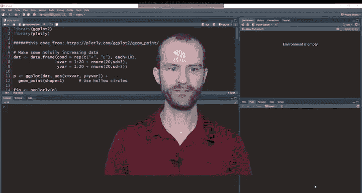

在许多方面，`plotly` 是 `ggplot2` 的一个替代方案，其语法相对容易学习，能够生成本课程迄今为止创建的多种相同类型的图表。

`plotly` 的显著特点在于，使用该工具可以非常轻松地制作交互式图形。


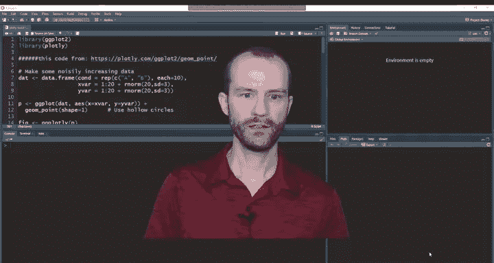

结合 `shiny` 和 `flexdashboard` 等工具，你可以使用 R 语言复制许多像 Tableau 这样的可视化软件的交互式图形。

如果你真的想最大化利用 R 语言的可视化技能，你应该花时间完整地学习 `plotly`。

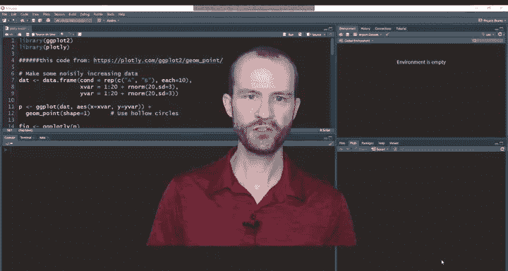

凭借我们目前所学的知识，将你关于如何在 R 中编码的知识转移到使用这个新包上，对你来说应该不会特别困难。

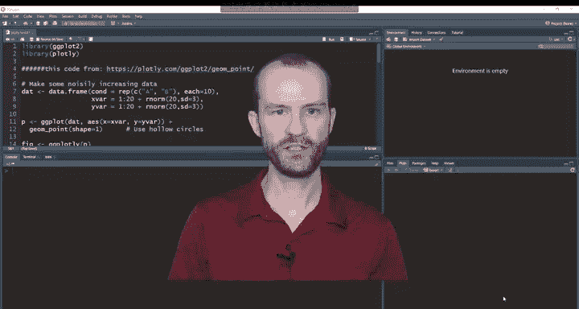

然而，在本课程中，我们没有时间涵盖所有内容，因此我们优先讲解 `ggplot2` 而非 `plotly`。

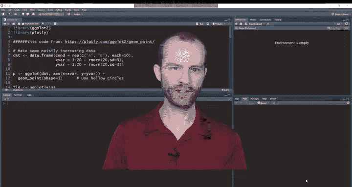

学习 `plotly` 的最佳资源在线上。

Carson Sievert 有一本教科书可供购买，它提供了非常好的入门介绍，其免费版本可在 `plotly.r.com` 在线获取。

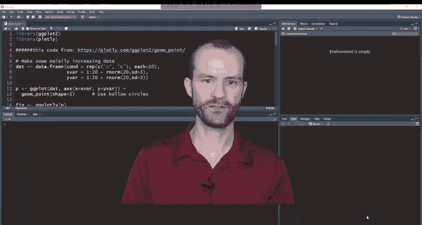

在 `plotly.com` 上还有一套很棒的参考资料。

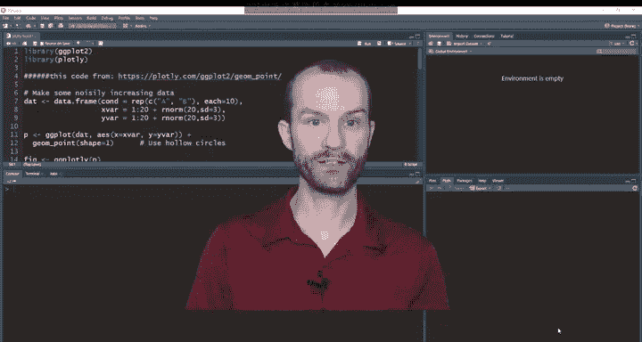

如果你有时间，利用在本课程中培养的技能来学习使用 `plotly` 是一个好主意。

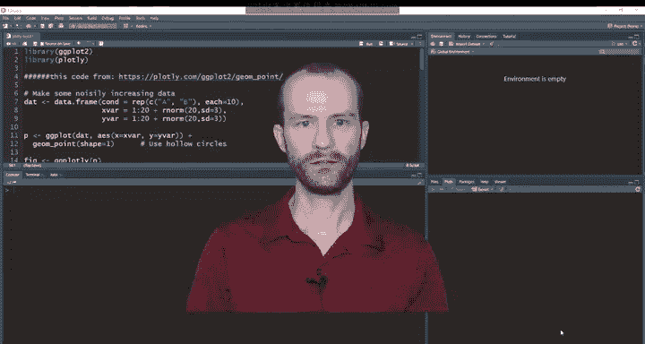


幸运的是，你无需学习 `plotly` 的全部内容，就可以利用它来改进我们在 `ggplot2` 中创建的可视化效果。

`plotly` 有一个特殊的函数，可以与 `ggplot2` 图形交互，使这些图形具有交互性，这个函数恰当地被称为 `ggplotly`。

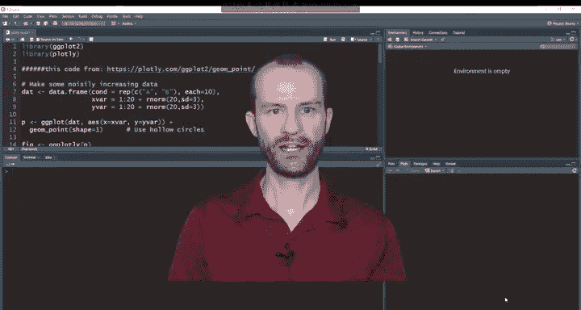

`ggplotly` 的基本用法非常简单，你只需创建一个 `ggplot2` 图形，然后将其放入 `ggplotly` 函数中，即可使用 `ggplotly` 的特殊工具。

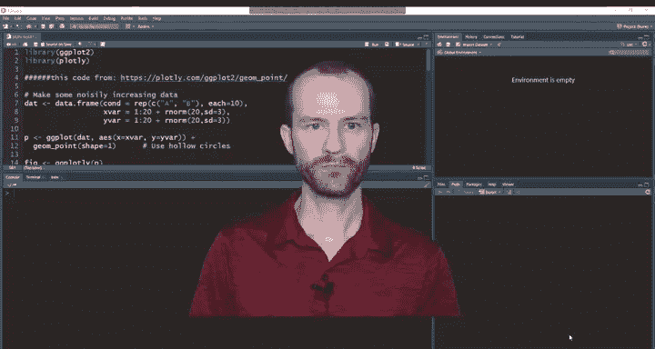

接下来，让我演示如何操作。请跟随本视频相关的 R 代码一起练习，我在这里使用了来自 `plotly.com` 的改编代码。

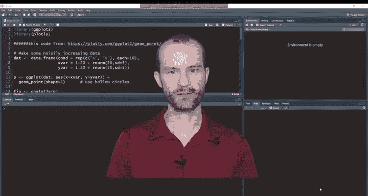

以下是具体步骤：

首先，安装并加载我们需要的库。

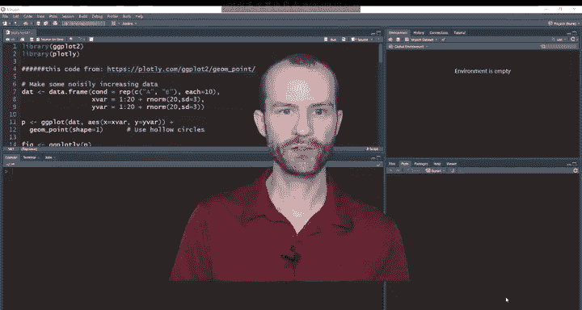

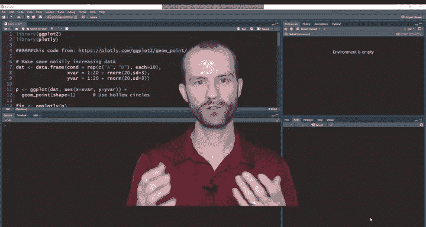

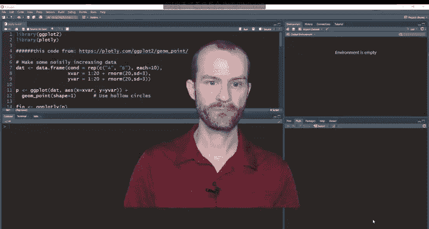

```r
# 安装并加载必要的包
install.packages("plotly")
library(ggplot2)
library(plotly)
```

接着，我将创建一些模拟数据，从一个正态分布中抽取数据，这是我们过去见过的做法。

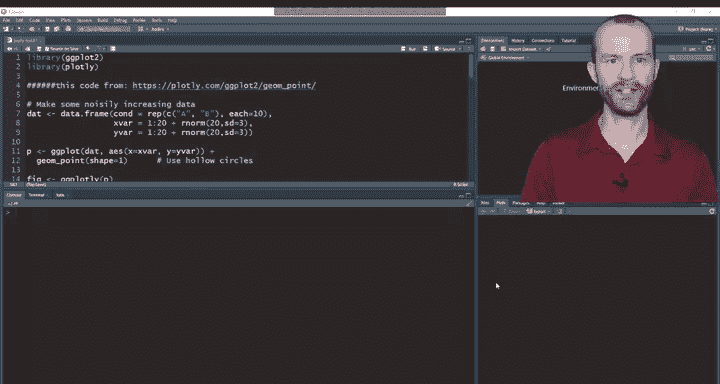

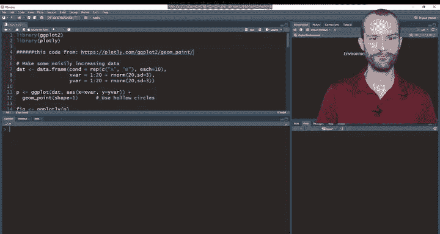

```r
# 创建模拟数据
set.seed(123)
data <- data.frame(
  x = rnorm(100),
  y = rnorm(100)
)
```

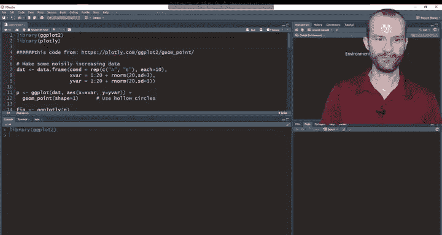

我们将使用 `ggplot2` 制作一个非常简单的散点图，并将其保存到 R 环境中的对象 `p`。

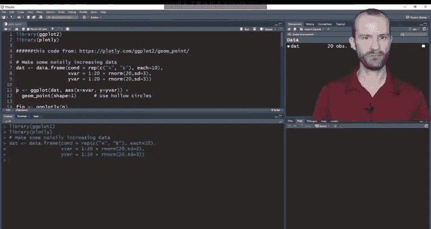

```r
# 创建 ggplot2 散点图
p <- ggplot(data, aes(x = x, y = y)) +
  geom_point() +
  labs(title = "一个简单的散点图", x = "X 轴", y = "Y 轴")
```

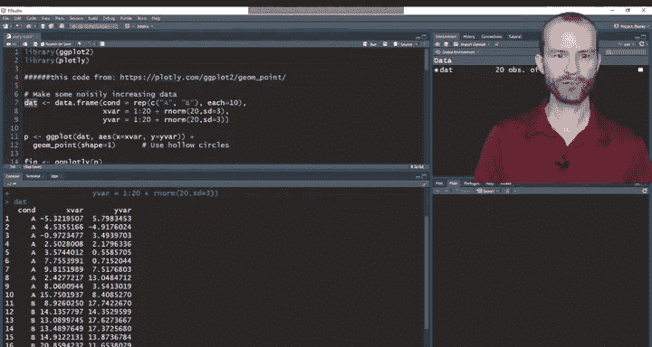

然后，我们只需用 `ggplotly` 函数包裹我们创建的 `ggplot2` 对象，并将其保存到对象 `fig`。

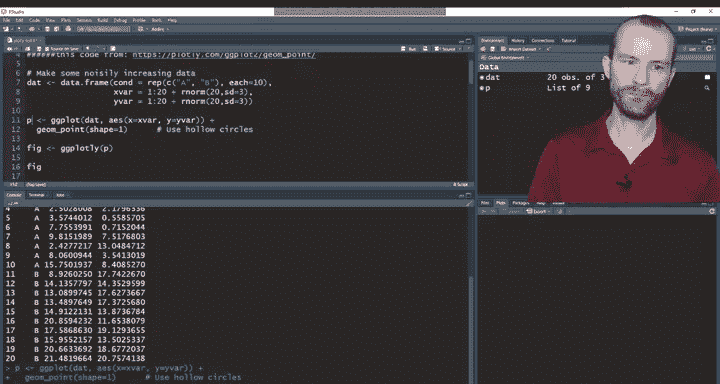

```r
# 使用 ggplotly 转换为交互式图表
fig <- ggplotly(p)
```

现在，如果你在 RStudio 中运行 `fig`，你将得到 `ggplot2` 图形，但附带了 `plotly` 的额外交互功能。

我们可以看到，当我们将光标悬停在一个数据点上时，会弹出一个显示该点数据信息的框。

你还会发现，该图表包含了传统静态 `ggplot2` 图形所不具备的缩放和平移功能。

你可以对许多不同的 `ggplot2` 图形采用完全相同的方法。花些时间尝试折线图、条形图、热图以及我们在课程中创建的其他类型的图形，看看当你将 `ggplot2` 图形输入 `ggplotly` 函数时，会产生什么样的交互性，这是非常值得的。

你还可以在将 `ggplot2` 图形输入 `ggplotly` 之前，进行所有我们之前做过的美学调整，例如更改标签、颜色等。

---

本节课中我们一起学习了如何利用 `ggplotly` 函数，将静态的 `ggplot2` 图表快速转化为功能丰富的交互式可视化作品。这为我们探索数据和展示结果提供了强大的新工具。