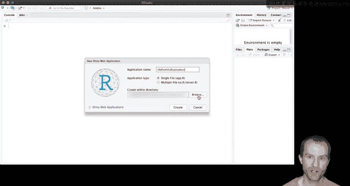
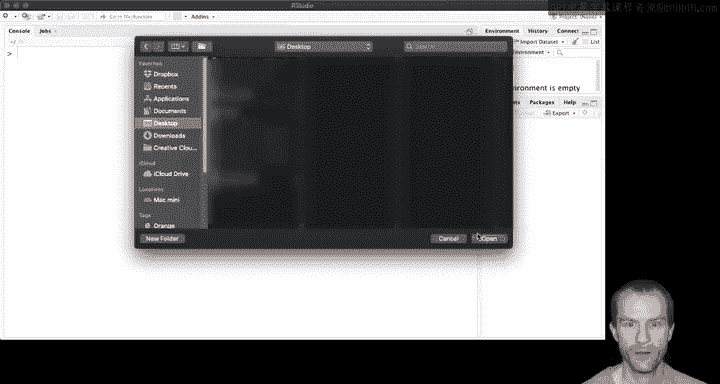
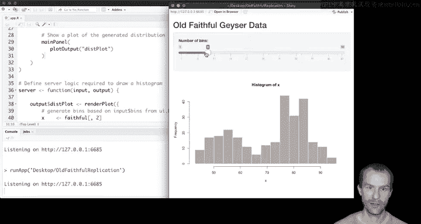

# 047：开始使用Shiny 🚀

在本节课中，我们将学习如何创建Shiny应用。Shiny是一个强大的R包，允许你创建交互式可视化并将其在线发布。我们将通过一个经典示例来理解Shiny应用的结构和工作原理。

## 概述


Shiny应用由两个核心部分组成：用户界面（UI）和服务器（Server）。用户界面控制用户如何与应用交互，包括输入元素（如滑块）和输出元素（如图表）。服务器则负责处理数据并生成可视化结果。两者之间的动态交互使得Shiny应用能够响应用户输入并实时更新输出。

## 经典示例：老忠实间歇泉数据

我们将通过一个经典示例来学习Shiny。该示例展示的是黄石国家公园老忠实间歇泉喷发间隔时间的直方图。用户可以通过左侧的滑块动态调整直方图的箱数，从而改变图表的粒度。

以下是创建该应用的关键步骤：





### 1. 创建Shiny应用项目

在RStudio中，点击“New File”按钮，选择“Shiny Web App”。为项目命名（例如“old_faithful_replication”），选择存储目录，并选择应用类型为“Single File”。

### 2. 理解应用结构

Shiny应用主要包含两个部分：UI和Server。在单文件应用中，它们通常写在同一文件中。

#### 用户界面（UI）

UI部分使用`fluidPage`函数定义，它控制应用的布局和外观。在我们的示例中，UI创建了一个侧边栏布局，左侧是输入面板（包含滑块），右侧是主面板（用于显示图表）。

以下是UI部分的关键代码：

```r
ui <- fluidPage(
  titlePanel("老忠实间歇泉数据"),
  sidebarLayout(
    sidebarPanel(
      sliderInput("bins",
                  "箱数:",
                  min = 1,
                  max = 50,
                  value = 30)
    ),
    mainPanel(
      plotOutput("distPlot")
    )
  )
)
```

*   `sliderInput`函数创建滑块，其参数包括：
    *   `"bins"`：输入值的名称，用于在Server中引用。
    *   `"箱数:"`：滑块在UI中显示的标签。
    *   `min`、`max`、`value`：滑块的最小值、最大值和初始值。
*   `plotOutput`函数指定输出区域将显示一个名为`"distPlot"`的图表。

#### 服务器（Server）

Server部分是一个函数，它接收来自UI的输入（`input`），进行处理，并生成输出（`output`）返回给UI。

以下是Server部分的关键代码：

```r
server <- function(input, output) {
  output$distPlot <- renderPlot({
    x <- faithful$waiting
    bins <- seq(min(x), max(x), length.out = input$bins + 1)
    hist(x, breaks = bins, col = 'darkgray', border = 'white')
  })
}
```

*   `renderPlot`函数告诉Shiny需要渲染一个图表。
*   `input$bins`获取来自UI滑块`"bins"`的当前值。
*   使用`hist`函数生成直方图，其箱数由`input$bins`动态决定。
*   生成的图表被赋值给`output$distPlot`，这与UI中`plotOutput("distPlot")`相对应。

### 3. 运行应用

在RStudio中，点击“Run App”按钮即可运行Shiny应用。应用会弹出一个窗口，显示交互式直方图。你可以拖动滑块，观察图表如何实时更新。

## 核心交互流程

理解UI和Server之间的数据流是掌握Shiny的关键：

1.  **用户输入**：用户在UI中操作滑块，改变`input$bins`的值。
2.  **服务器处理**：Server函数检测到`input$bins`的变化，重新执行`renderPlot`中的代码。
3.  **输出更新**：新生成的图表通过`output$distPlot`传递回UI，并更新主面板中的显示。



这个“输入 → 处理 → 输出”的循环使得Shiny应用具有动态交互性。

## 总结


本节课我们一起学习了Shiny应用的基础。我们了解了Shiny应用的两大核心部分：**用户界面（UI）** 和 **服务器（Server）**。通过老忠实间歇泉的示例，我们看到了如何通过`sliderInput`创建输入控件，以及如何在Server中使用`renderPlot`和`input$`对象来创建响应式图表。理解UI与Server之间通过`input`和`output`对象进行的数据传递，是构建更复杂Shiny应用的基石。在接下来的课程中，我们将通过更多简单的例子来巩固这些概念。