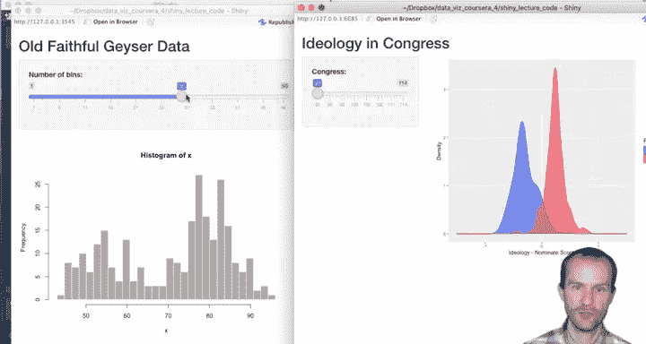
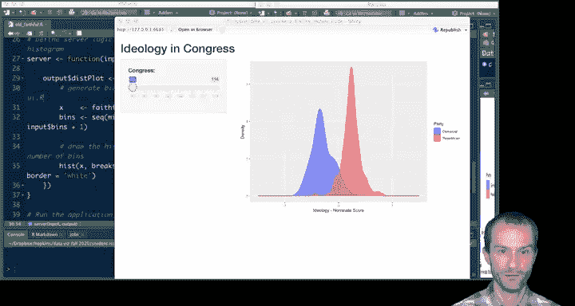
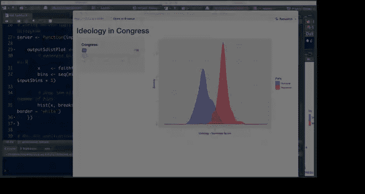

# 048：自定义Shiny应用程序示例 📊

在本节课中，我们将学习如何基于Shiny模板，通过修改代码来创建一个自定义的交互式数据可视化应用。我们将使用美国国会成员的意识形态数据，将原有的直方图示例改为动态密度图，并调整输入控件以适应新数据。

---

## 从模板开始修改

上一节我们介绍了Shiny的基本结构。本节中，我们将通过修改“Old Faithful”示例模板来创建新应用。

初次使用Shiny时，修改现有模板和示例通常比从零开始更容易。因此，我们将对之前见过的“Old Faithful”应用进行几处关键修改。

以下是主要修改内容：

1.  将直方图改为密度图。
2.  更换数据源，使用来自“有效立法中心”的美国国会数据。
3.  根据新数据的取值范围，修改滑块输入控件。

我们将创建一个密度图，展示美国国会成员意识形态随时间的分布变化。

---

## 理解数据与目标

大多数美国政客的意识形态可被归类为更自由或更保守。政治学家设计了一个名为“DW-NOMINATE分数”的指标，根据投票记录来衡量意识形态，其公式可简化为对投票模式的**降维分析**。分数越低代表越自由，分数越高代表越保守。

我们的目标是创建一个应用，允许用户通过滑块选择不同的国会届次，从而观察两大政党成员意识形态分布如何随时间演变。

观察代码可以发现，新应用与“Old Faithful”示例非常相似。我们的任务就是修改模板代码，使其适应新数据和我们试图通过可视化探究的问题。

为了便于学习，请打开本视频关联的.R文件，并与上一节的“Old Faithful”示例文件进行对比。

---

## 准备数据与静态可视化

首先，我们查看新应用的代码。第一步是加载`tidyverse`库，然后设置工作目录并导入CSV数据文件。

使用外部数据时，最佳实践是将数据文件与Shiny应用的.R文件放在同一文件夹中。请确保在本地运行时，工作目录设置正确，且该文件夹包含应用文件和所需数据文件。

导入数据后，我们需要进行一些数据整理，为可视化做准备。这些操作对你来说应该不陌生，但建议你暂停片刻，仔细阅读这些代码行，理解我们对数据所做的修改。

为了确保可视化效果符合预期，我们先创建一个静态版本的图形作为练习。

以下是创建静态密度图的代码步骤：

1.  **指定数据**：使用整理后的国会数据框。
2.  **设置美学映射**：将`x`轴映射到意识形态分数，用`color`区分政党。
3.  **添加几何对象**：使用`geom_density()`绘制密度图。
4.  **修改标签与坐标轴**：设置清晰的标题和坐标轴标签，并固定x轴范围以保证一致性。
5.  **调整配色**：使用`scale_color_manual()`为两个政党分配特定颜色。

运行这部分代码可以确认图形能正确显示。由于这些代码不在Shiny应用的UI或服务器函数内，它们不会在最终的交互式应用中显示。

从这张聚合了1970年代至今所有国会数据的静态图中，我们可以看到共和党与民主党成员的意识形态分布重叠区域很小。但我们的目标是观察每一届国会的情况。静态展示的一种方法是使用`facet_wrap`为每届国会创建小图。然而，使用Shiny应用可以实现更动态、更灵活的探索。

---

## 构建Shiny应用：用户界面(UI)

现在，让我们继续对比旧示例与新应用的代码。两者都从构建用户界面开始。

对于新应用，我们需要修改UI部分的以下内容：

*   **应用标题**：改为“Ideology in Congress”。
*   **滑块输入**：
    *   将输入ID改为`my_congress`。
    *   将标签改为“Select Congress”。
    *   根据数据中国会届次的实际范围（例如93到114届）调整`min`、`max`和`value`参数。
*   **图形输出**：将输出ID改为`congress_plot`，以匹配服务器端将生成的图形。

我们基本上沿用了旧应用的结构，但根据新数据和可视化目标调整了具体参数。

---

## 构建Shiny应用：服务器逻辑(Server)

在服务器函数部分，我们同样需要进行几处修改。

以下是服务器端的关键修改步骤：

1.  **更改输出对象**：将`output$hist`改为`output$congress_plot`，与UI中定义的输出ID保持一致。
2.  **替换绘图代码**：在`renderPlot()`函数内，将生成直方图的代码替换为创建包含两条密度曲线的ggplot图形代码。
3.  **连接输入与数据**：这是核心变化。在绘图的数据参数中，我们使用`filter()`函数，根据滑块输入值`input$my_congress`来动态筛选对应届次的国会数据。例如，当滑块值为93时，应用将只绘制第93届国会的数据。

请务必理解输入值`input$my_congress`如何传递到`filter()`函数中，并用于动态过滤数据集。

---

## 运行与探索应用

像之前一样运行应用。现在，你可以使用滑块在不同届次的国会之间切换，观察意识形态分布随时间的变化。

从结果中可以看到一个有趣的现象：随着时间的推移，两党成员的意识形态分布重叠区域越来越小。许多人将这一结果与当今美国政治中激烈的党派两极分化联系起来，认为两党之间的分歧日益加深，共识区域减少。

这正是Shiny交互式应用的强大之处：它让你能够动态观察可视化的变化，允许用户探索数据背后的故事。这些故事可能在一张静态图中并不明显，或者用单一图形难以清晰、便捷地展示。

---

## 总结

本节课中，我们一起学习了如何通过修改Shiny模板来创建自定义交互式应用。我们更换了数据源，将图形从直方图改为密度图，并调整了输入控件。关键在于理解了如何将UI中的输入（`input$my_congress`）与服务器端的数据处理（`filter()`函数）连接起来，从而实现动态可视化。这个过程展示了Shiny如何让数据探索变得更加直观和有力。