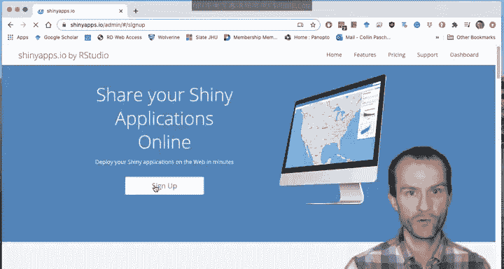
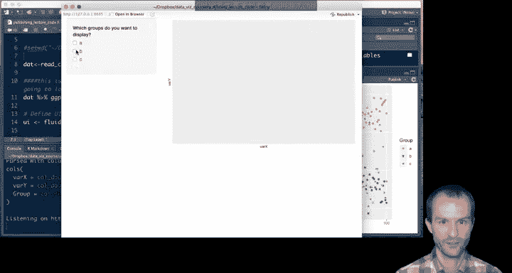
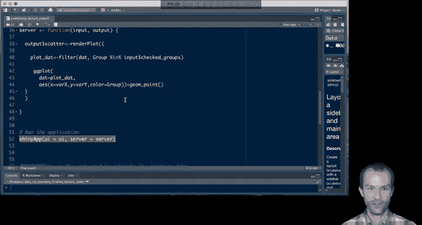
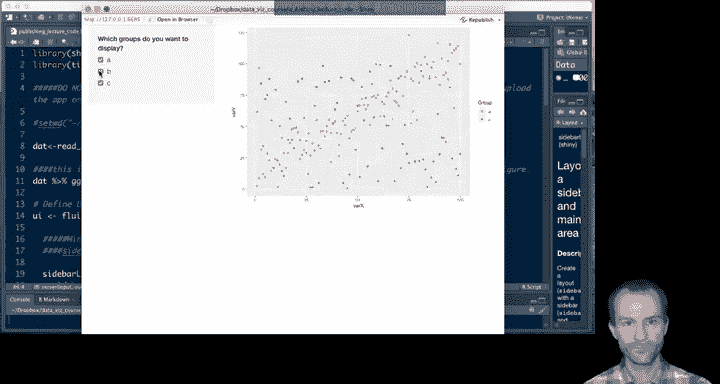
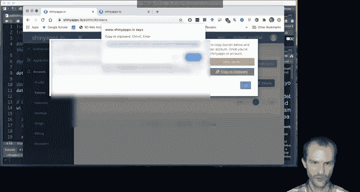
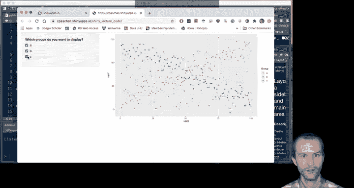

# 050：4_将Shiny应用程序部署到shinyapps.io 📤


在本节课中，我们将学习如何将编写好的Shiny应用程序分享给他人。我们将重点介绍两种方法：第一种是将应用程序发布到shinyapps.io网站；第二种是将Shiny代码集成到R Markdown文件中。本节我们将从发布到shinyapps.io开始。



---

## 概述

shinyapps.io是由RStudio提供的一项免费服务，允许用户在线托管和分享Shiny应用程序。要使用该服务，首先需要创建一个账户。

## 创建shinyapps.io账户

1.  访问 [shinyapps.io](https://www.shinyapps.io/)。
2.  点击“Sign Up”并完成注册流程。
3.  账户创建成功后，返回RStudio。




## 构建示例Shiny应用程序


为了演示发布过程，我们将构建一个简单的Shiny应用程序。本视频的配套材料中提供了相关脚本和数据文件。

这个应用程序将使用一个CSV文件中的数据创建散点图。该文件包含300行X和Y坐标的观测数据：
*   **100行** 属于 **组A**，X和Y值呈强正相关。
*   **100行** 属于 **组B**，X和Y值呈强负相关。
*   **100行** 属于 **组C**，X和Y值无相关性。

应用程序的目标是创建一个按组别着色的散点图，并允许用户通过复选框选择显示一个或多个组的数据，以观察不同组内的关系。

最终应用程序的界面将包含一个侧边栏面板和一个主面板。用户可以在侧边栏使用复选框选择要显示的组。

### 应用程序代码解析

以下是构建该应用程序的关键步骤和代码。

首先，加载必要的库并导入数据。**非常重要**：确保CSV文件与Shiny应用程序的R文件位于**同一目录**下，并且**不要在代码中设置工作目录**。在开发过程中可以临时设置，但在部署前务必将其注释掉，否则会导致上传失败。

```r
library(shiny)
library(ggplot2)
library(dplyr)
data <- read.csv("your_data_file.csv") # 请替换为实际文件名
```

接下来，构建用户界面（UI）。我们使用`fluidPage`和`sidebarLayout`来创建布局。

```r
ui <- fluidPage(
  sidebarLayout(
    sidebarPanel(
      checkboxGroupInput(inputId = "checked_groups",
                         label = "选择要显示的组：",
                         choices = c("Group A", "Group B", "Group C"),
                         selected = c("Group A", "Group B", "Group C"))
    ),
    mainPanel(
      plotOutput("scatter")
    )
  )
)
```

在服务器（server）函数中，我们创建输出并生成图形。这里使用`renderPlot`，并在其中先对数据进行过滤，再传递给`ggplot`。

```r
server <- function(input, output) {
  output$scatter <- renderPlot({
    # 根据复选框的选择过滤数据
    plot_data <- filter(data, group %in% input$checked_groups)
    # 使用过滤后的数据创建散点图
    ggplot(plot_data, aes(x = x, y = y, color = group)) +
      geom_point()
  })
}
```

最后，使用`shinyApp()`函数将UI和server组合起来并运行应用程序。

```r
shinyApp(ui = ui, server = server)
```

运行应用程序后，可以通过选择不同的复选框来控制图中显示的数据点。

## 发布应用程序到shinyapps.io



在编写并测试好应用程序代码后，就可以将其发布到shinyapps.io了。



1.  在RStudio编辑器中，点击 **“Publish”** 按钮。
2.  系统会提示连接发布账户，选择 **“shinyapps.io”**。
3.  按照指引登录您的shinyapps.io账户，进入仪表板（Dashboard）。
4.  在账户菜单中，选择 **“Tokens”**，点击 **“Show”** 显示密钥，然后复制。
5.  将复制的密钥粘贴回RStudio的对应框中，点击 **“Connect”**。
6.  连接成功后，选择需要为此应用程序上传的文件（通常是 `.R` 脚本文件和 `.csv` 数据文件）。
7.  勾选文件后，点击 **“Publish”**。

RStudio会将应用程序发布到shinyapps.io，完成后浏览器会自动打开已部署的应用程序链接。您可以将此链接分享给任何人，他们就可以在全球任何地方通过浏览器访问并与您的Shiny应用程序进行交互。



发布后，您可以在shinyapps.io的仪表板上看到您已部署的应用程序。


---



## 总结


本节课我们一起学习了如何将Shiny应用程序部署到shinyapps.io。关键步骤包括：创建shinyapps.io账户、构建一个包含数据过滤和动态绘图的示例应用程序、以及通过RStudio的发布功能将应用程序和相关文件上传到在线平台。掌握此方法后，您就可以轻松地与他人分享您的交互式数据可视化成果。