# 053：Shiny 中的布局 🧩

在本节课中，我们将学习如何控制 Shiny 应用用户界面中不同元素的布局。我们将介绍几种核心的布局方式，包括网格布局、标签页布局以及导航列表和导航栏页面布局。掌握这些布局技巧，能帮助你构建结构清晰、交互性强的数据仪表盘。

---

## 回顾基础布局

上一节我们创建了一个将所有输入和输出垂直堆叠在一个长页面上的 Shiny 应用。


我们已经熟悉了非常基础的布局选项。例如，在上一视频中，我们创建的应用只是将一系列输入和输出在页面上垂直堆叠。

此外，在学习如何将应用发布到 `shinyapps.io` 时，我们也看到了侧边栏布局是如何工作的。


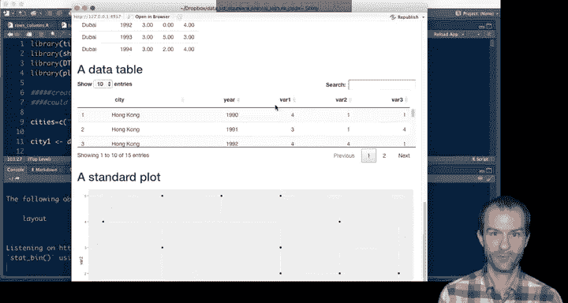

因此，我们无需再次回顾这些内容，你可以直接参考之前的视频，并将它们作为这些简单布局风格的模板。

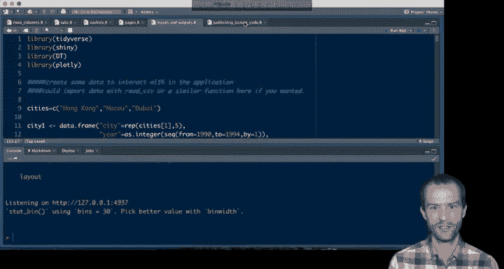

---

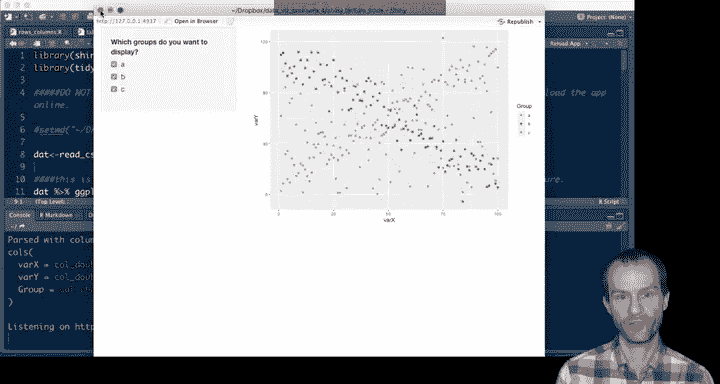

## 网格布局：并排展示可视化图表

有时，你可能希望在同一页面上并排展示多个可视化图表。

实现这一目标的方法是在应用中手动设置一个由行和列组成的网格。

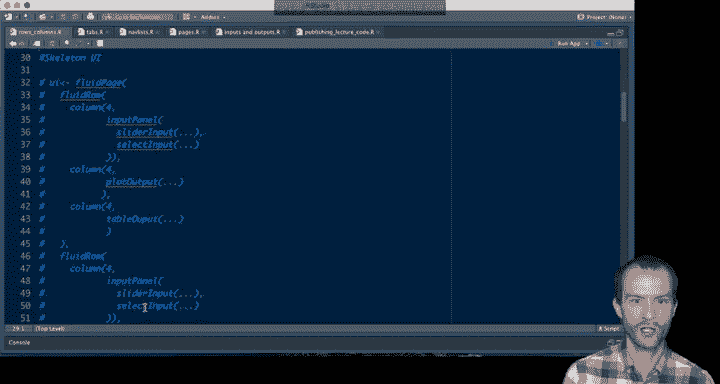

在 `fluidPage` 函数内部，你可以通过插入 `fluidRow` 函数作为参数来创建行。然后，在 `fluidRow` 内部，你可以通过添加 `column` 函数作为参数来创建多个列。

以下是创建网格布局的核心代码结构：

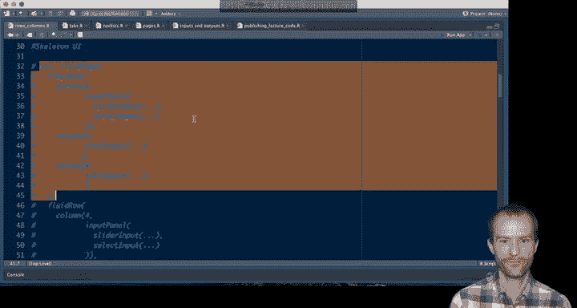

```r
fluidPage(
  fluidRow(
    column(width = 4, ...), # 放置内容
    column(width = 4, ...), # 放置内容
    column(width = 4, ...)  # 放置内容
  ),
  fluidRow(
    ...
  )
)
```

在每个行和列的交汇处（即矩阵的每个单元格），你都可以放置输入和输出控件。

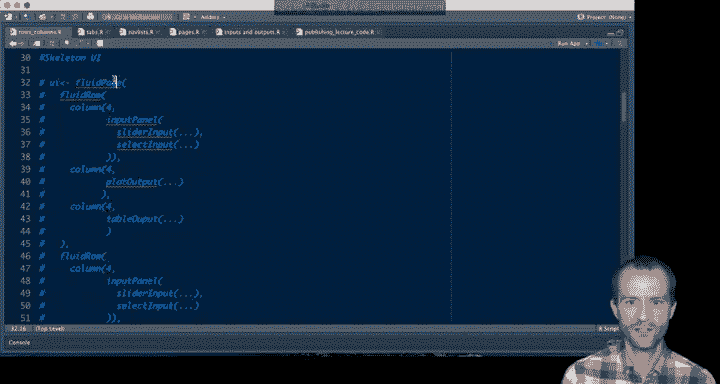

需要注意的是，每行中通过 `width` 参数设置的列宽单位总和应为 **12**。

运行此类应用，你将看到一个包含多行多列的网格。你完全可以自定义每行每列的内容。

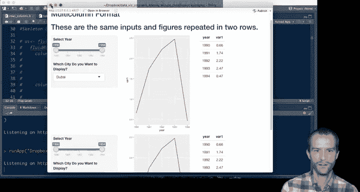

另外，你可以使用 `inputPanel` 函数包裹左侧列的输入控件，这能为输入区域提供一个美观的视觉高亮效果。

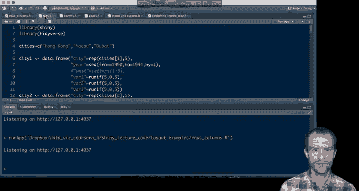

---

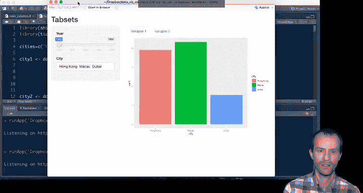

## 标签页布局：在同一区域切换不同视图

在应用中展示多个图表的另一个选项是使用标签页集。

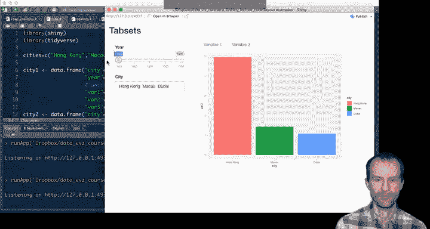

例如，假设你想使用一个侧边栏布局，其中包含一组输入控件，然后允许用户在同一主面板区域切换控制两个不同的输出图表。

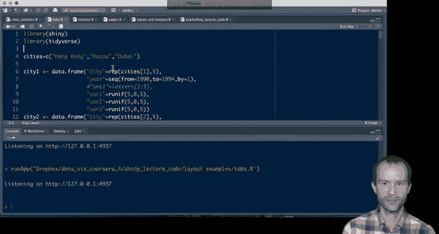

这可以通过 `tabsetPanel` 函数实现。其核心结构如下：

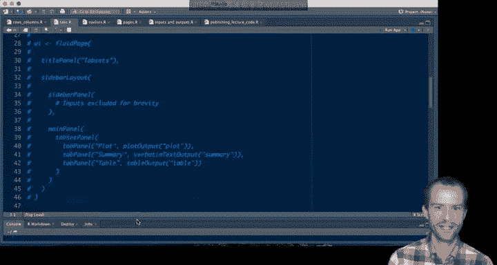

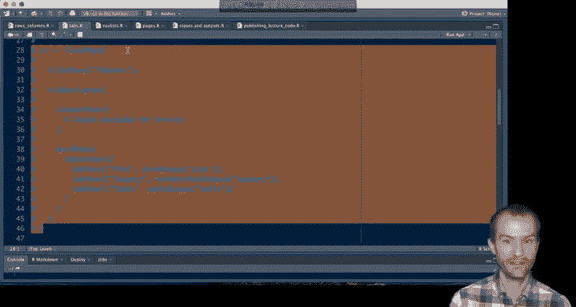

```r
sidebarLayout(
  sidebarPanel(
    # 放置输入控件
  ),
  mainPanel(
    tabsetPanel(
      tabPanel("标签页1标题", plotOutput("plot1")),
      tabPanel("标签页2标题", plotOutput("plot2"))
    )
  )
)
```

在用户界面代码中，我们首先设置一个 `fluidPage`，包含 `titlePanel` 和 `sidebarLayout`。在侧边栏面板设置输入控件，然后在主面板中指定一个 `tabsetPanel`，并为每个标签页设置标题和对应的输出函数。

服务器函数则负责接收输入，根据输入渲染相应的图形，并将渲染好的图形分配给对应的输出“插槽”，这些输出会显示在不同的标签页中。

---

## 高级导航：导航列表与导航栏页面

随着应用变得复杂，包含许多图表和输入时，你可能需要设置更复杂的导航选项。

这里有两种主要选择：创建导航列表或创建导航栏页面，它们的功能类似。

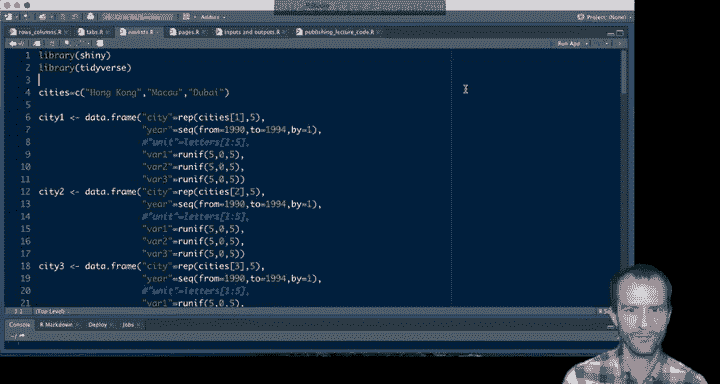

**导航列表**会创建一系列用户可以切换的不同视图。其骨架代码包含在视频附带的 `navlists.R` 文件中。

你可以在 `fluidPage` 函数中，将 `navlistPanel` 函数作为一个参数来创建导航列表。然后在导航列表内部，使用 `tabPanel` 函数提供不同的标题和内容项。在 `tabPanel` 函数内部，你可以放置输入和输出控件。

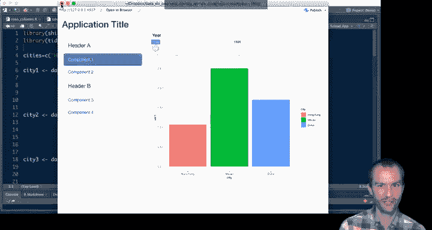

**导航栏页面**与导航列表非常相似，区别在于导航菜单的格式位于页面顶部，而非左侧。

在 `navbarPage` 函数中，你可以指定 `tabPanel` 作为其参数来创建不同的页面。

---

## 组合与进阶

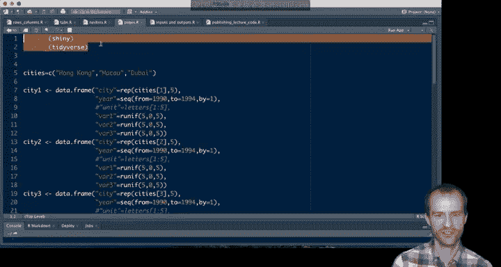

当然，你可以以无数种方式混合和匹配不同的布局选项。

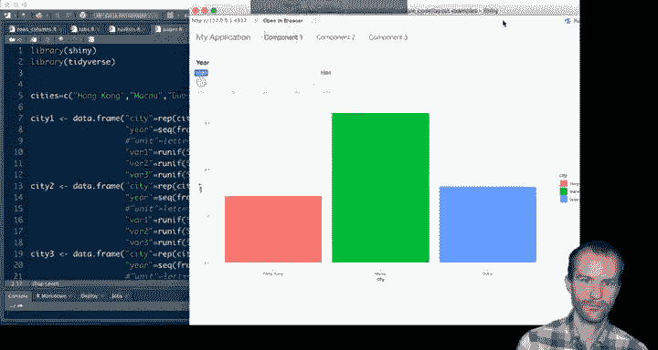

如果你查看 Shiny 官方画廊，你会看到许多通过操纵这些不同选项构建的更高级、更复杂的应用和仪表盘。

然而，当前的目标是入门，了解这些不同的布局选项，并感受如何使用这些基本选择来构建应用。

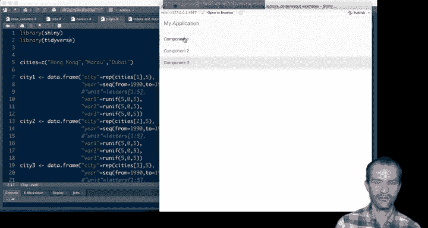

一旦掌握这些，你将能够解读更复杂的 Shiny 应用代码，并可以根据你想要展示的内容来有目的地构建它们。

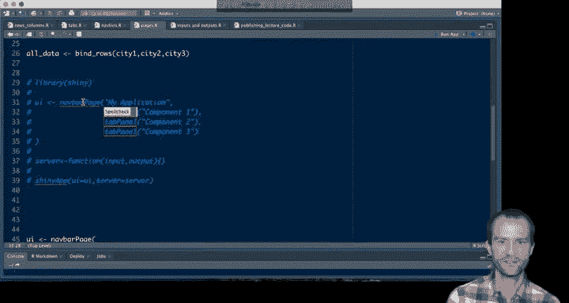

你现在已经具备了构建 Shiny 应用所需的所有基本技能。不要害怕查看模板和示例，多加练习修改和复制它们。当你准备好时，就可以使用 `shinyapps.io` 将它们发布到全世界。

---

## 总结

本节课我们一起学习了 Shiny 应用中的几种核心布局方式：

1.  **网格布局**：通过 `fluidRow` 和 `column` 函数创建行和列，实现内容的并排展示。
2.  **标签页布局**：使用 `tabsetPanel` 和 `tabPanel` 函数，允许用户在同一区域切换不同视图。
3.  **高级导航**：介绍了 `navlistPanel`（导航列表）和 `navbarPage`（导航栏页面）两种用于构建多页面复杂应用的布局方式。


恭喜你到目前为止的学习成果！你已经掌握了构建结构化和交互式 Shiny 应用界面的关键工具。接下来，请大胆实践，尝试组合这些布局，创造出属于你自己的数据仪表盘。祝你好运！😊