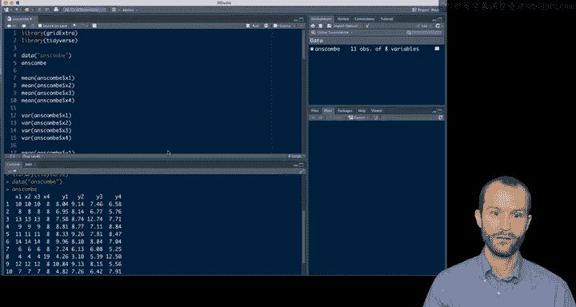
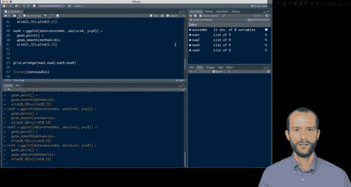

# 061：R语言数据可视化和仪表盘｜Data Visualization & Dashboarding with R
## 课程编号：P61 - 安斯库姆四重奏和数据恐龙 🦕📊

在本节课中，我们将学习两个经典的案例，它们有力地证明了数据可视化的重要性，即使面对看似简单的数据。

数据可视化在今天已无处不在，其价值在帮助人们理解数据驱动的世界时几乎无需赘述。

然而，如果你确实需要为数据可视化的价值提供佐证，一个值得回顾并熟记于心的经典案例就是安斯库姆四重奏。这个案例也常见于数据可视化教科书中。

安斯库姆四重奏是四个数据集的集合，每个数据集都包含两列：X和Y。

上一节我们提到了安斯库姆四重奏，本节中我们来看看它的具体数据特征。

如果你计算这些数据集的汇总统计量，会发现四个数据集看起来完全相同。

X列的均值和方差相同，Y列的均值和方差也相同。

对于这四个数据集中的每一个，X和Y之间的相关性也基本一致。

因此，如果你只看汇总统计量，很容易被误导，认为这四个数据集在本质上非常相似。

然而，数据可视化揭示出这四个数据集并不等同。

如果我们为X和Y值制作简单的散点图，并绘制一条最佳拟合的线性回归线，情况就一目了然了。

你可以看到，这些数据根本不等同，它们显示出非常不同的曲线和聚类模式。

这是一个极佳的具体实例，说明了即使对于非常简单的数据，创建可视化图表也是多么重要。

接下来，我们来看一个更有趣的例子。Steph Locke和Felix Kramer基于Alberto Cairo、Justin Matejka和George Fitzmaurice等人的示例，创建了一个名为`Dataaurus`的R包。

以下是对`Dataaurus`包的介绍：

这个可视化图表显示，`Dataaurus`数据包包含了13个不同的数据集。

这些数据集拥有基本相同的汇总统计量，但用散点图绘制时却呈现出截然不同的形状。

因此，如果你需要向任何人证明数据可视化的重要性，看看这些恐龙和星星形状的散点图就足够了。

本节课中我们一起学习了安斯库姆四重奏和`Dataaurus`数据包这两个案例。它们共同阐明了一个核心观点：**仅依赖汇总统计量（如均值、方差）可能会掩盖数据的真实结构，而可视化是揭示数据内在模式、避免误解的关键工具。** 记住，永远不要只满足于数字，要画出你的数据。