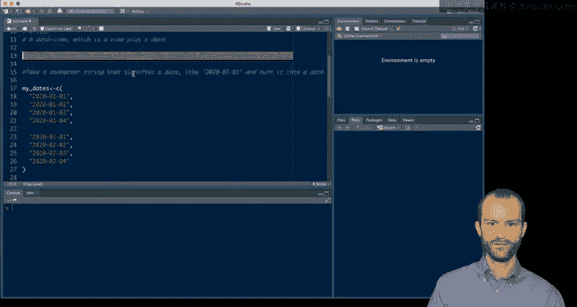
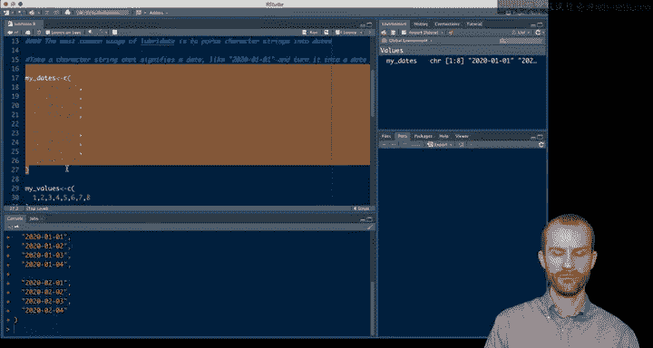
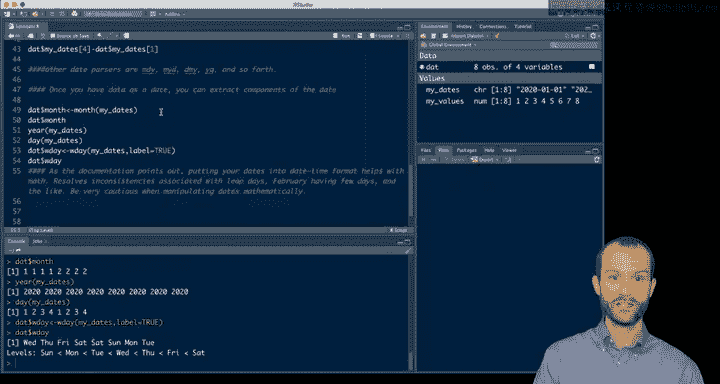
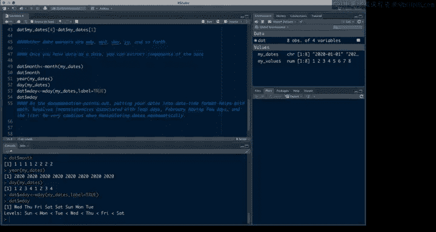

# 065：使用 lubridate 处理日期数据 📅


在本节课中，我们将学习如何处理数据中常见的日期类型。日期数据看似简单，但因其独特的属性（如不同月份的天数不同、闰年问题等），在分析和计算时常常带来挑战。我们将重点介绍 `tidyverse` 生态系统中的 `lubridate` 包，它专门用于高效、准确地解析和处理日期与时间。

## 为什么需要专门的日期处理工具？ 🤔

与字符串数据类似，日期是数据中另一种可能带来棘手问题的类型。

日期在数据中通常以字符串形式存在，但它们本质上并非真正的字符。

日期也不是普通的数字，因为日期和时间具有独特的属性，例如不同月份的天数不同，以及闰年的问题。

为了帮助处理这些问题，`tidyverse` 有一个额外的辅助包叫做 `lubridate`，它需要单独安装。

本视频之后的阅读材料提供了关于 `lubridate` 的详细讲解，但以下是其核心要点。

## 时间数据的三种类型 ⏳

在 `tidyverse` 中，时间数据有三种类型：

*   **日期**：仅包含年月日。
*   **时间**：仅包含时分秒。
*   **日期时间**：日期加上时间。

`lubridate` 的核心功能是提取可能嵌入在字符串中的这类数据，将其解析并转换为 R 中真正的日期类数据。

## 实践：将字符串转换为日期 🔧

让我们通过一个例子来具体操作。首先，我们有一个按“年月日”格式书写的日期字符串。

```r
dates <- c("2023-01-01", "2023-01-02", "2023-01-03", "2023-01-04")
```



然后，我们将其与一组任意变量值组合。



```r
values <- c(10, 15, 13, 18)
```

创建一个 `tibble` 数据框。

```r
library(tibble)
my_data <- tibble(dates = dates, values = values)
```

现在，如果我们尝试用日期列的第四个元素减去第一个元素，会发生什么？

我们可能认为结果应该是 3，因为间隔是三天。然而，你会发现这行不通，因为我们的日期目前是字符格式。

## 使用 lubridate 函数进行转换 🛠️

因此，我们必须使用 `lubridate` 中的一个函数。在这个例子中，使用 `ymd()`（代表年、月、日）将该字符串转换为 R 中的日期格式。

```r
library(lubridate)
my_data$dates <- ymd(my_data$dates)
```

一旦完成转换，我们就可以对日期进行数学运算，R 将能正确计算时间差。

```r
date_diff <- my_data$dates[4] - my_data$dates[1]
print(date_diff) # 输出：Time difference of 3 days
```

## lubridate 的其他优势 📊

将日期正确分类为日期类型后，除了能更好地进行数学运算，你还可以使用 `lubridate` 中的函数来提取日期的各个组成部分。

以下是可提取的部分组件示例：

*   `year()`：提取年份。
*   `month()`：提取月份（数字或名称）。
*   `day()`：提取一个月中的第几天。
*   `wday()`：提取一周中的第几天（数字或名称）。

此外，如果你查看文档，会发现有多个函数可以解析不同格式的日期，例如：

*   `mdy()`：用于“月日年”格式。
*   `dmy()`：用于“日月年”格式。
*   `ymd()`：用于“年月日”格式。

当日期被正确识别后，它们在排序、汇总或绘图时的表现也会更好。

## 总结 📝



本节课我们一起学习了如何处理 R 中的日期数据。简而言之，`lubridate` 让日期信息的处理变得简单得多。



你应该始终将数据中的日期信息从字符格式转换为日期类，这样才能充分利用这些函数进行准确的分析和可视化。