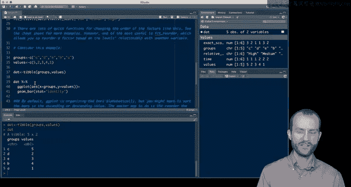
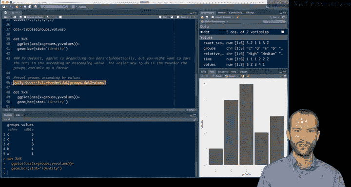
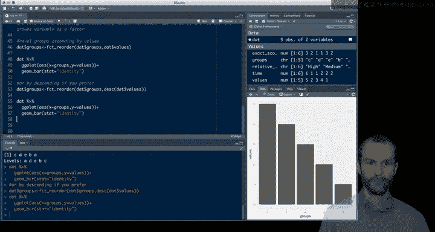

# 066：因子 📊

在本节课中，我们将要学习R语言中一种特殊的数据类型——因子。因子是处理分类数据的关键，尤其在数据可视化中，它能帮助我们正确控制分类变量的顺序。

除了日期之外，因子是另一种处理起来可能比较棘手的字符型数据。因子是一种分类数据，通常与某种顺序相关联，但这种顺序可能并非严格的数值顺序。

## 什么是因子？🔤

因子是分类数据，通常具有某种顺序，但这种顺序可能并非严格的数值顺序。例如，像“A组”、“B组”、“C组”这样的分组数据，或者像“高”、“中”、“低”这样的相对或一般评分。这些不是数字，但它们具有某种隐含的顺序，这在数据中可能非常重要。

处理此类字符数据的最佳方法是将其转换为因子。当你将数据转换为因子时，向量中的每个不同值都会被分配一个对应的水平，并且这些水平具有某种顺序。

## 因子的默认顺序问题

在R中，当你创建因子时，水平会自动分配，但自动分配的顺序可能没有意义。因为它们是按字母顺序排列的，而不是按相对大小顺序排列的。

为了纠正这个问题，我们将使用来自tidyverse的`forcats`包中的一个名为`fct_relevel`的函数，来手动重新排序因子的水平。

现在，水平处于正确的顺序，如果我们尝试绘制图表，因子数据的行为会好得多。

## 在绘图中应用因子重排序

当你遇到一个图表无法正确显示，并且你试图在某个轴上获得正确顺序时，这真的很有帮助。

例如，我们来看这个小型模拟数据集，其中包含一系列字母以及与每个字母关联的几个值。假设我们想要一个简单的条形图。默认情况下，R将这列字母视为因子，并按字母顺序对条形图的x轴进行排序。

这可能不是你在图表中想要的方式。如果不重新排序因子，处理起来会非常令人沮丧。但我们可以快速重新排序因子的水平，使图表更具吸引力。

通过向`fct_reorder`函数提供我们想要重新排序的向量，以及我们想要用来对因子水平进行排序的数据中的另一个向量，我们可以轻松地按照排序向量值的升序获得图表上所需的水平顺序。

如果我们想按降序进行，也可以轻松实现。

## 总结与工具

`forcats`包含许多方便的函数，可以快速以这种方式重新排序因子。因此，你应该花几分钟时间进一步熟悉这些函数，以备在你自己数据中需要使用它们。

请记住这个技巧，在你未来的项目中处理分类数据时，它会非常有用。

在本节课中，我们一起学习了因子的概念、其默认顺序的问题，以及如何使用`forcats`包中的`fct_relevel`和`fct_reorder`函数来手动重排因子水平，从而在数据可视化中获得正确的分类顺序。掌握因子是控制图表中分类变量显示顺序的关键。