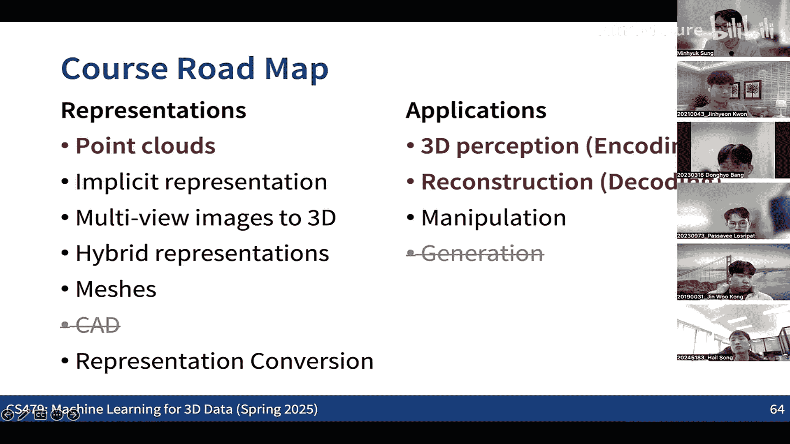

# 001：3D数据表示法

在本节课中，我们将要学习3D数据的各种表示方法。我们将探讨每种表示法的优缺点，理解它们在不同应用场景下的适用性，并初步了解如何在不同的3D表示之间进行转换。这对于后续设计处理或生成3D数据的神经网络至关重要。

## 概述：为什么需要讨论3D表示法？

上一讲我们简要介绍了3D数据的应用。为了设计能够处理3D数据的软件或神经网络，我们首先需要将3D信息以某种数字形式表示出来。这与处理文本或图像数据是类似的：我们需要将信息转化为神经网络能够理解的数字表示。

## 从1D和2D表示法中获得启发

在深入3D表示之前，让我们回顾一下如何处理一维（如文本）和二维（如图像）数据，这有助于我们思考如何将其扩展到三维。

### 文本（1D数据）的表示

处理文本时，我们通常进行以下步骤：
1.  **分词**：将文本分割成一系列单词或标记。
2.  **嵌入**：将每个标记映射到一个低维向量。

最终，整个文本被表示为一个向量序列，形成一个二维矩阵，然后输入神经网络。

### 图像（2D数据）的表示

处理图像时，我们将其视为一个二维像素网格：
*   每个像素包含颜色信息，通常用RGB三个通道值表示。
*   因此，一张图像最终表示为一个三维张量（宽度 × 高度 × 颜色通道）。

这种网格表示非常适合应用现有的神经网络层，如卷积操作或Transformer。

## 3D数据的主要表示方法

将1D和2D的思路扩展到3D，最直接的想法是使用3D网格。然而，对于3D数据，我们有多种表示方法，各有其适用场景和挑战。

### 体素网格

最直接的扩展是使用**3D网格（体素）**。就像图像的像素是“图片元素”，体素是“体积元素”，构成一个3D张量。

*   **优点**：概念直观，可以直接应用3D卷积等操作。
*   **缺点**：对于大多数只包含表面信息的3D物体（如扫描模型），内部大部分体素是空的，导致表示**效率极低**，计算和内存开销巨大。即使提高分辨率，位于表面的体素占比也很小（例如在128³分辨率下可能不足3%）。

为了解决效率问题，研究者尝试了**自适应分辨率网格**（在空区域使用大体素，在表面附近使用小体素）或**稀疏卷积**（只对有效区域进行计算）。这些方法提高了效率，但增加了实现的复杂性。

### 多视图图像

另一种思路是将3D数据**渲染成多个2D图像**（从不同视角）。

*   **优点**：可以直接利用成熟且高效的2D神经网络（如CNN、Transformer）来处理这些图像，实现分类、分割等任务。对于带有颜色（外观）信息的3D数据尤其有效。
*   **缺点**：为了完整捕捉3D形状，通常需要**大量视图**（例如80张图/物体），导致数据量庞大。此外，可能存在遮挡区域，如果视图不足，会丢失部分几何信息。

### 点云

点云是3D空间中的一组点的集合，每个点包含其坐标 (x, y, z)，并可附加颜色、法向量等信息。

*   **优点**：
    *   表示**高效紧凑**，尤其对于表面数据。
    *   神经网络架构相对**易于实现**，适用于编码（处理）和解码（生成）。
    *   是许多3D扫描设备的直接输出格式，在机器人、物理仿真中应用广泛。
*   **缺点**：
    *   缺乏**显式的表面和拓扑信息**，存在歧义（同一组点可能对应不同表面）。
    *   要捕捉精细细节需要**大量的点**。

### 网格（多边形网格）

网格是图形学中最常用的3D表示，它显式定义了表面。它由**顶点**、**边**和**面**（通常是三角形）组成。

*   **优点**：
    *   是描述表面的**最紧凑**表示之一。
    *   拥有显式表面信息，便于渲染、纹理映射、变形操纵和仿真。
    *   网络上有丰富的3D网格模型数据集。
*   **缺点**：
    *   处理难度大：每个网格的**连接结构可能不同**，难以设计像卷积那样通用的神经网络操作。
    *   生成难度大：确保神经网络输出一个**有效且流形**的网格（能正确表示表面和体积）非常具有挑战性。

### 隐式表示

隐式表示不直接存储几何，而是用一个**函数**（通常是一个神经网络）来描述3D形状。例如，向函数输入一个3D空间点坐标，它输出该点是在物体内部还是外部（占用率）。

*   **优点**：在**3D生成任务**中表现强大，可以表示非常复杂和连续的形状。
*   **缺点**：难以直接作为神经网络的**输入**进行处理。若想用于下游应用，需要**转换**为其他显式表示（如网格、点云）。

### CAD表示（简介）

使用更高层次的几何图元（如球体、圆柱体）通过布尔运算组合来表示形状。适用于制造和精确建模，但其神经网络生成和处理更为复杂，本课程不做重点讨论。

## 表示法之间的转换

在实际应用中，我们经常需要在不同表示法之间进行转换，因为数据获取、处理、生成和最终应用可能使用不同的表示。

以下是一些转换路径的示例：
*   **简单转换**：
    *   网格 → 点云：在网格表面采样点。
    *   网格 → 多视图：从不同视角渲染网格。
    *   隐式函数 → 体素：评估函数在所有体素中心点的值。
*   **复杂转换**：
    *   点云 → 网格：需要表面重建算法。
    *   点云 → 隐式函数：需要从离散点学习一个连续函数。
    *   多视图 → 网格/点云/隐式函数：属于3D重建的核心问题。

转换能力使得我们能够根据任务需求，灵活选择最合适的表示法进行数据处理，再将结果转换为最终应用所需的格式。

## 总结

本节课我们一起学习了3D数据的五种主要表示方法：**体素网格**、**多视图图像**、**点云**、**网格**和**隐式函数**。我们分析了每种方法的**优点**、**缺点**及其**典型应用场景**。

关键点在于，没有一种表示法是完美的。**体素**直观但低效；**多视图**便于利用2D网络但数据量大；**点云**高效且易于处理但缺乏表面细节；**网格**紧凑通用但难以用神经网络处理生成；**隐式函数**利于生成但难以直接用于输入。

因此，在实际的机器学习3D数据处理流程中，**根据数据来源、处理任务和最终应用需求，在不同表示法之间进行转换**是一项关键且常见的操作。在接下来的课程中，我们将首先深入探讨如何为**点云**数据设计编码和解码神经网络。