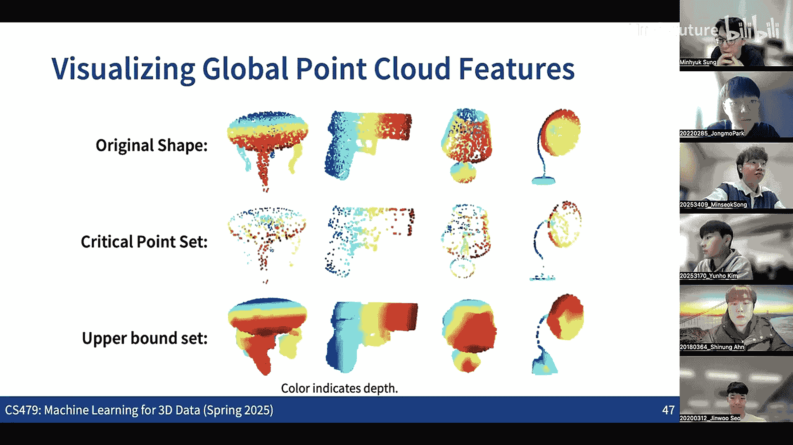
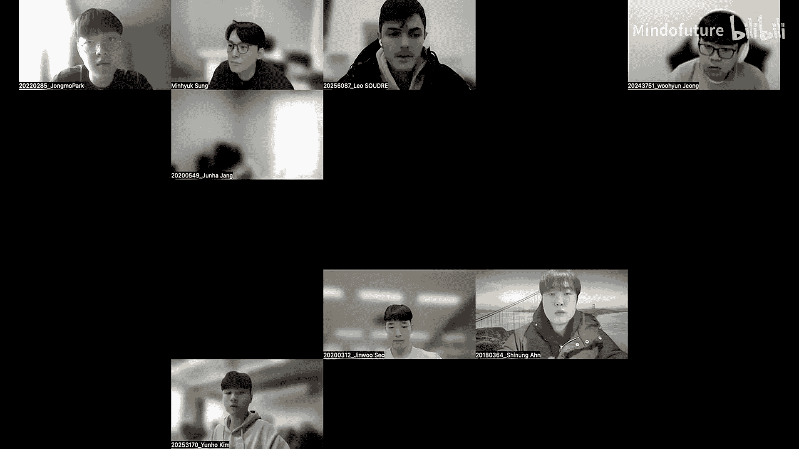

# 002：点云处理基础与PointNet架构 🧠


在本节课中，我们将学习3D数据的一种核心表示形式——点云，并深入探讨首个专门为处理点云数据而设计的经典神经网络架构：PointNet。我们将理解点云的特性、处理点云时神经网络需要满足的关键性质，以及PointNet如何通过巧妙的设计来满足这些要求。

---

## 点云：一种高效的3D数据表示 💎

上一节我们介绍了多种3D数据表示方法及其优缺点。本节中，我们来看看点云这种表示方法。

点云是一组无序的3D空间点坐标集合，通常表示为 `(x, y, z)`，并可附加颜色、法向量等信息。它易于从3D扫描设备中直接获取，也易于通过神经网络进行处理和生成。

点云的一个关键优势在于其**数据转换的便利性**。我们可以轻松地将其他3D表示（如体素、网格）转换为点云。因此，如果我们想从任意3D数据中提取信息（如物体分类），一个高效的策略是先将数据转换为点云，再使用点云编码器进行处理。这构成了我们研究点云处理架构的主要动机。

然而，点云也有其挑战：它需要大量点才能精确捕捉形状细节，并且点云数据具有两个需要神经网络特别处理的重要特性：**排列不变性**和（对于某些任务）**变换不变性**。

---

## 点云处理任务与关键性质 🎯

使用神经网络处理点云时，我们主要关注两类任务：
1.  **分类**：给定一个代表整个物体的点云，预测其类别（如飞机、椅子）。
2.  **分割**：为点云中的每一个点预测一个标签（如属于物体的哪个部件）。

这与2D图像处理中的图像分类和像素级分割任务类似。设计网络架构时，我们必须确保其输出符合点云数据的固有特性。

以下是点云处理中两个至关重要的性质：

*   **排列不变性**：点云是一个**集合**，点的排列顺序不应影响输出结果。例如，随机打乱点的顺序，分类结果应保持不变。
*   **变换不变性**：对点云施加某些几何变换（如旋转）后，其语义不应改变。例如，旋转一个飞机点云，它仍应被分类为飞机。

对于分割任务，我们还需要**排列等变性**：当输入点的顺序改变时，输出点的顺序应相应改变，以保持点与标签之间的对应关系。

如果神经网络不具备这些性质，将导致训练低效且泛化能力差。例如，网络需要看到所有可能的点排列和物体旋转姿态，才能学会将它们识别为同一类别。

---

## 构建排列不变性：对称函数 🔧

如何设计一个对输入点顺序不敏感的神经网络？核心在于使用**对称函数**。

对称函数是指其输出不随输入排列顺序而改变的函数。例如，最大值（`max`）、求和（`sum`）、平均值（`mean`）函数都是对称函数。

PointNet采用了一个通用的设计模式来构建复杂的对称函数网络。给定一个对称函数 `g`，我们可以通过以下组合构造一个新的对称函数 `f`：

```
f({x1, ..., xn}) = γ( g( { φ(xi) } ) )
```

其中：
*   `φ` 是一个共享的多层感知机，**独立地**处理每一个点。
*   `g` 是一个对称函数（如 `max`），用于**聚合**所有点的信息，生成一个全局特征。
*   `γ` 是另一个多层感知机，对聚合后的全局特征进行**后处理**，得到最终输出。

这种 `φ → g → γ` 的结构是PointNet的基础模块。通过选择 `max` 作为对称函数 `g`，该网络天然具备了排列不变性。

---

## 应对变换：空间变换网络 (Spatial Transformer Network) 🌀

实现变换不变性更为复杂。PointNet采用了一个实用而非理论保证的策略：**空间变换网络**。

其核心思想是，让网络自己学习一个变换（如旋转矩阵），在数据进入主网络之前，先将输入点云“对齐”到一个规范姿态。这相当于在网络的**最前端添加了一个自动对齐模块**。

具体实现如下：
1.  设计一个小型子网络（T-Net），以原始点云为输入。
2.  T-Net输出一个变换矩阵（例如3x3的旋转矩阵）。
3.  将此变换矩阵应用于输入点云，得到对齐后的点云。
4.  将对齐后的点云送入后续的主网络进行处理。

在PointNet中，甚至使用了两个T-Net：一个在3D坐标空间对齐，另一个在更高维的特征空间对齐。通过添加正则化损失，鼓励T-Net输出近似正交矩阵（接近旋转矩阵）。虽然这不能严格保证变换不变性，但在实践中能有效提升网络对姿态变化的鲁棒性。

---

## PointNet 网络架构详解 🏗️

结合以上概念，我们得到完整的PointNet架构。

**1. 分类网络：**
*   **输入**：`n` 个点的点云，每个点维度为3（xyz）或更高（如包含RGB）。
*   **对齐**：通过第一个T-Net预测3x3变换矩阵，对输入点云进行变换。
*   **逐点特征提取**：使用共享MLP将每个点映射到更高维空间（如64维）。
*   **特征对齐**：通过第二个T-Net预测另一个变换矩阵（如64x64），对高维特征进行对齐。
*   **进一步特征提取**：使用更多共享MLP层进一步提取特征（如到1024维）。
*   **全局特征聚合**：通过 **`max` 池化**层聚合所有点的特征，得到一个全局特征向量。
*   **分类输出**：全局特征向量经过最终的MLP，输出每个类别的得分。

**2. 分割网络：**
分割网络在分类网络的基础上进行扩展，需要输出每个点的标签。
*   **骨干网络**：复用分类网络直到全局特征聚合层之前的部分，得到每个点的局部特征。
*   **特征融合**：将每个点的局部特征与**重复拼接**的全局特征连接起来，形成新的逐点特征。这样，每个点的特征都包含了局部信息和全局上下文。
*   **逐点解码**：融合后的特征再通过一系列共享MLP，最终为每个点输出一个类别标签得分。

这种设计确保了分类任务的**排列不变性**和分割任务的**排列等变性**。

---

## PointNet 的优势与鲁棒性分析 🛡️

PointNet在ModelNet等基准测试上取得了与体素、多视图方法相媲美的精度，但其数据表示和网络架构**效率极高**。它仅用约1024个点（约3000个数值）和350万个网络参数，就能达到与需要数百万体素或数千万像素输入的大型网络相近的性能。

更引人注目的是其**对数据损坏的鲁棒性**。实验表明，即使在测试时随机丢弃80%的输入点，PointNet的分类精度下降也远小于其他方法。

**其鲁棒性源于 `max` 池化层的设计：**
在全局 `max` 池化中，对于输出特征向量的**每一个维度**，网络只从所有点中选取**最大值**。提供这个最大值的点被称为“**关键点**”。实际上，决定最终输出的仅仅是这一小部分关键点，而非所有点。

因此，只要损坏或丢失的点不属于关键点集合，网络的输出就不会改变。这解释了PointNet对点云缺失和噪声的强大容忍力。这也说明了为何选择 `max` 函数而非 `mean` 或 `sum` 函数至关重要。

---

## 总结 📝

本节课中我们一起学习了：
1.  **点云**作为一种高效、通用的3D数据表示形式。
2.  处理点云的神经网络必须具备**排列不变性**和**变换不变性**。
3.  通过**对称函数**（特别是 `max` 池化）的组合可以构建排列不变网络。
4.  **空间变换网络**是一种通过学习输入对齐来近似实现变换不变性的实用技术。
5.  **PointNet架构**巧妙地融合了上述思想，通过共享MLP、T-Net对齐和 `max` 池化，构建了一个高效且强大的点云处理网络。
6.  PointNet的**鲁棒性**源于其 `max` 池化操作，该操作使其输出仅依赖于一小部分“关键点”。





PointNet是3D深度学习领域的奠基性工作，其设计思想简洁而深刻。下一节，我们将探讨更复杂的点云处理架构。