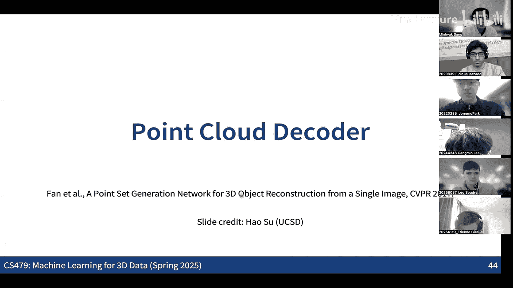

# 003：点云处理基础 (上)


在本节课中，我们将要学习处理3D点云数据的基础神经网络架构——PointNet。我们将探讨其核心设计思想，如何保证关键性质（如置换不变性），以及其优势和局限性。

---

## 概述

点云是3D数据的一种基本表示形式，由一组无序的3D点构成。PointNet是一种能够直接处理这种无序点集的神经网络。本节课我们将深入理解PointNet的设计原理，包括其如何通过对称函数实现置换不变性，以及如何通过空间变换网络应对旋转变化。

---

## PointNet 基础架构

上一节我们介绍了3D数据的多种表示形式，本节中我们来看看如何用神经网络直接处理点云。

PointNet 接收一个 `N x D` 的二维数组作为输入。其中 `N` 代表点的数量，`D` 代表每个点的特征维度（至少包含 XYZ 坐标，也可包含颜色、法向量等信息）。PointNet 主要有两种输出形式：
1.  提取整个物体的**全局信息**，用于分类任务。
2.  提取**每个点的信息**，用于分割任务。

在设计 PointNet 时，我们希望它满足两个关键性质：
1.  **置换不变性与等变性**：无论输入点的顺序如何排列，网络的输出（对于分类）或输出的顺序（对于分割）应保持一致。
2.  **变换不变性**：对输入点云施加某些变换（如旋转）后，输出应保持不变。

---

## 实现置换不变性：对称函数

如何保证无论点序如何变化，都能得到相同的输出呢？核心在于使用**对称函数**。

对称函数在输入顺序改变时，输出结果保持不变。常见的对称函数包括最大值、最小值、求和、平均值等。PointNet 选择使用 **最大值函数** 作为其核心的对称聚合函数。

基于此，我们可以构建一个通用的对称函数家族，其结构如下：
```
对称输出 = φ( γ( f(x1), f(x2), ..., f(xn) ) )
```
其中：
*   `f()` 是一个共享的多层感知机，**独立处理每一个输入点**。
*   `γ()` 是一个对称函数（如 `max`），用于**聚合所有点的信息**。
*   `φ()` 是另一个多层感知机，对聚合后的结果进行**后续处理**。

在 PointNet 中，`f()` 和 `φ()` 均由 MLP 实现，`γ()` 则采用 `max` 函数。这就是 PointNet 中最基础的模块。

---

## 实现变换不变性：空间变换网络

我们希望网络对点云的旋转具有鲁棒性。PointNet 通过引入 **空间变换网络** 来尝试对齐输入点云。

其思想是：网络自身预测一个变换矩阵（理想情况下是旋转矩阵），并将此变换应用于输入点云，使其对齐到一个“规范”的姿势，从而简化后续网络的学习。为了促使网络预测出有效的旋转矩阵，我们可以在损失函数中添加正则化项，例如要求输出的 3x3 矩阵接近正交矩阵。

同样的思想不仅可以应用在原始 XYZ 坐标空间，也可以应用在更高维的特征空间，形成特征变换网络。

---

## PointNet 的完整流程与鲁棒性

结合以上模块，PointNet 的流程如下：
1.  输入点云通过一个**空间变换网络**进行对齐。
2.  对齐后的点云通过 MLP 提取**每个点的局部特征**。
3.  使用 **`max` 池化**（对称函数）聚合所有局部特征，得到**全局特征**。
4.  全局特征再通过 MLP 得到最终的分类得分。

对于分割任务，网络结构会稍复杂：需要将局部特征与全局特征拼接起来，再为每个点预测标签。

**为什么选择 `max` 池化？**
除了作为对称函数，`max` 池化还带来了一个关键优势：**对缺失点的鲁棒性**。这是因为 `max` 操作只关注对每个特征维度贡献最大的那个点，这些点被称为**关键点集**。实验表明，这个关键点集通常只是原始点云的一个稀疏子集，并且能捕捉物体的关键结构特征（如桌角、边缘）。只要输入点云包含了这些关键点，即使其他点缺失，网络也能输出相似的特征，从而保持较高的准确性。

---

## PointNet 的局限性

尽管 PointNet 很有效，但它存在两个主要局限，这些局限在传统的2D卷积神经网络中得到了很好的解决：

1.  **缺乏层次化特征学习**：PointNet 只有“点级别”和“全局物体级别”两个极端特征层次，缺少中间尺度的局部到全局的渐进式抽象过程。而卷积神经网络通过下采样和局部卷积操作，能够自然地构建多尺度特征金字塔。
2.  **平移不变性不天然保证**：卷积神经网络通过关注局部邻域的相对关系，天然具有平移不变性。而 PointNet 的原始设计并未显式保证这一性质。

---

## 总结

本节课中我们一起学习了 PointNet 这一开创性的点云处理网络。
*   我们理解了其通过**对称函数**（特别是 `max` 池化）来实现**置换不变性**，并通过**空间变换网络**来应对**旋转变化**。
*   我们分析了 `max` 池化带来的**对点云缺失的鲁棒性**，并了解了其关键点集的原理。
*   最后，我们指出了 PointNet 的两个主要局限：**缺乏层次化特征**和**未显式保证平移不变性**。



在下一讲中，我们将介绍 PointNet++，它通过引入层次化结构和局部特征聚合，有效地解决了这些局限，并将卷积神经网络的思想成功迁移到了不规则的点云数据上。