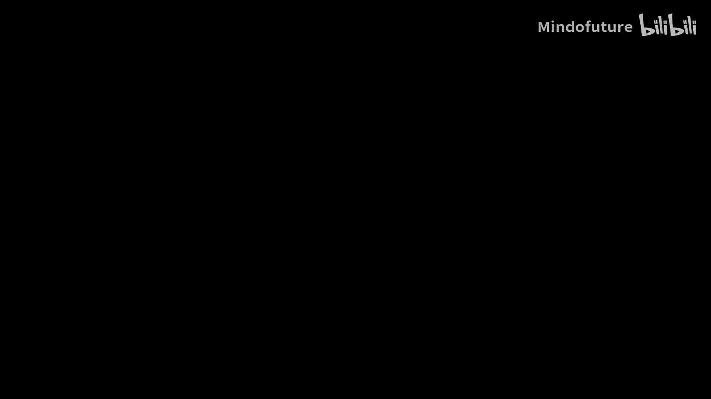
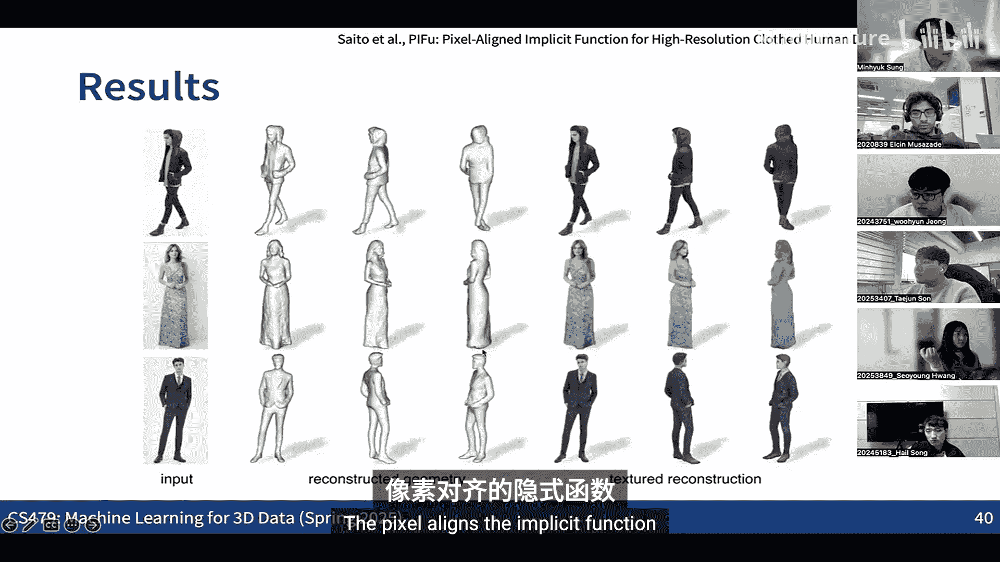
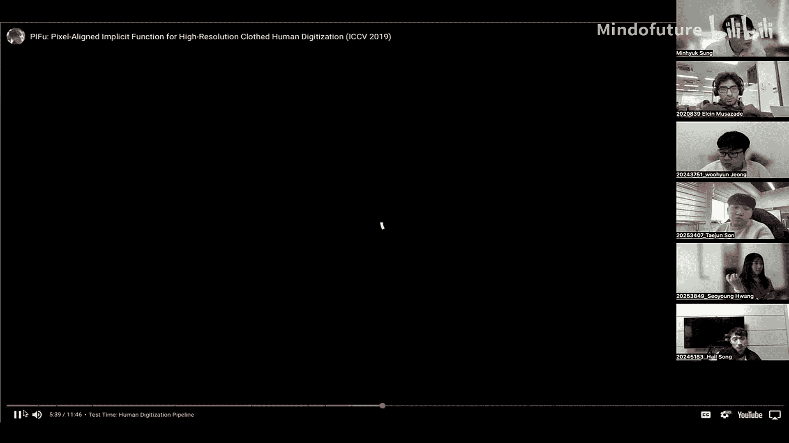
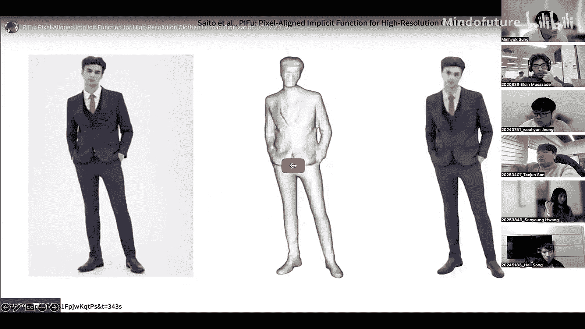
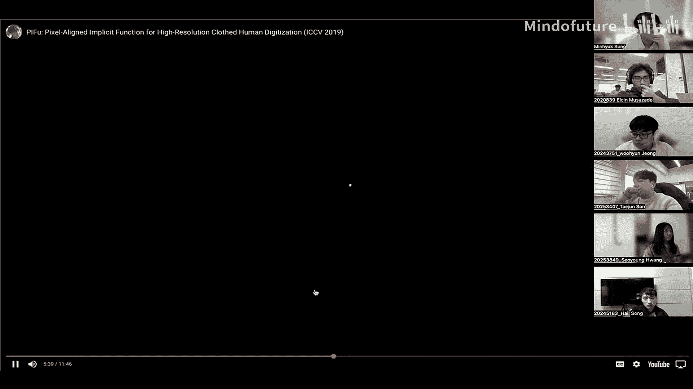
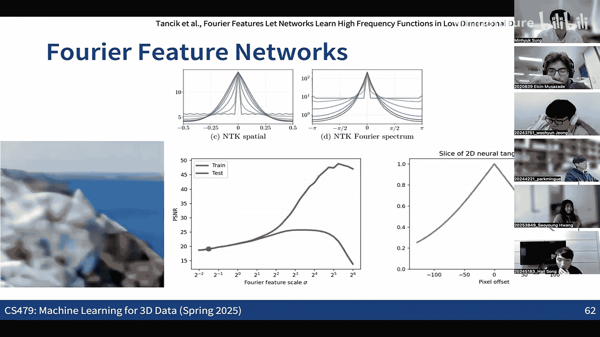
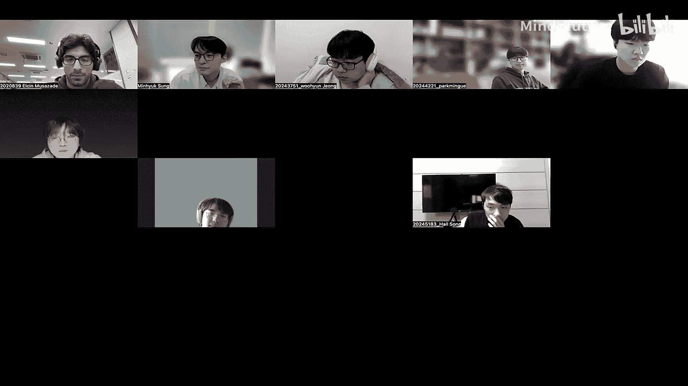

# 004：隐式神经表示

## 概述
在本节课中，我们将学习一种新的3D数据表示方法——隐式神经表示。我们将探讨如何将3D形状表示为连续函数，并使用神经网络来学习这个函数。课程将涵盖隐式表示的基本概念、实现方法、优势与局限性，以及如何将其应用于从单张图像重建3D形状等任务。

---

## 从点云解码器到隐式表示

上一节我们讨论了如何处理点云数据，包括编码器和解码器。我们介绍了PointNet、PointNet++等网络，以及如何为集合数据定义损失函数，例如倒角距离和推土机距离。这些度量标准不仅可以作为点云解码器的损失函数，也可以作为衡量点云之间相似性的通用指标。

实现基于这些损失函数的解码器是第一次作业的一部分。通过结合图像编码器和点云解码器，我们可以实现从图像到3D点云的生成。

我们讨论了点云表示在实现编解码器方面的优缺点。其优势在于架构简单、实现容易，并且处理3D数据效率较高。然而，点云表示也存在一些缺点，尤其是在构建解码器时。

## 点云解码器的局限性

如果有人要求你实现一个输出点云的3D重建网络，这种输出存在一些限制。

首先，点云表示的缺点是需要大量点才能捕捉精细细节。其次，我们上次讨论的解码器问题在于无法增加点的数量。如果我们设定输出点数为固定值（例如1024），则无法通过该架构生成更多点。这意味着我们无法控制输出的分辨率，总是得到固定数量的点。

另一个问题是，为了捕捉精细细节需要大量点，而生成大量点的解码器需要更深、更宽的架构，这将导致占用更多GPU内存和更长的训练时间。

此外，点云表示不直接显式地表征表面信息。为了将输出用于渲染、操作等应用，我们最终需要将其转换为其他表示形式。

## 引入隐式表示

鉴于点云解码器的这些缺点，我们今天将探讨另一种表示方法及其对应的解码器。今天的重点是隐式表示以及基于此的解码器架构。

隐式表示的核心思想是，我们不使用任何显式表示（如点云、网格），而是使用一个函数来表示3D形状。这个函数以3D空间中的任意查询点为输入，输出一个代表该3D形状的值。

这里有两个主要问题：
1.  函数将输出什么值？
2.  如何定义这个函数？

我们将讨论如何为隐式表示定义函数，以及从这种表示中能得到什么样的输出。

## 神经网络作为隐式函数

我们将要采用的基本思想非常简单：使用神经网络作为隐式表示的函数。

考虑一个神经网络，它以任意3D坐标 `(x, y, z)` 为输入，输出两种类型的数值之一：**有符号距离**或**占据值**。我们将在下一张幻灯片中解释这两种输出的含义。

给定一个3D形状（如网格或点云），我们训练神经网络，使其成为一个能表示该形状的函数。这个简单的架构非常直观：对于任意 `(x, y, z)` 坐标，我们得到一个值，它要么是有符号距离，要么是占据值。

## 输出类型：有符号距离与占据值

作为输出，我们可以考虑多种形式，但两种代表性的输出是**有符号距离**和**占据值**。

**有符号距离函数**测量查询点到表面最近点的距离。它在欧几里得空间中提供了关于表面的信息，但额外增加了基于符号的内部/外部信息。例如，我们可以定义形状内部的点具有负距离（-d），形状外部的点具有正距离（+d）。基于空间中距离的这种连续表示，要提取表面，我们只需取距离为零的点。这些点就构成了给定形状的表面。

**占据函数**则不关心距离，只将点分类为内部或外部。我们可以定义形状内部的点输出为1，外部的点输出为0。这意味着我们只记录占据信息，而非距离信息。

因此，我们可以考虑任何函数，给定查询点，输出距离或占据值，这可以作为给定形状的隐式表示。

## 训练隐式网络：损失函数与数据准备

我们希望训练一个神经网络，使其成为表示给定形状的函数。这里可能有一些问题。

第一个问题是，如何为有符号距离或占据值这两种选项定义损失函数？

有符号距离是空间中的连续值。对于这种情况，我们需要回归损失，如L2损失或L1损失。对于占据函数，这是一个将查询点分类为内部或外部的二分类问题，我们可以使用二元交叉熵损失。

从训练神经网络的角度看，哪一种更容易？占据值可能更容易，因为它本质上是一个分类问题，我们知道分类问题通常更容易训练神经网络收敛。然而，有符号距离包含了额外的距离信息，虽然训练可能更耗时，但这种额外信息对于许多应用可能很有用。

第二个问题是，给定一个3D形状，我们需要为有符号距离或占据值获取真实标签信息。这意味着我们应该能够从给定的3D形状计算有符号距离或占据值。

我们不会深入探讨提取这些信息的细节，但简要概述一下基本思路。对于从网格获取占据信息，假设我们有一个实体网格（水密表面），它明确定义了内部和外部。给定空间中的任意查询点，我们可以通过从该点向任意方向发射射线，并计算与表面的交点数量来确定其内外。如果交点数量为奇数，则该点在体积内部；如果为0或偶数，则在外部。这是判断点是否在网格内部的一种简单方法。

基于占据信息，如何计算有符号距离？这也很简单。从查询点找到表面上的最近点，得到距离信息。如果点在内部，则赋予距离负号；如果在外部，则赋予正号。这意味着从网格到隐式函数的转换是直接的，虽然可能需要一些计算时间，但我们可以轻松地从给定网格中提取隐式表示。

我们在这里要做的是，使用神经网络编码这种占据或有符号距离信息。其优势在于，我们可以使用非常轻量级的神经网络来编码给定3D形状的所有信息。这是使用神经网络作为压缩信息形式的一个有趣之处。

## 从点云到隐式表示

从网格到隐式表示在原理上是直接的，但问题是如何从点云转换到隐式表示。我们将在讨论完所有表示后，更深入地探讨不同数据表示之间的转换，并讨论如何从点云转换到隐式表示。实现这个想法将是作业的一部分。

现在我们可以看到，当3D形状表示为网格时，我们可以训练神经网络，使其接收查询点并预测占据值或有符号距离，使用回归损失或二元交叉熵损失。

从更工程化的角度，我们可以进行**重要性采样**。训练神经网络时更重要的点是靠近表面的点。远离表面的点，其内外属性非常明显。为了获得更准确的表面信息，我们可以在表面附近采样更多点。基本思想是在精确的表面上采样后，沿着表面法线方向进行一些扰动，从而在表面附近获得更多点（如图中红点所示）。同时，我们仍然从外部或其他地方采样一些稀疏点，以防止神经网络过拟合表面附近的点。这种重要性采样可以提供表面附近更准确的预测。

这是在训练此类网络时的一种更技术性的考量。

## 从单一形状到多形状解码

以上是使用隐式函数将单个3D形状信息编码到神经网络中的简单思路，但这仅适用于单个形状。

在构建解码器时，我们希望构建一个能生成多个形状的神经网络。这里的问题是，如何构建一个能产生多个形状的单一神经网络？

第一种思路是使用**形状编码器**。我们讨论过一些点云编码器，对于其他情况（例如图像到3D生成），我们也可以有图像编码器。我们可以从每个形状的输入中提取潜在特征，并将此信息附加到查询点上，一起作为隐式神经网络的输入。这是一个非常简单的想法。

即使没有任何编码器，我们也可以为一批形状制作解码器。我们可以为每个形状定义一些潜在变量，这些变量在训练过程中被优化。这种思路称为**自动解码器**，它没有任何编码器，只是为每个形状定义一些随机变量，并在训练隐式神经网络的过程中优化这些变量。

另一种思路是构建所谓的**超网络**。我们构建一个小的隐式神经网络，它以查询点为输入，输出占据值或有符号距离，该网络由若干层定义，每层都有参数。然后，我们构建另一个神经网络，它以图像或3D形状为输入，并预测这个隐式神经网络的参数作为输出。我们构建了一个输出其他神经网络参数的神经网络，因此称为超网络。

因此，我们可以通过为每个形状设置潜在向量，或使用超网络生成参数，来构建能解码多个形状的神经网络。

## 隐式表示的优势与权衡

这种架构取代了我们的点云解码器或体素解码器。其优势在于：
1.  架构可以非常简单、轻量，因为它不严格同时生成多个点或多个体素的值。它接收单个查询点并输出该点的值。因此，即使使用非常轻量的架构，我们仍然可以训练它来预测占据值或有符号距离。这意味着我们可以构建非常小的架构，隐式神经网络的模型尺寸远小于输出每个体素值的其他架构。
2.  隐式表示是**分辨率无关的**，这意味着我们可以在推理时随意改变输出的分辨率。对于点云解码器，一旦我们训练解码器生成例如1024个点，就无法在推理时改变点的数量。但对于隐式神经网络，我们可以在推理时控制分辨率，采样更多点并获取这些查询点的值。这是隐式表示的一个优点，我们可以根据需要改变分辨率，同时与基于体素的解码器相比，可以获得更精细的细节。

明显的缺点是，生成单个形状需要更多时间。因为点云解码器或体素解码器同时输出所有内容，我们只需要运行一次神经网络的前向传播。而对于隐式表示，我们需要查询空间中的多个点、大量查询点来获取信息，这意味着我们需要运行神经网络很多次。因此，在推理时间上，与那些架构相比，它需要更多时间。你可以在模型大小和推理时间之间看到一种权衡。隐式表示在减少神经网络大小方面有优势，但需要付出更多的计算成本。

## 处理复杂拓扑结构

隐式表示的另一个优势是，与直接预测表面或网格表示的架构相比，它可以自由表示任何拓扑形状。例如，椅子背面有许多孔洞，拓扑结构相当复杂。如果我们想用一组面片或表面来表示这些，精确描述会非常具有挑战性。但在我们的例子中，我们没有拓扑上的这种限制，我们只需要查询点并获取值。因此，在重建拓扑复杂的形状时，隐式表示可能是一个不错的选择。

## 形状插值

隐式表示还有一个有趣的经验优势：通过在潜在空间中进行插值，我们可以看到形状插值的有趣现象。

一旦我们训练了将形状编码为潜在向量并解码为隐式函数的编码-解码架构，如果我们对形状潜在向量进行插值，就可以看到形状平滑插值的结果。例如，在沙发和椅子之间进行插值，我们可以看到两者之间的中间形状。这可以通过简单地插值潜在代码来实现。

虽然没有理论保证插值会有多平滑，但通常与直接插值对应的体素占据值或有符号距离的情况相比，或者与简单地插值潜在代码的情况相比，我们可以看到更直观、平滑的插值结果。这也可以看作是隐式表示的一个优势。

## 扩展到其他模态

实际上，隐式神经网络的思想不仅可用于3D，还可用于所有数据模态。我们可以看到使用这种表示处理音频、图像等其他领域的技术。

一个有趣的例子是将其用于**超分辨率**。给定低分辨率图像以及训练时的高分辨率参考图像，我们可以做的是：给定连续空间中的任意查询点，我们取低分辨率图像中最近的四个像素，并基于此预测颜色信息。这是将图像的高分辨率信息以函数形式编码到神经网络中的另一个例子。其优势在于，我们可以构建非常紧凑的神经网络表示，压缩高分辨率图像的所有信息。这种思想也可以推广到处理多张图像。

## 隐式神经表示总结

隐式神经表示的思想可以总结如下：
*   它可以是非常紧凑的架构，同时仍能捕捉所有精细细节。
*   我们可以根据需要改变分辨率。
*   在形状拓扑方面非常灵活。
*   一个主要缺点是，在理想情况下，推理时间非常长，因为我们需要查询整个空间中的所有点，并为所有查询点获取输出。这将需要为大量查询点运行神经网络的前向传播。

## 图像到3D的隐式解码

具体来说，我们讨论了一些关于如何为3D形状构建隐式解码器的思路。对于某些自编码任务，我们也可以考虑添加编码部分。对于点云到隐式表示，编码器可以是PointNet，解码器可以是隐式神经网络。我们也可以考虑为编码使用超网络。这是可以编码和解码3D形状的编码-解码架构的两种类型。

现在，我们想具体看看图像到3D解码的例子。正如我们在点云解码器案例中讨论的，如果你想构建一个以单张图像为输入、输出3D形状的架构，应该怎么做？

这基本上就是我们需要某种图像编码器的情况。我们也可以考虑一些例子，以单张或多张图像为输入，输出表示3D形状的隐式函数。

这里的问题是，如何构建这种架构？这可能只是如何整合图像编码器的问题。一旦我们有了任何图像编码器，我们就可以使用相同的思路：要么预测形状的潜在代码，要么预测隐式神经网络的参数。我们可以做同样的事情。

但这里的问题是，在整合图像编码器和3D形状解码器方面，能否做得更好？我们能做的是考虑标注图像像素与3D空间点之间的空间对齐。我们将看到的是，当你看到3D空间中的每个点时，该点对应于特定的像素。这是图形学中的渲染过程：给定任何3D形状，将其投影到特定视点的平面上，我们可以看到3D空间中的每个点都对应于一个2D像素。

我们将在下一讲中更详细地讨论这种投影操作，以及定义相机模型。但即使不知道投影的确切细节，我们也可以看到3D空间中的每个点都将映射到图像中的一个点。这意味着，当你确定空间中每个点的占据值或有符号距离时，给定图像中最重要的信息就是对应的像素。

因此，实际上，我们可以更多地关注那个特定像素，以确定一个点的占据值或有符号距离，这可能更好地利用3D点与2D像素之间的空间对齐信息。基本上，这就是我们将要做的：如何更好地利用3D到2D映射的信息来获得3D重建输出。

在修改架构方面，我们要做的是：最简单的架构就是有一个图像编码器，提取一些潜在代码，可以作为隐式神经网络的额外输入。这是最简单的架构。但这种情况我们只使用了全局图像特征。

我们要做的是，现在我们将获取每像素特征，以便利用该信息专门确定查询点的信息。给定任何卷积神经网络（不一定必须是CNN，也可以是Transformer或其他能表达每像素特征同时看到整个图像的架构），最终会得到如图所示的每像素特征。

给定空间中任何查询点，我们将该点投影到该图像上，查看对应的像素。然后，我们获取该特定像素的特征向量（不是全局向量），作为额外的图像信息。基于此，我们确定内部/外部信息，也可以确定颜色信息。

你可以看到，这是对架构的简单扩展，我们进一步利用了2D-3D关系中像素与3D点之间的对应信息。这可以提供更好的输出，使3D输出更精确地与给定的2D图像对齐。

一个快速的问题是：如果我们只基于这种2D到3D的对应关系进行3D预测，那么与深度预测有什么区别？深度预测意味着我们可以进行某种3D预测，对于每个像素，我们测量到最近点的距离，这将给我们一个深度图像。这是神经网络中典型的深度预测：给定任何图像，对于每个像素，我们基本上测量到最近点的距离。

但与这种深度神经网络相比，拥有这种像素对齐的隐式神经网络有什么优势？深度预测，正如许多人提到的，只是获取第一个交点的信息。我们不知道第一个交点后面的形状信息。但使用隐式表示，我们可以获取沿射线的所有点的占据值或有符号距离信息。这意味着我们不仅获得第一个交点，还获得背面区域以及第一个交点之后的许多其他点的信息。因此，我们可以获得完整的3D信息，而深度只是部分3D信息。这是主要的区别。

显然，这个思路可以扩展到处理多张图像。我们不仅从单张图像获取每像素特征，还将点投影到其他视图的图像上，然后聚合所有这些每像素特征，以预测空间中某个点的占据值。

与深度预测的区别在于，现在我们也可以获得物体背面的信息。当更好地利用图像信息（这些每像素特征）时，可以达到这种精度水平。这是像素对齐隐式函数的结果。

## 提高隐式网络的准确性

接下来，我们将更深入地探讨如何提高这种隐式网络的准确性。

首先，如前所述，隐式表示是一个非常通用的思想，可以应用于任何其他领域，如图像、3D形状、音频等。但问题是，如果我们用典型的带有ReLU等激活函数的神经网络来构建隐式网络并训练它，实际上在很多情况下，很难获得捕捉所有精细细节的良好精度。

你可以看到，给定某种参考图像、形状和音频，使用相关的MLP，输出会丢失很多细节，只能给出粗略的图像和形状信息。问题是，为什么使用神经网络很难捕捉所有精细细节？如何改变神经网络以获得具有更多精细细节的多模态输出？

这个例子表明，使用典型的神经网络，我们基本上只能重建低频结果，如粗略形状和图像结构，同时丢失大量细节。问题是如何使神经网络捕捉所有这样的细节。

实际上，我们可以看到，我们想要捕捉的许多高频细节是那些高阶导数不接近于零的函数。高频细节意味着函数在时间或空间上波动，对于这类函数，很难期望其高阶导数接近于零。

但我们通常在设计神经网络时，会在每一层的末尾使用激活函数。如果我们看激活函数，典型使用的是ReLU函数。但如果我们取二阶或三阶或更高阶导数，我们可以看到二阶导数变为零，高阶导数也为零。这意味着，用ReLU函数封装所有层后，我们通过神经网络学习的整个函数变成了一个二阶或更高阶导数为零的函数。

这对于那类函数来说是个问题，我们无法正确捕捉所有精细细节，因为这些精细细节的高阶导数不会接近于零。这对于大多数其他已知的激活函数（如双曲正切函数或sigmoid函数）也是如此，如果我们看它们的形状，高阶导数并不 exactly 为零，但在大多数地方都接近于零。因此，在想要使用隐式神经网络捕捉高频细节时，这是一些挑战。

这意味着我们需要改变激活函数，而且新的激活函数应该是那些高阶导数不接近于零的函数。满足此条件的函数有多种选择。我们知道任何阶导数永远不会为零的函数是正弦或余弦函数。

这里的基本思想是，我们简单地使用正弦或余弦函数作为每一层的激活函数。实际上，这是第一次使用正弦或余弦函数作为激活函数。对于分类等许多任务，我们不需要考虑使用正弦或余弦函数作为激活函数，但对于想要使用神经网络构建隐式表示的情况，人们发现最好将激活函数改为高阶导数永不为零的函数。在这种情况下，我们使用正弦函数。

我们可以看到，它比其他使用其他激活函数的情况收敛得快得多。这些是关于网络在重建输入图像方面收敛速度的结果。你可以看到，从一开始，当使用正弦函数时，输出已经非常接近输入图像。

使用正弦或余弦函数作为激活函数的一个有趣之处是，即使重建图像的一阶和二阶导数也与输入函数的一阶和二阶导数非常相似。这是与其他情况相比的优势。对于其他使用常规激活函数的情况，你可以看到一阶和二阶导数与真实值相差甚远。

实际上，改变激活函数对训练隐式数字神经网络产生了重大影响。

另一个有趣的现象是，当使用这种正弦函数作为激活函数时，你甚至可以仅用导数信息来重建函数。这是一个有趣的案例：我们训练神经网络，使其输出的导数与给定真实函数的导数相同。这意味着我们不是直接用函数值训练神经网络，而是用函数值的梯度训练。我们只提供导数作为数据。对于这种情况，当我们将激活函数切换为正弦函数时，我们可以看到，通过匹配一阶和二阶导数，我们也能正确地重建函数。

这是求解泊松方程的情况。泊松方程基本上就是根据给定的导数信息重建函数。这是我们用神经网络求解方程的情况。当我们只提供导数信息时，神经网络内部会发生什么？

## 应用于3D重建

我们可以考虑对3D表示做同样的事情。我们简要讨论了有符号距离函数和占据函数。实际上，有符号距离函数的一个优势是它实际上拥有比仅仅表面更多的信息。如果我们取有符号距离函数的梯度，该梯度就变成了表面法线信息。

正如你在这里看到的，如果我们在空间中有某种有符号距离函数，取其梯度，该梯度就与表面法线信息对齐，为表面提供了额外信息。因此，与仅具有二元占据信息相比，拥有有符号距离函数是一件好事。

此外，当你有给定形状的正确有符号距离函数时，梯度在空间中处处为1。这满足**程函方程**，即梯度范数为1。有符号距离函数应满足空间中任意点的程函方程。

正如我们利用图像的导数信息重建图像一样，我们也可以对3D做同样的事情：在满足程函方程的同时，使梯度与观测信息对齐。如果我们使用正弦函数作为激活函数来训练隐式神经网络，我们可以得到非常清晰、精确的3D形状结果，与使用ReLU函数的情况相比。

这也是使用正弦函数激活的优势。

## 位置编码与频率控制

实际上，几乎在同一时间引入的一个类似思想是：SIREN是使用正弦函数作为激活函数的情况，基本上是将每一层的输出封装为正弦和余弦函数。

类似地，我们可以对每一层的输入做同样的事情，而不是对每一层的输出。这里，**位置编码**的基本思想是做同样的事情，但在将输入馈送到每一层之前，我们将输入信息添加到正弦或余弦函数中。

然后，基本上将这些封装后的输入信息馈送到神经网络中。你可以看到，即使对于输入x，我们也可以考虑一堆正弦和余弦函数，同时改变这里的频率。我们也可以有多个具有不同频率的正弦和余弦函数，从而增加输入的维度。

例如，这是我们有XY坐标的情况，通过多个正弦余弦函数映射XY坐标以增加维度，然后我们可以将这些信息馈送到神经网络中。这是一种类似的做法，只是我们不是在层的末尾使用正弦余弦函数，而是在层的输入部分使用。这是唯一的区别。

这里的问题是，为什么其他模型不使用正弦？正弦对于隐式理论表示在重建某些信号或函数时可能有用，这些情况我们想要捕捉包含高频细节的函数，其高阶导数不会为零，对于这些情况，我们知道正弦更有效。但对于其他任务，尤其是分类，众所周知，对于分类，像ReLU这样的激活函数在某些部分为零，在其他部分线性，效果要好得多。因此，这表明根据神经网络的任务和应用，我们需要选择正确的激活函数。

这里的教训是，对于隐式神经网络，使用正弦或余弦函数作为激活函数要好得多，但并非所有其他情况都如此。这是现在我们在神经网络输出端使用正弦余弦函数的例子，而对于神经网络的输入端。

如果你之前上过深度学习课程，你可能会听到类似的想法。实际上，这与**位置编码**的思想完全相同。如果你学习过Transformer，并且看过《Attention Is All You Need》这篇论文，你会发现实际上同样的思想在同一时间的多项工作中被引入。同样的思想也被称为位置编码。

基本上，这都是关于位置编码的。位置编码的一个好处是，我们可以根据用于正弦和余弦函数的频率来控制输出函数的平滑度。

这就是为什么我们想使用多个正弦和余弦函数，以及如何在这里设置频率的意义。根据我们如何为正弦和余弦函数设置频率，我们将在神经网络的训练过程中看到不同的结果，可能是欠拟合或过拟合。

这些是我们根据用于正弦和余弦函数的频率设置，可能得到欠拟合或过拟合结果的例子。例如，当我们为这里的正弦和余弦函数设置低频时，可能会得到过于平滑的输出，导致欠拟合。当我们设置高频时，可能会得到过拟合的结果，输出函数具有过高的频率。

因此，基本上，根据我们对输出函数的先验知识（例如，输出函数应该是我们知道输出频率应为低频平滑函数的高频函数），我们可以考虑控制正弦和余弦函数的频率，以获得欠拟合或过拟合的结果。

这就是我们可以做的控制激活函数平滑度的事情。

## 理论背景：核回归

如果我再补充一些关于为什么我们可以基于正弦和余弦函数的频率来控制输出频率的理论背景。

其理论解释是，我们首先需要了解**核回归**的思想，它基本上与神经网络无关。但让我们考虑这样一种情况：我们有一些数据点，包括输入和输出，就像神经网络一样。我们有一些输入和输出的训练数据，我们想估计一个这种形式的函数。我们可以看到，这基本上是一种核函数，它定义了两个点之间的某种邻近性。

获得函数的最佳近似基本上意味着我们获得最优的alpha，以最小化这种风险目标函数。通过解决这种风险问题，我们可以优化权重alpha。这是在给定核函数定义的情况下，获得核回归解的情况。

根据我们拥有的核函数类型，我们也会得到欠拟合和过拟合的不同结果。例如，当你有一个定义两点之间邻近性的较宽函数时，即使有一些数据点，你也会得到平滑的函数结果。而较窄的核函数会导致过拟合数据点。

为什么我们谈论这种核回归？理论上，人们已经证明，在某种假设下（尽管不切实际），训练神经网络可以被视为寻找核回归的解，这意味着我们在给定核函数的情况下找到了最优解。

而且，这也成为核函数以此形式定义的情况。它取输入点的某种点积。你可以看到这样的含义。

因此，当你训练任何深度神经网络时，该网络将收敛到核函数的解，其中核函数由两个数据点的某种点积定义。

基于此，我们可以看到，通过一些计算，如果我们将给定的数据点映射到正弦和余弦函数中，通过三角函数的计算，我们实际上可以看到，经过这种带有位置编码的映射后，神经网络的核函数变成了两个点之差的函数。现在我们可以看到，经过这种映射后，核变成了这两个点之差的函数，而且核的宽度现在由我们为这里余弦函数设置的频率决定。

这基本上是关于为什么余弦正弦函数中的频率将决定最终输出中的过拟合和欠拟合的更多理论解释。但显然，在某些条件下，神经网络确实如此，实际上我们可以在许多神经网络中看到这种现象。

这也是一个例子，我们使用隐式神经网络编码全图像信息，同时改变核大小。改变核大小基本上意味着我们调整余弦和正弦函数的频率。当我们使用将输入映射到低频正弦和余弦函数的映射时，我们会看到像这样的欠拟合结果。当我们增加正弦和余弦函数的频率，缩小宽度时，我们会看到像这样的过拟合结果，在最坏的情况下，可能会看到这种非常嘈杂的输出。

这基本上意味着，不仅仅是使用正弦或余弦函数作为激活函数或输入函数，选择正确的频率以获得我们想要的输出也非常重要。

## 总结

本节课我们一起学习了隐式神经表示。我们探讨了如何将3D形状编码为连续函数，并使用神经网络来学习这个函数。关键点包括：
*   使用有符号距离函数或占据值作为隐式表示的输出。
*   利用神经网络作为函数逼近器，并通过回归损失或分类损失进行训练。
*   通过重要性采样和改变激活函数（如使用正弦函数）来提高重建精度。
*   隐式表示具有分辨率无关、模型紧凑、能处理复杂拓扑等优点，但推理速度较慢。
*   扩展应用到图像到3D重建，并引入了位置编码来控制输出函数的频率特性。

基于这个思想，我们将继续学习神经渲染等相关主题。