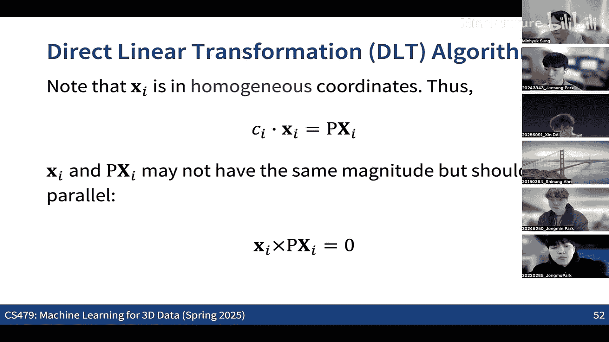

# 005：相机模型


## 概述

在本节课中，我们将学习计算机视觉和图形学中的一个基础概念：相机模型。我们将了解如何用数学方式描述3D世界中的点如何被投影到2D图像平面上。理解相机模型对于后续学习从多视角图像进行3D重建以及神经渲染至关重要。

---

## 回顾：隐式神经表示

上一节我们讨论了3D形状的新表示方法——隐式神经表示。其核心思想是使用一个神经网络（例如符号距离函数或占据函数）来表示3D形状。这种表示方法非常紧凑，能捕捉精细细节，且分辨率灵活。主要的缺点是生成单个形状需要较长时间，因为需要查询三维空间中的大量点。

我们还讨论了SIREN网络和位置编码网络，通过使用正弦或余弦函数作为激活函数，可以更好地捕捉高频细节。这种方法可以应用于图像、音频和3D数据，甚至仅使用梯度信息也能重建信号。

通过控制正弦/余弦函数的频率，我们可以控制模型的欠拟合与过拟合程度。频率越高，细节捕捉越好，但可能过拟合；频率越低，输出越平滑，但可能丢失细节。

基于此，我们探讨了如何从单张图像进行2D到3D的重建，其架构通常包含一个图像编码器和一个3D解码器，解码器预测每个3D查询点的符号距离或占据信息。

---

## 从多视角图像进行3D重建

本节我们将探讨如何从多张图像（多视角）进行更好的3D重建。在传统计算机视觉中，存在不依赖神经网络的技术来完成此任务，例如**同时定位与地图构建**或**运动恢复结构**。

其基本思想很简单，类似于人类用双眼感知深度。当我们从两个不同视角观察同一个3D点时，可以在两个图像中找到对应的2D像素点。如果我们知道这两个相机的姿态（位置和朝向），就可以从每个相机中心出发，通过其对应的2D像素点向3D空间发射一条射线。理论上，这两条射线应该在原始的3D点处相交。通过找到许多这样的对应点并计算射线交点，我们就能重建出稀疏的3D点云。

这是一个非常经典的技术。例如，大约十年前，人们就能从互联网上收集的城市或房间照片中重建出建筑物甚至整个城市的3D模型。

像**COLMAP**这样的库可以实现这一过程。这种技术的优势在于无需监督学习即可完成3D重建。

然而，这种方法也有明显的局限性：其输出通常是**稀疏的点云**，无法生成任意视角下的清晰、完整的3D表面模型，也缺乏精细的细节。

这就引出了一个问题：**如何利用神经网络的力量，从任意视角获得具有清晰细节的完整图像？** 这就是我们将在后续课程中讨论的**神经渲染**的目标。在深入神经渲染之前，我们需要先打好基础，理解相机模型。

---

## 相机模型

### 针孔相机模型

最简单的相机模型是**针孔相机模型**。它假设相机是一个带有小孔的盒子，所有光线都通过这个小孔投射到后面的图像平面上，形成倒立的像。

为了简化数学计算，我们通常做一个等价操作：将图像平面放在小孔前方（沿光轴方向），这样投影的图像就是正立的，且数学形式更简洁。

假设相机坐标系中有一个3D点 `(X, Y, Z)`，图像平面位于 `Z = f` 处（`f` 是焦距）。该点在图像平面上的投影坐标 `(x, y)` 可以通过相似三角形原理计算：

```
x = f * X / Z
y = f * Y / Z
```

### 齐次坐标

为了将投影变换表示为矩阵乘法（更易于计算和组合），我们引入了**齐次坐标**。

在齐次坐标系中，一个n维点被表示为一个(n+1)维向量。例如，2D点 `(x, y)` 表示为 `(x, y, w)`，3D点 `(X, Y, Z)` 表示为 `(X, Y, Z, w)`。其中，`w` 是一个标量。所有形如 `(x, y, w)` 和 `(k*x, k*y, k*w)` （k ≠ 0）的向量都代表同一个2D点 `(x/w, y/w)`。

这意味着齐次坐标引入了一个额外的维度，并定义了一种等价关系：缩放整个向量不改变其所代表的点。

**优势**：
1.  **可以表示无穷远点**：例如，2D齐次坐标 `(x, y, 0)` 代表一个方向为 `(x, y)` 的无穷远点。
2.  **能将投影变换表示为线性变换**：透视投影在笛卡尔坐标下是非线性的（涉及除法），但在齐次坐标下可以写成矩阵乘法的形式。

### 投影矩阵

使用齐次坐标，针孔相机的投影过程可以写成一个 **4x4** 矩阵：

```
P = [ [f, 0, 0, 0],
      [0, f, 0, 0],
      [0, 0, 1, 0] ]
```

注意：这是一个 **3x4** 矩阵作用于齐次坐标为 `(X, Y, Z, 1)` 的3D点，得到齐次坐标为 `(fX, fY, Z)` 的投影点。要得到最终的2D像素坐标 `(x, y)`，我们需要进行**齐次化**：`x = (fX)/Z`, `y = (fY)/Z`。

更一般地，相机投影矩阵 **K**（内参矩阵）通常写成：

```
K = [ [fx,  s, cx],
      [ 0, fy, cy],
      [ 0,  0,  1] ]
```

其中：
*   `fx`, `fy`：x和y方向的焦距。
*   `cx`, `cy`：图像主点（通常接近图像中心）的坐标。
*   `s`： skew参数，通常为0，表示像素是矩形的。

### 相机坐标系与世界坐标系

上述讨论假设3D点已经位于**相机坐标系**中。但在实际应用中，我们有一个固定的**世界坐标系**。因此，完整的投影过程包含两步：

1.  **外参变换（刚体变换）**：将世界坐标系下的点 `P_world` 变换到相机坐标系 `P_camera`。这包括旋转 `R` 和平移 `t`。
    ```
    P_camera = R * P_world + t
    ```
    用齐次坐标的矩阵形式表示为一个 **3x4** 矩阵 `[R | t]`。

2.  **内参变换（投影）**：将相机坐标系下的点投影到2D图像平面，使用内参矩阵 `K`。

因此，从世界坐标到图像坐标的完整投影可以写为：
```
[像素齐次坐标] = K * [R | t] * [世界坐标齐次坐标]
```
其中 `[R | t]` 是 **3x4** 外参矩阵，`K` 是 **3x3** 内参矩阵。它们的乘积 `P = K * [R | t]` 是一个 **3x4** 的投影矩阵，概括了整个相机模型。

---

## 相机标定

一个自然的问题是：**如何求得这个投影矩阵 P？**

这个过程称为**相机标定**。一种常见的方法是使用一个已知3D形状的标定物（例如棋盘格），并找到其3D角点与它们在图像中2D投影点之间的对应关系。

给定一组3D-2D点对 `(X_i, Y_i, Z_i) <-> (u_i, v_i)`，投影方程给出：
```
λ * [u_i, v_i, 1]^T = P * [X_i, Y_i, Z_i, 1]^T
```
其中 `λ` 是一个未知的比例因子（来自齐次化）。

我们可以利用向量叉积的性质：如果两个向量平行，它们的叉积为零。因此，对于每个点对，我们可以建立方程：
```
[u_i, v_i, 1]^T × (P * [X_i, Y_i, Z_i, 1]^T) = 0
```
这会产生两个线性独立的方程。通过收集多个点对（通常>=6个）的方程，我们可以构建一个线性方程组，并通过求解该方程组（例如使用奇异值分解SVD）来得到投影矩阵 `P` 的各个元素。

---

## 总结

本节课我们一起学习了3D数据处理中的基础——相机模型。
1.  我们从最简单的**针孔模型**出发，理解了3D点如何投影到2D图像。
2.  为了便于计算，我们引入了**齐次坐标**，它允许我们用矩阵乘法表示投影变换，并能优雅地处理无穷远点。
3.  完整的相机模型由**内参矩阵 K**（描述相机自身的成像属性）和**外参矩阵 [R|t]**（描述相机在世界中的姿态）组成。
4.  最后，我们简要介绍了**相机标定**的基本思想，即如何从已知的3D-2D点对应关系中求解出投影矩阵。



理解这些概念是至关重要的，因为它们构成了从多视角图像进行3D重建以及后续高级神经渲染技术的数学基础。在接下来的课程中，我们将利用这些知识，探讨传统的多视角3D重建方法及其局限性，并最终走向神经渲染。