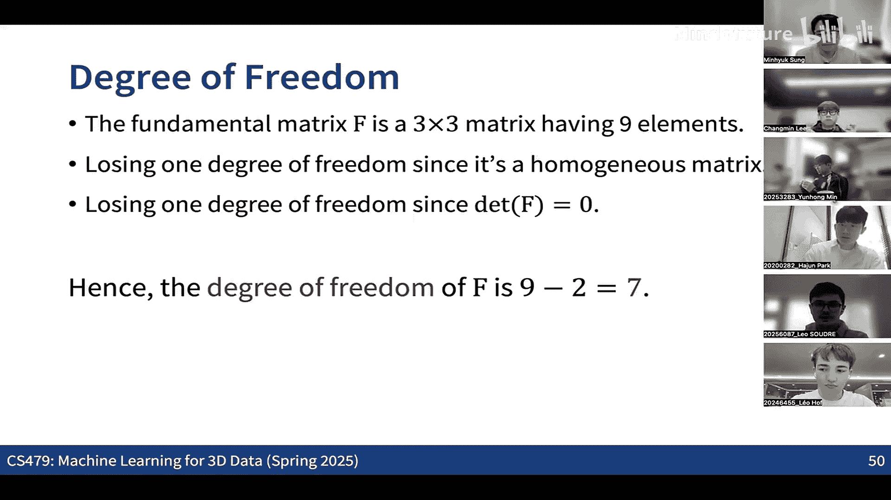

# 006：对极几何

在本节课中，我们将学习如何从多视角图像中计算相机姿态，这是3D重建的关键步骤。我们将重点介绍对极几何的基本概念，包括对极点、对极线和基础矩阵，并了解它们如何帮助我们仅从2D图像对应点中推导出相机之间的相对位置和方向。

---

## 坐标系统回顾

上一节我们介绍了相机模型的基础。本节中，我们来看看如何利用这些模型进行3D重建。

我们定义了三种坐标系：
*   **世界坐标系**：3D空间中的绝对参考系。
*   **相机坐标系**：以相机光心为原点的坐标系，通过旋转 **R** 和平移 **t** 与世界坐标系关联。
*   **图像坐标系**：2D成像平面上的坐标系，通过投影（涉及焦距 **f**、主点偏移 **c_x, c_y**）与相机坐标系关联。

结合外参（**R, t**）和内参（**K**），我们得到完整的相机矩阵 **P**，它将3D齐次坐标映射到2D齐次坐标：
`P = K [R | t]`

一个特殊情况是**归一化图像坐标**，即假设内参矩阵 **K** 为单位矩阵时的坐标。这等价于将3D点投影到 `z=1` 的平面上。

---

## 齐次坐标与无穷远点

使用齐次坐标的一个好处是能优雅地处理无穷远元素。

*   **无穷远点**：在齐次坐标中，最后一个分量为0的向量表示一个方向上的无穷远点。所有平行线相交于同一个无穷远点。
*   **无穷远线**：连接所有无穷远点的线。

在齐次坐标下，点和线的对偶性使得运算非常方便：
*   连接两点的线：`l = x1 × x2`
*   两条线的交点：`x = l1 × l2`
*   叉积运算可以通过一个反对称矩阵 `[x]_×` 来实现。

一个关键性质是，对于向量 **x**，其对应的反对称矩阵 `[x]_×` 的行列式为0，即它是一个秩为2的矩阵（非满秩）。我们稍后会用到这个性质。

---

## 相机矩阵求解（相机标定）

现在，我们来看一个具体问题：如何从已知的2D-3D点对应关系中求解相机矩阵 **P**。

问题是：给定一组3D点 `X_i` 及其在图像上的投影2D点 `x_i`，求相机矩阵 **P**，使得 `x_i ≅ P X_i`（`≅` 表示在齐次坐标下相等，允许一个尺度因子）。

由于齐次坐标的尺度模糊性，我们不能直接解线性方程 `x_i = P X_i`。相反，我们利用方向相同的条件：向量 `x_i` 和 `P X_i` 应平行，即它们的叉积为零：
`x_i × (P X_i) = 0`

将这个方程展开并重新排列，对于每一对对应点，我们可以得到关于 **P** 矩阵元素的两个线性方程。将所有对应点的方程堆叠起来，我们得到一个齐次线性系统：
`M p = 0`
其中 **p** 是将 **P** 矩阵按行展开成的12维向量，**M** 是由已知的2D和3D坐标构成的矩阵。

由于尺度模糊性，**P** 有11个自由度（12个参数减1个尺度）。因此，我们需要至少5.5对（即6对）点来求解。在实践中，我们使用更多点并通过奇异值分解（SVD）来鲁棒地求解。

**求解方法**：对矩阵 **M** 进行SVD分解：`M = U Σ V^T`。方程的解 **p** 就是 **V** 的最后一列（对应最小奇异值的右奇异向量）。这最小化了代数误差，是实际应用中常用的方法。

---

## 从运动恢复结构（SfM）流程简介

在实际的多视角3D重建中，获取精确的2D-3D对应通常很困难。更常见且实用的是利用2D-2D的图像对应点。

一个完整的SfM流程大致如下：
1.  **特征提取与匹配**：在不同图像中检测关键点（如SIFT特征）并建立对应关系。
2.  **估计相机姿态**：在已知相机内参 **K** 的前提下，从匹配点中计算相机之间的相对运动（旋转 **R** 和平移 **t**）。这是我们本节课后续的重点。
3.  **三角化**：利用估计出的相机姿态，将匹配的2D点反向投影为3D点。
4.  **集束调整**：进行全局优化，同时精修3D点位置和所有相机参数，以最小化重投影误差。

这是一个复杂的流程，涉及许多细节（如使用RANSAC去除误匹配、旋转平均等）。接下来，我们将深入探讨其中的核心环节：如何从2D对应点计算相对相机姿态。

---

## 对极几何：基础概念

假设我们有两张从不同视角拍摄的图像。对于一个3D空间点 **X**，它在第一张图像上的投影是 **x**，在第二张图像上的投影是 **x'**。

*   **对极线**：给定第一幅图像中的一个点 **x**，它在第二幅图像中对应的点 **x'** 必然位于一条特定的直线上，这条线称为 **x** 的**对极线**。这是因为 **x** 对应着一条从第一个相机光心出发的射线，这条射线在第二个相机视图上投影成一条线。
*   **对极点**：第一个相机的光心在第二个相机图像上的投影点，称为**对极点 e'**。同样，第二个相机的光心也会投影到第一个图像上成为对极点 **e**。**所有对极线都通过对极点**。

---

## 基础矩阵与本质矩阵

对极几何的代数关系由一个3x3的矩阵来描述。

*   **基础矩阵 F**：描述了两幅图像之间对应点的约束关系。对于一对匹配点 `x` 和 `x'`（齐次坐标），满足：
    `x'^T F x = 0`
    基础矩阵 **F** 将一个图像中的点映射到另一个图像中的对极线：`l' = F x`。
    **性质**：**F** 是秩为2的矩阵，有7个自由度（尺度模糊性 + 秩2约束）。

*   **本质矩阵 E**：当我们使用**归一化图像坐标**（即去除了相机内参 **K** 的影响）时，对应的矩阵称为本质矩阵。它与基础矩阵的关系为：
    `E = K'^T F K`
    其中 **K** 和 **K'** 是相机内参矩阵。如果我们假设两个相机内参相同，则 `E = K^T F K`。

本质矩阵 **E** 具有更明确的几何意义：它直接与相机的外参（相对运动）相关。

---

## 本质矩阵与相机姿态

假设我们将第一个相机的坐标系设为世界坐标系。那么，第二个相机相对于第一个相机的运动由旋转 **R** 和平移 **t** 描述。

本质矩阵 **E** 可以通过相机运动参数表示为：
`E = [t]_× R`
其中 `[t]_×` 是平移向量 **t** 的反对称矩阵。

这个公式揭示了关键信息：
1.  对极点 **e'**（在第二幅图像中）实际上就是第二个相机坐标系下的平移方向 **t**（因为第一个相机的光心在世界坐标系是原点，投影到第二个相机就是 **t** 方向）。
2.  **E** 矩阵包含了恢复 **R** 和 **t** 所需的全部信息。

**从E分解R和t**：通过对 **E** 进行SVD分解（`E = U Σ V^T`），我们可以得到四种可能的 **R** 和 **t** 的组合。需要通过三角化一个点并检查其深度（为正）来选出唯一正确的解。

---

## 计算流程总结

综上所述，从两幅图像的2D对应点中估计相对相机姿态的流程如下：

1.  **输入**：多组图像特征匹配点 `{x_i <-> x'_i}`，以及相机内参矩阵 **K**。
2.  **计算基础矩阵 F**：利用匹配点约束 `x'^T F x = 0`，通过SVD等方法求解 **F**。
3.  **计算本质矩阵 E**：利用公式 `E = K^T F K`。
4.  **分解本质矩阵**：对 **E** 进行SVD分解，得到四种可能的 `(R, t)` 解。
5.  **选择正确解**：通过三角化少量点并检查其在前方（深度为正）来选择唯一可行的相机姿态。

---

本节课中，我们一起学习了对极几何的核心概念，它是连接2D图像与3D场景的桥梁。我们了解了如何通过对极点、对极线、基础矩阵和本质矩阵来描述两幅视图之间的关系，并掌握了从图像对应点中计算相机相对姿态的基本数学原理。下一讲，我们将继续探讨如何具体实现这些计算，并最终过渡到利用这些估计的相机参数进行神经渲染，实现更精细的3D重建。