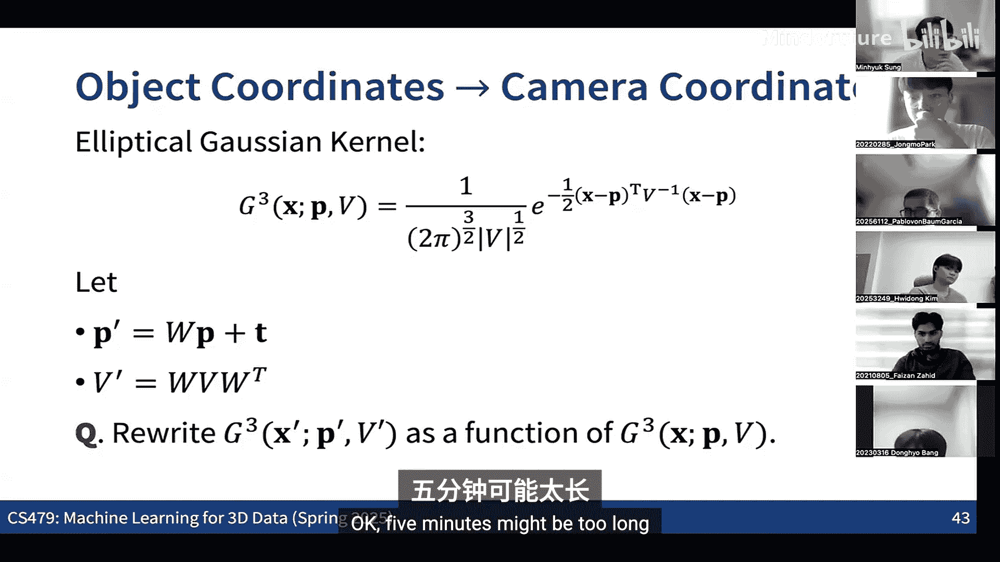
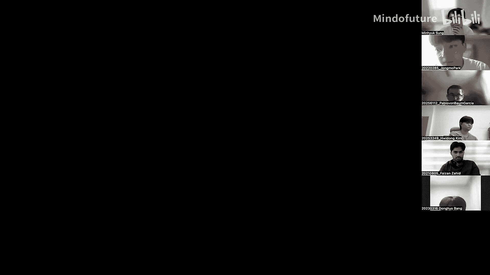
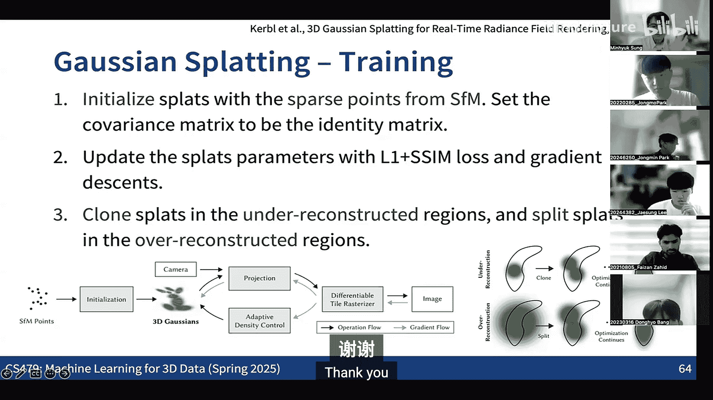

# 007：高斯泼溅 (Gaussian Splatting)

在本节课中，我们将要学习一种先进的神经渲染技术——高斯泼溅。这是一种结合了显式与隐式表示的混合方法，能够实现极其快速且高质量的3D场景渲染。

## 概述

上一节我们介绍了神经辐射场等隐式神经渲染技术。本节中，我们将探讨一种基于点云与体积渲染方程的混合表示方法：高斯泼溅。该方法的核心思想是使用3D高斯椭球体作为基本图元来表示场景，并通过光栅化而非光线追踪的流程进行高效渲染。

## 从神经辐射场到混合表示

我们之前讨论的神经辐射场技术，其核心是基于光线追踪的体渲染方程。每次渲染时，需要从相机发射光线，沿光线采样点，并通过神经网络评估每个采样点的不透明度与辐射度信息。这种方法虽然灵活，但计算量巨大，训练和渲染速度都较慢。

为了提升效率，研究者们开始探索混合表示方法，例如 Instant NGP，它将神经网络的参数显式地分配到3D空间的体素中。这样，当光线穿过场景时，只有被光线触及的体素特征需要被更新和计算，从而提高了训练和渲染的效率，但牺牲了一定的内存效率。

类似地，我们也可以考虑使用点云作为显式表示的基础。给定一个描述几何的粗略点云，我们可以为每个点定义特征，并在渲染时，只考虑光线附近点的贡献，应用相同的体渲染方程。高斯泼溅正是这一思路的延伸，但它不是使用简单的点，而是使用带有体积信息的3D高斯椭球体作为基本图元。

## 高斯泼溅的基本原理

高斯泼溅是一种基于“泼溅图元”的渲染技术。每个图元本质上是一个3D高斯分布，它定义了在3D空间中某一点的不透明度和颜色信息。

以下是高斯泼溅中每个图元（或称“泼溅”）所包含的基本属性：

*   **位置 (P)**: 高斯椭球体在3D空间中的中心点。
*   **协方差矩阵 (Σ)**: 一个3x3的对称矩阵，定义了高斯椭球体的形状、大小和方向。在对象坐标系中，我们通常假设它是轴对齐的，即一个对角矩阵，对角线上的值代表三个主轴方向的缩放。
*   **不透明度 (α)**: 定义了该图元对最终像素颜色贡献的权重。
*   **颜色 (c)**: 定义了该图元的颜色信息。为简化讨论，我们这里使用与视角无关的颜色，但该方法可以轻松扩展到与视角相关的辐射度。

因此，一个3D高斯函数可以定义为：
`G(x) = exp(-1/2 (x - P)^T Σ^{-1} (x - P))`
其中 `x` 是3D空间中的任意点。

渲染的目标是，给定一组这样的高斯泼溅图元，计算从特定相机视角看到的2D图像。

## 坐标变换与投影近似

为了高效计算，我们需要将3D空间中的高斯泼溅投影到2D图像平面上。这个过程涉及多个坐标系的转换：

1.  **对象坐标系**: 每个高斯泼溅的局部坐标系，原点在其中心，坐标轴与其椭球体的主轴对齐。
2.  **相机坐标系**: 以相机为中心的坐标系。
3.  **光线坐标系/图像平面坐标系**: 将3D点投影到2D图像平面后的坐标系。通常定义为 `(x/z, y/z, ||(x, y, z)||)`，前两维是投影后的2D坐标，第三维是深度信息。

从对象坐标系到相机坐标系的变换（称为视图变换 `F`）是一个仿射变换（旋转 `R` 加平移 `t`）：
`x' = R x + t`
其中 `x` 是对象坐标，`x'` 是相机坐标。重要的是，**经过线性变换后，高斯分布仍然保持为高斯分布**，只是其均值和协方差矩阵发生了相应变化。

然而，从相机坐标系到光线坐标系的投影变换 `G` 是非线性的（因为涉及除法 `x/z, y/z`）。如果直接应用，高斯泼溅在图像平面上将不再是一个高斯分布。

为了解决这个问题，高斯泼溅采用了一个关键**近似**：在泼溅中心点 `P'` 处，对投影函数 `G` 进行**一阶泰勒展开**，将其近似为一个线性变换 `J`（即雅可比矩阵）。这样，在近似下，泼溅在光线坐标系中仍然可以被视为一个高斯分布。

通过这一系列变换和近似，我们最终得到了在2D图像平面上每个高斯泼溅的投影：一个2D高斯分布。其中心是3D中心点的投影，协方差由原始的3D协方差经过视图变换和近似的投影线性变换共同决定。

## 基于光栅化的体渲染

与传统神经辐射场使用光线追踪不同，高斯泼溅采用了**光栅化**的渲染流程：

1.  **排序**: 对于图像中的每个像素，我们收集所有投影到该像素附近的高斯泼溅图元，并按照它们到相机的深度（在光线坐标系中的第三维坐标）进行从近到远的排序。
2.  **Alpha 合成**: 我们使用与体渲染类似的Alpha合成公式来计算最终像素颜色，但计算方式得到了极大简化。

体渲染方程的核心是沿光线积分。在高斯泼溅的设定下，经过数学推导（并引入一个“非重叠局部支持”的假设，即假设各个高斯泼溅之间的重叠很小），沿光线对3D高斯函数的积分可以简化为计算其对应的2D高斯函数在像素点处的值。

最终，像素颜色 `C` 的计算公式可以简化为一个按深度排序的Alpha合成：
`C = Σ (c_i * α_i * w_i)`
其中：
*   `c_i` 是第 `i` 个高斯泼溅的颜色。
*   `α_i` 是第 `i` 个高斯泼溅的不透明度。
*   `w_i` 是第 `i` 个高斯泼溅的权重，由该泼溅投影后的2D高斯函数在当前像素坐标处的值决定，并考虑了前面所有泼溅的累积透明度。

这个计算过程非常高效，因为它将3D体渲染问题转化为了在2D图像平面上对一系列有序的、带有透明度的2D高斯斑点进行合成，这非常适合在现代GPU上并行实现。

## 高斯泼溅的优势

基于上述原理，高斯泼溅技术展现出以下显著优势：

*   **渲染速度极快**: 可实现实时渲染（例如60 FPS甚至更高），远超之前的神经渲染方法。
*   **视觉质量高**: 能够生成非常清晰和逼真的新视角图像。
*   **内存效率较高**: 相比Instant NGP等需要巨大显存的方法，高斯泼溅的表示更为紧凑。
*   **易于集成**: 其光栅化的流程与现代图形学管线兼容性更好。

## 总结

本节课我们一起学习了高斯泼溅的基本原理。这是一种利用3D高斯椭球体作为显式图元，并通过坐标变换、投影近似和光栅化流程来实现高效体渲染的技术。它巧妙地将复杂的3D积分问题简化为2D图像平面的合成操作，从而在速度、质量和内存之间取得了出色的平衡。下一节中，我们将继续探讨如何从多视角图像训练得到这些高斯泼溅图元，以完成3D场景的重建。