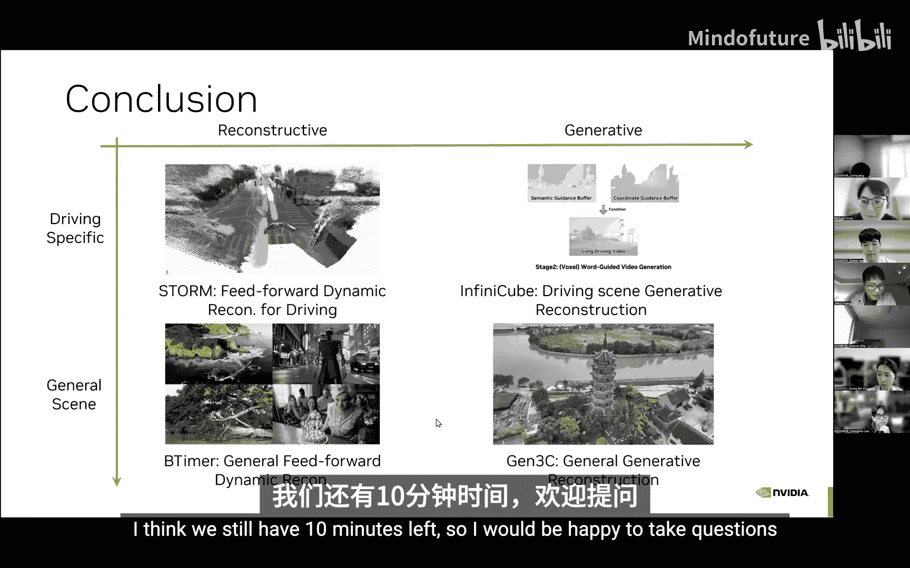

# 008：嘉宾讲座 - NVIDIA高级研究科学家黄嘉辉

## 概述
在本节课中，我们将学习由NVIDIA高级研究科学家黄嘉辉带来的关于动态3D场景生成式重建的前沿研究。讲座将涵盖从特定驾驶场景到通用场景，从重建方法到生成方法的一系列技术，包括Storm、B-Timer、InfiniteCube和Gen3C等核心工作。

---

## 什么是3D重建？
3D重建的目标是将所有传感器测量数据（包括相机捕获的图像、激光雷达捕获的点云）转换为数字化格式，以用于各种下游任务，例如可视化和分析。

一个经典的例子是从运动中恢复结构（Structure from Motion， SFM）。你仅从传感器测量数据中获取图像，并重建相机姿态以及场景的结构。

在过去几年中，3D重建方法取得了巨大进展。这些技术尝试将图像或激光雷达点云作为输入，结合传感器校准和姿态信息，将它们转换为3D世界的数字化表示。

例如，左侧是Instant NGP的结果，右侧是神经表面重建（Neural Surface Reconstruction）的几何结构。

### 3D重建的两个子任务
在3D重建中，我们可以区分两个基本子任务：

1.  **外观重建**：例如Instant NGP或NeRF，主要用例是新视角合成。目标是模拟相机在不同位置拍摄时图像的样子。
2.  **几何重建**：这对于物理模拟非常有用。例如，如果你想在道路上放置一辆汽车，你需要平滑的几何来确保驾驶体验。

外观重建有更多的下游任务，例如机器人或自动驾驶中的策略训练与评估。本次讲座将主要关注**外观重建**，即新视角合成。

---

## 方法概览：从重建到生成
本次讲座将沿着两个轴线介绍四种方法：
*   **垂直轴（场景类型）**：从**驾驶特定场景**（可利用特定先验）到**通用场景**。
*   **水平轴（方法类型）**：从**重建方法**（仅重建现有观测）到**生成方法**（生成未观测到的新内容）。

我们将要介绍的论文包括：Storm、B-Timer、InfiniteCube和Gen3C。

---

## Storm：用于大规模户外场景的时空重建模型
上一节我们介绍了3D重建的基本概念，本节中我们来看看第一个具体工作：Storm。它专注于大规模户外动态场景的重建。

像NeRF或3D Gaussian Splatting这类方法通常通过**每场景优化**进行重建，这需要数分钟到数小时。而**前馈方法**（如Large Reconstruction Model）使用单个前馈网络，在毫秒级时间内完成重建，速度显著提升。

3D Gaussian Splatting使用3D高斯函数表示场景，催生了一种称为**像素对齐3D表示**的方法，例如GSRM。GSRM的核心思想是：输入多张图像，通过视觉Transformer处理，为输入图像的每个像素回归一个3D高斯函数。沿着从该像素发出的射线放置这个高斯函数，然后聚合所有输入视图的高斯函数，形成完整的场景表示。

Storm要回答的问题是：**如何将这种方法扩展到动态的户外场景？** 这比物体级设置更具挑战性。

Storm的输入是来自车载环视相机（前视、左视、右视）在多个时间步长的图像。它的输出是一个动态高斯表示，可以在任意视角渲染，并能获取深度和场景运动信息。

### Storm的工作原理
Storm仍然使用像素对齐的动态表示。它将图像令牌输入视觉Transformer。除了图像令牌，它还引入了一些可查询的**运动令牌**。

经过Transformer后，运动令牌会与图像令牌进行交叉注意力计算，为每个图像令牌分配一个**运动基**。这个运动基可以进一步解码为每个时间步上每个高斯函数的场景流。

为了可视化这个过程：假设有一个移动的摩托车，它在不同时间步的图像中处于不同位置。通过使用回归出的速度向量（或速度基），可以利用基本的物理公式（速度 × 时间步长）将所有高斯函数移动到一个特定的目标时间步。然后，将所有时间步和所有图像的高斯函数聚集起来，形成一个**规范场景表示**。

### 关键特性与优势
以下是Storm方法的一些关键优势：

*   **仅使用RGB损失进行训练**：网络训练只利用RGB损失，使用数千个Waymo场景进行重建和渲染，并与真实图像比较。**运动分解是以自监督方式直接学习的**，不需要任何真实的运动向量监督。
*   **潜在高斯表示**：可以将RGB高斯总结为潜在高斯，即为每个3D高斯分配一个高维潜在向量，然后渲染潜在图像并通过解码器解码。这更多地表示了场景语义，而非外观，能够表示复杂的人体运动和非刚性场景运动。
*   **性能对比**：与每场景优化方法（如3DGS和动态NeRF方法）相比，Storm不仅达到了更高的PSNR（图像质量更好），而且**推理时间极短**。渲染时，高斯表示可以实现超过200 FPS的实时渲染速度。
*   **自监督场景流**：该方法可以以完全自监督的方式重建整个场景的场景流，无需任何物体真实速度向量标注。
*   **无监督运动掩码**：生成的运动分割掩码可以作为语义分割的弱信号，但这些分割是基于运动而非语义或实例进行分组的。

Storm假设每个高斯函数只能进行线性运动。这对于自动驾驶场景（车辆通常直线行驶）成立，但对于通用场景则不再适用。这就引出了我们的下一个方法。

---

## B-Timer：用于通用动态场景的前馈重建模型
上一节我们介绍了专注于线性运动动态场景的Storm，本节中我们来看看一个适用于更通用场景的方法：B-Timer。

B-Timer是首批用于动态3D场景的**前馈重建模型**之一。它适用于通用场景，例如给定一个DAVIS数据集的视频，它可以重建动态场景。你可以在固定相机下播放视频，然后冻结时间、移动相机，再让视频继续播放。

与之前的方法相比，B-Timer继承了每场景优化方法的准确性和先验利用优势，同时**重建时间非常短**（约150毫秒）。现有的一些动态场景方法要么优化耗时数小时，要么只能重建点云图而无法渲染新视角。B-Timer是前馈的，能在秒级内重建场景，并输出支持实时新视角渲染的高斯函数。

### 什么是“子弹时间”重建？
“子弹时间”效果源自电影《黑客帝国》，即时间仿佛冻结，子弹缓慢飞过。B-Timer采用了这个隐喻：**给定输入视频，模型只重建场景在某一特定时间帧被“冻结”时的状态**。

尽管输入视频是完全动态的，但模型接收整个视频加上一个你想要进行“子弹时间”处理的目标时间步，然后重建出该时刻的静态场景。

在推理时，我们迭代地对每个时间步进行重建。你输入视频的所有图像以及一个期望的“子弹时间”步，模型会给出一个没有场景运动的“子弹时间”重建。如果要生成动画，只需将模型应用于不同的时间步。

这种方法看似简单，但解决了许多问题：你不再需要考虑使用何种动态场景表示，因为只是在做简单的**逐帧重建**。这也有利于并行化，并且模型架构可以做得非常简单，受益于Transformer架构加速的最新进展。

### 模型细节
模型的输出是目标时间步（即“子弹时间”步）的3D高斯表示。对于每个输入图像，我们使用**上下文时间嵌入**（图像实际捕获的时间步）和**子弹时间嵌入**（我们希望冻结场景的时间步）来提示模型。模型可以直接通过RGB重建损失进行监督。

此外，我们提出了一个新颖的**时间增强器模块**。对于具有快速运动的视频，在上下文帧之间重建场景可能具有挑战性。NTE模块接收两个相邻帧和一个介于它们之间的目标时间步，通过该模块直接预测出插值时间点的RGB图像（这是一个图像合成模型，而非3D高斯模型）。使用NTE模块后，运动过渡更加平滑。

### 训练与数据
在训练中，我们采用了训练大规模视频模型的最佳实践，使用尽可能多的数据。我们收集了跨越动态主体、领域、视图数量和帧数等多个因素的数据集，并设计了课程训练计划：首先在大量数据集上进行3D静态预训练，然后在合成多视图数据和真实世界单视图视频数据集上进行微调。

真实世界数据来自Panda-70M，我们使用与MegaS或Jo-SLAM类似的方法，为视频中的每一帧标注相机姿态和深度图，以便用于监督我们的模型。这个标注引擎非常方便，可以直接处理互联网视频（包括SfM视频），并实时提供相机姿态和深度信息。

### 结果展示
B-Timer能够处理SfM视频、DAVIS数据集视频和DyCheck数据集视频，实现实时可视化的新视角合成。此外，B-Timer与静态场景完全向后兼容。如果将所有输入时间步设置为相同，它可以立即重建静态场景，就像所有图像都在同一时刻捕获一样。

在NVIDIA内部，B-Timer和Storm正被集成到名为“NeuR”的产品化努力中，用于为自动驾驶应用构建仿真环境。

---

## InfiniteCube：利用世界引导视频模型进行无界可控的动态3D驾驶场景生成
前面两节我们讨论了重建方法，它们不补全缺失区域或生成新内容。接下来，我们将转向生成方法，看看如何利用最先进的生成扩散模型的力量来生成超越传感器测量的内容。

第一个生成式工作是InfiniteCube。首先介绍一些背景知识。

### 背景：稀疏体素层次结构与VAE
一种3D场景表示称为**稀疏体素层次结构**。它非常简单，就是多个不同分辨率的稀疏体素层级堆叠在一起。FVDB是NVIDIA提出的一个专门处理此数据结构的框架，它建立在PyTorch之上，提供了一系列可微分的AI算子。

为了在此稀疏体素层次结构上构建生成模型，需要设计一个**结构化变分自编码器**。对于潜在扩散模型，关键的两部分是：1）将实际模态压缩到潜在空间的VAE；2）对该潜在空间分布进行建模的扩散模型。

为了用VAE有效压缩稀疏体素网格，需要设计合适的编码器和解码器。编码器可以使用常规的3D稀疏卷积。解码器方面，我们有一篇名为X-Cube的论文，它采用迭代细分和剪枝方案：从粗糙层级的稀疏体素层次开始，将每个体素细分为四个子体素，并移除不需要的体素，迭代应用此过程，最终从潜在空间得到高分辨率稀疏体素网格。

为了生成这些稀疏体素，我们可以逐级进行：从潜在变量生成网格及其属性，并将其直接作为下一级的潜在变量，从而迭代细化和生成更精细的稀疏体素层次。

### InfiniteCube 概述
InfiniteCube建立在X-Cube之上，能够生成更大规模的场景（例如300米 x 400米，理论上没有严格限制）。

InfiniteCube以高清地图作为输入（包含车道和道路边界）。它分为三个阶段：
1.  生成**体素化世界**。
2.  在体素化世界之上生成**长驾驶视频**（合成外观）。
3.  将驾驶视频和3D稀疏体素提升为可实时可视化的**3D高斯场景**。

### 阶段一：高清地图条件下的3D体素生成
我们精心设计如何将向量格式的高清地图栅格化到3D体素上，以便用3D体素条件化我们的扩散模型，从而生成语义体素世界。每个生成的体素块大小为51.2米 x 51.2米，允许我们迭代应用此技术，通过**扩散外绘技术**逐块生成，最终覆盖高清地图的所有区域，生成一个非常大的稀疏体素世界。

### 阶段二：在体素上合成外观
我们利用最先进的**视频模型**（如Stable Video Diffusion、Cosmos、W.A.L.T等）来合成逼真的外观。问题是：如何确保生成的视频符合稀疏体素网格的内容？

我们的方法是：在稀疏体素世界中合成一个相机轨迹（模拟汽车在驾驶场景中行驶），然后渲染两个缓冲区：
1.  **坐标缓冲区**：每个像素的颜色代表体素在世界坐标系中的实际坐标。
2.  **语义缓冲区**。

我们训练一个视频基础模型，以这两个缓冲区作为输入，输出与这些缓冲区直接对应的图像。我们使用自回归生成，以这些缓冲区为条件，逐帧、逐块地生成所有帧。

通过文本提示（如“晴天”、“阴天”、“夜晚”），我们可以合成不同的外观。该方法还支持其他操作，如向场景中插入物体，或控制天气（保持相同的道路结构和汽车运动，仅改变外观）。生成的视频长度可达20秒，并可扩展至更长。

### 阶段三：提升至3D高斯表示
我们将重建分为两个分支：
1.  **像素分支**：类似于B-Timer或Storm，生成像素对齐的3D高斯函数。
2.  **体素分支**：将图像特征反投影到3D体素上，并在这些体素上应用3D卷积来回归3D高斯属性。

结合这两个分支，我们可以获得一个3D高斯场景，可以在不同相机角度下完全可视化，甚至可以缩放以获得场景（包括动态物体）的详细视图。所有这些最终结果都仅以高清地图和物体边界框作为输入生成。

随着更强大的视频模型（如Cosmos World Foundation Model及其变体Cosmos-Transfer）的发展，我们能够生成分辨率更高、同时保持高清地图可控性的驾驶视频。

---

## Gen3C：具有精确相机控制的3D感知世界一致视频生成
最后一节，我们介绍一个超越静态场景、超越重建、超越驾驶场景的通用方法：Gen3C。

Gen3C的能力非常多样：
*   **单视图输入**：给定一张图像，可以合成不同角度的相机运动。
*   **稀疏视图输入**：执行3D重建并生成未见相机角度的平滑过渡。
*   **动态视频输入**：在原始动态视频之上合成新的相机轨迹。

### 核心思想
Gen3C的核心思想是生成一致且可控的视频。基本技术是使用**投影点云作为视频模型的3D缓存引导**。

与之前仅使用CLIP嵌入作为视频模型条件的方法相比，当相机前后移动时，那些方法容易损坏，因为它们是因果性的，基于上一帧作为输入。而有了3D缓存，你通过彩色点云显式地记住了空间中的内容，可以非常一致地合成前后移动的视频，不会损失太多质量。

### 工作流程
无论输入是单视图、多视图还是动态视频，Gen3C都使用深度估计方法将图像提升为3D点云。然后，将提升的3D点云渲染到我们想要渲染的相机视图上，并使用这些渲染的点云作为条件输入到视频生成模型（视频扩散模型）中，生成与投影点云相对应的场景。

点云可能存在许多伪影（例如深度估计不准确、存在黑洞），但通过训练视频扩散模型，它能够学习真实世界视频的分布，并尝试以投影点云为条件，从而不仅遵循点云投影条件，还能生成非常自然的视频。

### 多视图融合
由于Gen3C也支持多视图图像输入，它需要找到一种有效的方法来融合来自不同时间步的图像。我们尝试了多种方法：
*   **显式融合**：在3D空间中直接聚合点云。
*   **隐式融合**：在潜在空间中进行连接。

Gen3C采用了对缓存进行最大化操作的方法，使其实际上是顺序无关的。经过实验，我们发现两种方法都有效，但隐式融合方法能提供更准确、更清晰的重建，因此我们采用了后者。

### 结果展示
Gen3C能够生成各种有趣的结果，例如根据单张图像生成自由相机运动，根据稀疏视图生成平滑的3D重建和视角插值，以及根据动态视频生成全新的相机轨迹（如无人机视角、变道模拟等）。这对于典型的NeRF或3D Gaussian Splatting来说很难实现，因为它们通常没有这些观测。

---

## 总结
本节课中，我们一起学习了四种前沿工作，它们涵盖了从驾驶特定场景到通用场景，从重建方法到生成方法的技术光谱。这些方法融合了视觉Transformer、视频扩散模型、3D高斯泼溅等多种技术。

技术总是在不断进步。我们希望未来能有一个完全生成式的重建方法，允许通过易于使用的用户界面实时进行新视角合成，并自由操纵和更改相机轨迹。这是一个美好的目标，我们相信仍需投入更多努力，在不久的将来构建真正的世界模拟器。

---
*讲座结束，感谢观看。*