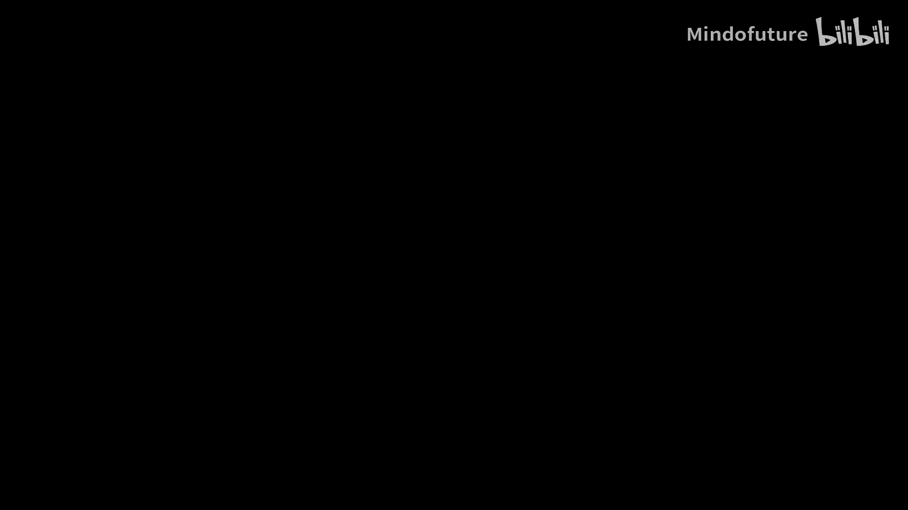
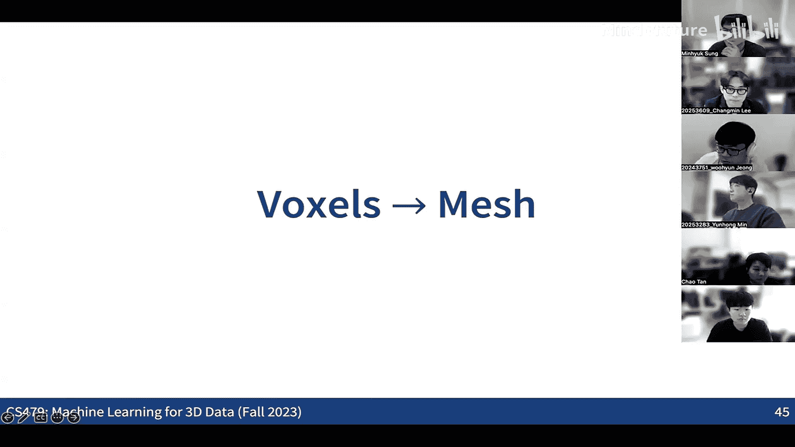

# 010：表示转换（1/2）



在本节课中，我们将学习如何在不同类型的3D数据表示之间进行转换。我们已经讨论过多种3D表示方法，如体素、点云、网格和多视图图像，以及神经辐射场（NeRF）和3D高斯泼溅等神经渲染方法。本节课将重点探讨如何在这些表示之间建立桥梁，特别是如何从点云数据中重建出隐式函数（如符号距离函数），以及如何将体素转换为网格。

---

## 概述

在之前的课程中，我们介绍了多种3D数据表示方法及其编码、解码方式。最近，我们讨论了基于神经渲染的两种主要表示：完全隐式的NeRF和更显式的3D高斯泼溅。这些方法都利用体渲染方程从多视图图像重建3D场景。

然而，不同的应用场景可能需要不同的表示形式。例如，点云适用于某些任务，而网格则适用于其他任务。一个关键问题是：我们能否将NeRF或高斯泼溅的输出转换为其他表示形式？本节课将探讨这些转换的基本思想和方法。

---

## 从神经渲染输出中获取深度信息

上一节我们介绍了神经渲染的基本概念，本节中我们来看看如何从这些表示中提取几何信息，例如深度。

一种简单的方法是从NeRF中提取深度信息。回顾体渲染方程，其中透明度与不透明度的乘积可以视为光线在某个点终止的概率权重。通过找到终止概率最高的点，我们可以估计出该视角下的深度。

**公式**：在体渲染中，颜色 `C` 的近似计算为：
```
C ≈ Σ Ti * αi * ci
```
其中 `Ti` 是累积透明度，`αi` 是不透明度，`ci` 是颜色。深度可以估计为期望的终止位置。

虽然这种方法可能无法获得非常精确的几何，因为NeRF主要针对渲染进行优化，但它提供了一种从隐式场获取几何信息的途径。近期也有研究专注于从多视图图像中直接重建精确的符号距离函数。

对于3D高斯泼溅，我们可以进行类似的计算，通过估计透明度和不透明度来预测深度。此外，还有研究探索使用2D高斯（椭圆）而非3D椭球来进行泼溅，以期获得更精确的表面对齐和深度信息。

这些是从神经渲染输出（如NeRF和高斯泼溅）转换为其他表示（如深度图）的基本思路。

---

## 表示转换的完整路径

到目前为止，我们已经了解了多种表示形式。如果我们审视它们之间的转换关系，会发现有些路径是直接的，而有些则存在缺失的环节。

以下是不同表示之间直接的转换路径：
*   **从隐式函数到体素**：非常直接，只需在体素网格的每个位置评估隐式函数的值。
*   **从网格到点云**：只需在网格表面采样点。
*   **从网格到多视图图像**：使用标准图形学流水线渲染网格即可。

然而，关键的缺失环节在于：
1.  如何从点云转换回隐式函数？
2.  如何从体素转换到网格？

本周和下周的内容将聚焦于填补这些空缺，使我们能够在所有表示之间自由转换。

---

## 从点云到隐式函数

本节我们将深入探讨第一个缺失环节：如何从一组表面采样点（点云）重建出隐式函数，特别是符号距离函数（SDF）。

### 问题定义

假设我们有一个点云 `{pi}`，这些点是物体表面的采样。我们的目标是找到一个符号距离函数 `f(x)`，使得对于所有表面点 `pi`，有 `f(pi) = 0`。同时，对于不在表面的点，`f(x)` 的值表示该点到最近表面的有符号距离（例如，外部为正，内部为负）。

如果只使用 `f(pi) = 0` 这个条件，一个平凡的零函数（对所有输入都输出0）就是一个解，但这显然不是我们想要的。因此，我们需要引入额外的约束或假设。

---

### 方法一：移动最小二乘法

一种简单的想法是假设表面在局部可以用一个多项式函数来近似。对于空间中的任意查询点 `x`，我们只利用其邻近的点来拟合一个局部多项式。

**基本思路**：
我们假设在查询点 `x` 附近，符号距离函数 `f` 可以近似为一个多项式：
```
f(p) ≈ B(p)^T * a
```
其中 `B(p)` 是一个向量，包含点 `p` 坐标的多项式项（如 `1, x, y, z, x^2, xy, ...`），`a` 是待求的系数向量。

我们希望这个近似函数在点云中的点 `pi` 上尽可能接近0。为了避免平凡解，我们要求系数向量 `a` 的范数为1（即 `||a|| = 1`）。同时，我们更重视距离查询点 `x` 较近的点。这通过引入一个权重函数 `w(||pi - x||)` 来实现，距离越近，权重越大。

**核心优化问题**：
我们通过求解以下加权最小二乘问题来找到局部最优系数 `a`：
```
最小化 Σ w(||pi - x||) * (B(pi)^T * a)^2
约束条件为 ||a|| = 1
```
常用的权重函数（径向基核函数）包括高斯核、逆二次函数等。

**求解**：
上述带约束的优化问题可以通过拉格朗日乘数法转化为一个特征值问题。最终，最优系数向量 `a` 是某个矩阵 `M` 的最小特征值对应的特征向量。矩阵 `M` 由权重矩阵和多项式项矩阵构成。

**代码概念**：
```python
# 伪代码：对于每个查询点x
1. 计算点云中所有点 pi 到 x 的距离。
2. 根据距离计算每个点的权重 w_i。
3. 为每个点 pi 构造多项式项向量 B(pi)。
4. 构建加权设计矩阵，形成矩阵 M。
5. 计算矩阵 M 的特征值和特征向量。
6. 选择最小特征值对应的特征向量作为系数 a。
7. 则查询点 x 处的函数值 f(x) = B(x)^T * a。
```

**参数影响**：
权重函数中的带宽参数 `h` 至关重要。较小的 `h` 使得拟合更局部化，可能捕捉细节但也对噪声更敏感；较大的 `h` 考虑更广范围的点，结果更平滑但可能丢失细节。

移动最小二乘法也可以用于估计点云中每个点的**法向量**。当使用一阶多项式（平面）进行拟合时，拟合出的平面法向即近似为表面法向。法向量在许多3D处理任务中都非常有用，例如点云渲染、特征提取等。

---

### 方法二：径向基函数

移动最小二乘法进行的是局部拟合，可能缺乏全局一致性。另一种思路是进行全局优化，使用径向基函数来隐式地表示整个符号距离场。

**基本思路**：
我们将目标符号距离函数表示为许多径向基函数的加权和：
```
f(x) = Σ λj * φ(||x - cj||)
```
其中 `φ` 是径向基函数（如高斯函数、三次谐波函数 `φ(r) = r^3` 等），`cj` 是中心点（通常就取点云中的点 `pi`），`λj` 是待求权重。

我们已知对于所有表面点 `pi`，有 `f(pi) = 0`。但这同样会导致零权重的平凡解。为了避免这种情况，我们需要引入额外的约束点。

**引入约束点**：
利用估计或已知的表面法向量 `ni`，我们在每个表面点 `pi` 的内外两侧各取一个偏移点：
*   `pi + d * ni` （外部点），期望的SDF值为 `+d`
*   `pi - d * ni` （内部点），期望的SDF值为 `-d`

这样，我们得到了 `3N` 个约束条件（`N`个零点，`2N`个非零点），可以建立一个关于权重 `λj` 的线性方程组 `Aλ = b`，并通过求解这个（可能规模很大的）线性系统来得到全局权重。

**优缺点**：
*   **优点**：进行全局优化，通常能获得更一致、更高质量的隐式场，尤其适用于干净、稠密的点云。
*   **缺点**：需要法向量信息；计算量大（需解大型线性系统）；对噪声比较敏感，因为噪声会影响全局解。

---

### 方法三：隐式移动最小二乘法

这是一种介于局部拟合和全局拟合之间的方法，它直接利用法向量信息，通过一种近似推导得到一个非常简单的闭式解。

**基本思路**：
对于查询点 `x`，我们想用其在每个点云点 `pi` 处的泰勒展开来近似。保留到一阶项：
```
f(pi) ≈ f(x) + ∇f(x)^T * (pi - x) ≈ 0
```
这里 `f(x)` 是查询点处的函数值（未知），`∇f(x)` 是查询点处的梯度（未知）。如果我们做一个**大胆的近似**：用点 `pi` 处的表面法向量 `ni` 来代替 `∇f(x)`，那么上式变为：
```
f(x) + ni^T * (pi - x) ≈ 0
```
现在，对于每个点 `pi`，我们都有一个关于 `f(x)` 的近似方程。我们通过加权最小二乘法来求解最优的 `f(x)`，权重依然取决于 `pi` 与 `x` 的距离。

**最终解**：
求解上述加权最小二乘问题，可以得到一个简洁的闭式解：
```
f(x) ≈ - ( Σ w_i * ni^T * (pi - x) ) / ( Σ w_i )
```
这个公式可以理解为：用所有点 `pi` 处的切平面（由点和法向定义）到查询点 `x` 的有符号距离的加权平均，来近似 `x` 到真实表面的有符号距离。

**特点**：
*   计算非常高效，无需迭代优化或解线性系统。
*   显式地利用了法向量信息。
*   可以看作是使用预计算的法向量和点来定义局部切平面，然后组合这些信息来估计全局隐式场。

---

## 方法比较与总结

以下是三种主要方法的比较：

| 特性 | 移动最小二乘法 | 径向基函数 | 隐式移动最小二乘法 |
| :--- | :--- | :--- | :--- |
| **是否需要法向量** | 否（但可用于估计法向量） | **是** | **是** |
| **优化范围** | 局部拟合 | **全局优化** | 基于局部近似的全局估计 |
| **计算速度** | **快**（每个点独立解小规模特征值问题） | 慢（需解大型线性系统） | **非常快**（闭式解） |
| **抗噪性** | 局部性使其对局部噪声有一定鲁棒性 | 差（噪声影响全局解） | 依赖于法向量质量和权重函数 |
| **输出质量** | 可能局部不一致，细节取决于参数 | 通常全局一致且质量高 | 质量较好，计算效率高 |
| **关键参数** | 权重函数类型、带宽 `h` | 基函数类型、偏移距离 `d` | 权重函数类型、带宽 `h` |

在实际应用中，选择哪种方法取决于具体需求：
*   如果需要快速估计且无法向量，可选用移动最小二乘法。
*   如果有准确的法向量且追求高质量重建，可考虑径向基函数或隐式移动最小二乘法。
*   隐式移动最小二乘法在效率和质量之间提供了一个很好的平衡。

---

## 下节预告与课程作业

本节课我们重点学习了如何从点云数据出发，通过移动最小二乘法、径向基函数和隐式移动最小二乘法来重建符号距离函数。这填补了从点云到隐式函数表示的关键转换环节。

然而，要完成从点云到网格的完整转换，我们还需要下一个关键步骤：**如何将体素（或更一般地，在网格上评估的隐式场）转换为网格表面**。这通常通过**行进立方体**等算法实现。

在接下来的课程中，我们将：
1.  介绍另一种更强大的全局优化方法，用于从点云和法向量重建隐式场。
2.  详细讲解如何将体素表示的隐式场转换为三角网格。

**课程作业**：
本课程的作业将涉及实现**隐式移动最小二乘法**。你将获得一个2D或3D点云及其法向量，需要：
1.  使用上述方法计算指定区域网格点上的符号距离函数值。
2.  （在学习了下一讲内容后）应用行进立方体算法将网格上的符号距离场转换为轮廓线（2D）或三角网格（3D）。
鼓励同时实现和比较移动最小二乘法与径向基函数，以加深对不同方法的理解。

---

## 总结

本节课中，我们一起学习了3D表示转换中的一个核心部分：从点云重建隐式符号距离函数。我们探讨了三种主要技术：
1.  **移动最小二乘法**：通过局部多项式拟合进行重建，也可用于估计表面法向量。
2.  **径向基函数**：通过全局线性优化进行重建，需要法向量，能产生高质量结果但计算量较大。
3.  **隐式移动最小二乘法**：利用法向量和泰勒展开近似，得到一个高效且实用的闭式解。



掌握这些方法，我们就能将离散的点云数据转换为连续的隐式场表示，为后续的网格化等处理奠定基础。下一节课，我们将继续探索表示转换的另一个关键环节——从体素到网格的转换。