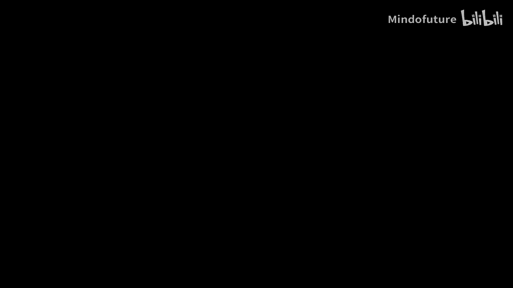
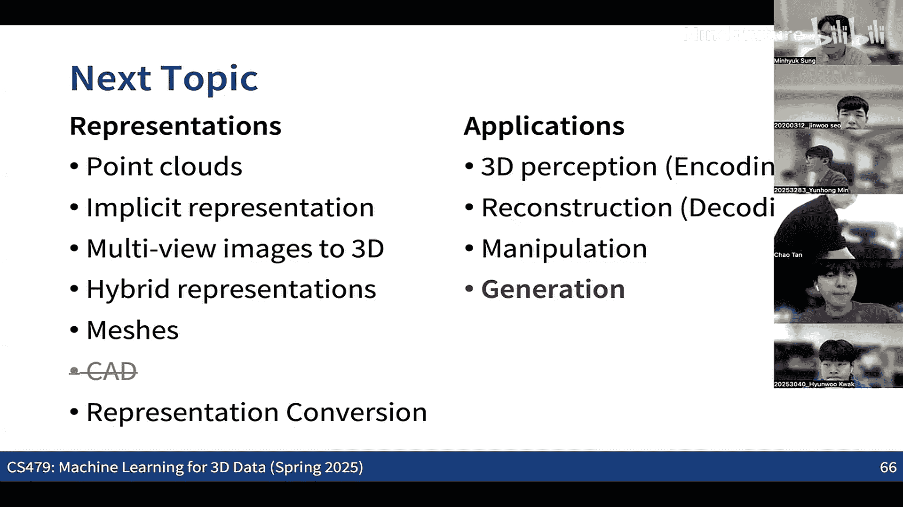

# 011：网格变形 (Mesh Deformation) 🧊



在本节课中，我们将要学习一种新的主题：网格变形。我们将探讨如何利用网格表示法对3D形状进行自然的变形操作，并深入理解其背后的核心数学原理。

---

## 概述

到目前为止，本课程主要讨论了3D数据的不同表示方法。上周，我们学习了如何在各种表示之间进行转换。然而，我们尚未深入探讨一种非常流行且实用的表示方法：网格。网格表示法在计算机图形学中应用广泛，因为它能以紧凑且明确的方式表示表面。本节课，我们将重点学习如何对网格进行变形操作，特别是介绍一种名为“尽可能刚性”的变形技术。

---

## 网格表示法的优势与应用

上一节我们介绍了3D数据的多种表示形式，本节中我们来看看网格表示法的独特优势。

网格是一种类似图的结构，由**顶点**、**边**和**面**组成。与普通图不同，网格的边和顶点共同构成了表示表面一部分的**面**。通常，这些面是三角形，形成三角网格，这是图形应用中最常见的选择。

**公式**：一个三角网格可以表示为 `M = (V, E, F)`，其中 `V` 是顶点集合，`E` 是边集合，`F` 是面集合。

网格表示法有许多优点：
*   **渲染**：对于将3D数据渲染成图像，这种显式表示非常高效。
*   **纹理映射**：可以方便地在表面定义颜色信息。
*   **物理仿真**：常用于各种物理模拟应用。
*   **形状操控与变形**：对于操纵和变形表面非常有效。

其缺点在于连接结构不规则，这给将其作为神经网络的输入或输出带来了一些困难。然而，常见的流程是先用其他表示法（如隐式函数）生成3D数据，再将其转换为网格以用于后续应用。

---

## 网格变形的基本思想

了解了网格的优势后，本节我们来看看网格变形的核心目标。

网格变形的高层思想是：定义一个**目标函数**，在满足给定约束条件（如固定某些顶点、移动某些顶点）的同时，使变形尽可能**平滑自然**。

例如，我们有一个平面网格，希望固定灰色区域的顶点，将黄色区域的顶点向上移动，并自动确定中间浅蓝色区域顶点的最佳新位置，以实现自然过渡。

**核心问题**：如何定义目标函数，以确定中间顶点的“自然”位置？这没有唯一答案，取决于如何设计目标函数。

---

## 变形技术分类与ARAP方法

上一节我们介绍了变形的基本思想，本节中我们来看看一种具体且流行的变形技术。

变形技术种类繁多，主要可分为：
*   **基于表面的直接变形**：直接操作网格表面。
*   **基于笼子的变形**：通过变形包围网格的粗糙外框（笼子）来驱动内部网格变形。
*   **基于骨架的变形**：定义内部骨骼，通过移动骨骼来驱动表面变形。

由于时间有限，我们将聚焦于一种非常流行的技术：**尽可能刚性变形**。

ARAP变形的核心思想是：定义目标函数，使得网格的变形在**局部**尽可能接近**刚性变换**。刚性变换只包含**旋转**和**平移**，没有拉伸、缩放或剪切。这意味着，我们希望物体的每个局部区域在变形时，都像一块刚体一样只发生旋转和平移。

**公式**：3D刚性变换有6个自由度：3个平移参数 `(tx, ty, tz)`，3个旋转参数（例如欧拉角或旋转矩阵）。

---

## 局部刚性变换的数学定义

为了形式化“局部刚性”的概念，我们需要为其建立数学模型。

对于网格上的每个顶点 `i`，我们考虑其**一阶邻域**（即通过边直接相连的邻居顶点）。设参考顶点 `i` 的位置从 `pi` 变形到 `pi‘`。

**局部刚性**意味着：存在一个**旋转矩阵 Ri**，使得对于所有邻居顶点 `j`，从 `pi` 到 `pj` 的边向量 `eij` 的变形，可以通过应用同一个旋转矩阵 `Ri` 来近似得到。

**公式**：`eij‘ ≈ Ri * eij`，其中 `eij = pj - pi`，`eij‘ = pj‘ - pi‘`。

我们的目标是找到最优的旋转矩阵 `Ri`，使得上述近似尽可能准确。这引出了一个最小二乘问题：最小化 `Σj wij || Ri * eij - eij‘ ||²`，其中 `wij` 是边的权重。

---

## 普氏分析 (Procrustes Analysis) 问题

上一节我们遇到了一个需要求解带约束旋转矩阵的优化问题，本节中我们来看看这个通用问题的解法。

上述寻找最优旋转 `Ri` 的问题，本质上是一个经典的**正交普氏分析**问题。该问题在许多领域（如机器人、医学图像分析）都会出现。

**问题描述**：给定两组对应的点 `{xi}` 和 `{yi}`，以及权重 `wi`，寻找最优的旋转矩阵 `R` 和平移向量 `t`，以最小化加权距离和：`Σi wi || (R * xi + t) - yi ||²`。

**求解步骤**：
1.  **固定 R，求解最优 t**：通过求导并令梯度为零，可得最优平移 `t*` 与两组点的加权中心有关。
2.  **将 t* 代入，问题简化为只关于 R**：目标是最大化 `Trace(R * S)`，其中 `S = X * W * Yᵀ`，`X` 和 `Y` 是点坐标矩阵，`W` 是权重对角矩阵。
3.  **求解最优 R**：对矩阵 `S` 进行**奇异值分解**：`S = U * Σ * Vᵀ`。
    *   计算矩阵 `M = Vᵀ * U`。
    *   最优旋转矩阵 `R*` 为：`R* = V * M‘ * Uᵀ`，其中 `M‘` 是一个修正后的对角矩阵，用于确保 `det(R*) = +1`（即排除镜像变换）。
    *   **代码描述**：
        ```python
        # 假设已有对应点集 X, Y 和权重 w
        # 计算去中心化点集 X_hat, Y_hat
        # 构造矩阵 S = X_hat * diag(w) * Y_hat.T
        U, Sigma, Vt = np.linalg.svd(S)
        # 计算中间矩阵
        M = np.dot(Vt.T, U.T)
        # 确保行列式为+1
        if np.linalg.det(M) < 0:
            Vt[-1, :] *= -1
            M = np.dot(Vt.T, U.T)
        R_optimal = np.dot(Vt.T, np.dot(np.diag([1, 1, np.linalg.det(M)]), U.T))
        ```

通过SVD，我们可以高效地求解这个带约束的旋转矩阵优化问题。

---

## 拉普拉斯-贝尔特拉米算子 (Laplace-Beltrami Operator)

在定义ARAP变形的目标函数时，边的权重 `wij` 的选择很重要。这个选择与离散曲面上的微分算子密切相关。

我们可以在3D网格（曲面）上定义函数，就像在欧几里得空间一样。**拉普拉斯-贝尔特拉米算子**是定义在曲面上的拉普拉斯算子的推广。

在离散三角网格上，该算子可以近似为一个矩阵 `L`，称为**余切权重拉普拉斯矩阵**。其元素定义如下：

**公式**：对于边 `(i, j)`，其权重 `Lij = -0.5 * (cot αij + cot βij)`，其中 `αij` 和 `βij` 是边 `(i, j)` 所对的两个角。`L` 矩阵的对角线元素 `Lii = -Σj≠i Lij`。

这个算子有许多应用，例如**谱分析**（曲面上的傅里叶变换）和**滤波**。在ARAP变形中，我们正是使用这种余切权重来定义边的重要性，因为它能很好地反映网格的局部几何。

---

## ARAP变形的交替优化算法

现在，我们整合所有概念，来看ARAP变形算法的完整流程。

ARAP变形的总目标是：找到所有顶点的新位置 `{pi‘}` 和每个顶点的局部旋转 `{Ri}`，使得变形既满足用户约束（固定点、移动点），又尽可能局部刚性。

**优化问题**：最小化总能量 `E = Σi Σj∈N(i) wij || Ri * (pj - pi) - (pj‘ - pi‘) ||²`，并满足位置约束。

这是一个关于 `{pi‘}` 和 `{Ri}` 的联合优化问题，很复杂。我们采用**交替优化**策略：
1.  **固定旋转 {Ri}，求解位置 {pi‘}**：此时能量函数关于 `{pi‘}` 是二次的。求导后，我们得到一个**线性方程组**：`L * P‘ = b`，其中 `L` 是余切权重拉普拉斯矩阵，`b` 是由当前旋转 `{Ri}` 计算得到的向量。结合位置约束（通过选择矩阵 `S` 表示），可以求解这个带约束的线性系统。
2.  **固定位置 {pi‘}，求解旋转 {Ri}**：此时每个顶点的旋转 `Ri` 可以独立求解。这正是我们之前讨论的**普氏分析**问题，对每个顶点邻域单独应用SVD即可。

**算法流程**：
*   初始化顶点位置（例如，使用简单的线性插值满足约束）。
*   重复以下步骤直到收敛：
    *   **局部步骤**：固定顶点位置，为每个顶点求解最优局部旋转 `Ri`（使用SVD）。
    *   **全局步骤**：固定所有旋转 `{Ri}`，求解满足约束的顶点新位置 `{pi‘}`（求解线性系统）。

通过迭代，变形会逐渐变得平滑且自然，同时严格遵守用户指定的约束。

---

## 总结



本节课中我们一起学习了网格变形技术。我们首先回顾了网格表示法的优势，然后引入了变形的核心目标。接着，我们深入探讨了**尽可能刚性变形**这一流行方法，其关键在于追求局部区域的刚性变换。为了求解最优旋转，我们学习了经典的**普氏分析问题**及其基于SVD的解法。此外，我们还了解了**拉普拉斯-贝尔特拉米算子**在定义变形权重中的作用。最后，我们看到了ARAP算法如何通过**交替优化**旋转和顶点位置来实现高效、交互式的自然网格变形。这项技术是3D几何处理中连接建模、编辑与生成的重要工具。