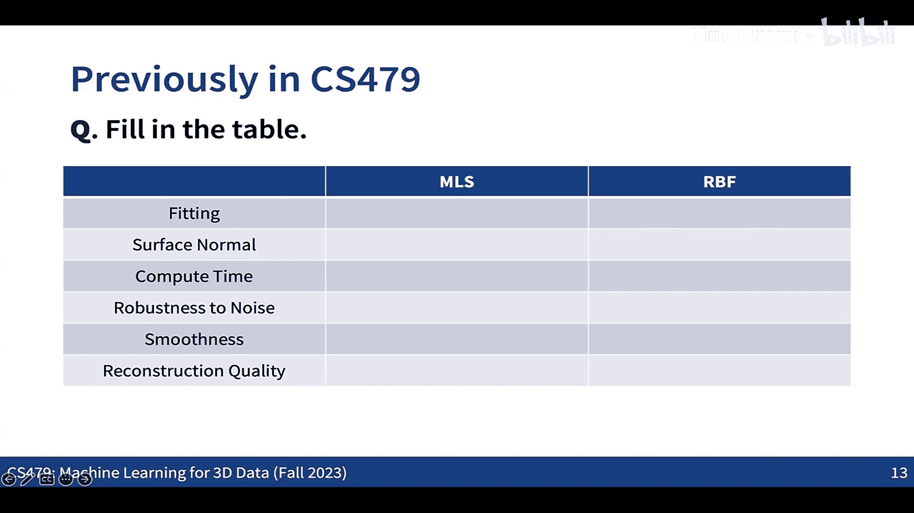
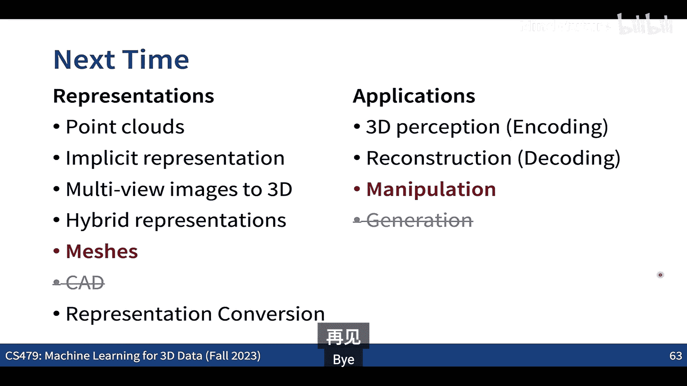

# 012：表示转换（2/2）

在本节课中，我们将继续学习如何在不同3D数据表示之间进行转换。上一节我们介绍了点云到隐式函数转换的基本思路，本节我们将深入探讨一种更优的全局优化方法——泊松表面重建，并学习如何将体素表示转换为网格。

## 从点云到隐式函数：泊松表面重建

上一节我们讨论了移动最小二乘法和径向基函数两种方法。它们各有优劣：移动最小二乘法是局部拟合，计算快，对噪声鲁棒；径向基函数是全局拟合，结果更平滑，但需要法线信息且计算较慢。本节介绍一种能直接优化隐式函数值的方法——泊松表面重建。

泊松表面重建的核心思想是：给定带有法线信息的点云（即定向点云），我们想得到一个隐式函数，其梯度应与输入的法线场对齐。这可以表述为一个最小二乘问题：寻找函数 **F**，使其梯度 **∇F** 与给定的法线场 **V** 尽可能接近。

**公式**：`min_F ∫ ||∇F(x) - V(x)||² dx`

然而，直接对这个向量场积分可能不可行，因为并非所有向量场都是“保守场”（即某个标量函数的梯度）。为了解决这个问题，我们将其转化为求解泊松方程。

通过变分法和欧拉-拉格朗日方程，上述最小化问题可以推导出以下泊松方程：

**公式**：`∇²F = ∇·V`

这里，`∇²` 是拉普拉斯算子，`∇·` 是散度算子。这意味着，我们需要找到一个函数 **F**，其拉普拉斯算子等于给定法线场 **V** 的散度。

为了实际计算，我们需要在离散空间（如3D网格）中求解这个方程。这涉及将连续函数和算子离散化。

*   **函数离散化**：在网格的每个体素中心（或角点）采样，函数值表示为一个向量。
*   **算子离散化**：梯度 (`∇`)、散度 (`∇·`) 和拉普拉斯 (`∇²`) 等微分算子可以表示为大型稀疏矩阵。
*   **问题转化**：泊松方程 `∇²F = ∇·V` 在离散后转化为一个线性系统：`L * F = b`，其中 `L` 是拉普拉斯算子矩阵，`b` 是法线场散度计算得到的向量。

然而，仅凭这个方程，解不唯一（给 **F** 加上任意常数仍满足方程）。因此，我们需要添加额外约束：在已知的表面采样点处，函数值应为零（即符号距离函数的零水平集）。

**公式**：`min_F ∫ ||∇F(x) - V(x)||² dx + λ Σ_i |F(p_i)|²`

其中 `p_i` 是表面采样点。这被称为“屏蔽泊松方程”。求解此方程即可得到全局优化的隐式符号距离函数。

以下是泊松表面重建的优缺点总结：
*   **优点**：通过全局优化得到高质量的隐式函数，能很好地捕捉形状细节。
*   **缺点**：计算量大（需解大型线性系统），严重依赖准确且稠密的法线信息，对输入噪声敏感。

泊松方程的应用非常广泛，例如在图像处理中可用于无缝图像拼接（泊松图像编辑）。

## 从体素到网格：行进立方体算法

获得隐式函数（或占用场）后，常需要从中提取显式的网格表面。最常用的算法是行进立方体算法。

其基本思想是：遍历3D空间中的每个体素（立方体），根据该立方体8个角点的符号距离值（正为外部，负为内部），判断等值面（零水平集）如何穿过这个立方体，并生成相应的三角面片。

具体步骤如下：
1.  **分类角点**：对每个立方体，判断其8个角点是在形状内部（符号距离为负）还是外部（符号距离为正）。
2.  **计算交点**：对于一条边，如果其两个端点符号相反，则等值面必定穿过该边。通过线性插值计算出边的交点位置。
3.  **连接交点**：根据立方体8个角点的内部/外部状态，确定如何连接这些交点以形成三角面片。

由于8个角点各有2种状态，理论上共有 `2^8 = 256` 种配置。通过旋转和对称性，这些配置可以归纳为15种（或14种，取决于对称性分类）独特的模式。对于每种模式，我们可以预先定义好三角面片的连接方式。

以下是行进立方体算法的优缺点总结：
*   **优点**：实现简单，每个体素可独立处理，易于并行计算（如使用GPU加速）；无需调节参数。
*   **缺点**：生成的网格拓扑质量无保证，可能在体素间产生不理想的连接；对于尖锐边缘的捕捉效果不佳；存在拓扑歧义情况（某些配置下有两种可能的连接方式），通常需要特殊处理（如细分体素或随机选择一种）。

一个相关的变体是**行进四面体**算法，它将空间划分为四面体而非立方体，可以规避一些专利问题，原理类似。

## 总结

本节课我们一起学习了3D表示转换的最后两种关键技术：
1.  **泊松表面重建**：一种将带有法线的点云通过求解泊松方程，全局优化为高质量隐式符号距离函数的方法。
2.  **行进立方体算法**：一种从隐式函数（或体素占用场）中提取显式三角形网格的标准方法，通过遍历和配置表生成表面。

至此，我们已经涵盖了在不同3D表示（点云、隐式函数、体素、网格、多视图图像）之间进行转换的主要桥梁技术。掌握这些转换方法对于处理多样化的3D数据至关重要。在接下来的课程中，我们将探讨如何对这些3D数据，特别是网格，进行编辑和操作。