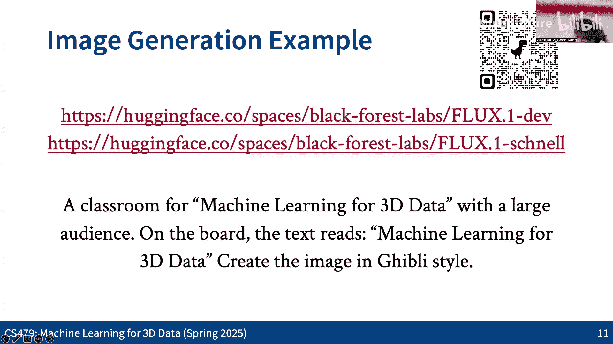
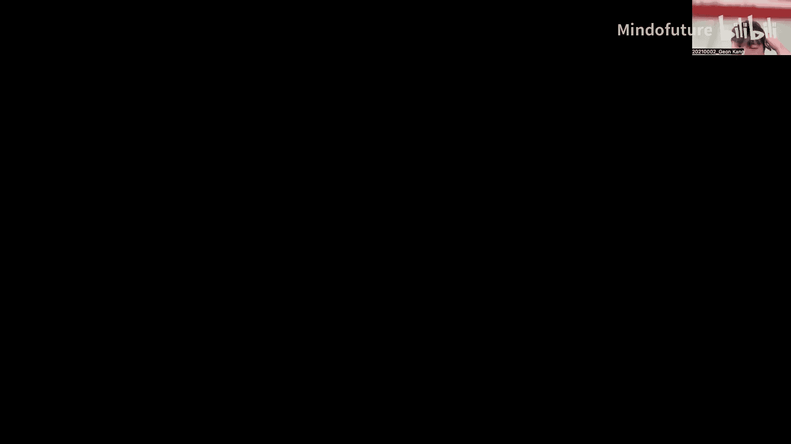
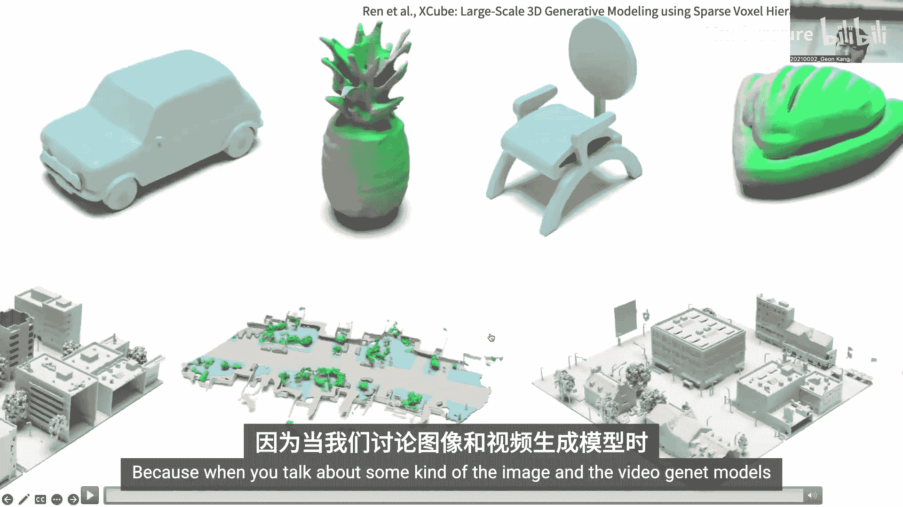
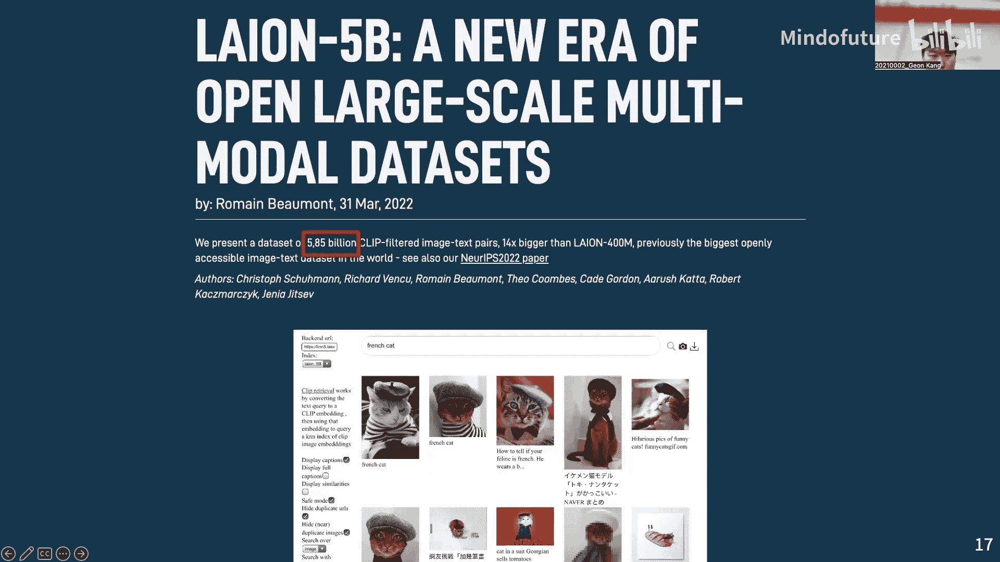
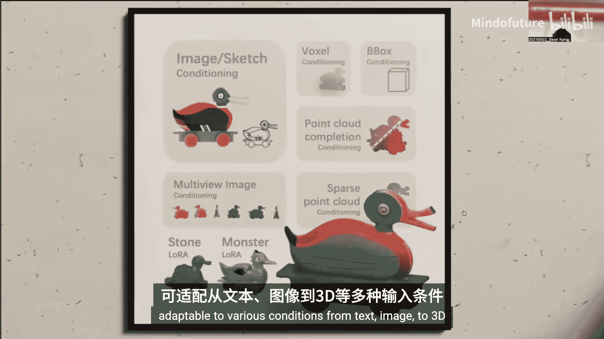
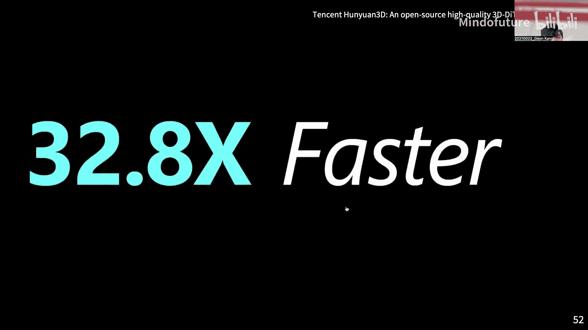
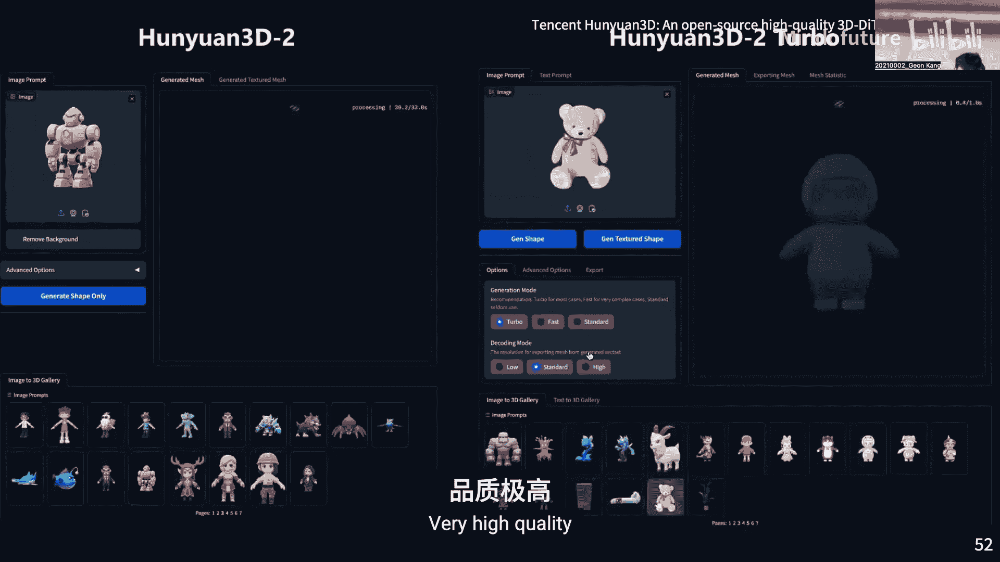
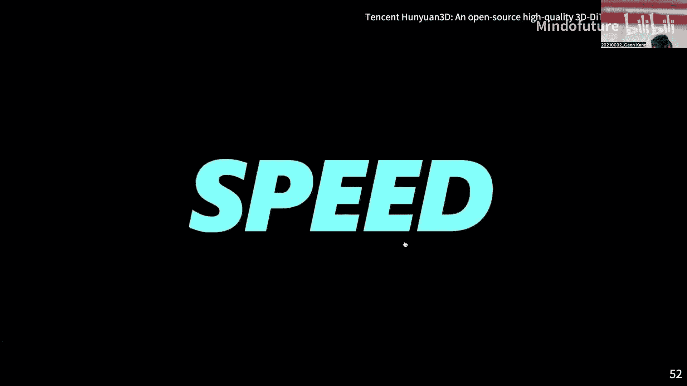
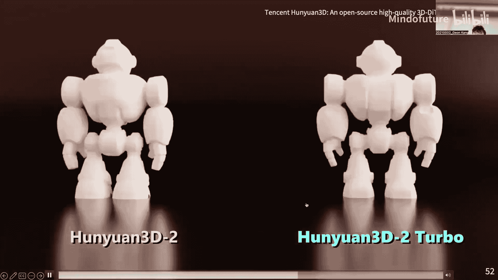
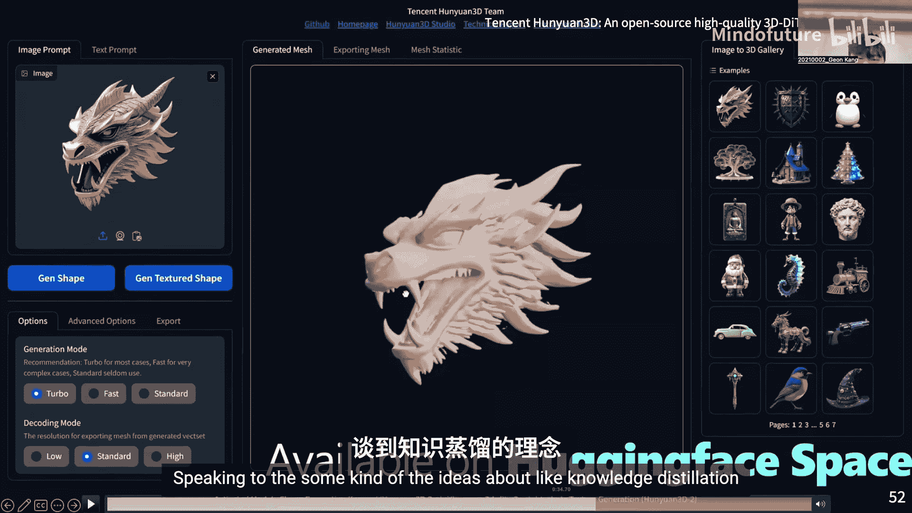

# 013：3D生成

在本节课中，我们将要学习3D数据生成这一主题。我们将探讨如何利用有限的3D数据，结合强大的2D图像先验知识，来创造多样化的3D内容。这是当前3D机器学习领域一个非常前沿和活跃的研究方向。

---

## 课程回顾与未覆盖主题

上一节我们讨论了3D数据的各种表示方法及其应用。本节中，我们来看看如何生成这些3D数据。

在本课程中，我们讨论了3D数据的多种表示形式及其应用，以及如何将3D数据作为神经网络的输入和输出。我们也分析了每种表示方法的优缺点。

实际上，当我们专注于特定表示方法时，有些主题没有时间在本课程中涵盖。正如课程开始时提到的，除了我们讨论过的表示方法，还有一些结构化的表示方法，它们能更明确地表示尖锐边缘、平面等结构。这些表示方法通常用于计算机辅助设计领域，我们在本课程中没有讨论。

此外，与感知相关的任务还有很多，例如3D场景中的检测和分割。这些任务旨在从室内外扫描场景中检测物体（如椅子、桌子）及其形状。我们并未深入探讨如何在3D数据中实现这些想法。

许多3D技术也广泛应用于机器人领域，例如教导自主代理如何在空间中导航和操作物体。这些应用我们也没有涉及。

在课程开始时，我们讨论了点云，以及如何使神经网络具有旋转不变性或等变性。但我们并未保证使用特殊的变换架构。有一些更专业的神经网络架构可以完全保证旋转不变性和等变性，这些是更高级的主题，本课程没有讨论。

上次我们还讨论了形变。此外，还有许多其他几何处理任务，如寻找形状对应关系等。这些主题我们也没有时间覆盖。

还有一个我们尚未讨论的主题是3D生成。现在生成式人工智能非常热门，我们也看到了许多用于3D数据的生成式AI技术。今天我们将简要讨论一些最新的3D数据生成技术。

---

## 2D生成的现状

在深入探讨3D生成之前，我想问大家一些问题：你们有多少人尝试过生成图像？你们使用哪些生成模型来制作这些图像？是DALL-E、Midjourney、Stable Diffusion还是其他模型？

现在很多人喜欢制作并分享AI生成的图像。我们看到图像和视频生成模型取得了巨大进展，例如著名的开源模型Stable Diffusion。这意味着你不仅可以利用模型生成图像，还可以下载模型并在自己的机器上构建应用。生成质量已经非常高。

在深入3D生成的细节之前，让我们先快速体验一下2D图像生成。如果你还没有尝试过，可以访问一些在线工具。例如，你可以使用某些能产生更高质量图像的模型，或者使用来自同一家公司但速度更快、质量稍低的模型。

为什么不尝试访问这些网站并输入一些文本提示来生成图像呢？例如，尝试生成“一个穿着毛衣的幽灵在吃汉堡”这样的描述。

（此处应有生成图像的演示）

我们可以看到，生成模型现在能够产生非常逼真且与文本描述高度一致的图像输出。这不仅仅是图像，视频生成也取得了巨大进步。例如，最近发布的模型可以生成高质量、长时长的视频。

---

## 3D生成的挑战与机遇

欢迎来到机器学习3D数据处理课程。我们现在看到的2D模型已经能够生成非常逼真的图像和视频。今天我们要讨论的是：如何为3D数据实现类似的生成能力？

目前最先进的3D生成模型已经能够产生一些3D物体。有趣的是，它们还能生成非常多样化的3D场景。这些都是利用3D生成模型的输出。

但今天我想提出的一个问题是：3D生成的多样性如何？当我们谈论图像和视频模型时，其成功的原因之一是数据的规模。例如，用于训练图像生成模型的数据集规模可能达到数十亿级别，几乎与地球人口相当。

与这种庞大的2D数据集规模相比，我们用于3D模型训练的数据集规模要小得多。典型的3D数据集可能只有千万级别。问题是：我们能否创造出真正能激发人类创造力、生成各种随机3D形状的3D生成模型？

如果神经网络只是记忆它们见过的数据，那么拥有小规模3D数据集意味着模型只能看到很小范围的3D数据。我们想要的是能够产生可想象但现实中不存在的3D形状的生成模型，例如“穿着毛衣的幽灵在吃汉堡”。

那么，我们如何制作具有这种创造力的3D生成模型呢？今天我们将讨论的基本思路是：如何利用2D图像数据来辅助3D生成。

关键在于，对于3D数据，我们只有相对较小的数据集，但对于2D图像，我们拥有近乎无限规模的数据集。我们知道，这两种数据并非完全不同——图像实际上是3D世界的投影。

因此，问题转化为：我们不需要大量的3D数据，而是可以利用关于投影（即图像）的信息来生成3D数据本身。这是一个有趣的问题。

我们可以这样表述：给定一些关于2D图像的先验信息，能否生成某种3D物体？这在哲学上与“洞穴之喻”有相似之处，即人们只看到真实事物的投影。那么，仅通过观察这些投影，我们如何想象并生成对应的真实事物呢？

---

## 从神经辐射场到少视图重建

为了实现上述目标，我们需要回顾一下神经辐射场的讨论。神经辐射场的基本思想是：给定一个神经辐射场表示，我们可以从任意视角渲染出图像，然后检查渲染出的图像与给定视角的真实图像之间的差异，并通过最小化L2损失来优化神经辐射场参数。

这是神经辐射场流程的基本思想。我们也看到了神经辐射场的许多局限性，例如渲染速度慢（已通过高斯泼溅等技术解决）、无法处理非朗伯表面、复杂场景和光照等。

我们在这里要关注的问题是：神经辐射场通常需要很多图像来构建一个完整的3D表示。如果你使用过相关的笔记本工具进行场景重建，可能会发现当输入图像不足时，重建质量不佳。

那么问题是：如何用更少的图像进行神经辐射场重建？例如，我们只有10张、5张甚至1张图像。如果我们想用非常少的图像进行重建，就需要更多的先验信息。

一个想法是使用深度信息。基本思路是，我们不仅从每个视角捕获RGB颜色信息，还获取深度图像。首先基于深度图像进行3D重建，然后融合RGB颜色信息。这是一种更直接地从输入源获取3D信息的方法。

但是，如果没有这类深度信息，我们如何提供额外的先验信息呢？为此，我们可以引入文本-图像相似性信息。

---

## 利用CLIP模型进行文本引导的3D重建

这里的关键是使用一个预训练模型，例如CLIP。你们有多少人听说过CLIP模型？CLIP的基本思想是将所有文本和图像嵌入到一个高维球面空间中，图像与文本、图像与图像之间的相似性可以通过该空间中的余弦相似度来衡量。

这是一个预训练模型，它提供了关于图像和文本之间接近度或相似性的信息。

基于此，我们可以做什么？假设我们只有一个物体的三张图像。我们能做的是：这个物体的所有图像都应该与描述它的文本相似。

具体做法是：虽然我们只有这个物体的三张图像，但我们仍然可以从任何随机视角渲染这个物体。然后检查渲染出的图像是否与文本描述相符。我们如何检查这种差异？我们可以将渲染出的图像映射到CLIP空间，并检查其与文本描述在该空间中的相似性距离。

基本思想是，从任何视角渲染这个物体，其渲染图像在CLIP空间中都应该与描述文本有较高的相似性。我们使用的额外信息就是文本描述所提供的语义先验。

我们只有少量图像，但仍有文本描述。利用文本描述，我们不再仅仅最小化像素级的L2损失，而是最小化渲染图像与文本在CLIP空间中的（不）相似性。

可以看到，这并没有改变神经辐射场流程的任何部分，只是改变了损失函数。对于给定的三张图像，我们仍然可以计算它们视角的误差。对于我们没有真实图像的随机视角，我们则计算渲染图像与文本的相似性并最小化其差异。

仅仅通过改变神经辐射场中的损失函数，我们就可以实现这种文本引导的3D重建。这合理吗？

这是截至2021年左右关于如何用极少图像进行神经辐射场重建的核心思想。那么，我们需要多少图像呢？人们测试了5张、3张甚至单张图像的情况。

在极端情况下，我们甚至可以不用任何图像进行重建。这合理吗？这里的想法是，现在我们根本不使用任何图像，只使用文本描述，然后最小化从各个随机视角渲染的图像与文本之间的差异。看看是否能得到一些合理的输出。

有一些工程技巧可以获得更稳定的输出，但这确实实现了仅从文本草图生成3D物体，而无需任何输入图像。

这实际上是第一个例子，表明我们现在不仅可以重建3D，还可以从文本生成3D，而无需任何图像。可以看到一些非常随机的输出，例如“一艘船形状的南瓜灯”。虽然看起来不真实，但它确实生成了一些可想象的、新颖的3D内容。这是一个有趣的例子，说明我们现在可以利用2D图像信息进行3D生成，而无需任何3D输入。

---

## 利用图像生成模型作为判别器

那么，能否使用图像生成模型来代替CLIP呢？我们看到计算机视觉中图像生成模型取得了巨大进展，能否用这些模型来替代CLIP，以评估输出质量？

生成器和判别器的主要区别在于：我们需要的不是生成器，而是判别器。生成器以文本为输入并生成图像作为输出。但基于神经辐射场的生成流程，我们需要的是能够同时接收文本和图像作为输入，并判断它们是否对齐的架构。这在基于扩散的生成中会更清晰。

问题是如何将预训练的生成器转换为判别器？我们需要能够同时接收文本和图像，并判断它们是否对齐，以及图像是否逼真。

虽然不深入讨论如何实现这种转换的细节（这需要更多关于扩散模型的背景知识），但我们可以看到，基本思路仍然是使用相同的神经辐射场流程，只改变判别部分。

我们不再检查渲染图像与给定图像的对齐程度，而是使用图像生成模型（作为判别器）来检查渲染图像与给定文本的对齐程度。基于此，我们可以生成3D物体。

实际上，这些不仅仅是简单的3D苹果，而是使用这种流程生成的。这意味着，利用你们作业二中关于神经辐射场或高斯泼溅的代码，如果稍微修改损失函数以纳入真实感判断，你们也可以制作出这样的物体。

这个想法的亮点在于：虽然我们没有大量的3D信息，但我们所做的只是将3D物体渲染成2D图像（这相当于从3D世界到2D世界的映射），然后使用我们的生成模型作为判别器，检查输出是否逼真、是否与文本一致。接着，我们通过反向传播将反馈发送回3D物体。

关键点是，这种想法不仅可以应用于3D，还可以应用于任何可以渲染成图像的东西，包括特效。例如，那些具有更复杂软件信息（如着色器）的视觉效果，或者我们可以编程实现的粒子效果。我们可以应用相同的技术：将这些效果渲染成普通图像，然后应用相同的想法进行优化。

如果你想尝试这个想法，可以找到一些网站，它们结合了现有的神经辐射场技术和图像生成模型，可以实现3D生成。

---

## 当前方法的局限性与未来方向

那么，以这种方式进行3D生成有什么缺点呢？有哪些典型的问题或挑战？

一个很好的观点是，我们能否从这种像素级的监督中学习到几何信息？这确实很难从像素价格中学习几何。还有其他问题吗？例如，多视角不一致性。

有些部分可能看起来没问题，但仅仅通过从各个角度检查逼真度，可能会导致问题。这种生成方式的一个典型问题是“多面脸”问题。

让我播放一个视频示例。从每个单独的视角看，它都还可以。但当你开始旋转它时，你会发现它不合理，实际上可能有两张或三张脸。这个问题被称为“多面脸”问题，不仅在角色模型上，在其他物体上也会出现。

有很多技术试图解决这个问题，但我们仍然面临一些挑战，例如物体内部出现空洞、存在漂浮部分等。这意味着，仅使用2D信息进行3D重建可能不足，仍然面临这些挑战。在利用有限的3D数据制作非常逼真的3D物体方面，我们还有很长的路要走。

---

## 结合大规模3D数据集的直接训练

目前也有很多尝试直接在大规模3D数据集上训练生成模型。

“每一项伟大的创造都始于一个火花，但正是不懈的努力将想法变为现实。介绍Clay，一个可控的大规模生成模型，它缩小了想象与3D创作之间的差距。基于广泛的3D数据集训练，Clay包含一个15亿参数的几何模型和一个10亿参数的材料模型。在一分钟内，Clay可以根据文本、图像或3D输入，生成带有PBR材质的详细3D资产。”

这是一个由科技公司开发的模型。可以看到，他们也使用大规模数据来制作3D内容。通常，游戏公司对使用生成模型进行内容生成非常感兴趣。有一家公司在3D生成方面进展非常迅速。

你可以搜索“文本到3D”并查看一些模型输出的质量。我们看到了3D生成技术的进步，无论是直接基于大规模3D数据集训练，还是通过从2D图像模型进行知识蒸馏来生成更多样化的输出。

我认为，未来我们将看到更多结合策略：严格使用3D数据集，同时利用来自2D图像和视频模型的知识，以制作高质量且多样化的3D内容。

---

## 知识蒸馏在3D编辑等任务中的应用

谈到知识蒸馏的想法，实际上不仅有制作3D模型的技术，还有更多应用，例如编辑。使用某些模型，我们不仅可以生成，还可以进行编辑和结构修改。例如，使用一些提示点来进行这样的更改。

还有一些重建/消费的例子，我们在场景中添加一些特效，而无需任何直接操作。

我们上次简要讨论了可变形模型，当时讨论的主要是基于几何的形变。这意味着当我们试图使形变尽可能小时，我们可能只从几何角度考虑。但从语义角度，我们知道这是错误的，应该修复。这更多是关于几何信息的先验。我们可以考虑使用预训练的生成模型来修正这些错误的形变。

这是一个例子。这种知识蒸馏不仅可以应用于3D生成，还可以应用于任何其他类型的视觉内容生成，例如制作非常宽的 panoramic 图像。

它也可以用于制作360度全景图像，以及在给定场景上进行协调的生成和设计。

这些是一些示例。这是关于如何制作3D模型以及如何利用预训练的2D模型制作各种不同内容的高级思路。如果你对这些主题更感兴趣，实际上我下学期将教授一门课程，我们可以考虑讨论这些不同的模型。

---

## 总结

本节课中我们一起学习了3D生成的高级概念。我们探讨了如何利用有限的3D数据和强大的2D先验（如CLIP和扩散模型）来生成新颖的3D内容。我们看到了从文本生成3D、少视图重建等技术的核心思想，也了解了当前方法面临的挑战（如多视角不一致性）和未来的发展方向（如结合大规模3D数据集直接训练）。虽然我们无法深入所有技术细节，但这为你理解当前3D生成领域的关键思路提供了基础。