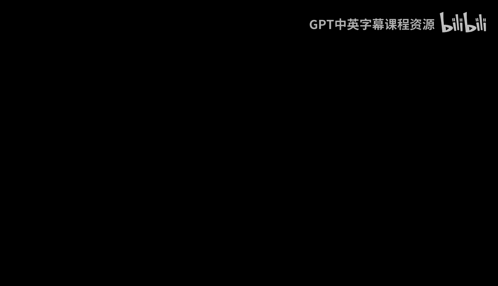
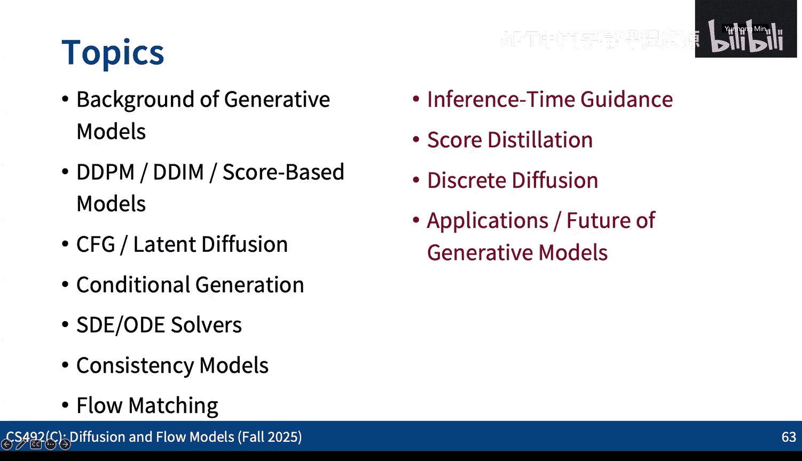

# 扩散和流模型：11：流匹配 2

在本节课中，我们将深入探讨流匹配模型，并揭示其与扩散模型之间的深刻联系。我们将看到，流模型实际上是扩散模型的推广，而扩散模型是流模型的一个特例。理解这种关系将帮助我们统一看待这两种强大的生成模型。

---

## 流匹配回顾

上一节我们介绍了流匹配模型的基本概念。现在我们来回顾一下关键点。

在流匹配的框架下，我们改变了时间域的定义：生成过程的时间 `t` 从 `0` 流向 `1`。其中：
*   `x_0` 是来自参考分布（如标准高斯分布）的样本。
*   `x_1` 是来自数据分布的样本。

我们讨论了三个核心概念：
1.  **流映射 (Flow Map)**：`φ_t(x)`，描述了从时间 `0` 到 `t` 的确定性变换。
2.  **向量场 (Vector Field)**：`v_t(x)`，是流映射关于时间的导数，定义了数据点在每个时刻的“速度”。
3.  **概率路径 (Probability Path)**：`p_t(x)`，描述了数据在时间 `t` 的分布。

它们之间的关系由以下公式定义：
*   向量场是流映射的导数：`v_t(φ_t(x)) = d/dt φ_t(x)`
*   向量场和概率路径通过**福克-普朗克方程**关联：`∂p_t(x)/∂t = -∇·(p_t(x) v_t(x))`

我们的目标是训练一个神经网络 `u_θ(x_t, t)` 来近似这个向量场 `v_t(x)`，这类似于扩散模型中预测噪声的网络。

---

## 条件流匹配

由于目标向量场没有闭式解，我们引入了**条件流匹配**。

我们同样定义三个条件对象：
1.  **条件流映射**：`φ_t(x | x_1)`
2.  **条件向量场**：`v_t(x | x_1)`
3.  **条件概率路径**：`p_t(x | x_1)`

一个常见且重要的特例是**线性高斯路径**。我们假设条件流映射是 `x_0` 和 `x_1` 的线性插值，并且 `x_0` 服从标准高斯分布：
*   条件流映射：`φ_t(x | x_1) = (1 - t) * x_0 + t * x_1`
*   条件概率路径：`p_t(x | x_1) = N(x; (1 - t) * μ(x_1) + t * x_1, σ^2(t) * I)`
*   条件向量场：通过对流映射求导可得 `v_t(x | x_1) = (x_1 - x_0)`

此时，速度方向就是 `x_0` 到 `x_1` 的直线方向。

另一种特例是遵循**扩散模型轨迹**的路径，其条件概率路径定义为类似扩散过程的形式，相应的向量场也会不同。

基于条件流映射，我们可以训练网络。以下是两种训练目标：

**当条件概率路径有闭式解时（如线性高斯路径）：**
训练网络 `u_θ` 来匹配条件向量场 `v_t`。
`L(θ) = E_{t, x_1, x_0} [ || u_θ(φ_t(x_0 | x_1), t) - v_t(φ_t(x_0 | x_1) | x_1) ||^2 ]`

**更一般的情况（适用于任意条件流映射）：**
我们同时采样 `x_0` 和 `x_1`，通过条件流映射计算中间点 `x_t` 及其速度，并训练网络匹配该速度。
`L(θ) = E_{t, x_1, x_0} [ || u_θ(x_t, t) - (d/dt φ_t(x_0 | x_1)) ||^2 ]`

---

## 流模型与扩散模型的等价性

现在，我们来探讨流模型与扩散模型之间的核心联系。实际上，**流模型是扩散模型的推广**，而**扩散模型是流模型的一个特例**。

关键在于视角的不同：
*   **扩散模型**：首先定义（条件）概率路径 `p_t(x | x_1)`，然后推导出相应的得分函数和（随机）动态过程。
*   **流模型**：首先定义（条件）流映射 `φ_t(x | x_1)`，然后推导出相应的向量场和概率路径。

对于**线性高斯路径**这一特例，两者在数学上是等价的。我们可以证明，流模型中的向量场 `v_t(x)` 与扩散模型中的得分函数 `∇ log p_t(x)` 存在直接关系。

让我们从线性高斯条件流映射出发。已知：
`x_t = φ_t(x_0 | x_1) = α_t * x_0 + σ_t * x_1` （这里使用了与变分扩散模型相同的 `α_t` 和 `σ_t` 函数，但时间方向为 `0→1`）

通过对流映射求导，可以得到条件向量场 `v_t(x | x_1)`。为了得到边际向量场 `v_t(x)`，我们需要对 `x_1` 求期望：
`v_t(x) = E_{p_t(x_1 | x)} [ v_t(x | x_1) ]`

这里，`p_t(x_1 | x)` 表示给定中间点 `x` 时，最终数据点 `x_1` 的后验分布。根据**Tweedie公式**，这个后验期望可以表示为：
`E[x_1 | x_t] = (x_t - σ_t^2 * ∇ log p_t(x_t)) / α_t`

将Tweedie公式代入向量场的期望表达式中，经过代数运算，我们可以得到流模型的向量场与扩散模型的得分函数之间的关键关系：

`v_t(x) = [α_t' / α_t] * x - [σ_t' * α_t - σ_t * α_t'] / α_t * ∇ log p_t(x)`

其中 `α_t'` 和 `σ_t'` 是 `α_t` 和 `σ_t` 对时间 `t` 的导数。这个公式清晰地表明，**一旦我们知道得分函数 `∇ log p_t(x)`，就可以计算出向量场 `v_t(x)`，反之亦然**。

进一步地，我们知道在扩散模型中，预测的噪声 `ε_θ` 与得分函数的关系为：
`ε_θ(x_t, t) ≈ -σ_t * ∇ log p_t(x_t)`

将此关系代入上面的公式，我们可以直接得到向量场 `v_t(x)` 与预测噪声 `ε_θ` 之间的关系：

`v_t(x) = [α_t' / α_t] * x - [σ_t' * α_t - σ_t * α_t'] / (α_t * σ_t) * ε_θ(x_t, t)`

这个公式至关重要。它意味着：
1.  **模型转换**：一个预训练的扩散模型（已学会预测噪声 `ε_θ`）可以直接转换为一个流模型，只需使用上述公式计算速度场，然后通过求解ODE进行生成。
2.  **等价性**：对于线性高斯路径，训练一个预测噪声的网络（扩散模型）和训练一个预测速度的网络（流模型）在数学上是描述同一事物的两种方式。

因此，概率流ODE（PF ODE）和从条件流匹配推导出的ODE是相同的。这统一了扩散模型和流模型的视角。

---

## 流匹配的优势与应用

流匹配不仅提供了另一种理解生成模型的视角，还带来了一些实际优势和新可能性。

**1. 更灵活的建模：**
条件流映射不必是线性的。我们可以设计非线性流映射（例如二次型），这为模型设计提供了更大的灵活性，尽管在实践中简单的线性形式往往表现良好。

**2. 更一般的分布映射：**
流匹配不要求参考分布必须是标准高斯分布。原则上，它可以学习**任意两个分布之间的映射**。这意味着我们可以实现从一个数据分布到另一个数据分布的直接转换，这超越了传统扩散模型的范围。

**3. 加速生成：整流流**
一个重要的应用是**整流流**技术，它可以显著加速生成过程。

在基础流模型中，即使条件轨迹被定义为直线，但通过训练得到的边际向量场 `v_t(x)` 所确定的轨迹可能是弯曲的。这意味着生成时需要多次迭代求解ODE。

整流流的思想是通过**微调**使轨迹变直。具体步骤如下：
*   **第一步**：用随机配对 `(x_0, x_1)` 训练一个初始流模型（Rectified Flow 1）。
*   **第二步**：使用第一步训练好的模型进行生成，得到新的配对 `(x_0', x_1')`，其中 `x_1'` 是模型从 `x_0'` 生成的数据。用这些新的、更“对齐”的配对数据来微调模型（Rectified Flow 2）。
*   **迭代**：重复此过程（Rectified Flow 3, ...）。

经过几次迭代后，轨迹会变得越来越直。最终，我们可能只需要**极少的步数（甚至一步）** 就能从噪声生成高质量样本，同时保持多样性。

这使我们仿佛“回归”到了单步生成模型（如最初的GAN），但获得了扩散模型级别的质量。许多最新的图像/视频生成模型（如Flux）正是基于流匹配和此类技术构建的。

**4. 与其他加速方法的对比：**
一致性模型是另一种基于扩散模型的加速方法。目前，整流流（基于流模型）和一致性模型（基于扩散模型）正在竞争，两者都能在极少的步数内实现高质量生成。

---

## 总结

本节课中，我们一起学习了流匹配模型的深入内容及其与扩散模型的联系。

我们首先回顾了流匹配的核心概念：流映射、向量场和概率路径。然后，我们深入探讨了**条件流匹配**，特别是**线性高斯路径**这一重要特例。

最关键的是，我们揭示了**流模型与扩散模型在数学上的等价性**。通过推导，我们证明了对于线性高斯路径，流模型的向量场与扩散模型的得分函数（以及预测的噪声）可以通过确定的公式相互转换。这意味着两者本质上是同一枚硬币的两面，只是建模的出发点不同。

最后，我们探讨了流匹配的**优势**，尤其是**整流流**技术如何通过微调使生成轨迹变直，从而实现**极速高质量生成**。这解释了为什么许多前沿生成模型开始转向流匹配框架。

从最初的单步模型（GAN），到迭代的扩散模型，再到如今通过流匹配实现的高效单步/少步模型，我们看到了生成模型发展的一个有趣循环与飞跃。在接下来的课程中，我们将把目光转向这些模型的应用，例如如何在推理阶段引导模型生成符合用户偏好的内容。