# 扩散与流模型：第12讲：推理时间引导生成 1 (Diffusion and Flow Models, F - GPT中英字幕课程资源 - BV1CKpvz1EH5)

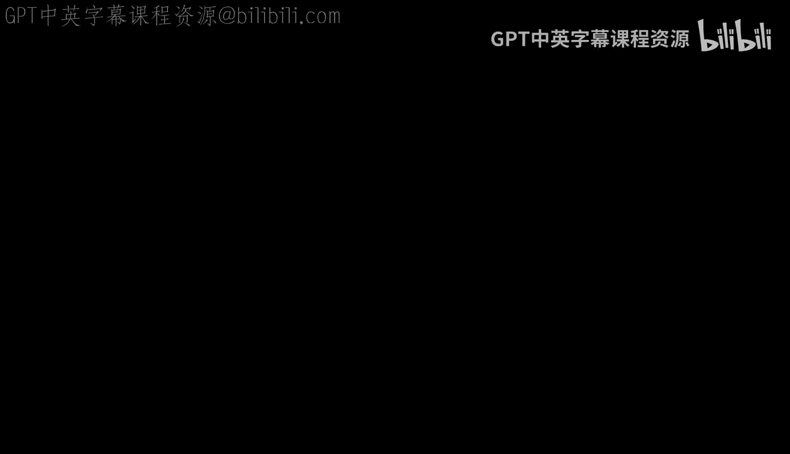

## 📚 概述

在本节课中，我们将要学习如何利用预训练的扩散或流模型，在推理（生成）阶段注入额外的引导信息，从而实现条件生成或解决逆问题，而无需对模型进行额外的条件化训练。

## 🧠 背景回顾

上一节我们介绍了扩散模型和流模型的基本训练与生成过程。扩散模型的优势在于能生成高质量且多样化的样本，但其缺点是生成速度较慢，因为需要迭代的去噪步骤。我们之前讨论过一些在推理时加速生成的技术。

然而，这种迭代过程本身也带来了一个好处：它允许我们在生成轨迹的每一步注入“引导”。我们曾在讲解分类器引导（Classifier Guidance）和无分类器引导（Classifier-Free Guidance）时见过这种思想。它们通过在每一步的预测噪声（即分数）上添加一个偏移量，来引导生成过程朝向符合特定条件（如类别标签）的样本。

但上述方法都需要额外的训练：要么训练一个分类器，要么训练一个能同时输出条件与非条件噪声的模型。本节课的核心问题是：**我们能否仅使用一个预训练的无条件生成模型，在推理时通过修改其生成过程来实现条件引导？**

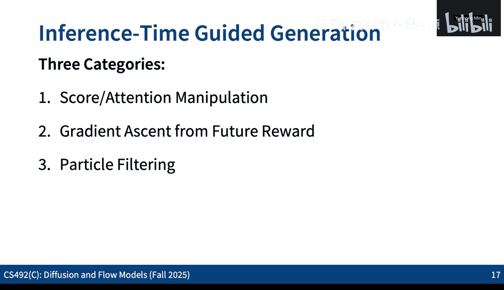

答案是肯定的。扩散和流模型的迭代生成本质上是在构建一条从噪声到数据点的轨迹。我们可以在每一步对这个轨迹施加“推力”，使其最终到达我们期望的目标区域。接下来，我们将探讨几种实现这种“推理时引导”的技术。

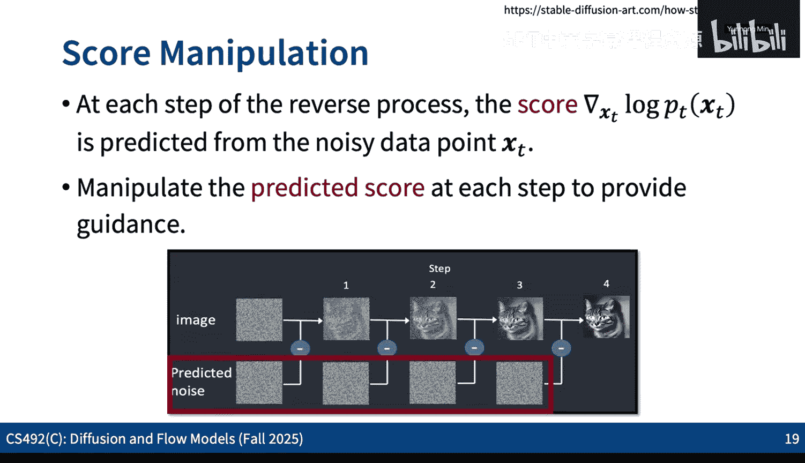

## 🛠️ 核心方法：分数操纵

实现推理时引导的一个核心思路是“分数操纵”。在每一步反向去噪过程中，我们并不直接使用模型预测的原始分数（噪声），而是对其进行修改，使其指向我们期望的目标。

以下是实现分数操纵的几种技术分类。本节课我们将重点讨论前两类。

### 1. 基于启发式的分数操纵

这类方法没有严格的理论保证，但凭借巧妙的工程实践，在许多任务上效果显著。其核心思想通常是在生成过程中，混合来自不同过程（如正向扩散和反向去噪）的中间结果。

#### 示例：图像修复（Inpainting）

**问题定义**：给定一张图像和其上的一个掩码区域（即待修复的部分），目标是生成一个完整的图像，其非掩码区域（背景）与输入一致，掩码区域（前景）的内容则合理且与背景协调。

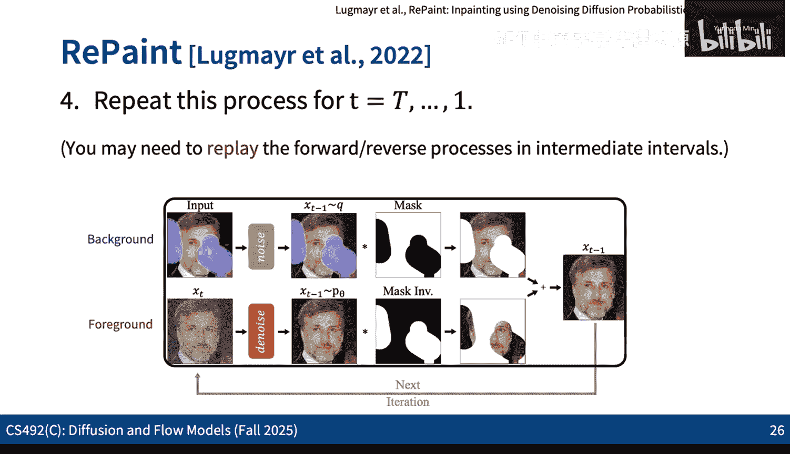

**传统方法**：可以收集“破损图像-完整图像”对来训练一个条件扩散模型。

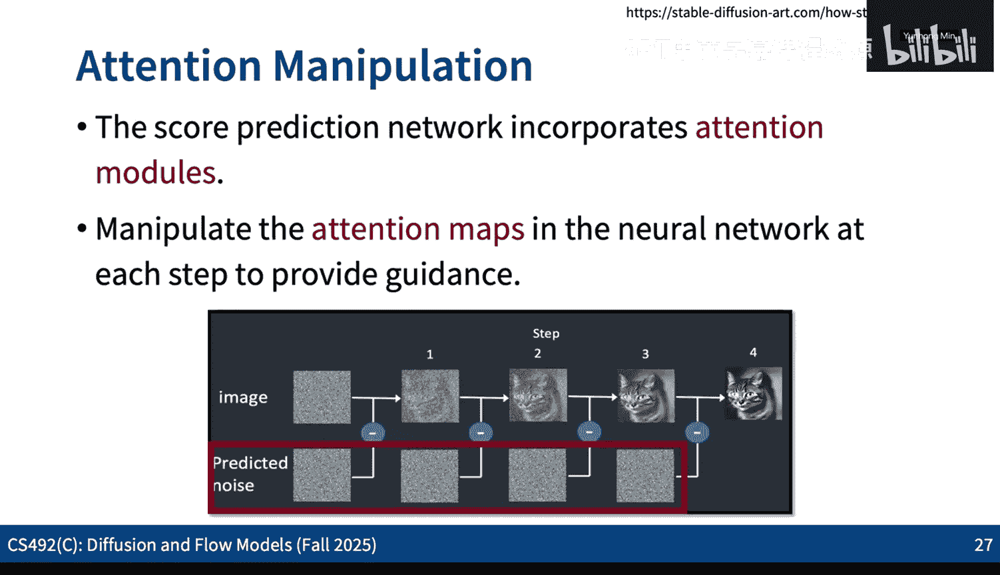

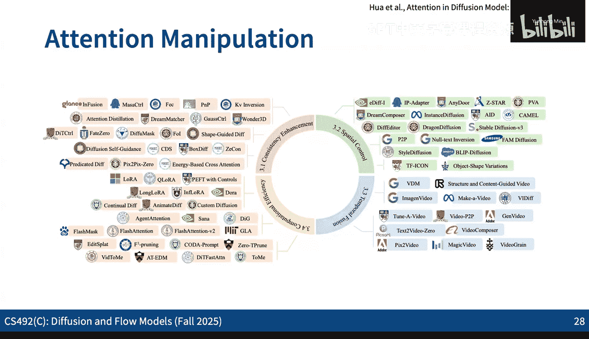

**推理时引导方法（如RePaint）**：我们仅使用一个预训练的无条件图像生成扩散模型。其步骤如下：
1.  设 `x_t` 为第 `t` 步的带噪图像。
2.  对整张图像（包括前景和背景）执行一步标准的反向去噪，得到候选 `x_{t-1}^reverse`。
3.  对背景区域，执行一步**正向扩散**过程（从 `x_{t-1}` 加噪到 `x_t` 的逆过程），得到 `x_{t-1}^forward`。这能尽可能保留背景的原始信息。
4.  组合：最终的第 `t-1` 步图像 `x_{t-1}`，其背景区域取自 `x_{t-1}^forward`，前景区域取自 `x_{t-1}^reverse`。
5.  重复此过程直至结束。

**原理浅析**：对于背景，我们反复进行“轻微加噪再轻微去噪”，这类似于对原图做微小扰动，因此能较好地保持原貌。对于前景，我们执行标准的生成过程，但背景的“锚定”信息会通过模型内部的注意力机制等，间接引导前景生成与背景协调的内容。虽然缺乏严格理论解释，但实践表明该方法常能产生合理结果。

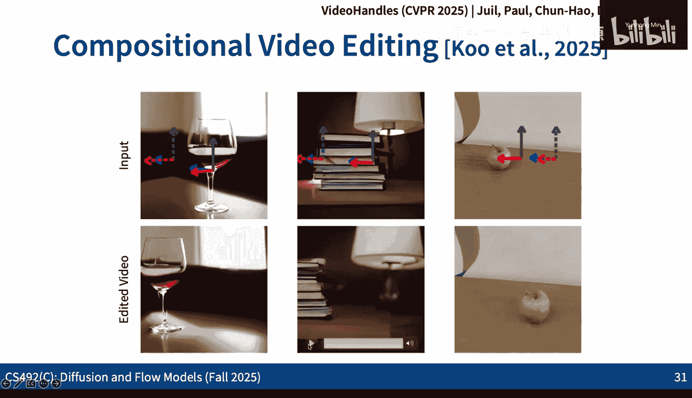

#### 更多应用

通过操纵分数或模型内部的注意力图（Cross-Attention, Self-Attention），还能实现更多功能，例如：
*   **风格迁移**：结合图像A的结构和图像B的风格。
*   **布局控制**：根据给定的文本描述和物体边界框布局来生成图像。
*   **视频编辑**：对视频中的物体进行移动、替换等操作。

这类方法的优点是直接、灵活，尤其适合空间编辑任务。缺点是缺乏理论保证，可能失败，且技巧性强。

### 2. 基于梯度的方法：求解逆问题

上一类方法是启发式的。现在，我们看一类有更明确数学形式的方法，用于解决“逆问题”。

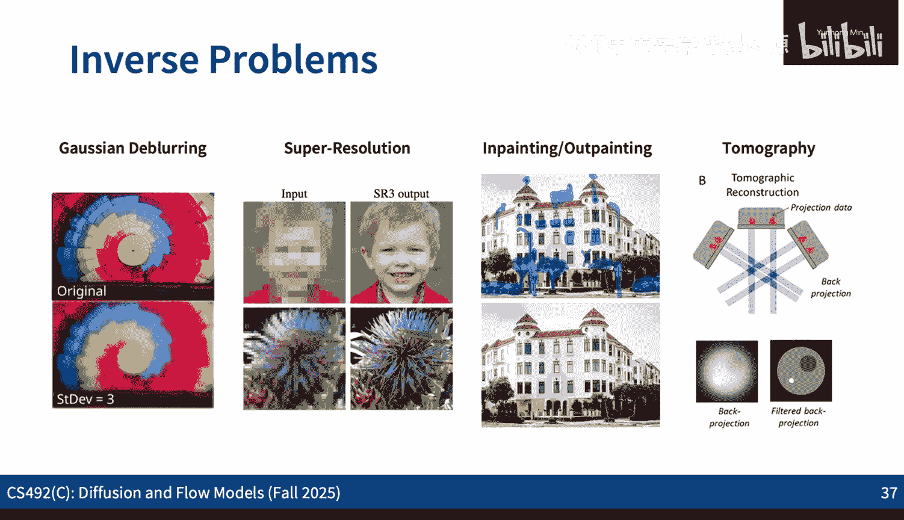

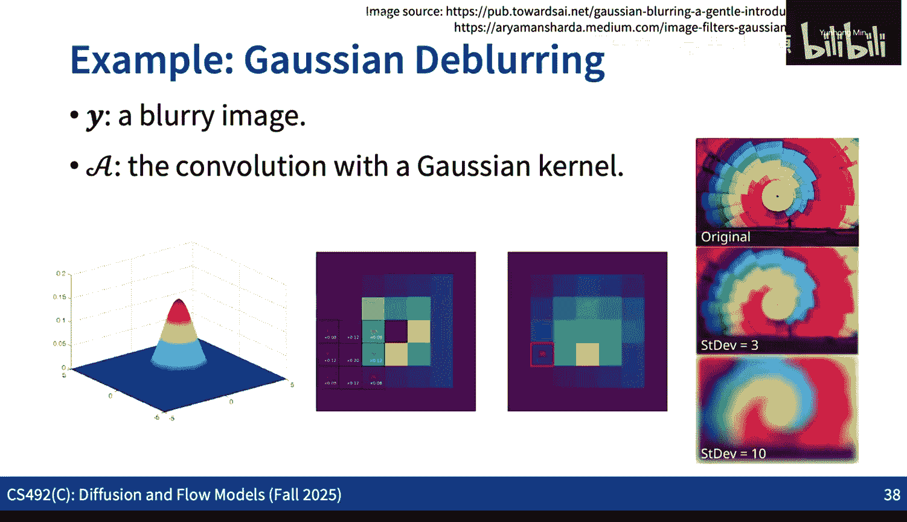

#### 什么是逆问题？

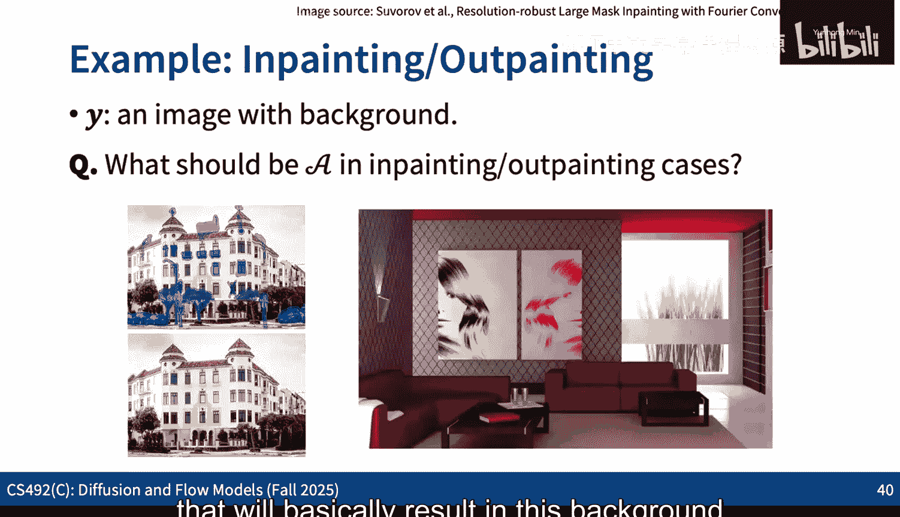

逆问题广泛存在于各个领域。其一般形式是：
我们想要求解未知的“因” `x`，但我们只能观测到“果” `y`。两者通过一个已知的（通常不可逆的）映射 `A` 相连，可能还包含观测噪声 `n`。

**公式**：
`y = A(x) + n`

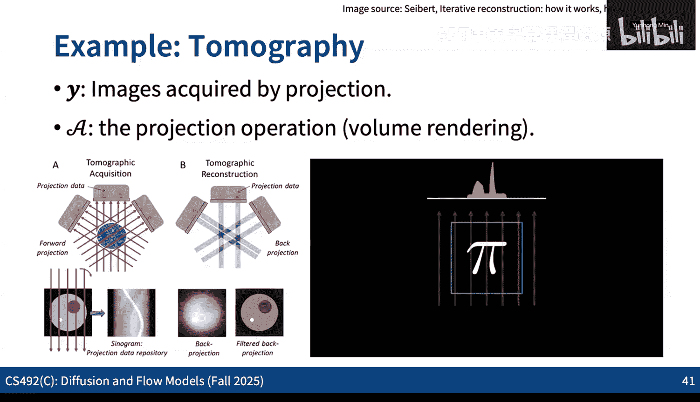

**目标**：在已知 `A` 和观测值 `y` 的情况下，找到一个 plausible 的 `x`，使得 `A(x)` 尽可能接近 `y`。由于 `A` 不可逆，解通常不唯一，这正是生成模型可以发挥作用的地方。

**图像领域的例子**：
*   **图像去模糊**：`A` 是模糊核卷积。
*   **图像超分辨率**：`A` 是下采样操作。
*   **图像修复**：`A` 是掩码操作。
*   **CT/MRI重建**：`A` 是投影（Radon变换）。

#### 用预训练扩散模型求解逆问题

我们有一个预训练的无条件扩散模型，它建模了数据 `x` 的分布 `p(x)`。我们想要求解 `p(x | y)`，即在观测 `y` 下的后验分布。

根据贝叶斯规则，后验分布的分数（我们生成时需要）可以分解：

**公式**：
`∇_{x_t} log p(x_t | y) = ∇_{x_t} log p(x_t) + ∇_{x_t} log p(y | x_t)`

其中：
*   `∇_{x_t} log p(x_t)` 是无条件分数，我们的预训练模型已经可以估计（即预测的噪声）。
*   `∇_{x_t} log p(y | x_t)` 是似然分数，表示在给定中间状态 `x_t` 时，观测 `y` 的可能性。

**关键挑战**：我们不知道 `p(y | x_t)`，因此无法直接计算其分数。

**解决方案**：进行近似。我们需要建立 `y` 与 `x_t` 之间的联系。通过扩散过程的前向公式，我们知道 `x_t` 与原始数据 `x_0` 有关。一个非常粗略的近似是假设在给定 `x_t` 时，`x_0` 的分布是一个高斯分布，其均值可由 Tweedie 公式估计：`E[x_0 | x_t]`。

##### 近似方法一：伪逆引导（适用于线性A）

**假设**：映射 `A` 是线性的，且观测噪声 `n` 是高斯噪声。那么 `p(y | x_0)` 是高斯分布。

**推导**：通过一系列假设和近似（包括假设 `p(x_0 | x_t)` 为高斯分布），可以推导出 `p(y | x_t)` 也近似为高斯分布，进而得到其分数的闭合形式。

**最终引导项形式（简化，无观测噪声时）**：
`∇_{x_t} log p(y | x_t) ≈ - (1/σ_t^2) A^T (A E[x_0 | x_t] - y)`

其中 `A^T` 是 `A` 的伪逆，`σ_t` 是 `t` 时刻的噪声标准差。这个项作为偏移量加到原始分数上，引导生成过程。

##### 近似方法二：更简单的梯度近似

如果我们放弃 `A` 是线性的假设，并做一个**更强但更简单**的近似：直接假设 `p(y | x_t) ≈ p(y | E[x_0 | x_t])`。也就是说，我们用 `x_t` 估计出的 `x_0` 的期望值来代替 `x_t` 本身，去评估似然。

那么，似然分数近似为：
`∇_{x_t} log p(y | x_t) ≈ ∇_{x_t} [ - || y - A(E[x_0 | x_t]) ||^2 / (2σ^2) ]`

这实质上是关于重建误差 `L2` 损失的梯度。通过链式法则，我们可以计算这个梯度对 `x_t` 的导数。

**在DDPM采样中的具体实现**：
在DDPM的采样步骤中，更新规则通常是：
`x_{t-1} = function( x_t, predicted_noise )`

当我们添加引导时，相当于用 `predicted_noise + guidance_term` 去替换 `predicted_noise`。可以证明，这等价于先按原方式计算出 `x_{t-1}`，然后加上一个由引导项推导出的修正量：

**公式**：
`x_{t-1} = x_{t-1}(original) + guidance_coefficient * ∇_{x_t} || y - A(E[x_0 | x_t]) ||^2`

**惊人的简洁性**：这意味着，要为一个预训练的扩散模型添加这种基于重建误差的引导，你**只需要在采样循环中添加一行代码**，来计算这个梯度并更新 `x_{t-1}`。无需任何重新训练或微调。

## 🎯 总结

本节课我们一起学习了如何为预训练的扩散模型在推理时注入引导信息。
1.  我们首先回顾了**分数操纵**的核心思想：通过修改生成轨迹每一步的分数，来引导输出方向。
2.  接着，我们介绍了两类方法：
    *   **启发式分数操纵**：以图像修复（RePaint）为例，展示了如何通过混合正向和反向过程的结果来实现空间引导。这类方法灵活但缺乏理论保证。
    *   **基于梯度的逆问题求解**：我们将条件生成问题形式化为贝叶斯逆问题。通过近似似然分数 `p(y | x_t)`，推导出可以在采样步骤中添加的引导项。特别地，基于重建误差梯度的近似方法实现极其简单，仅需在采样代码中添加一行，即可使模型适应去模糊、超分、修复等多种任务，而无需额外训练。

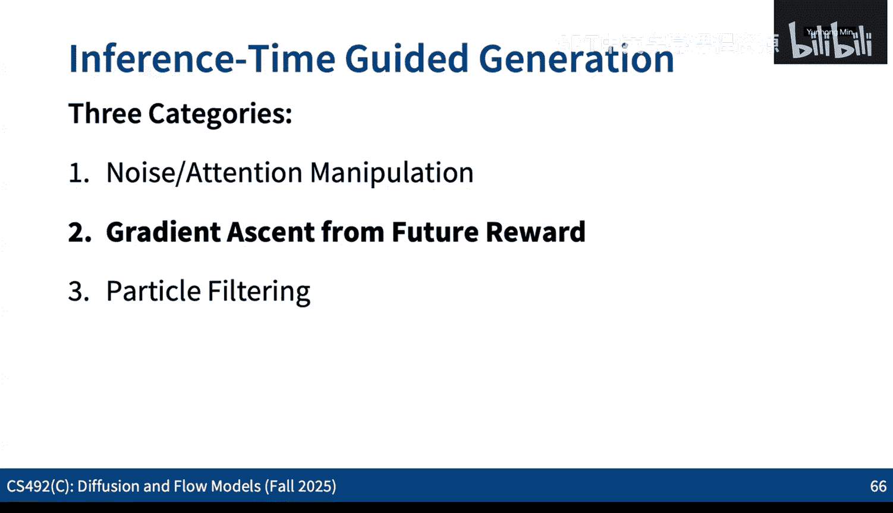

这些技术展示了扩散模型迭代生成框架的强大可操控性。在下节课中，我们将继续探讨第三类技术，并从连续时间（ODE/SDE）的视角来统一理解这些引导方法。