# 扩散与流模型：13：推理时引导生成 2 (下) 🧠

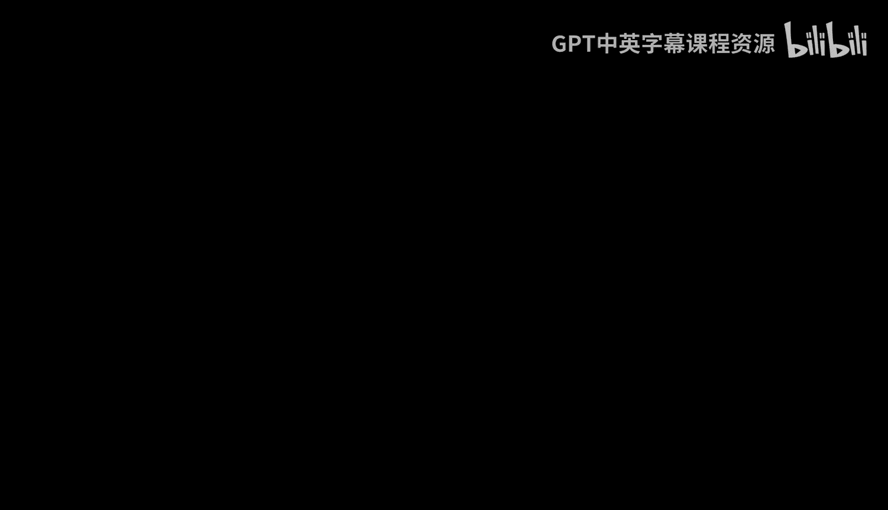

在本节课中，我们将继续探讨推理时引导生成技术。上一节我们介绍了基于梯度上升的DPS方法，本节中我们将从更广阔的视角来看待这一技术，并探讨其在更复杂场景下的应用，包括非可微奖励函数和过程奖励。

## 概述：从特定技术到通用框架

我们之前讨论的DPS方法，本质上是定义了一个可微的奖励函数（例如负L2损失），并通过梯度上升来引导生成过程。这可以被视为一个更通用框架的特例：**我们拥有一个预训练的生成模型（提议者）和一个评估生成质量的函数（验证者）**。我们的目标是在推理时，利用验证者来引导提议者，以生成更符合用户期望的输出。

这种“提议者-验证者”范式在大型语言模型中已非常普遍（例如思维链、O1/O3模型）。我们的目标是探索如何将类似的思想应用于扩散和流模型。

## 奖励最大化视角下的推导 🔄

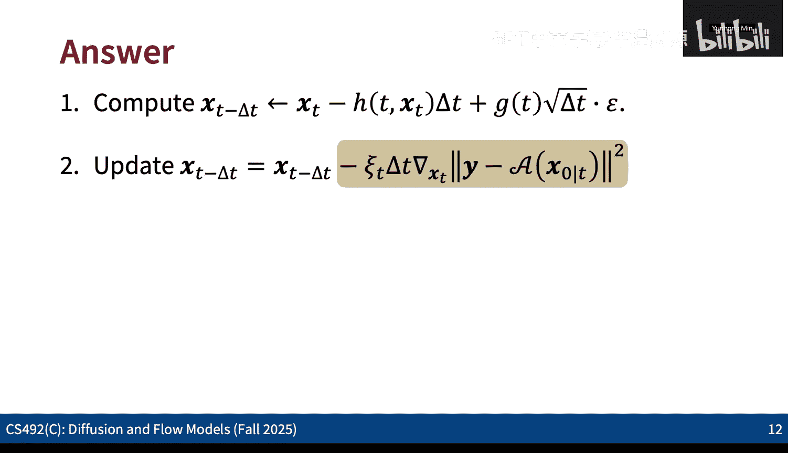

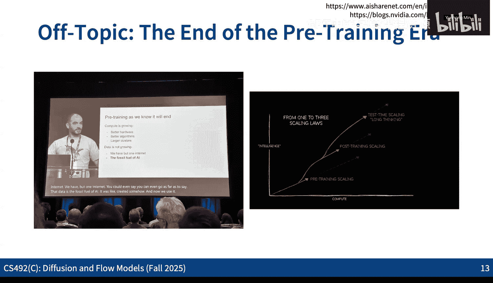

我们可以从一个更形式化的角度来理解DPS。假设我们有一个预训练模型定义的数据分布 `p(x)` 和一个奖励函数 `R(x)`。我们不仅想从 `p(x)` 中采样，更希望采样出的 `x` 能最大化期望奖励，同时又不至于偏离原始分布太远。

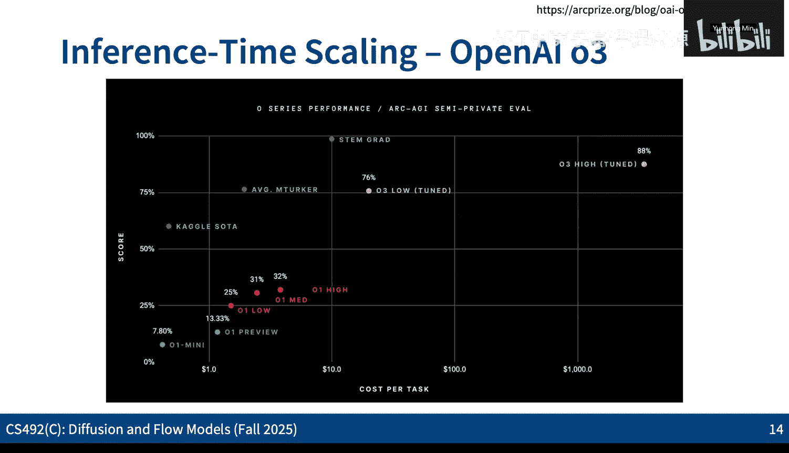

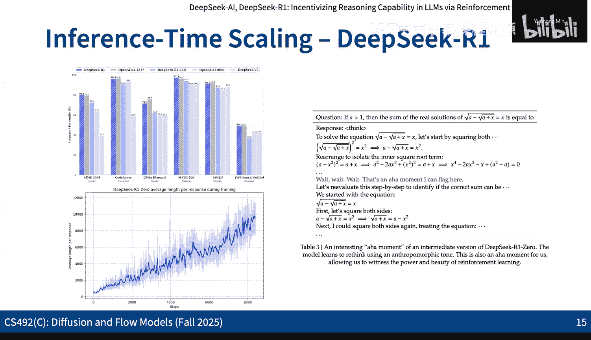

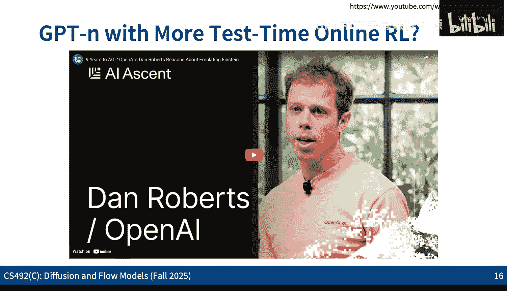

我们可以定义一个新的目标分布 `p*(x)`：
`p*(x) ∝ p(x) * exp(λ * R(x))`
其中 `λ` 是一个权衡参数，控制我们对奖励的重视程度。

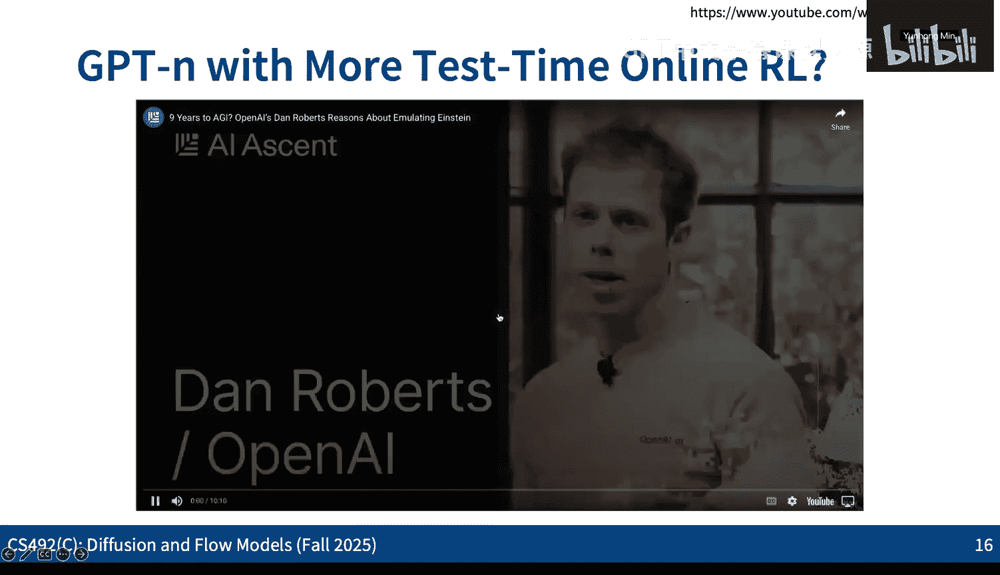

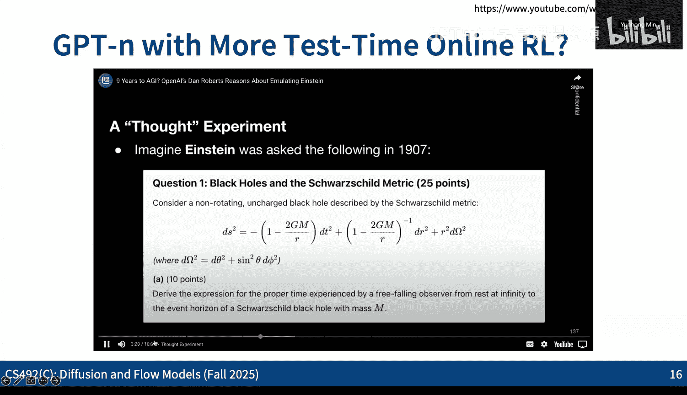

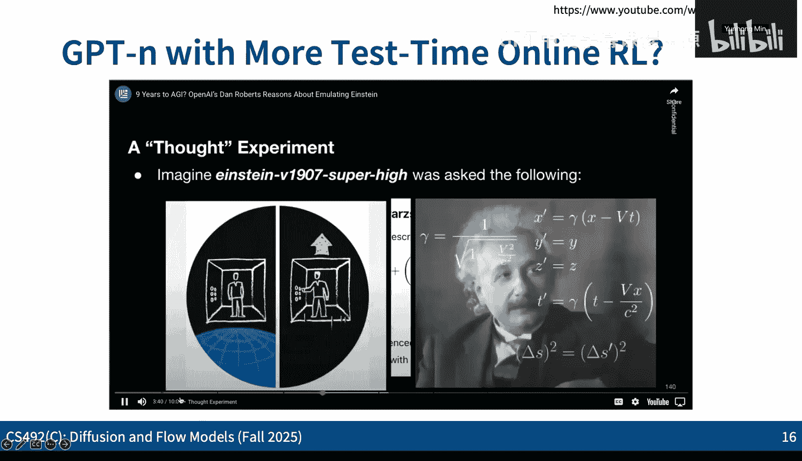

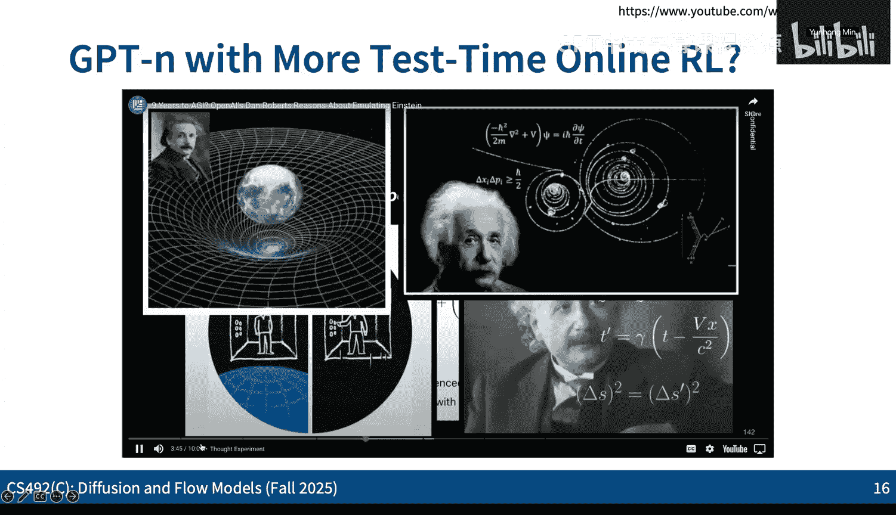

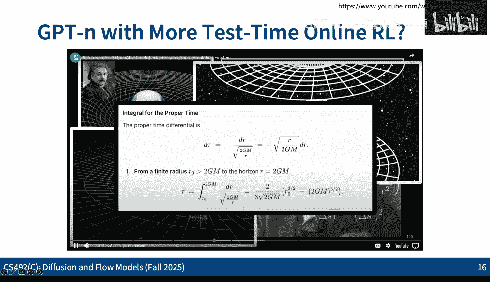

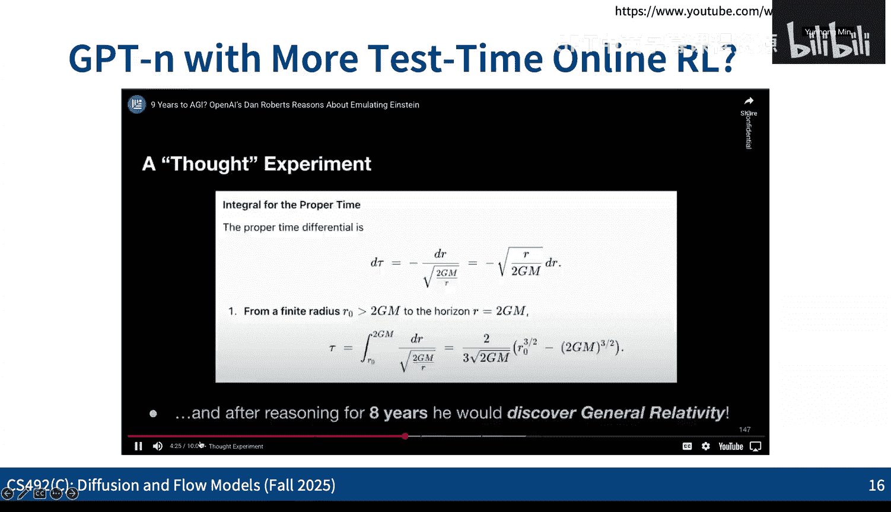

我们的目标是从这个新分布 `p*(x)` 中采样。对于扩散模型，我们需要推导出对应于 `p*(x)` 的中间时间步 `t` 的分数函数。经过一系列推导和近似（关键的一步是使用Tweedie公式来近似最优价值函数），我们可以得到引导后的分数函数：
`∇ log p_t*(x_t) ≈ ∇ log p_t(x_t) + λ * ∇ E[R(x_0) | x_t]`
这恰好与DPS的更新公式一致：原始分数加上奖励函数关于期望最终输出的梯度。

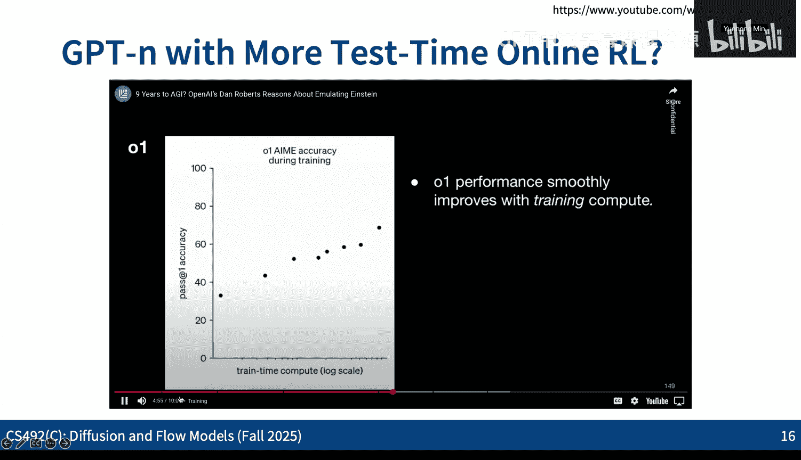

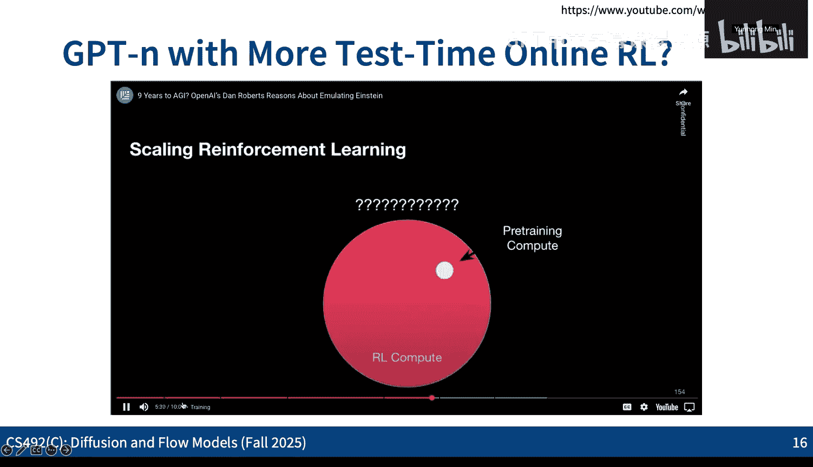

**结论**：DPS方法可以理解为在推理时，通过梯度上升来从奖励修正后的分布 `p*(x)` 中进行采样。这为该方法提供了一个基于最优化的理论解释。

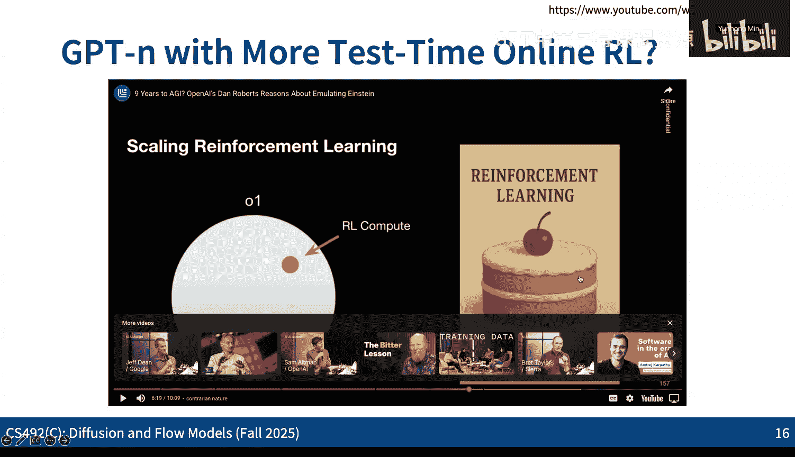

## 应用扩展：定义你的奖励函数 💡

理解了通用框架后，关键在于如何为你的任务定义合适的奖励函数 `R(x)`。以下是一些可能的方向：

*   **图像生成**：除了重建损失，可以是美学评分、与文本描述的匹配度、特定物体数量等。
*   **运动生成**：避免与环境碰撞、符合物理规律、动作流畅度等。
*   **分子生成**：具有特定的结合位点、满足化学稳定性、高生物活性等。
*   **跨模态生成**：利用预训练的2D图像扩散模型生成3D纹理或全景图。此时，奖励函数可以强制不同视角或图像块在重叠区域保持一致。

**核心思想**：只要你能将引导目标表达为一个（至少近似）可微的函数，就可以将其作为 `R(x)` 嵌入到DPS框架中，在推理时引导预训练模型生成新颖的内容。

## 处理非可微奖励函数 🧩

然而，许多有用的评估标准是不可微的，例如“图像中恰好有5只猫”、“生成的代码无编译错误”。对于这种情况，我们可以回到“提议者-验证者”范式的本质。

一个最直接的方法是**采样-筛选**：用扩散模型生成大量样本，然后用不可微的验证者（如目标检测器、编译器）选出最好的一个。但这需要运行大量完整的生成过程，效率低下。

更高效的方法是引入**过程奖励** 和**树状搜索**。在扩散生成的过程中，我们可以在中间步骤 `t` 进行分支，生成多个可能的未来轨迹。利用过程奖励（例如，在生成中途预估最终奖励，或检查部分条件是否已满足）来评估这些分支，剪枝掉不理想的，并继续探索有希望的分支。这类似于LLM中的思维树搜索。

对于扩散模型，一个优势是即使在中间步骤 `x_t`，我们也可以利用Tweedie公式估计出期望的最终输出 `E[x_0 | x_t]`，从而可以近似计算任何针对最终输出的奖励 `R(E[x_0 | x_t])` 作为过程奖励，无需专门设计。

## 前沿应用示例 🚀

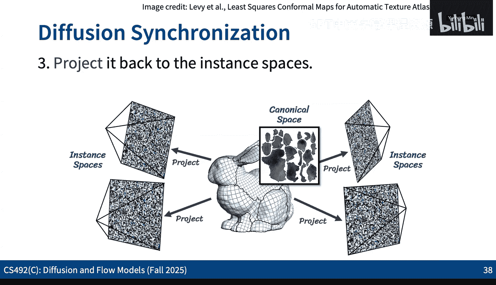

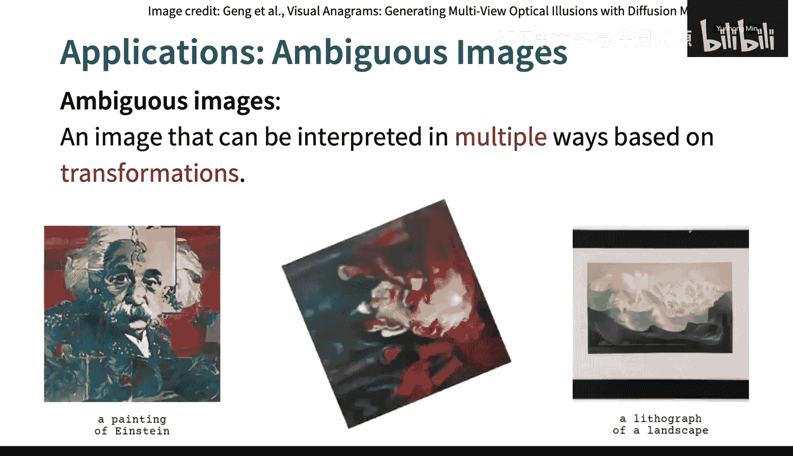

基于上述技术，研究者们实现了一些传统方法难以完成的任务：

*   **精确属性控制**：生成包含**确切数量**物体（如“82个蓝色气球”）的图像，通过定义计数奖励来实现。
*   **复杂文本对齐**：生成与复杂、精确描述（如“一把没有靠背的椅子”）高度一致的图像，利用大型语言模型作为验证者提供反馈。
*   **生成画中画与无限缩放**：通过同步多个生成“窗口”的扩散过程，并强制重叠区域一致，可以创建无缝的全景图、360度图像甚至无限缩放动画。

## 总结与展望 📚

本节课我们一起深入探讨了推理时引导生成技术。

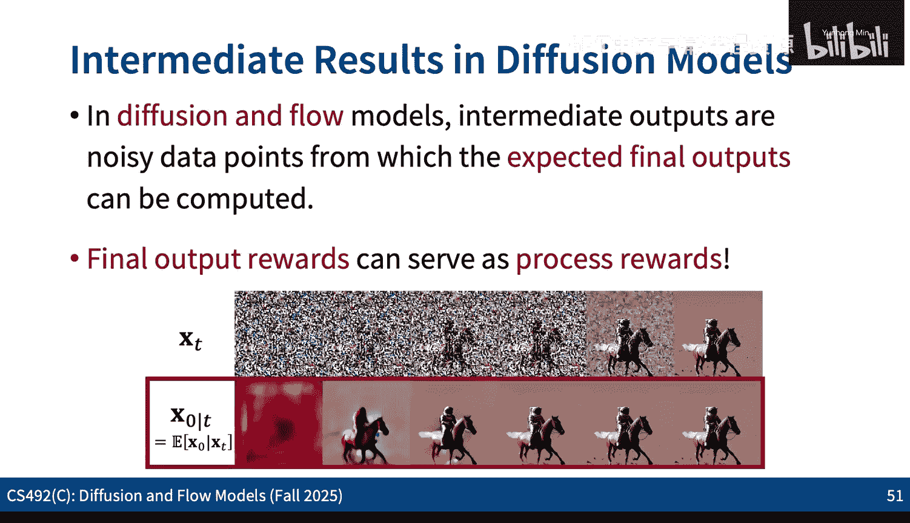

1.  **理论框架**：我们将DPS方法置于一个更通用的“奖励最大化”框架下进行理解，其核心是通过梯度操作从奖励修正后的分布中采样。
2.  **核心扩展**：关键在于为具体任务设计合适的可微奖励函数 `R(x)`，从而将用户意图注入生成过程。
3.  **应对挑战**：对于非可微的奖励，我们介绍了基于“采样-筛选”和“过程奖励树搜索”的策略，以提高引导的效率和能力。
4.  **强大应用**：这些技术使得用预训练模型完成精确属性控制、复杂文本对齐和跨模态生成（如2D到3D）成为可能。

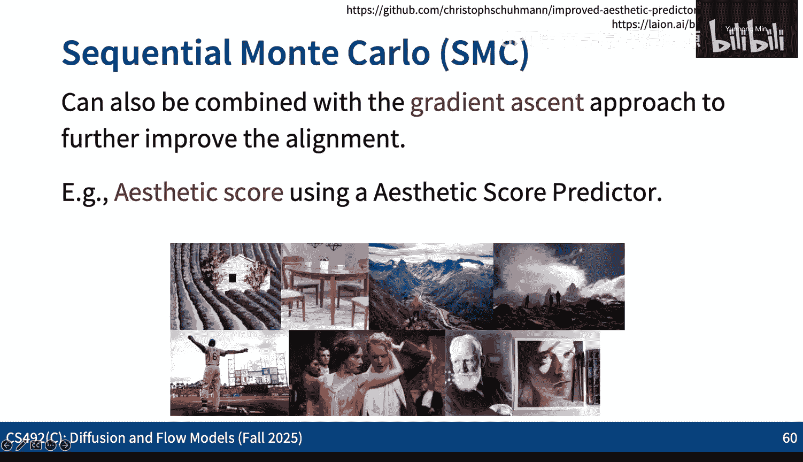

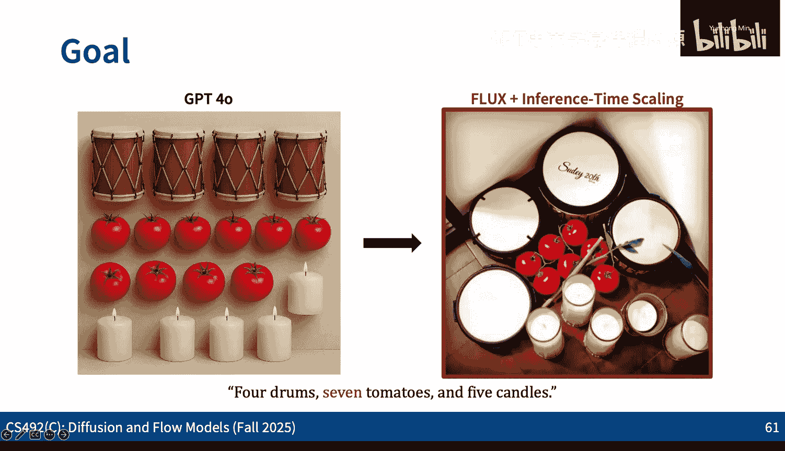

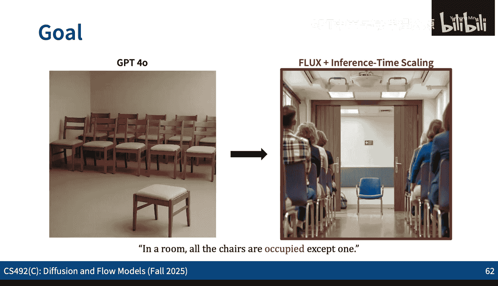

推理时计算正成为提升AI模型性能的关键范式。对于扩散模型，通过巧妙地设计验证逻辑（无论是可微的奖励函数还是不可微的筛选器），我们能够在无需重新训练的情况下，极大地扩展预训练模型的能力和应用边界。这为轻量级、高效率的AI应用开发打开了新的大门。