# 扩散和流模型：P15：嘉宾讲座2 - Philipp Henzler (3D生成模型综述)

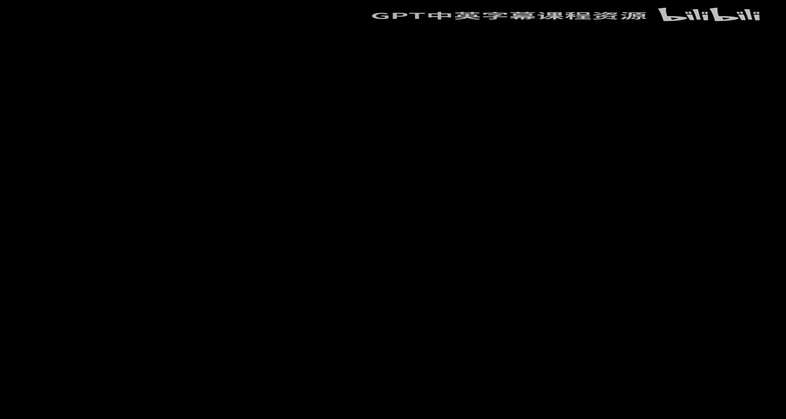

在本节课中，我们将跟随Philipp Henzler的讲座，系统性地学习3D生成模型的发展脉络、核心方法以及未来挑战。我们将从早期方法开始，探讨如何结合强大的2D生成模型来高效地创建高质量、可控的3D内容。

---

## 个人背景与研究历程

我自2018年攻读博士学位以来，一直致力于3D重建与生成领域的研究，主要方向是自监督3D重建和外观建模。

此后，领域发展非常迅速。我在2022年加入谷歌，从事生成式3D重建和生成式3D重写工作。随后，视频模型的兴起改变了研究格局和可能性边界。

我们领域的进展如此之快且令人印象深刻，以至于借助生成式AI的3D重建方法已经能够大规模应用。因此，我们谷歌的团队成功将部分研究成果转化为产品。我们首先专注于重建鞋子，利用图像模型辅助3D重建，并将其应用于谷歌购物。后来，我们开始研究视频模型，这帮助我们扩展到了谷歌购物上的任何物体类别。

过去几年的进展令人无比兴奋。在今天的讲座中，我将讨论3D生成方法，并探讨如何将其与生成式视频模型联系起来。

---

## 什么是生成式3D模型？

首先，我们来定义什么是生成式3D模型。

其核心是一个系统，它接收如文本提示或图像等控制输入，并利用生成模型来产生一个3D表示。

然而，为了在屏幕上实际看到3D模型的内容，必须将其渲染成2D图像。

早期的3D生成建模工作始于2016年，使用生成对抗网络。那是一个纯粹的生成模型，具有噪声潜变量，然后被训练用于通过3D判别器产生三维体素。

这种方法对输入没有特定的控制，并且训练需要3D真实数据。

后续的一些工作，如PlatonicGAN，通过添加可微分渲染器和2D判别器，消除了对3D真实数据的需求，从而解决了3D数据问题。

这使得模型能够直接在互联网数据上进行训练。PlatonicGAN还引入了图像编码器，以实现从单张图像进行3D重建。

基于图像重建的思想，像PixelNeRF这样的工作专注于多视角输入。其核心是聚合来自多个输入图像的编码，将它们融合成一个以NeRF形式存在的单一、一致的3D表示。

以上提到的所有方法都有一个共同点：它们都直接预测一个三维一致的、显式的3D表示。

这具有显著优势，因为一旦拥有了3D模型，就可以从任何视角渲染模型，这非常快速且廉价。这使得它非常适合实时应用或手机、平板等移动设备。

但缺点是，这些结果的整体质量相当低。

---

## 为何早期3D生成质量受限？

那么，我们或许应该问自己：为什么质量低？如果我们回想一下Richard Sutton的教训，答案可能在于两个限制性假设。

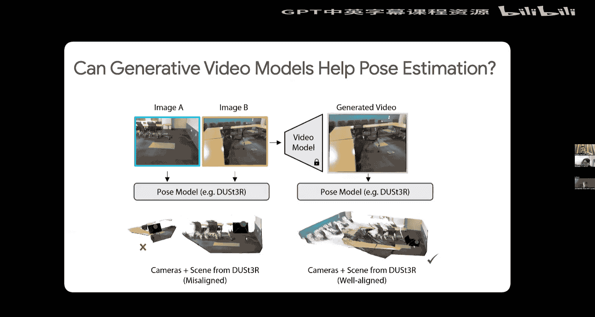

第一，高质量的3D数据非常稀缺。
第二，我们不应该使用任何强归纳偏置，例如在我们的案例中就是渲染。

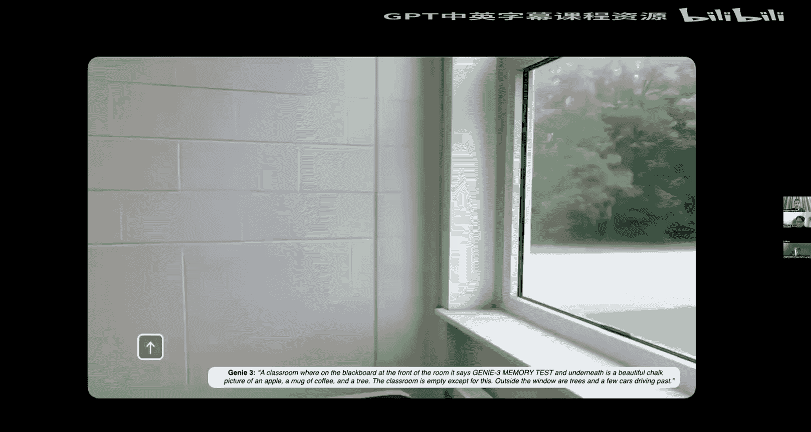

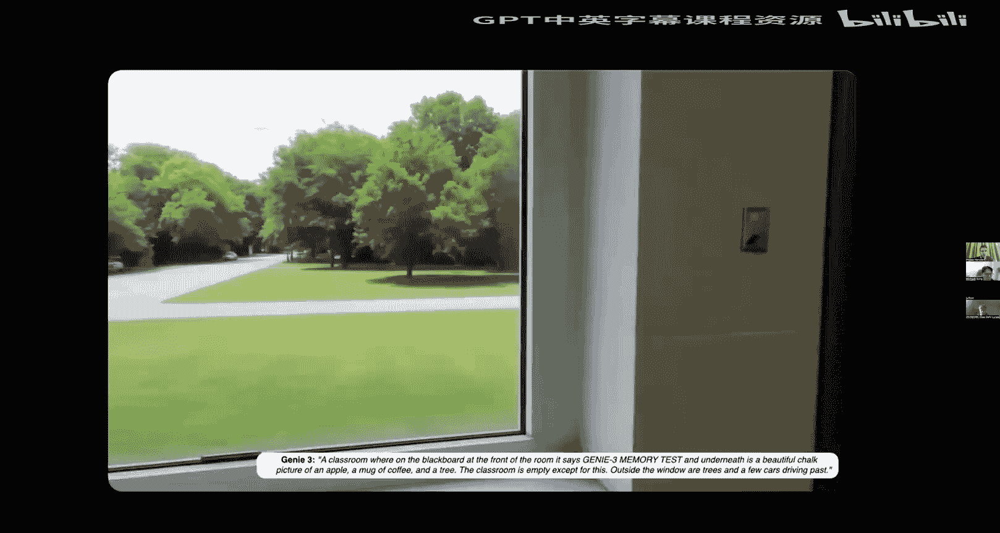

另一方面，如果我们观察2D生成模型，如图像或视频模型，我们会意识到这些模型实际上可以随数据规模扩展，因为互联网上有数十亿的2D图像或视频。此外，这些模型的归纳偏置有限，因为它们直接产生2D像素。

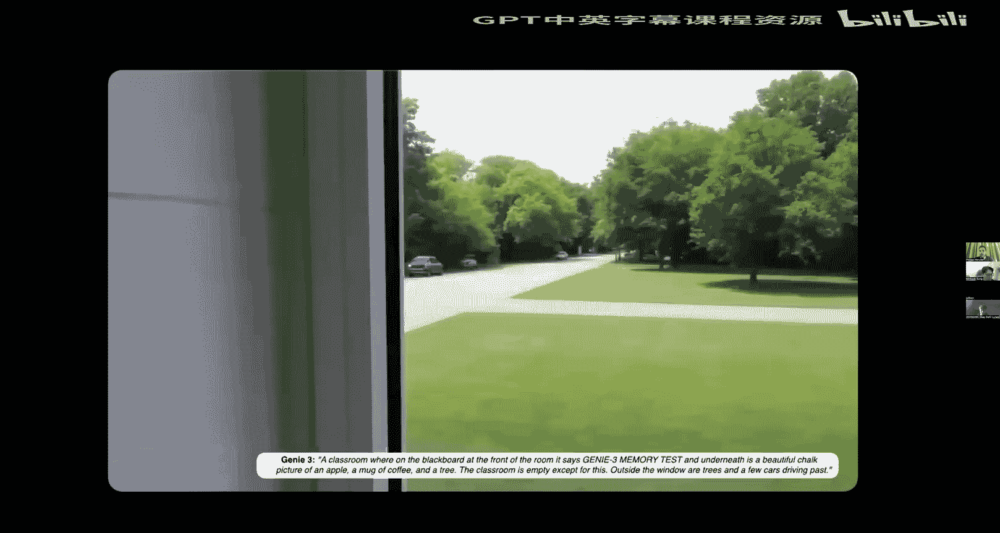

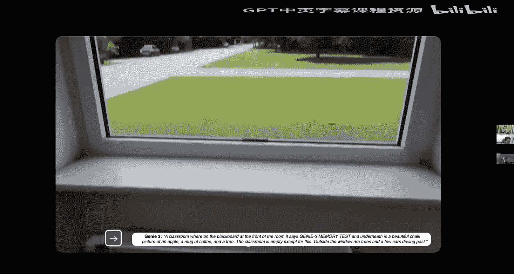

多年来，随着计算资源的增加，这些模型变得越来越好。我们可以用更大的模型和更多的计算资源来训练它们。

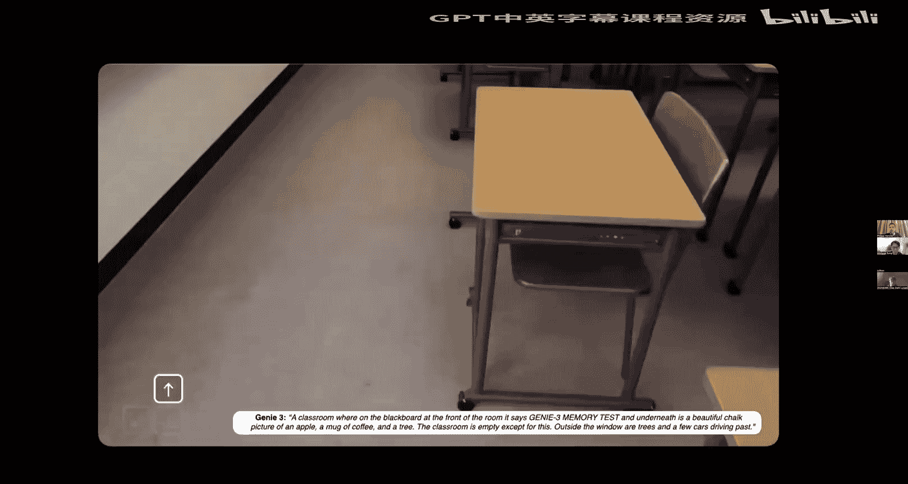

但问题是，这些视频模型产生的输出是否真实，更重要的是，是否物理正确？

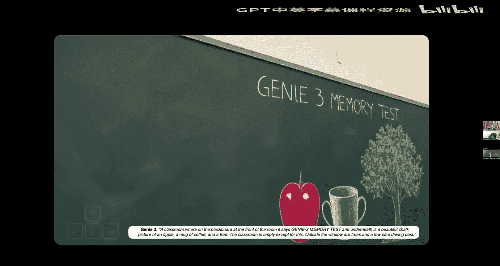

在我们最近的一项工作中，我们感兴趣于探索这个方向，并想了解视频模型对3D的理解程度如何。

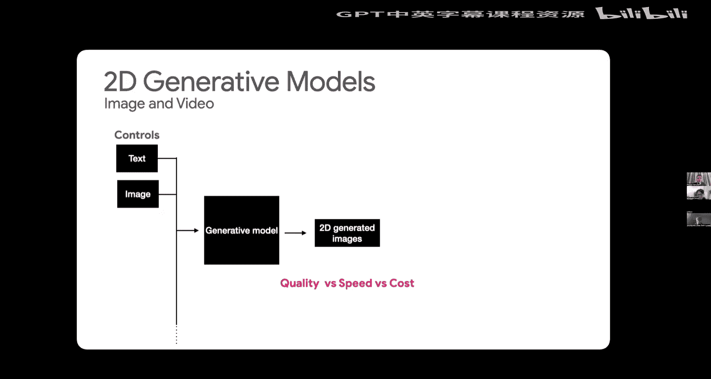

---

## 视频模型对3D物理世界的理解

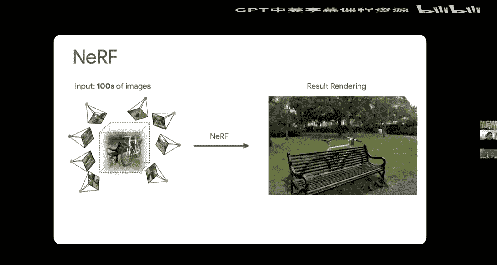

为了回答这个问题，我们研究了视频模型理解姿态的能力。

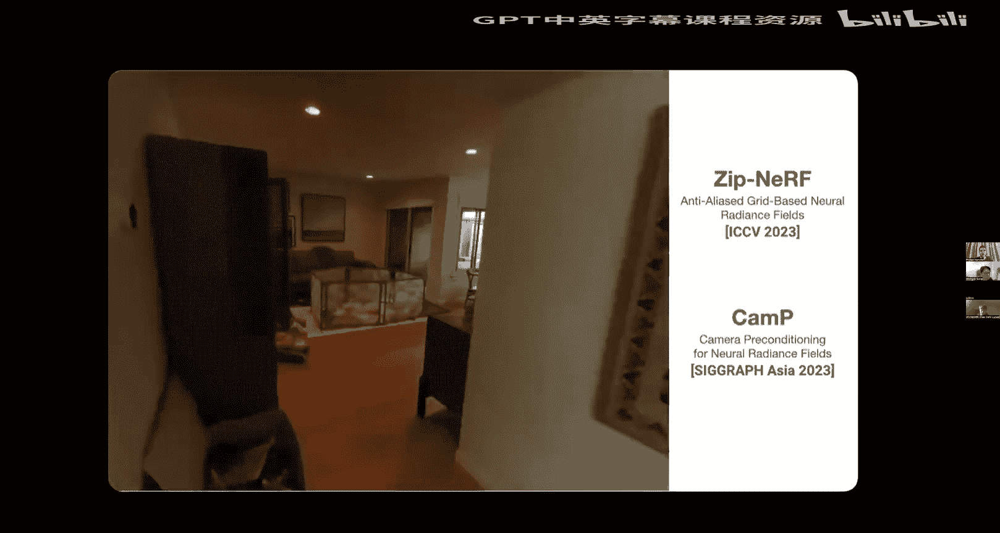

如图所示，对于重叠很少的场景图像A和B，我们运行一个现成的姿态估计模型来预测相机姿态。

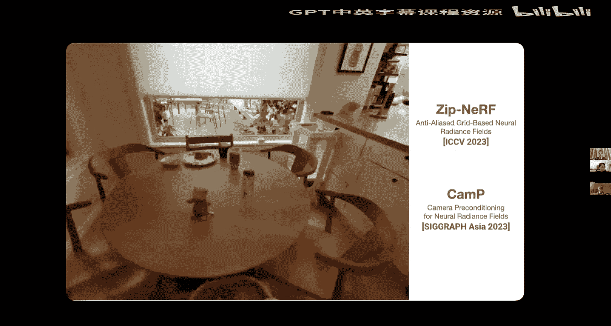

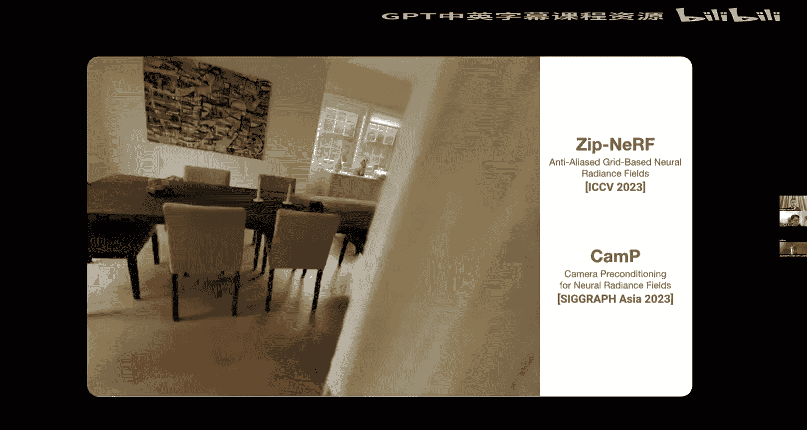

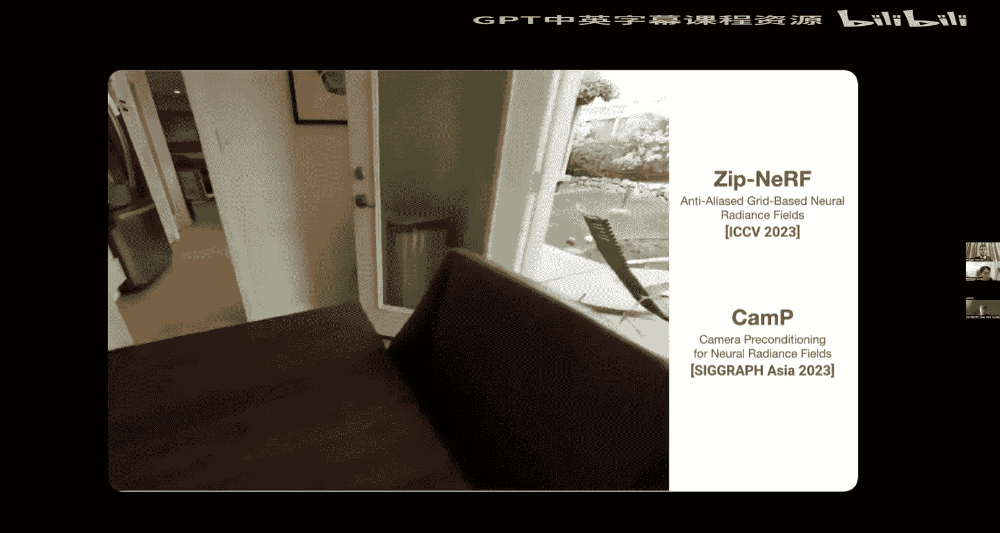

我们知道，依赖视觉对应关系的现成姿态估计器很难准确预测姿态。

为了找出视频模型是否能理解两张图像之间的姿态，我们使用了几个视频生成模型来插值连接这两张图像的视频。

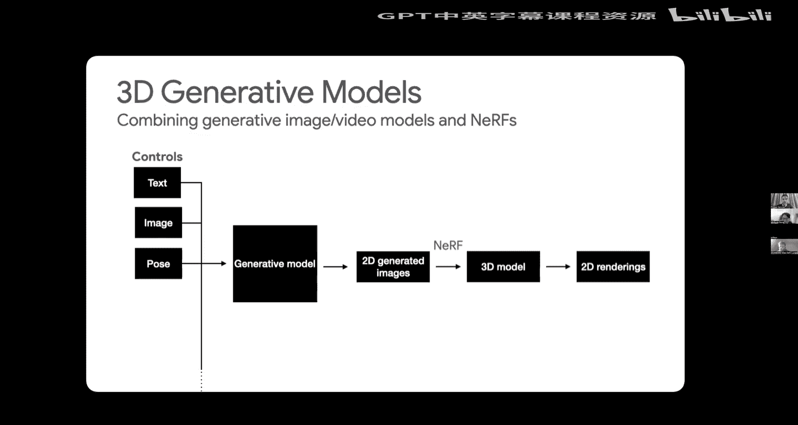

假设视频模型能够理解两张图像之间的姿态，它应该生成一个在输入图像之间物理正确的路径。

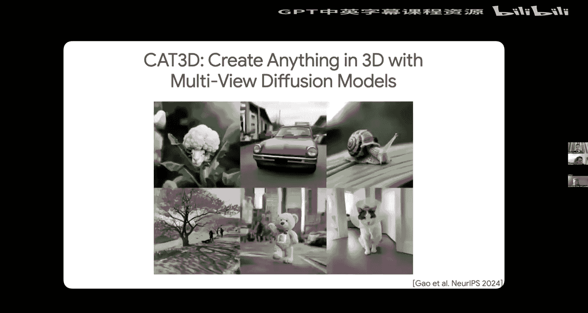

为了验证这一点，我们将额外生成的图像与两张输入图像一起输入给这个现成的姿态估计器，并检查姿态估计是否有所改善。

我们发现情况确实如此，来自视频模型的这些额外生成的帧实际上增强了姿态估计。

因此，这意味着视频模型能够正确地隐式建模物理世界。

如果我们观察最新的视频模型，我们可以确信这些模型能产生高度真实的结果。例如，这里展示的视频是由V3模型生成的，它展示了多样的相机运动、场景运动以及高度真实的物理效果。

此外，像Genie3这样的交互式视频模型已经允许我们在3D世界中导航。如图所示，我们不仅仅是在观看一个片段，而是可以主动地在教室中穿行。这里的每一次按键，如前进、左转、右转，都会提示模型生成新的帧，我们可以自由地从不同视角导航，最终走向窗户并向外看。

这里的关键部分是，当我们转身时，教室看起来和之前一样，它实际上保持了一致性。

---

## 为何仍需显式3D建模？

那么问题来了：如果这些纯粹的2D视频模型已经如此出色，我们为什么还需要显式地建模3D？显式建模3D的论据是什么？

答案是，虽然这些视频模型可以随数据和计算规模扩展，但其推理成本也随之上升，这目前阻止了我们在手机和平板电脑上部署这些模型。

我们如何克服这个问题？

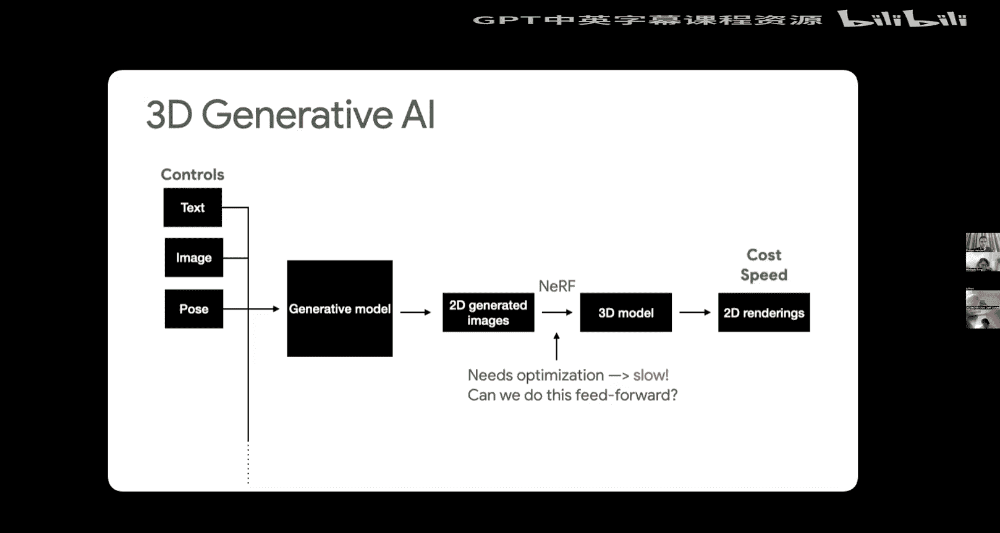

---

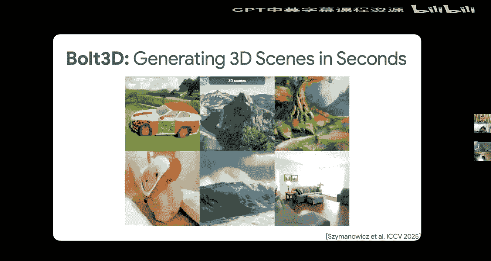

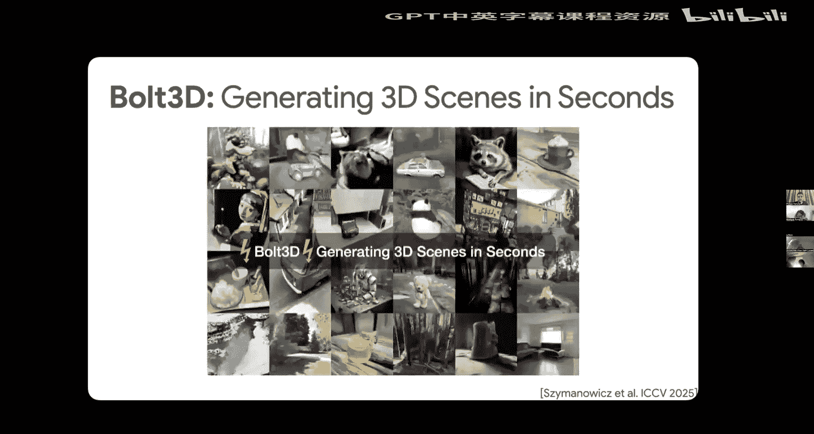

## 结合2D生成与3D重建的优势

从3D的角度来看，我们已经知道像NeRF这样的工具，可以在给定数百张图像的情况下对3D内容进行建模。

一旦我们有了数百张图像，我们就可以以极高的细节捕捉3D场景，从而允许我们以任意新视角进行渲染。与图像和视频模型相比，这可以以非常低的成本实现。

让我们看一个例子。这里是一个大型复杂场景的飞览，它是一个拥有多个房间和大花园的房子。重要的是，这实际上是完全交互式的，意味着我们可以任意控制相机，选择任何我们想要的视角。

然而，这个场景主要是通过从不同视角捕获这座房子的许多图像生成的。

好消息是，我们似乎有两块可以组合的拼图。一方面，我们有生成图像和视频模型，可以产生高度真实的2D图像；另一方面，有NeRF模型，可以将这些图像提炼成高效的3D表示，从而可以高效地部署和渲染。

这正是我们在Cafe3D中探索的组合。

---

## Cafe3D：结合生成与重建

Cafe3D是一种可以接收文本提示、单张图像或多张图像，并生成3D场景的方法。

让我们更详细地看看这个方法。Cafe3D首先接收输入：观察视角，其中包含输入图像和相应的相机参数。

然后，我们使用预训练的VAE将图像编码为图像潜变量。同时，姿态和相机信息被编码成每个像素的光线图，它基本上只包含每个像素的光线信息，简单来说就是每个像素的原点和方向。

模型也接收新视角。对于这些视角，我们实际上没有输入图像。因此，我们向模型传递一个噪声潜变量来代替编码的潜变量，以及姿态信息。

为了帮助区分观察视角和新视角，我们还输入一个掩码，告诉模型哪些视角是观察到的，哪些不是。

模型的输入可以是这两种不同类型输入的任意混合。模型以完全相同的方式处理它们。这只是一个可能已知或未知于模型的大型视角集合。

模型接收所有这些信息，然后简单地为一组指定的目标视角生成一组新的视角。

我们在一个大型的姿态多视角图像数据集上训练这个模型，因此它被监督以同时产生多个一致的帧。由于这个模型在所有不同帧之间存在张力，我们实际上可以获得非常一致的样本。

一旦我们的扩散模型训练完成，我们随后提出了一个两阶段设置来重建结果。如图所示，给定一些输入视角，我们使用多视角模型生成所需场景的密集视角集合。然后，我们简单地使用一个相对标准的NeRF流程来重建这些视角。

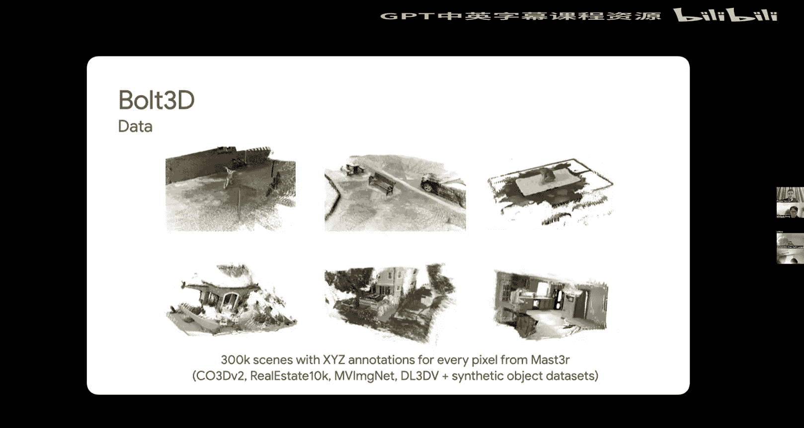

虽然我们生成的样本并非完全3D一致，但它们足够一致，使得NeRF重建流程能够将它们整合成一个一致的3D输出。

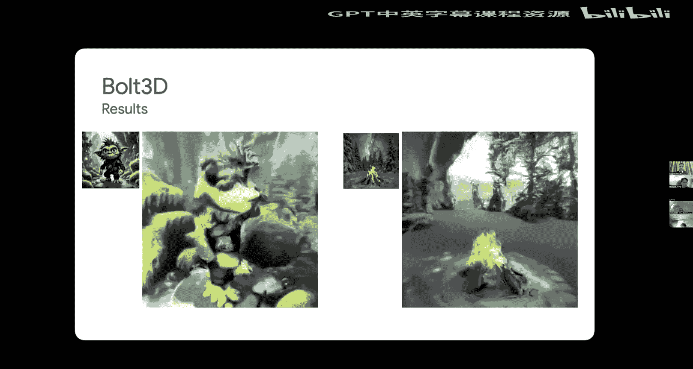

端到端，我们的方法能够在短短一分钟内，从任意数量的输入（如三张图像甚至单张图像）生成完整的3D场景。

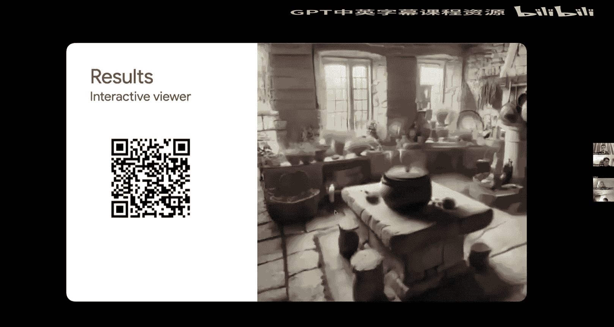

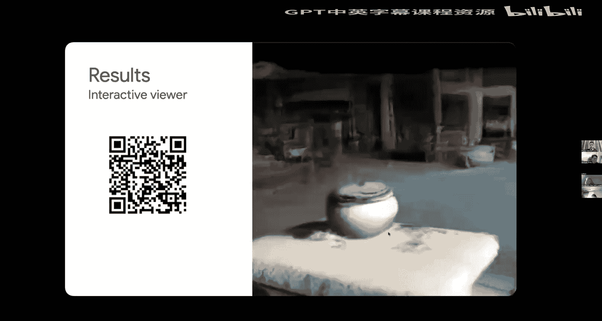

---

## 迈向前馈式3D生成：Both3D

回到我们的概述，我们看到可以使用像NeRF这样的3D方法结合生成式3D模型，来生成快速且廉价渲染的3D模型。

然而，在这个循环中有一个优化步骤，这仍然是推理速度的瓶颈。我们问自己：能否用前馈模型取代这个优化步骤？

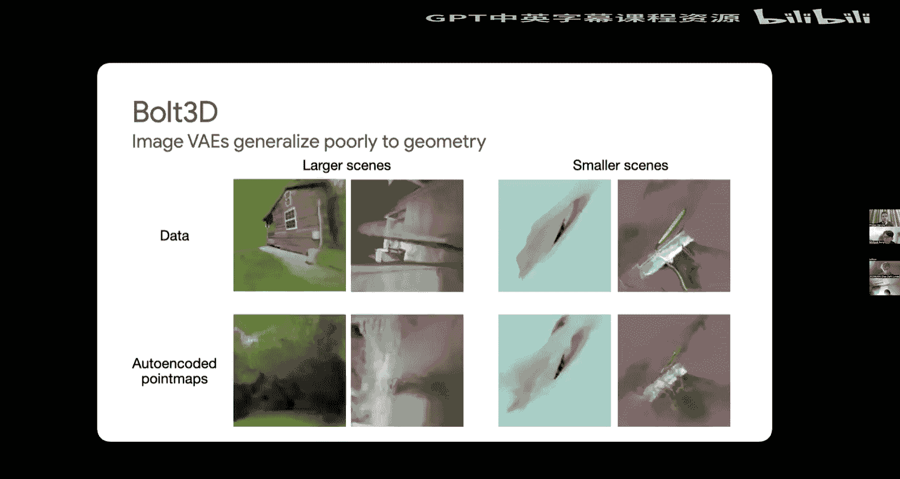

这个问题的答案由另一项工作给出，称为Both3D。

Both3D让你在单个GPU上不到七秒内生成3D场景。

让我们看看我们是如何实现这一点的。

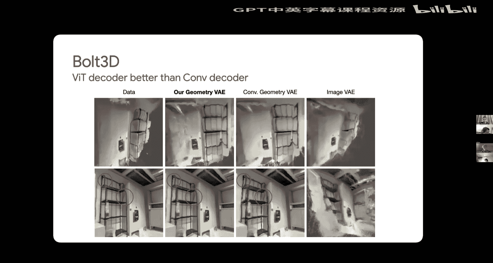

这里的核心思想基于Splatting Image，其目标是在给定单张图像的情况下重建每个像素的高斯点。然而，这种方法纯粹基于重建，无法处理场景的任何未见部分，因为它不是生成模型。

然而，在Both3D中，我们提出也使用图像来表示3D场景，但我们提出的是一个生成式流模型，而不是重建模型。

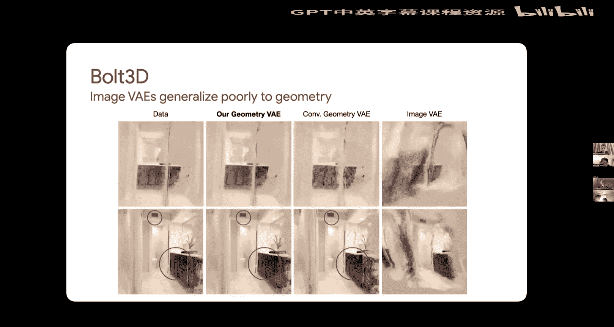

与Splatting Image相比，Both3D允许我们幻觉出场景的未见区域，因为我们实际上提出了一个生成模型。

在Both3D中，生成过程由两部分组成。

首先，我们有一个潜变量扩散模型，它以图像和点云图的形式生成多视角外观和几何。如果我们回顾Cafe3D，Cafe3D只预测RGB潜变量，而在这里我们额外有点云图潜变量。

然后，在第二部分，一个高斯头部在给定图像和点云图的情况下，联合回归3D高斯的其余属性，即它们的尺度和不透明度。

高斯的输出是多视角的Splatting Image，其中包含共同代表整个3D场景的3D高斯。

采用这种两阶段流程的原因——首先生成RGB颜色和XYZ位置，然后预测不透明度和尺度——在于我们可以稳健地获得多视角数据集中外观和点云图的监督。

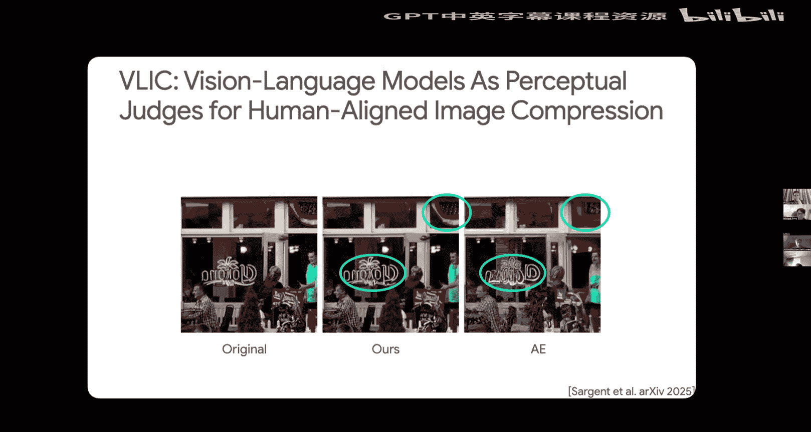

为了获得位置的监督，我们只需在现有的多视角数据集上运行结构运动流程，这非常稳健。然而，要获得像素高斯不透明度和尺度的优质监督并不容易，因此训练扩散模型来输出它们并非易事。此外，最近的一项工作表明，在给定颜色和位置信息的情况下，回归不透明度和尺度比生成它们要容易得多。

这解释了我们首先训练RGB和XYZ的生成模型，然后回归剩余属性的设计选择。

让我们更仔细地看看我们是如何做到这一点的。生成过程是使用外观和几何的多视角潜变量扩散模型实现的。

与Cafe3D类似，模型的输入是一组场景的观察视角和未见视角。观察视角包含干净的RGB潜变量，以及这次还有一个噪声的几何潜变量和观察视角的相机姿态。未见视角包含噪声的RGB潜变量、噪声的几何潜变量以及目标视角的相机姿态。与Cafe3D相比，这里我们额外为观察和未见视角都提供了几何潜变量。

然后，扩散模型输出一组图像和几何潜变量，为每个视角对输出一对。

随后，图像和几何被独立解码为全分辨率的RGB和XYZ图像。

这里的一个见解是，简单地使用现成的RGB自编码器来编码点云图会导致非常低质量的重建。我现在不深入细节，但我们稍后会讨论几何自编码器。

接下来，我们训练一个多视角高斯头部，它接收所有预测的每视角点云图和RGB图像，以产生一组Splatting Image。这意味着我们将每个视角转换为高斯。在这里，所有视角之间的交叉注意力非常重要，这样网络可以共同推理所有这些Splatting Image，以确保3D一致性。

最后，我们可以渲染这些图像来查看最终输出。

为了训练这个模型，我们创建了一个大型的3D场景数据集，并在CO3D、RH0K、MVMageNe和DL 3DV的所有场景上运行了最近的结构运动流程。这是必要的，以便我们所有的数据为每张图像都有密集的XYZ标注，使这些数据适合扩散模型训练。结合合成物体数据集，这使我们能够在大规模数据集上训练我们的生成器。

让我们看看一些结果。这里我们看到两个仅凭单张图像就忠实重建的场景，我们还可以看到模型实际上可以幻觉出未见区域。

我们还在项目网页上有更多例子，甚至有一个交互式视图，你可以实时探索我们的场景，请自行查看。

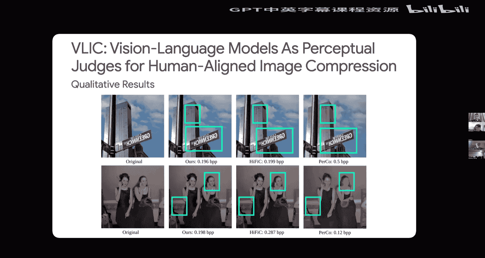

---

## 几何自编码器的挑战

现在我想更详细地讨论几何自编码器，因为学习用潜变量扩散模型处理几何被证明最初异常困难。我们发现，为图像自编码预训练的VAE并不真正适合几何自编码。

我们发现无论场景规模大小都是如此，但我实际上观察到对于更大的场景，我们会得到更灾难性的失败。

这可能是因为压缩图像的目标并不真正适合压缩几何，例如，感知损失对几何来说没有意义。

另一个原因是数据的尺度，因为输入图像总是在0和1之间，但这对于几何来说很少见。

另一个有趣的见解是，我们发现用于XYZ数据的VAE解码器实际上需要是一个Transformer。尽管在数量上卷积解码器的表现与Transformer解码器相似，但当你实际观察卷积解码器的结果时，它会导致感知上令人不快的伪影，比如无法保持直线，正如你在这张幻灯片上看到的那样。

这些伪影也可以在一系列场景中看到，包括这个浴室场景。由于为Both3D微调几何VAE至关重要，我也想与大家分享VAE领域的另一项工作，这是我们最近提交给CVPR的，所以你们实际上是第一批听到这项工作的人。由于它仍在评审中，让我们快速浏览一下VAE，然后我们将回到生成式3D。

---

## VLM作为感知评判的图像压缩

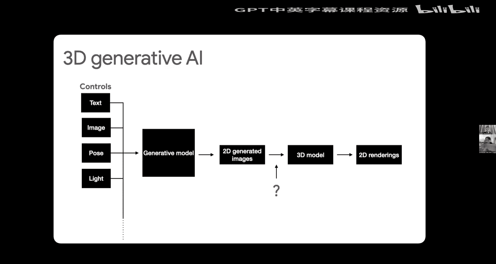

我将介绍的论文名为“视觉语言模型作为人类对齐图像压缩的感知评判器”。

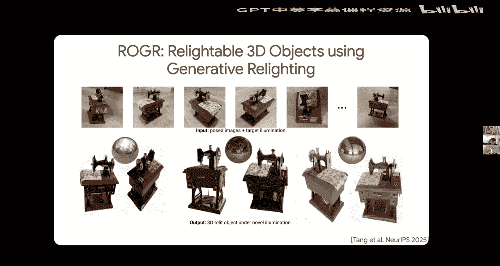

通常，当我们训练自编码器时，我们使用如PSNR或SSIM等损失函数，然而这些损失与人类感知的对齐度很差。例如，人类对人脸和文本的扰动非常敏感，但对自然纹理（如草或填充物）或其他模式（如本幻灯片所示图像右上角的旗帜或窗户上的文字）则不那么敏感。

为了解决这个问题，我们提出了一种方法，使用现成的视觉语言模型作为感知评判器，以改进当前的自编码器训练，使其更专注于人类对齐的图像压缩。

如图所示，我们的方法改进了窗户上的文字，如果你仔细观察，它也改进了旗帜上的图案。尽管在像素级别上并不完全正确，但我们的方法产生了一个在我们人类看来大致相同的旗帜图案。但如果你非常仔细地看，可以看到白点的位置实际上并不相同。我不确定你是否能通过Zoom看到这一点。但我们稍后可以在网页上看到这一点，一旦上传。

我们如何实现这样的效果呢？

让我们看看这个方法。这里的想法是，给定原始图像，我们使用扩散自编码器，并使用两个不同的噪声种子对原始图像解码两次，得到解码A和解码B。

然后，我们提示一个VLM来评估两个解码中哪个更受偏好。

基于VLM的响应，我们然后使用扩散DPO来改进扩散自编码器。

理论上，这里可以使用任何奖励函数来确定失败和成功的解码，但在我们的案例中，我们选择使用VLM来执行此操作，这是该方法的新颖之处。

让我们更详细地看看我们的方法。同样，给定解码A和B以及原始图像，我们提示网络分析来自自编码器的这两个不同样本。

然后，VLM的任务是产生一个介于-5和5之间的数值评分，指示重建A还是重建B更接近原始图像。这里负数意味着A更好，正如本例所示。

由于VLM容易产生幻觉，我们使用以下三种策略使我们的损失更加稳健。

首先，我们不仅以相同顺序输入A和B，还会反转输入图像到VLM的顺序。
其次，我们为A和B运行多个种子的VLM，然后将它们求和，以减少VLM输出的噪声。
第三，如前所述，我们也可以使用任何类型的度量标准来确定哪张图像更好。因此，对于第三个策略，我们额外使用LPIPS度量来确定哪个重建更准确。

如果VLM和LPIPS一致，我们则将评分传递给扩散DPO，否则我们直接丢弃样本。我们还分别测试了LPIPS和VLM偏好，虽然单独使用每种偏好方案都能改善结果，但将两种方案结合使用能带来最佳性能。

将我们的方法与其他竞争对手比较，我们可以看到我们的方法允许我们正确解码文本，如图所示。当我们观察背景中的建筑时，我们还可以看到它改善了窗户的高频纹理，更像是窗户的较小部分。此外，在底部的第二个例子中，我们可以看到我们的方法改善了人脸重建，正如你在这里看到的，如果你看右边的女人，以及背景墙上的图案。

我们还在多个数据集上定量评估了这种方法与多个竞争对手的比较。大多数方法都在不同的每像素比特数上训练，我们在这里没有表示为BPP。我们也以两种不同的BPP训练我们的方法，一个模型在0.07 BPP上训练，另一个在0.21 BPP上训练。

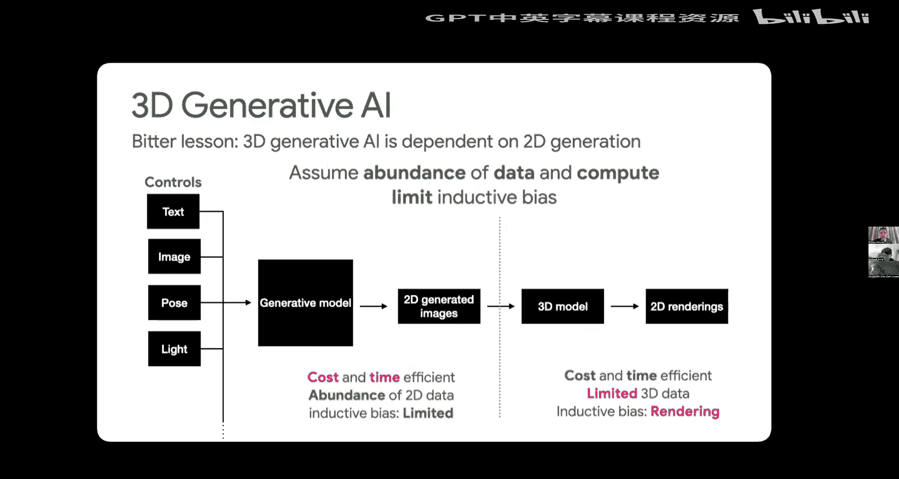

当我们查看数字时，我们的方法在PSNR上表现相当差，正如你在右侧看到的。我们的方法显示为蓝线，PSNR值越高意味着结果越好，但你可以看到我们的结果实际上有最低且最差的数值。但这实际上并不是我们的目标，我们更关心的是人类感知，因为这才是我们想要的。

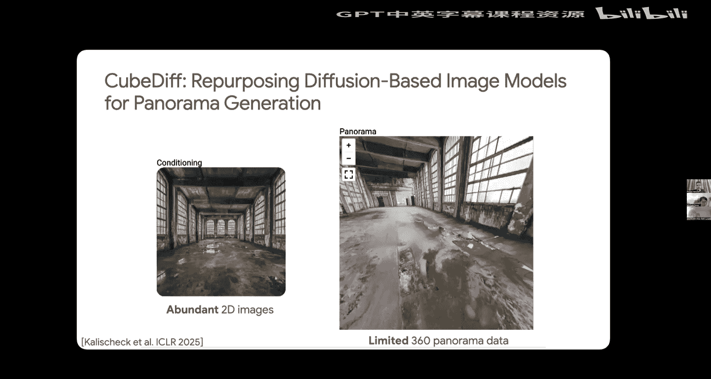

为了更清楚地了解这一点，我们还进行了用户研究，并为所有方法计算了eO分数。如图所示，我们的方法在MS Coco和Click 2020数据集上表现相当好。然而，与PO ELic方法相比，我们的方法在Click 2022数据集上表现不佳，这有点不幸，但很难说这是为什么，因为PO EL没有发布代码，而且Click 2022数据集也只包含30张图像，这也可能导致结果有噪声。

但观察其他感知度量，如FID、FID Dno和LPIPS分数，我们可以看到我们的方法实际上在所有方面都表现得相当好。

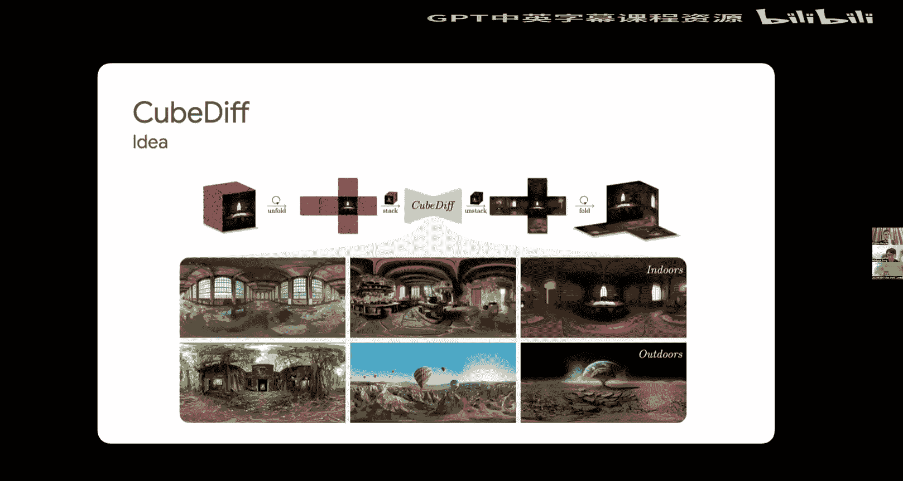

---

## 回到生成式3D

这结束了我们对VAE的快速浏览。虽然这并非直接专注于3D生成，但我非常有兴趣看到我们如何将类似于这里讨论的VLM后训练用于3D相关任务。

言归正传，让我们回到生成式3D。之前我介绍了Both3D，这是一种在给定2D生成图像的情况下以前馈方式生成3D场景的方法。

到目前为止，我们讨论了很多关于3D内容生成的内容，但对于内容创作来说，另一个重要因素是允许对输出进行细粒度控制。其中一种控制是光照。

在下一部分，我们将讨论如何为生成式3D模型启用光照控制。

---

## 可控光照：Roga

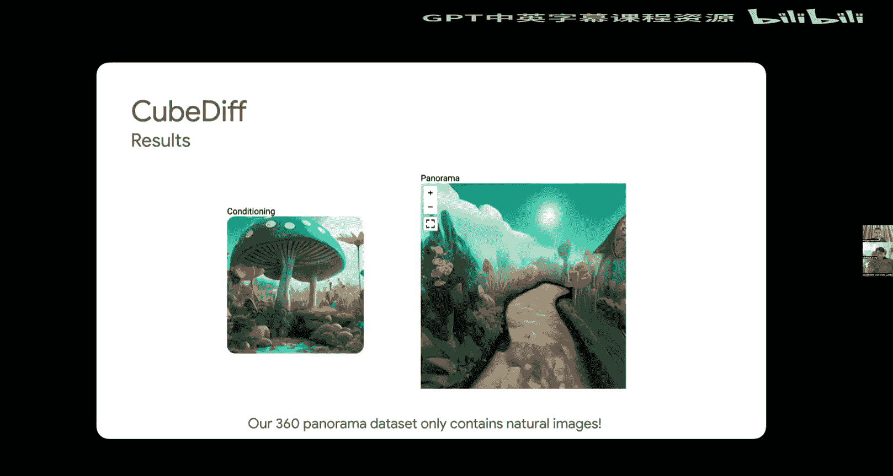

我们在名为Roga的方法中解决了这个任务。在这里，给定姿态图像和目标光照，目标是生成新光照下的3D重光照模型。

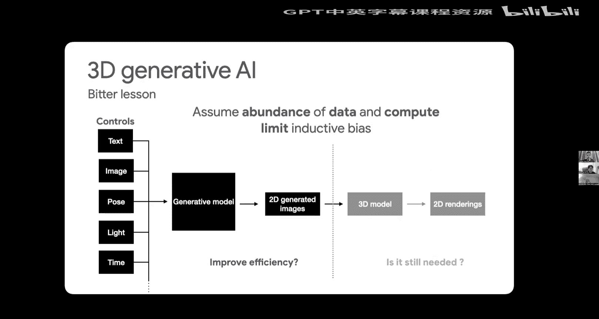

为了实现这一点，我们训练了一个类似于Cafe3D和Both3D中多视角模型的多视角重光照模型，但这次是针对重光照。不同之处在于，输入不仅是一组图像及其对应的姿态，还有光照条件。然后，我们训练这个模型为每个可用光照产生输入视角的重光照版本。

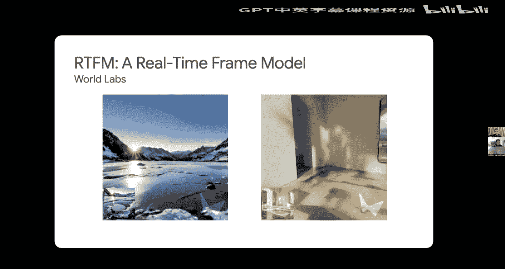

对于从1到M的每个可用光照，这个多视角模型的目标是产生一个n乘以M的重光照图像数据集，然后可以用作光照条件NeRF优化的数据集。

目标是重光照一个物体。这里有多种不同的光照，以便我们可以训练NeRF来适应目标光照。想象一下光照舞台，我们可以任意打开和关闭灯光。想法是，如果我们覆盖了足够多样化的不同光照集合，NeRF应该能够泛化到未见过的目标光照。

让我们首先从一个标准的NeRF设置开始，在这里我们为每个姿态i调节NeRF，并在对应于输入姿态的图像上计算渲染损失。

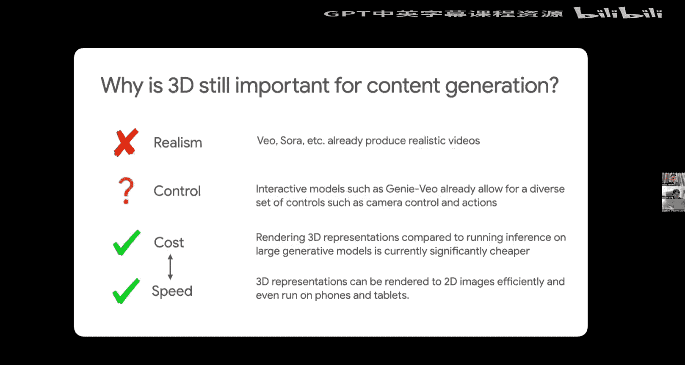

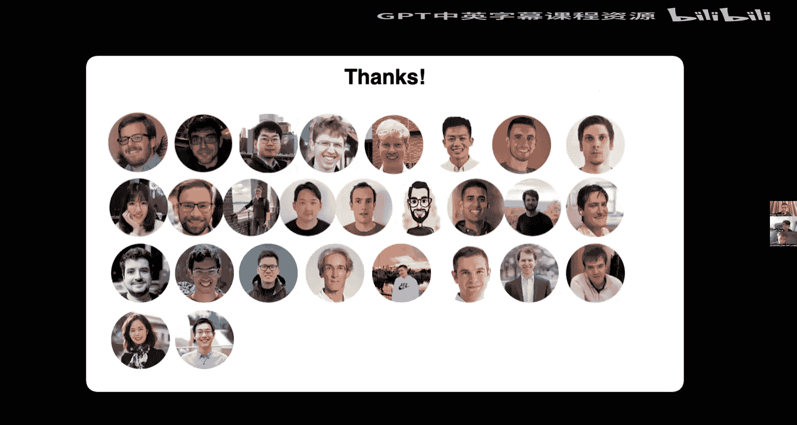

为了训练一个光照条件NeRF，任务是对输入光照进行编码，这样我们也可以输入光照作为