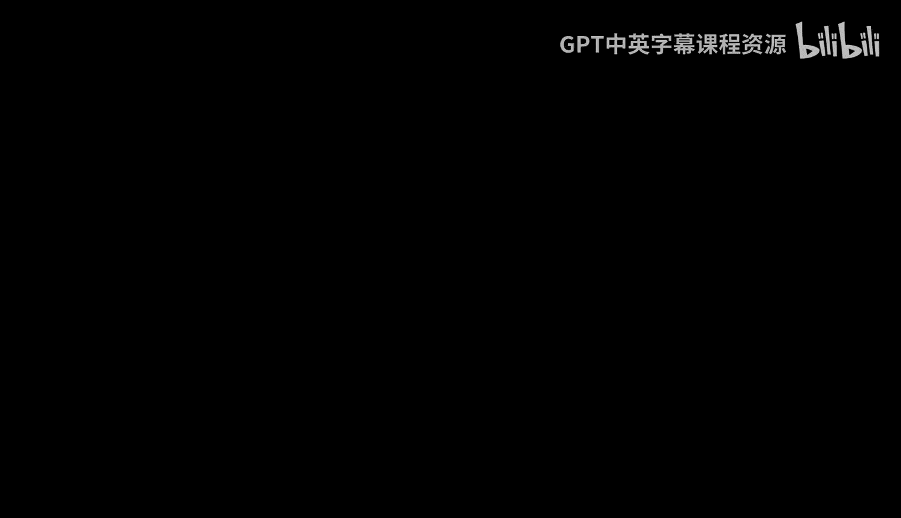
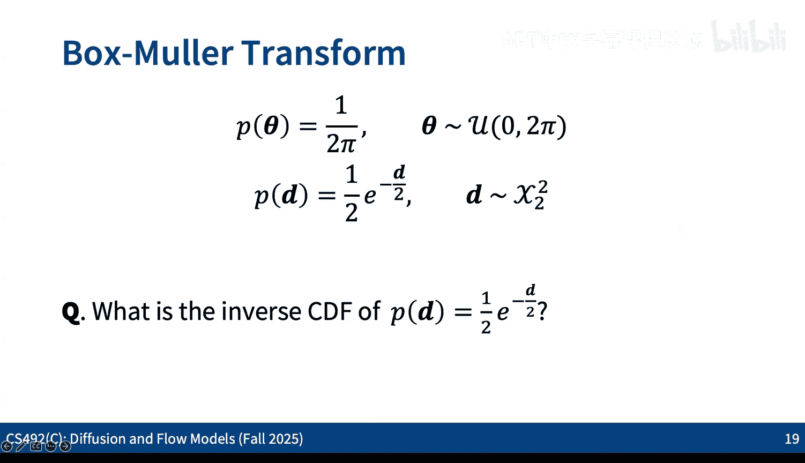
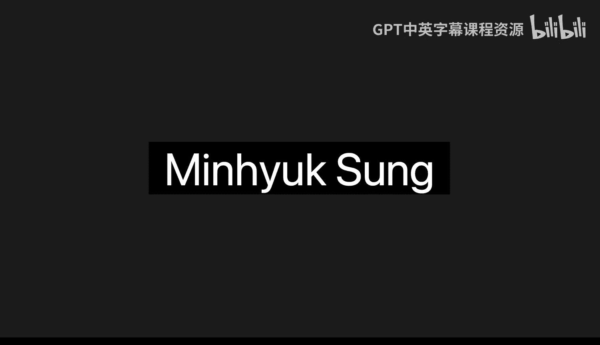
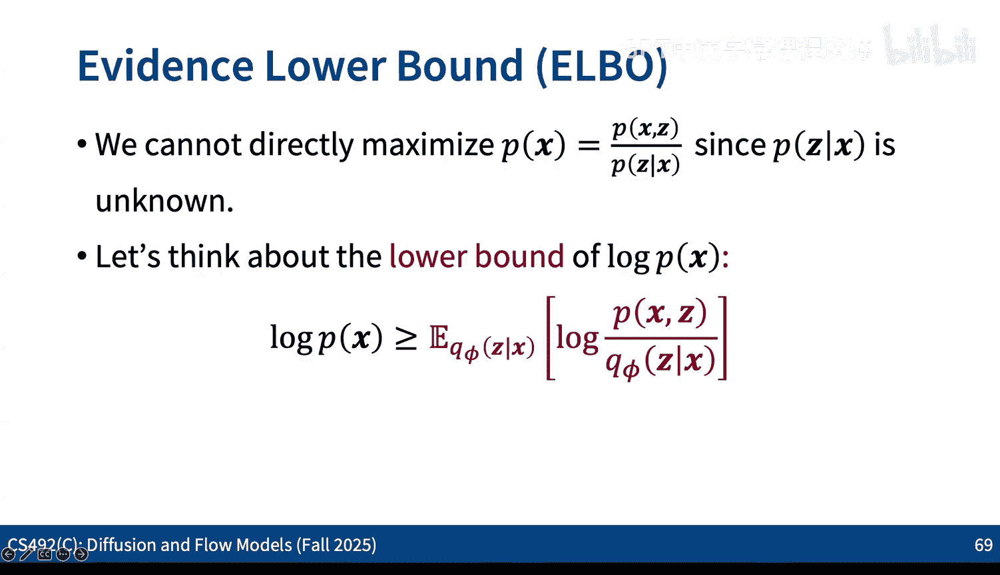

# 扩散和流模型：02：生成模型基础入门 🎯

在本节课中，我们将回顾生成模型的一些基础知识，特别是变分自编码器和生成对抗网络等经典思想，为后续学习扩散和流模型打下基础。

## 概述：生成模型的核心问题

生成模型的基本目标是：给定一个庞大的数据集（例如数十亿张图像），我们如何构建一个模型，使其能够生成与数据集中的样本相似，但又是全新的数据点？

为了简化问题，我们首先从统计学角度来理解它。我们将给定的数据点（例如2D空间中的点）视为来自某个未知的**潜在概率分布**的样本。生成模型的任务就变成了：如何从这个未知的分布中采样新的数据点。

## 从已知分布中采样

如果概率分布是已知的，并且形式简单，我们可以直接从中采样。以下是两种基本方法。

### 逆变换采样

这是一种基础的采样方法，适用于我们可以计算累积分布函数及其逆函数的情况。

以下是其核心步骤：
1.  对于给定的概率分布，计算其累积分布函数。
2.  从均匀分布 `U(0, 1)` 中采样一个值 `u`。
3.  计算累积分布函数的逆函数在 `u` 处的值，即 `x = CDF^{-1}(u)`，这个 `x` 就是来自目标分布的样本。

对于离散的类别分布，这个过程非常直观。对于连续分布，原理完全相同，只是需要处理平滑的累积分布函数。

### 处理高斯分布：变量变换法

然而，对于像标准正态分布这样的常见分布，我们无法直接写出其累积分布函数逆函数的闭式解。这时，我们可以使用**变量变换**的技巧。

以从二维标准正态分布采样为例：
1.  我们首先生成两个独立的标准正态分布样本 `(x, y)`。
2.  将其视为笛卡尔坐标，并转换为极坐标 `(r, θ)`。
3.  可以证明，转换后的变量 `θ` 服从 `[0, 2π)` 上的均匀分布，而 `r^2` 服从一个自由度为2的卡方分布。
4.  均匀分布很容易采样。对于 `r^2` 的分布，其累积分布函数的逆函数有简单的闭式解：`F^{-1}(u) = -2 * log(1 - u)`。
5.  因此，我们可以先采样 `θ ~ U(0, 2π)` 和 `u ~ U(0, 1)`，然后计算 `r = sqrt(-2 * log(1 - u))`。
6.  最后，通过 `x = r * cos(θ)`, `y = r * sin(θ)` 转换回笛卡尔坐标，即可得到两个独立的标准正态分布样本。

对于多元高斯分布，如果协方差矩阵是对角阵（各维度独立），只需对每个维度独立采样。对于一般的多元高斯分布，可以先从标准多元高斯分布采样，然后通过线性变换 `x = μ + Lz`（其中 `LL^T = Σ`）得到目标分布的样本。

## 生成模型的通用框架

上一节我们讨论了从已知分布采样的方法。但在现实中，我们面对的是图像等高维数据，其真实分布 `P_data(x)` 是未知的。本节我们来看生成模型解决此问题的通用思路。

核心思想是：学习一个从**简单的已知分布**（如标准高斯分布）到**复杂未知的数据分布**的映射。

我们定义：
*   `z`：来自简单潜在分布（先验分布，如 `N(0, I)`）的样本。
*   `x`：来自真实数据分布 `P_data(x)` 的样本。
*   生成过程：`z ~ P(z) -> x = G(z)`，其中 `G` 是我们需要学习的生成器（或解码器）。

我们的目标是训练一个神经网络作为生成器 `G`，使得对于从 `P(z)` 采样的任何 `z`，`G(z)` 看起来都像是从 `P_data(x)` 中采样的数据点。

## 经典方法一：生成对抗网络

GAN的灵感来源于对抗攻击的思想，它通过让两个网络——生成器 `G` 和判别器 `D`——相互竞争来进行训练。

以下是GAN的核心机制：
*   **生成器 `G`**：接收噪声 `z`，尝试生成逼真的假数据 `G(z)`。
*   **判别器 `D`**：接收数据 `x`（真或假），尝试判断其来源，输出为真的概率 `D(x)`。
*   **对抗训练**：`G` 试图生成以假乱真的数据来欺骗 `D`，而 `D` 则努力提高鉴别能力。这形成了一个极小极大博弈，其价值函数为：
    `min_G max_D V(D, G) = E_{x~P_data}[log D(x)] + E_{z~P(z)}[log(1 - D(G(z)))]`

尽管GAN能生成高质量样本，但它存在一些显著问题：
1.  **训练不稳定**：极小极大博弈难以优化，容易陷入模式崩溃或梯度消失。
2.  **判别器过早收敛**：如果判别器过于强大，生成器将无法获得有效的梯度进行学习。
3.  **模式丢失**：生成器可能只学习到数据分布的一部分模式，缺乏多样性。

## 经典方法二：变分自编码器

为了解决GAN训练不稳定的问题，VAE采用了不同的思路：将生成问题转化为对**条件概率分布**的学习和推断问题。

VAE的核心是学习**似然分布** `P_θ(x|z)`，即在给定潜在变量 `z` 时，生成数据 `x` 的概率。我们通常假设这个分布是高斯分布，其均值由神经网络 `μ_θ(z)` 预测，方差固定或也由网络预测。

我们希望最大化真实数据 `x` 的边际似然：`P_θ(x) = ∫ P_θ(x|z) P(z) dz`。但直接计算这个积分是难以处理的。

VAE的关键技巧是引入一个**近似后验分布** `Q_φ(z|x)`（通常也设为高斯分布，由编码器网络预测均值和方差），并构建边际似然的一个可计算的下界——**证据下界**：

`log P_θ(x) >= ELBO = E_{z~Q_φ(z|x)}[log P_θ(x|z)] - D_KL(Q_φ(z|x) || P(z))`

ELBO由两部分组成：
1.  **重构项**：期望在近似后验下采样的 `z` 能够通过解码器很好地重构 `x`。
2.  **正则项**：KL散度，约束近似后验分布 `Q_φ(z|x)` 不要偏离先验分布 `P(z)` 太远。

通过最大化ELBO，我们可以同时训练编码器 `Q_φ` 和解码器 `P_θ`。生成时，我们从先验 `P(z)` 采样 `z`，然后通过解码器 `P_θ(x|z)` 采样得到新数据 `x`。

## 重要数学概念回顾

在深入VAE的ELBO推导之前，我们需要回顾几个关键的数学概念，它们在后续模型中会反复出现。

### 边际分布、条件概率与贝叶斯规则
*   **边际化**：从联合分布 `P(x, z)` 中得到单个变量分布的过程，例如 `P(x) = ∫ P(x, z) dz`。
*   **贝叶斯规则**：连接先验、似然、后验和边际似然的关系式：`P(z|x) = P(x|z)P(z) / P(x)`。
    *   `P(z)`：先验分布，我们预设的关于 `z` 的分布。
    *   `P(x|z)`：似然分布，生成模型的核心，表示给定 `z` 产生 `x` 的可能性。
    *   `P(z|x)`：后验分布，看到数据 `x` 后对 `z` 分布的更新。
    *   `P(x)`：边际似然，数据本身的概率。

### KL散度
KL散度衡量两个概率分布 `P` 和 `Q` 之间的差异：`D_KL(P || Q) = E_{x~P}[log (P(x) / Q(x))]`。它非负且不对称。当两个高斯分布分别为 `N(μ1, Σ1)` 和 `N(μ2, Σ2)` 时，其KL散度有闭式解：
`D_KL(P1 || P2) = 1/2 [ tr(Σ2^{-1}Σ1) + (μ2 - μ1)^T Σ2^{-1} (μ2 - μ1) - k + log( |Σ2| / |Σ1| ) ]`
其中 `k` 是维度。

### 凸函数与琴生不等式
*   **凸函数**：函数图像上任意两点连线位于函数图像上方。形式化定义为：`f(tx + (1-t)y) <= t f(x) + (1-t)f(y)`，对于 `t ∈ [0,1]`。
*   **琴生不等式**：对于凸函数 `f` 和随机变量 `X`，有 `f(E[X]) <= E[f(X)]`。对于凹函数，不等式方向反转。这个不等式在推导ELBO时至关重要。

## 总结

本节课中我们一起学习了生成模型的基础知识。我们从统计学视角定义了生成模型的目标——从未知数据分布中采样。接着，回顾了从已知分布（如高斯分布）采样的基本技术，如逆变换采样和变量变换法。然后，我们介绍了生成模型的通用框架：学习一个从简单潜在分布到复杂数据分布的映射。在此基础上，我们探讨了两种经典方法：GAN通过对抗训练直接学习生成器，但存在训练不稳定的问题；VAE则通过最大化证据下界来学习似然分布和近似后验分布，提供了更稳定的训练框架。最后，我们回顾了边际分布、贝叶斯规则、KL散度和琴生不等式等关键数学工具，为下一节课深入推导VAE的ELBO做好了准备。