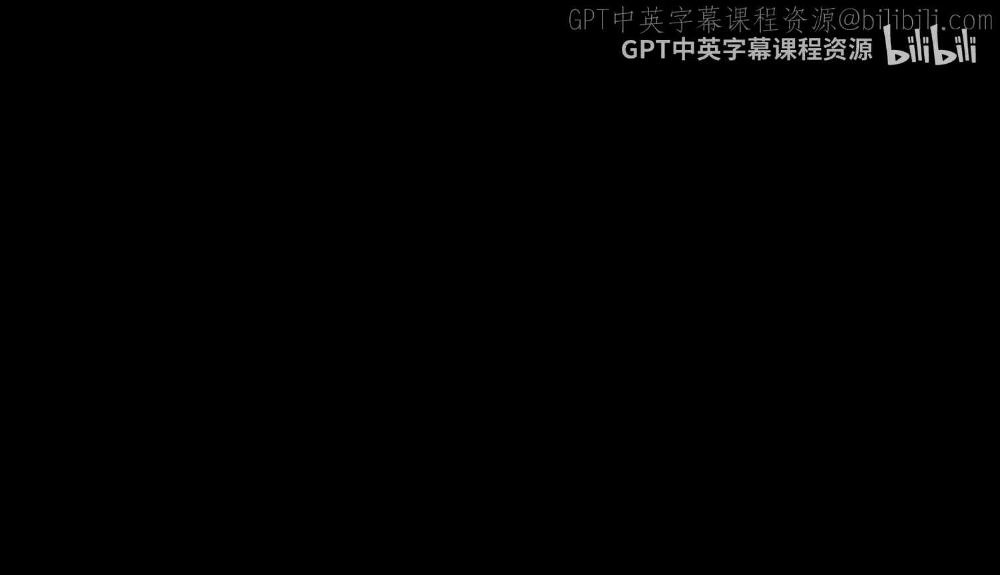
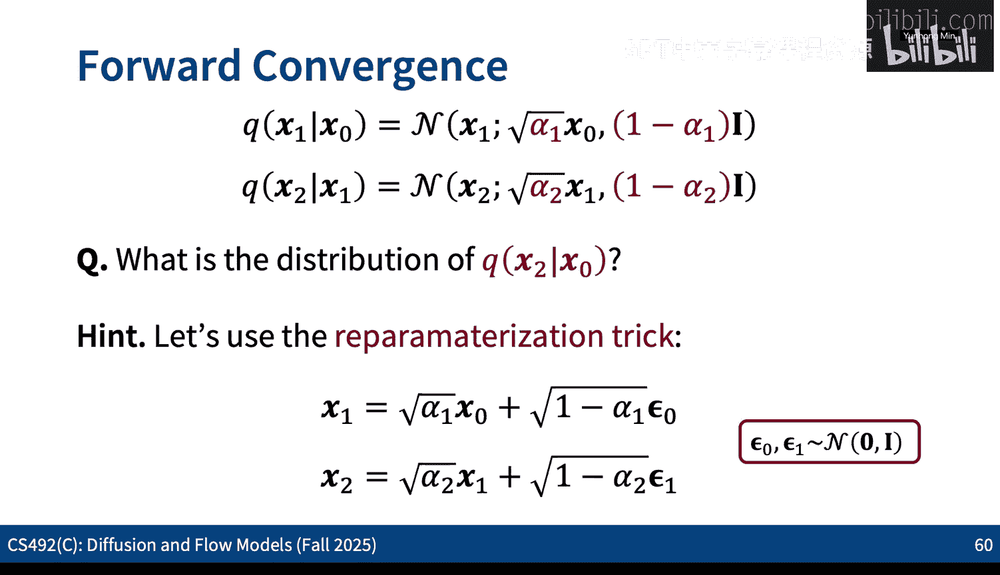
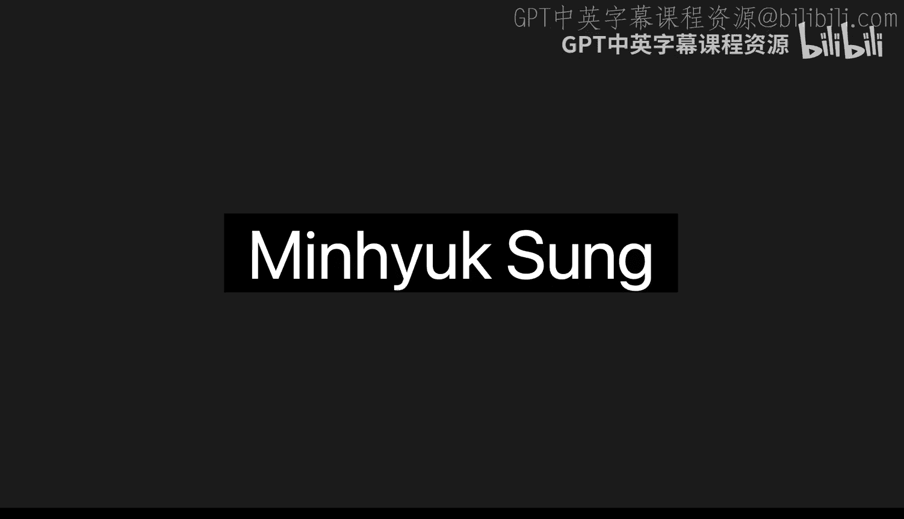
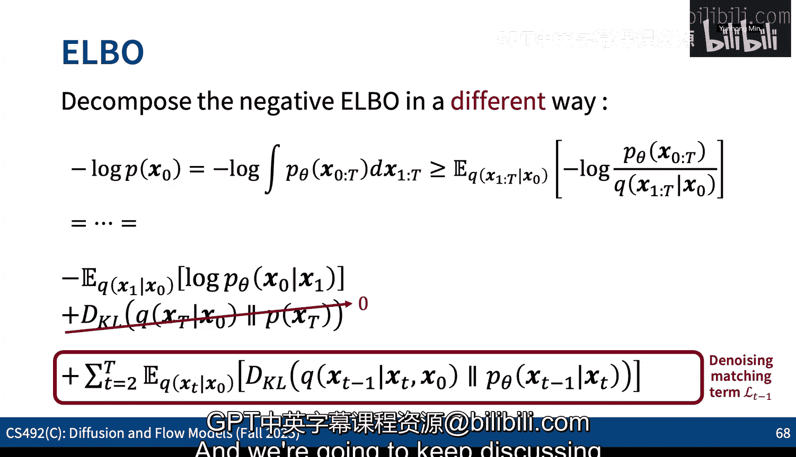

# 扩散和流模型：03：去噪扩散概率模型 1 (DDPM) 🧠



## 概述
在本节课中，我们将学习去噪扩散概率模型的基本思想。我们将从变分自编码器出发，探讨其局限性，并引出扩散模型的核心概念：通过一个预定义的前向扩散过程将数据逐步变为噪声，再学习一个反向过程从噪声中重建数据。

---

## 从变分自编码器到扩散模型

上一节我们介绍了变分自编码器的基本原理。本节中，我们来看看如何从VAE的框架出发，构建更强大的生成模型。

变分自编码器的核心思想是学习一个从简单潜在分布（如标准高斯分布）到复杂数据分布的映射。我们定义了一个编码器网络来近似后验分布 `q(z|x)`，以及一个解码器网络来定义似然分布 `p(x|z)`。训练目标是最大化证据下界。

**ELBO公式**：
```
ELBO = E_{z~q(z|x)}[log p(x|z)] - KL(q(z|x) || p(z))
```

然而，VAE存在一个主要限制：我们通常假设似然分布 `p(x|z)` 和后验近似分布 `q(z|x)` 都是高斯分布。对于复杂的数据分布，这种假设可能是一个过于简化的近似，导致生成样本模糊。

为了构建更复杂的分布，一个自然的想法是引入多个潜在变量层，形成分层或递归的VAE结构。

---

## 分层VAE与马尔可夫假设

我们不再使用单个潜在变量 `z`，而是引入一系列潜在变量 `x1, x2, ..., xT`。数据点记为 `x0`。

为了使模型可处理，我们做出**马尔可夫假设**：每个状态 `xt` 只依赖于前一个状态 `xt-1`，而不依赖于更早的历史。这意味着生成过程（反向过程）可以分解为一系列条件概率的乘积。

**生成过程（反向过程）**：
```
p(x0:T) = p(xT) ∏_{t=1}^{T} p(xt-1 | xt)
```

类似地，我们也可以定义一个变分后验分布（前向过程），同样遵循马尔可夫假设。

**变分后验（前向过程）**：
```
q(x1:T | x0) = ∏_{t=1}^{T} q(xt | xt-1)
```

在这个分层框架下，ELBO函数会变得更加复杂。但关键问题仍然是：我们需要联合训练编码器（定义 `q`）和解码器（定义 `p`），这通常很困难。

---

## 扩散模型的核心思想

扩散模型可以看作是分层VAE的一个特例，它做出了两个关键的简化设计：

1.  **维度匹配**：所有潜在变量 `xt` 的维度都与原始数据 `x0` 相同。
2.  **固定前向过程**：变分后验分布 `q(xt | xt-1)` 是**预定义**的，而不是通过神经网络学习的。我们只学习反向过程 `p(xt-1 | xt)`。

我们引入新的术语：
*   **前向过程 (Forward Process)** 或 **扩散过程 (Diffusion Process)**：从数据 `x0` 逐步加噪声，最终得到近似纯噪声 `xT` 的过程。对应固定的分布 `q`。
*   **反向过程 (Reverse Process)** 或 **去噪过程 (Denoising Process)**：从噪声 `xT` 逐步去噪，最终重建数据 `x0` 的过程。对应需要学习的分布 `p`。

我们的目标是：精心设计一个固定的前向过程 `q`，使得当我们只学习反向过程 `p` 时，能够自然地最大化ELBO。

---

## 前向扩散过程的设计

我们如何设计这个固定的前向过程 `q(xt | xt-1)` 呢？在DDPM中，它被定义为一个小方差的高斯分布，其均值向零收缩。

**前向转移分布**：
```
q(xt | xt-1) = N(xt; √(1-βt) * xt-1, βt * I)
```
其中 `βt` 是一个在 `(0, 1)` 区间内很小的数，并且通常随着 `t` 增加而增加（`β1 < β2 < ... < βT`）。

**参数含义**：
*   `√(1-βt)`：收缩因子，使 `xt` 的均值向原点靠近。
*   `βt`：每一步添加的噪声方差。

这个过程可以理解为：在每一步，我们取当前状态 `xt-1`，将其稍微向零缩放，并加入一点高斯噪声。随着步骤 `t` 的增加，数据 `x0` 的信息被逐渐“扩散”掉，最终 `xT` 将接近一个纯噪声分布。

一个关键的优势是，得益于高斯分布的性质和马尔可夫假设，我们可以推导出从 `x0` 直接到任意中间步骤 `xt` 的“跳跃”分布，而无需逐步迭代。

**前向跳跃分布**：
```
q(xt | x0) = N(xt; √(ᾱt) * x0, (1 - ᾱt) * I)
```
其中 `αt = 1 - βt`，`ᾱt = ∏_{s=1}^{t} αs`。

由于每个 `βt` 都接近1，`αt` 接近0，当 `t` 足够大时，`ᾱt` 会趋近于0。这意味着 `q(xT | x0)` 的均值项几乎为0，方差项接近1。

**结论**：
```
q(xT | x0) ≈ N(0, I)
```
也就是说，经过足够多的扩散步骤后，`xT` 的分布会接近我们预设的简单先验分布——标准高斯分布 `N(0, I)`。这正好满足了ELBO中正则化项 `KL(q(z|x) || p(z))` 最小化的要求（即让后验近似分布接近先验分布）。因此，这个预定义的前向过程是合理的。

---





## 总结

本节课中我们一起学习了：
1.  **VAE的局限性**：假设似然和后验为高斯分布可能不足以建模复杂数据。
2.  **分层VAE**：引入多个潜在变量并使用马尔可夫假设来构建更复杂的分布。
3.  **扩散模型起点**：将分层VAE特例化，固定前向扩散过程，只学习反向去噪过程。
4.  **前向过程设计**：通过一个精心设计的、逐步加噪的高斯转移过程，确保最终分布接近标准高斯噪声，从而与ELBO的目标相一致。




下一节课，我们将继续深入探讨如何训练这个反向去噪过程，并完成扩散模型的完整推导。