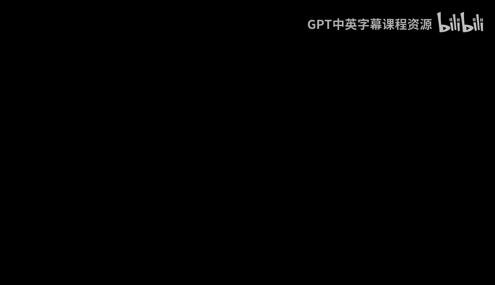
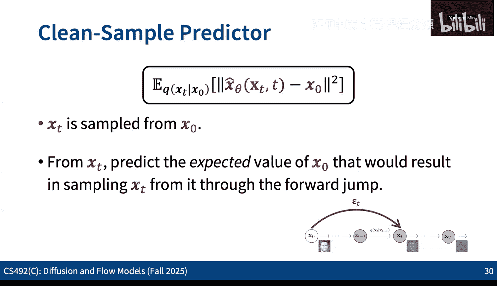
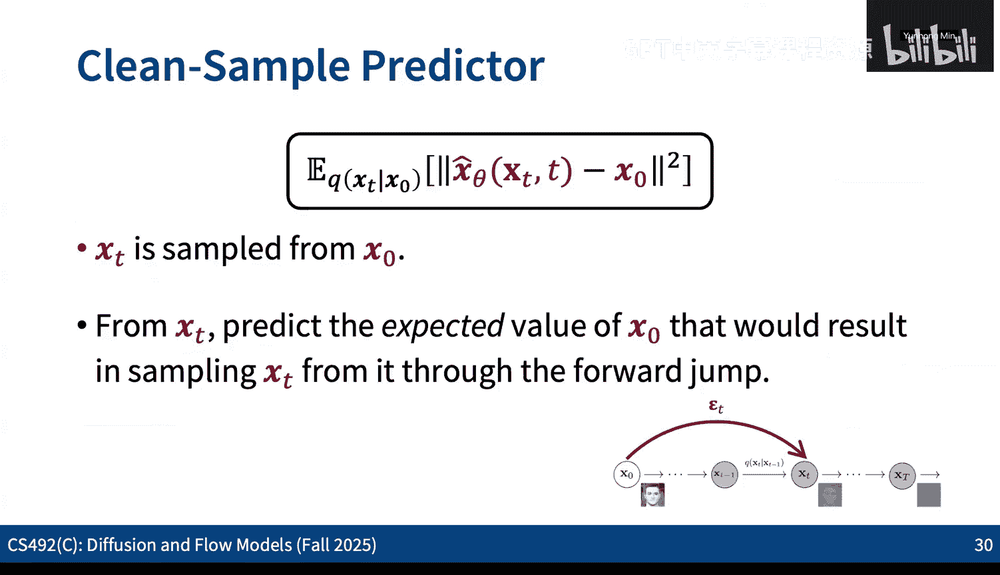
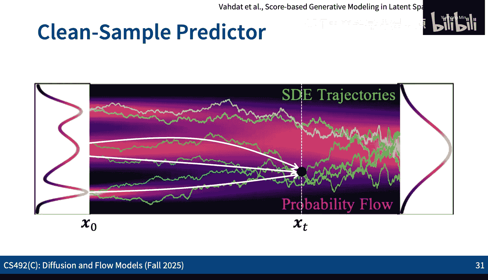
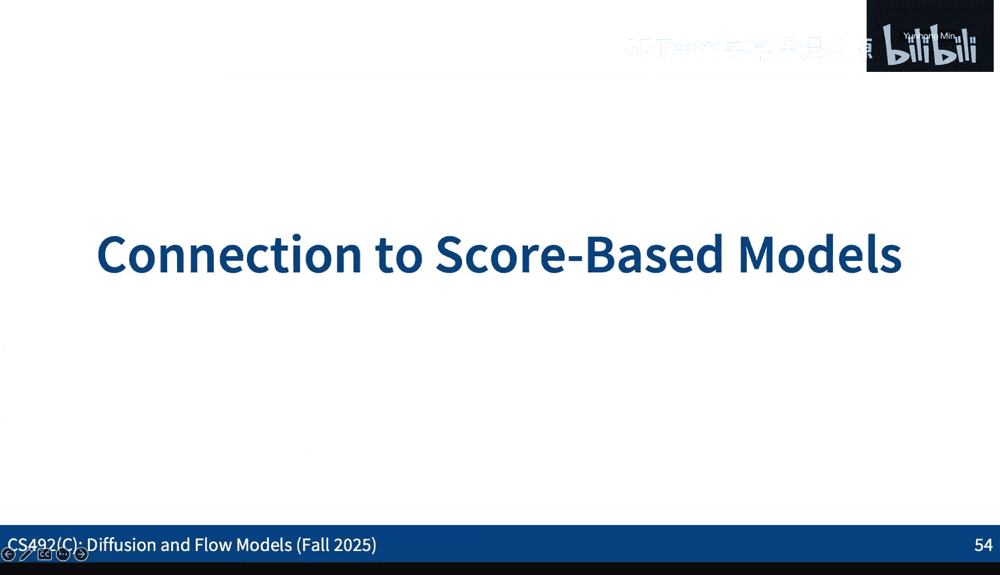

# 扩散与流模型：第4讲：去噪扩散概率模型 2 (DDPM) 🧠

在本节课中，我们将继续学习扩散模型的基础知识。我们将深入探讨如何通过定义前向过程来简化反向过程的学习，并最终推导出简洁有效的训练目标。

## 概述 📋

上一节我们介绍了扩散模型的基本框架，即通过一个预定义的前向过程将数据点逐步加噪，并学习一个反向的去噪过程来生成数据。本节中，我们将具体推导去噪扩散概率模型（DDPM）的训练目标，理解其如何将复杂的似然函数学习简化为一个简单的噪声预测任务。

## 前向过程回顾

扩散模型的核心思想是定义一个从数据点 \(x_0\) 到纯高斯噪声 \(x_T\) 的马尔可夫前向过程。这个过程是预先定义好的，无需学习。

前向过程的每一步转移分布被定义为高斯分布：
\[
q(x_t | x_{t-1}) = \mathcal{N}(x_t; \sqrt{1-\beta_t} x_{t-1}, \beta_t I)
\]
其中，\(\beta_t\) 是一个在 \((0, 1)\) 区间内随时间 \(t\) 递增的噪声调度参数。这个过程可以理解为逐步向数据中注入高斯噪声。

一个关键特性是，我们可以直接计算从 \(x_0\) 到任意中间步骤 \(x_t\) 的“跳跃”分布，而无需迭代：
\[
q(x_t | x_0) = \mathcal{N}(x_t; \sqrt{\bar{\alpha}_t} x_0, (1 - \bar{\alpha}_t) I)
\]
这里，\(\alpha_t = 1 - \beta_t\)，且 \(\bar{\alpha}_t = \prod_{s=1}^{t} \alpha_s\)。这使得在训练时可以直接采样加噪后的数据 \(x_t\)。

## 反向过程与训练目标

我们的目标是学习反向过程 \(p_\theta(x_{t-1} | x_t)\)，使其能够从噪声 \(x_T\) 逐步恢复出数据 \(x_0\)。通过推导证据下界（ELBO），我们可以将损失函数分解为几项。其中，最关键的一项是去噪匹配项：
\[
L_{t-1} = D_{KL}(q(x_{t-1} | x_t, x_0) \ || \ p_\theta(x_{t-1} | x_t))
\]
我们的目标是让学习的反向转移分布 \(p_\theta\) 尽可能接近真实的后验分布 \(q(x_{t-1} | x_t, x_0)\)。

通过贝叶斯规则和我们对前向过程的定义，可以推导出 \(q(x_{t-1} | x_t, x_0)\) 也是一个高斯分布，其均值和方差具有闭合形式：
\[
q(x_{t-1} | x_t, x_0) = \mathcal{N}(x_{t-1}; \tilde{\mu}_t(x_t, x_0), \tilde{\beta}_t I)
\]
其中，
\[
\tilde{\mu}_t(x_t, x_0) = \frac{\sqrt{\bar{\alpha}_{t-1}}\beta_t}{1-\bar{\alpha}_t} x_0 + \frac{\sqrt{\alpha_t}(1-\bar{\alpha}_{t-1})}{1-\bar{\alpha}_t} x_t
\]
\[
\tilde{\beta}_t = \frac{1-\bar{\alpha}_{t-1}}{1-\bar{\alpha}_t} \beta_t
\]

## 简化训练目标

基于以上推导，一个自然的想法是将反向过程也参数化为高斯分布 \(p_\theta(x_{t-1} | x_t) = \mathcal{N}(x_{t-1}; \mu_\theta(x_t, t), \Sigma_\theta(x_t, t))\)。为了最小化 KL 散度，我们可以将方差 \(\Sigma_\theta\) 设置为与 \(\tilde{\beta}_t\) 相同（这是一个可计算的常数），而只用一个神经网络来学习均值 \(\mu_\theta\)。

当两个高斯分布的方差相同时，它们之间的 KL 散度简化为其均值之间的 L2 距离。因此，训练目标简化为：
\[
L_{t-1} \propto \mathbb{E}_{x_0, \epsilon, t} [\| \tilde{\mu}_t(x_t, x_0) - \mu_\theta(x_t, t) \|^2]
\]
这里，\(x_t\) 是通过 \(x_t = \sqrt{\bar{\alpha}_t} x_0 + \sqrt{1-\bar{\alpha}_t} \epsilon\) 从数据 \(x_0\) 和标准高斯噪声 \(\epsilon\) 采样得到的。

## 预测目标的选择

虽然直接预测均值 \(\mu_\theta\) 是可行的，但在实践中，我们通常采用等价的但更稳定的预测目标。以下是三种常见的选择：

以下是三种等价的参数化方式：

1.  **预测均值 \(\mu_\theta(x_t, t)\)**：最直接的方式。
2.  **预测原始数据 \(x_0\)**：根据公式 \(\tilde{\mu}_t\) 是 \(x_t\) 和 \(x_0\) 的线性组合，我们可以让网络预测 \(\hat{x}_0\)，然后计算 \(\mu_\theta\)。这可以理解为在每一步都“预见”最终输出，并根据这个预见决定下一步。
3.  **预测噪声 \(\epsilon_\theta(x_t, t)\)**：由于 \(x_t = \sqrt{\bar{\alpha}_t} x_0 + \sqrt{1-\bar{\alpha}_t} \epsilon\)，我们可以将 \(\tilde{\mu}_t\) 重写为 \(x_t\) 和 \(\epsilon\) 的函数。让网络预测噪声 \(\hat{\epsilon}\) 通常是**最稳定和常用的方法**，因为噪声 \(\epsilon\) 服从标准高斯分布，其统计特性稳定，有利于神经网络学习。

使用噪声预测器时，损失函数变为：
\[
L_{\text{simple}} = \mathbb{E}_{x_0, \epsilon, t} [\| \epsilon - \epsilon_\theta(x_t, t) \|^2]
\]
这是一个非常简洁的目标：给定一个加噪样本 \(x_t\) 和时间步 \(t\)，神经网络只需要预测出注入的噪声 \(\epsilon\)。

## 生成（采样）过程

训练好噪声预测网络 \(\epsilon_\theta\) 后，生成新样本的过程是一个迭代的去噪过程：

1.  从标准高斯分布采样 \(x_T\)。
2.  对于 \(t = T, T-1, ..., 1\)：
    *   用网络预测噪声：\(\hat{\epsilon} = \epsilon_\theta(x_t, t)\)。
    *   计算反向过程的均值：\(\mu_\theta(x_t, t) = \frac{1}{\sqrt{\alpha_t}} (x_t - \frac{\beta_t}{\sqrt{1-\bar{\alpha}_t}} \hat{\epsilon})\)。
    *   采样下一步：\(x_{t-1} = \mu_\theta(x_t, t) + \sigma_t z\)，其中 \(z \sim \mathcal{N}(0, I)\)，\(\sigma_t^2\) 通常取 \(\tilde{\beta}_t\)。
3.  最终得到生成样本 \(x_0\)。

## 模型表达能力的关键

一个重要的洞见是：尽管前向过程 \(q\) 和每一步的反向转移 \(p_\theta\) 都是高斯分布，但整个反向过程（即数据的似然分布 \(p_\theta(x_0)\)）**并不是高斯的**。

这是因为反向过程的均值 \(\mu_\theta\) 是由一个**非线性神经网络**预测的，该网络以 \(x_t\) 和 \(t\) 为输入。通过堆叠多个这样的非线性高斯转移步骤，组合而成的分布可以变得非常复杂，从而能够建模复杂的数据分布 \(p_{\text{data}}(x_0)\)。这正是扩散模型克服 VAE 表达能力限制的关键所在。

## 总结 🎯

本节课我们一起深入学习了去噪扩散概率模型（DDPM）的训练细节：

*   我们通过精心设计前向加噪过程，使得真实的后验分布 \(q(x_{t-1} | x_t, x_0)\) 具有高斯闭合形式。
*   通过最小化 ELBO，我们将学习目标简化为让反向转移分布匹配这个高斯后验。
*   通过将方差固定为常数，训练目标进一步简化为学习该高斯分布的均值。
*   我们介绍了三种等价的预测目标（均值、原始数据、噪声），其中**预测噪声**是最常用且稳定的方法。
*   最终，训练一个扩散模型简化为一个简单的噪声预测任务，其损失函数是预测噪声与真实噪声之间的 L2 距离。
*   尽管组件简单，但得益于神经网络预测均值的非线性特性，扩散模型能够表达极其复杂的数据分布。

经过一系列巧妙的推导，扩散模型的训练和采样在实现上变得异常简洁，这构成了其强大能力的基础。下一节，我们将探讨扩散模型与得分匹配（Score Matching）之间的联系。