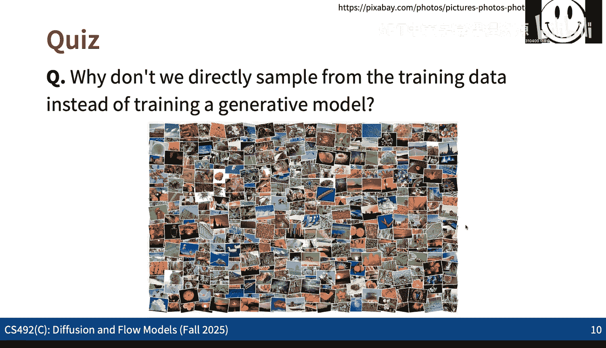
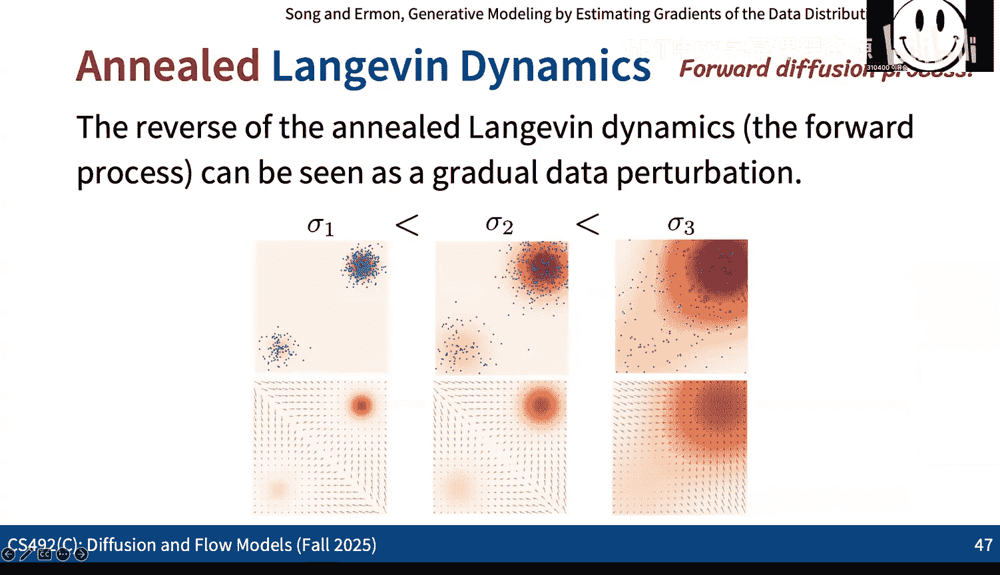
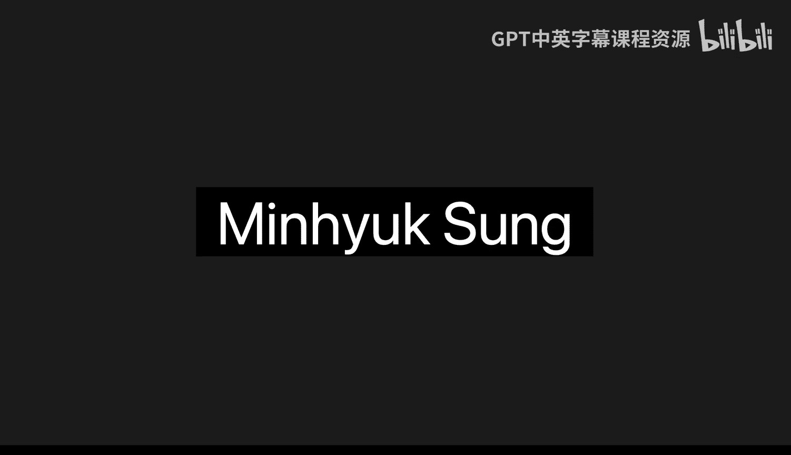

# 扩散和流模型：05：基于分数的模型

在本节课中，我们将要学习基于分数的生成模型的核心概念。我们将探讨“分数”在统计学中的定义，理解分数函数与扩散模型中噪声预测的关系，并揭示分数函数如何用于从复杂分布中采样。

---

## 概述

上一节我们介绍了扩散概率模型（DPM）的基本思想，特别是其马尔可夫过程和预定义的高斯转移分布。本节中，我们将深入探讨扩散模型中“噪声预测”的深层含义，并引入“分数函数”这一核心概念。我们将看到，预测噪声本质上是在学习一个特定分布的分数函数，而基于分数函数的朗之万动力学提供了一种从分布中采样的强大方法。

## 分数函数的定义

在统计学中，“分数”具有特定的含义。对于一个概率密度函数 \( p(x) \)，其分数函数定义为该函数对数关于数据点 \( x \) 的梯度。

**公式**：
\[
\nabla_x \log p(x)
\]

例如，考虑扩散模型中的前向跳跃分布 \( q(x_t | x_0) \)，我们知道其闭式解是一个高斯分布。计算该条件分布的分数函数，会得到一个与我们在噪声预测网络中试图预测的量密切相关的表达式。

## 分数函数与噪声预测的关系

在扩散模型中，我们定义了前向过程：
\[
x_t = \sqrt{\bar{\alpha}_t} x_0 + \sqrt{1 - \bar{\alpha}_t} \epsilon_t, \quad \epsilon_t \sim \mathcal{N}(0, I)
\]
其中 \( \epsilon_t \) 是标准高斯噪声。

我们可以推导出条件分布 \( q(x_t | x_0) \) 的分数函数为：
\[
\nabla_{x_t} \log q(x_t | x_0) = -\frac{\epsilon_t}{\sqrt{1 - \bar{\alpha}_t}}
\]

**核心发现**：噪声预测网络所预测的 \( \epsilon_t \)，经过一个缩放因子后，**恰好等于**该前向跳跃分布的分数函数。这意味着，噪声预测器实际上是在学习一个特定分布的分数函数。

## 利用分数函数进行采样：朗之万动力学

一个关键的问题是：为什么分数函数如此重要？答案是，即使我们不知道概率密度函数 \( p(x) \) 的具体形式，只要我们知道它的分数函数 \( \nabla_x \log p(x) \)，我们就可以通过 **朗之万动力学** 从这个分布中采样。

朗之万动力学的迭代更新公式如下：

**公式**：
\[
x_{i+1} = x_i + \gamma \nabla_x \log p(x_i) + \sqrt{2\gamma} \, z_i, \quad z_i \sim \mathcal{N}(0, I)
\]
其中 \( \gamma \) 是步长。

这个过程可以理解为：从一个任意的初始点（例如均匀分布）开始，沿着分数函数（即概率对数梯度的方向）移动，同时注入一些高斯噪声。经过足够多次迭代后，采样点将收敛到目标分布 \( p(x) \)。**这避免了直接计算逆累积分布函数的困难**。

## 分数估计的挑战与解决方案

然而，在实际中，我们只有来自目标分布 \( p_{data}(x) \) 的样本，并不知道其真实的分数函数 \( \nabla_x \log p_{data}(x) \)。直接估计它非常困难，尤其是在数据概率密度很低的区域，分数估计会非常不准确，导致朗之万动力学在初期失效。

解决方案是引入一系列**噪声扰动分布**。我们不是直接学习 \( p_{data}(x) \) 的分数，而是学习其经过高斯平滑后的版本 \( p_{\sigma}(x) \) 的分数，其中：
\[
p_{\sigma}(x) = \int p_{data}(y) \mathcal{N}(x; y, \sigma^2 I) dy
\]
这个分布更加平滑，没有低概率区域，因此其分数函数在整个空间中都更容易学习。

以下是关键思路：
1.  **大噪声（初期）**：使用较大的 \( \sigma \)，分布非常平滑，分数估计准确，朗之万动力学可以将粒子从低概率区域有效地驱动到高概率区域附近。
2.  **小噪声（后期）**：逐渐减小 \( \sigma \)，分布越来越接近原始数据分布 \( p_{data}(x) \)。此时分数估计在数据高密度区域是准确的，可以进一步细化样本，使其收敛到真实数据分布。

## 与扩散模型的联系

这个“从大噪声到小噪声”的渐进过程，**正好对应了扩散模型的反向过程**。
*   在扩散模型的前向过程中，我们不断向数据添加噪声（增大方差），对应于创建一系列噪声越来越大的平滑分布 \( q(x_t) \)。
*   在反向过程中，我们训练一个网络（噪声预测器）来预测每一步的噪声。我们已经证明，这等价于学习对应时刻 \( t \) 的噪声扰动分布 \( q(x_t) \) 的分数函数 \( \nabla_{x_t} \log q(x_t) \)。
*   反向采样的迭代过程，本质上就是执行了一系列条件依赖的朗之万动力学步骤，从噪声最大的分布 \( q(x_T) \approx \mathcal{N}(0, I) \) 开始，逐步去噪，最终采样出 \( q(x_0) \approx p_{data}(x) \)。

因此，扩散模型提供了一个**系统化的框架**，来学习和利用一系列噪声尺度下的分数函数，从而稳定、高效地从复杂数据分布中生成样本。

## 总结

本节课我们一起学习了基于分数的模型的核心思想。
1.  我们定义了**分数函数** \( \nabla_x \log p(x) \) ，它编码了概率分布的形状信息。
2.  我们揭示了扩散模型中的**噪声预测**本质上是学习一个高斯扰动分布的分数函数。
3.  我们介绍了**朗之万动力学**，它利用分数函数从分布中采样，而无需知道分布的具体形式。
4.  我们探讨了直接估计数据分布分数的困难，并提出了通过**多尺度噪声扰动**来稳定学习过程的解决方案。
5.  最后，我们将这些概念与**扩散模型**统一起来，展示了扩散模型的反向过程是如何通过学习一系列噪声尺度下的分数函数，来实现稳健的数据生成。

通过基于分数的视角，我们加深了对扩散模型工作原理的理解，并为后续学习更广泛的生成模型（如流模型）奠定了基础。下一节，我们将开始讨论非马尔可夫过程的扩散模型。