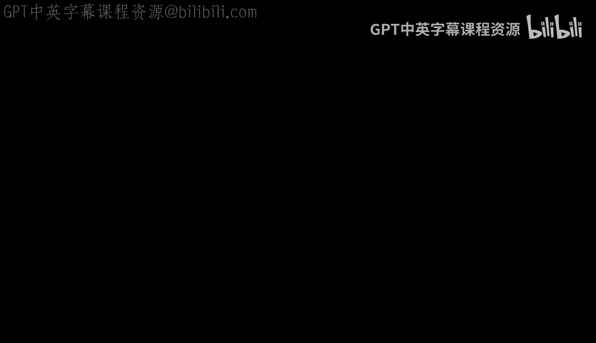
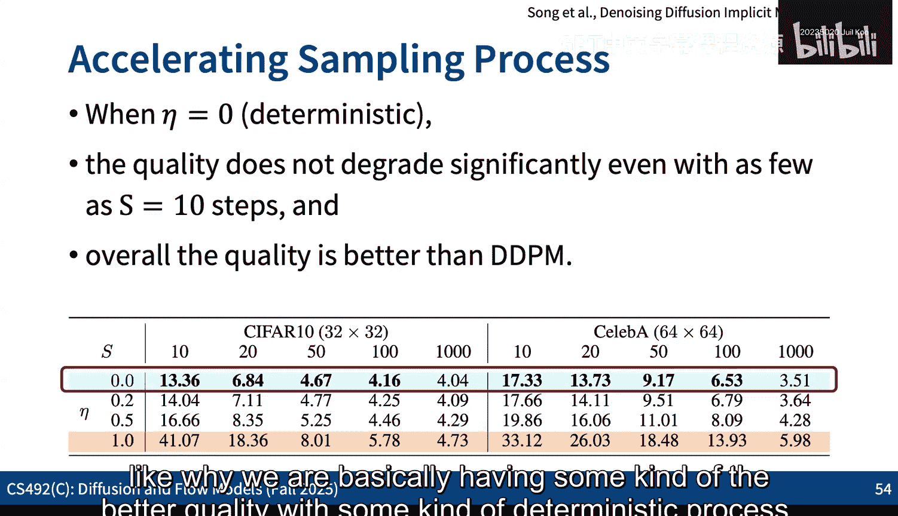
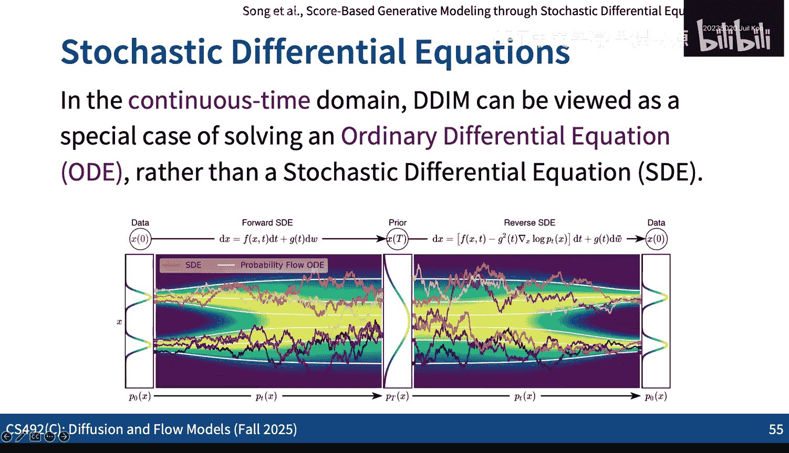

# 扩散与流模型：06：去噪扩散隐式模型 (DDIM)

在本节课中，我们将学习去噪扩散隐式模型。这是一种对标准去噪扩散概率模型（DDPM）的推广，它允许我们使用非马尔可夫的前向过程，并能在推理时通过改变生成过程来显著加速采样，而无需重新训练模型。

---

## 概述：从数据采样到生成新数据

上一节我们介绍了基于朗之万动力学的模型，其核心思想是利用分数函数进行采样。本节中，我们来看看如何生成全新的数据点，而不仅仅是复制训练集中的样本。

基本思路是，如果我们直接从数据分布 \( Q(X_0) \) 中采样，只能得到已有的数据点。为了生成新数据，我们向数据分布中添加高斯噪声，从而得到一个“模糊化”的分布 \( Q(X_t) \)。我们的目标是从这个新分布中采样，得到接近真实数据但又有所不同的新样本。

为了实现从 \( Q(X_t) \) 中采样，我们利用朗之万动力学。我们不需要知道 \( Q(X_t) \) 的确切形式，只需要知道其分数函数（即对数概率密度的梯度）\( \nabla_{x_t} \log Q(x_t) \)。通过从先验分布（如标准高斯分布）开始，并依据分数函数迭代更新样本点，我们就能从目标分布中采样。

然而，这里存在一个权衡：如果添加的噪声方差太小，在远离数据密集区的区域，分数函数值接近零，导致粒子难以移动到高概率区域；如果噪声方差太大，修改后的分布会严重偏离原始数据分布，分数函数也不准确。

解决方案是使用一个随时间递减的噪声方差。我们从高方差开始，确保所有粒子都有动力向高概率区域移动；随着粒子接近目标，我们逐渐降低方差，以获得更准确的分数估计，从而生成更精确的样本。这就是朗之万动力学的核心动机。

这意味着，在训练我们的分数预测网络时，我们需要为每个时间步 \( t \) 学习对应的分数函数，并且噪声方差会随时间递减。这个过程看起来已经非常接近我们在DDPM中所做的了。

---

## DDPM与分数模型的联系

实际上，扩散模型的反向过程正是在模拟这种朗之万动力学。我们从较大的高斯噪声开始，随着时间步减小噪声，利用更准确的分数变量来获得更好的样本。

如果我们观察朗之万动力学的反向过程，会发现它实际上等同于扩散模型中的前向过程：从一个接近原始数据分布的状态开始，逐步添加越来越大的高斯噪声，使得粒子无论从哪里开始，都能被“推”向高概率区域。

因此，这可以看作是解释扩散模型的一种方式，它与我们之前讨论的DDPM共享了许多思想。但两者并不完全相同。在DDPM中，我们以前向转移分布 \( q(x_t | x_{t-1}) \) 为起点进行定义。而在基于分数的模型中，我们是从添加高斯噪声卷积的角度来定义前向过程 \( q(x_t | x_0) \)。它们是定义生成模型迭代过程的不同具体方式，但核心理念相通。

---

## 泛化DDPM：非马尔可夫过程

DDPM将前向和反向过程都定义为马尔可夫过程，即 \( x_t \) 只依赖于前一个状态 \( x_{t-1} \)。现在的问题是：我们能否定义一个非马尔可夫过程？

回顾DDPM的变分下界（ELBO）目标函数，我们需要建模的是所有潜变量在给定数据 \( x_0 \) 下的联合分布。通过分解，我们发现真正需要的是两个分布：
1.  前向边缘分布：\( q(x_t | x_0) \)
2.  反向条件分布：\( q(x_{t-1} | x_t, x_0) \)

在DDPM中，我们先定义了前向转移分布 \( q(x_t | x_{t-1}) \)，然后推导出了上述两个分布。但ELBO目标函数表明，我们真正需要的只是这两个分布。

这就引出了DDIM的核心思想：**我们能否直接定义这两个分布，而不显式定义前向转移分布 \( q(x_t | x_{t-1}) \)**？这样我们就得到了一个更通用的框架。

在DDIM中，我们直接定义 \( q(x_t | x_0) \) 和 \( q(x_{t-1} | x_t, x_0) \)。为了采样得到某个中间变量 \( x_t \)，我们不再像DDPM那样从 \( x_0 \) 一步步前向传播到 \( x_t \)，而是采用另一种方式：首先从 \( x_0 \) “跳跃”到最终时间步 \( x_T \)，然后依据定义的反向分布一步步采样回到 \( x_t \)。这使得前向过程变成了一个非马尔可夫过程，因为 \( x_{t-1} \) 的采样同时依赖于 \( x_t \) 和初始的 \( x_0 \)。

---

## 保持ELBO不变的关键

接下来的问题是：我们该如何具体定义这两个分布？

一个关键的设计目标是：**我们希望保持与DDPM相同的边缘分布 \( q(x_t | x_0) \)**。如果我们能做到这一点，那么模型的ELBO目标函数就与DDPM保持一致（最多相差一个常数因子）。

这意味着，一旦我们用相同的目标函数训练好一个DDPM模型，我们就可以在推理（生成）时改变生成过程。我们可以运行原始的马尔可夫过程，也可以运行新的非马尔可夫过程。这是非常有趣的一点：**在不重新训练模型的情况下，仅通过改变推理过程就能影响生成模型的性能**。我们将在整个课程中多次看到这种思想：通过改进推理过程来加速生成。

---

## 推导反向转移分布

我们的任务是：定义 \( q(x_{t-1} | x_t, x_0) \)，同时确保边缘分布 \( q(x_{t-1} | x_0) \) 与DDPM中的形式一致。

我们假设反向条件分布是一个高斯分布，其均值是 \( x_t \) 和 \( x_0 \) 的线性组合：
\[
q(x_{t-1} | x_t, x_0) = \mathcal{N}(w_0 x_0 + w_t x_t, \sigma_t^2 I)
\]
其中 \( w_0, w_t \) 是待求系数，\( \sigma_t^2 \) 是方差。

我们知道DDPM中前向边缘分布的形式为：
\[
q(x_{t-1} | x_0) = \mathcal{N}(\sqrt{\bar{\alpha}_{t-1}} x_0, (1 - \bar{\alpha}_{t-1})I)
\]
其中 \( \bar{\alpha}_t = \prod_{s=1}^{t} (1 - \beta_s) \)，\( \beta_s \) 是噪声方差。

根据概率论，边缘分布可以通过联合分布积分得到：
\[
q(x_{t-1} | x_0) = \int q(x_{t-1} | x_t, x_0) q(x_t | x_0) dx_t
\]
这里，\( q(x_t | x_0) \) 是已知的（与DDPM相同），\( q(x_{t-1} | x_t, x_0) \) 是我们假设的形式。当先验分布和似然分布都是高斯分布时，其边缘分布也是高斯分布，且均值和方差有闭合解。

通过匹配边缘分布 \( q(x_{t-1} | x_0) \) 的均值和方差，我们可以求解出系数 \( w_0 \) 和 \( w_t \)。推导结果如下：
\[
w_0 = \frac{\sqrt{\bar{\alpha}_{t-1}} (1 - \frac{\bar{\alpha}_t}{\bar{\alpha}_{t-1}})}{1 - \bar{\alpha}_t}, \quad w_t = \frac{\sqrt{\frac{\bar{\alpha}_t}{\bar{\alpha}_{t-1}}} (1 - \bar{\alpha}_{t-1})}{1 - \bar{\alpha}_t}
\]
方差 \( \sigma_t^2 \) 则是一个可以自由选择的参数，只要满足非负且小于DDPM中对应方差的上界即可。

---

## DDIM的生成过程

现在，我们来看DDIM的实际生成（反向）过程。由于ELBO不变，我们训练好的噪声预测网络 \( \epsilon_\theta \) 可以继续使用。

在DDPM中，给定 \( x_t \)，我们通过噪声预测器估计出 \( \hat{\epsilon}_t \)，进而估计出去噪后的 \( \hat{x}_0 \)：
\[
\hat{x}_0 = \frac{x_t - \sqrt{1 - \bar{\alpha}_t} \hat{\epsilon}_t}{\sqrt{\bar{\alpha}_t}}
\]
在DDIM中，我们使用这个估计出的 \( \hat{x}_0 \)，并代入我们推导出的反向分布中进行采样：
\[
x_{t-1} = w_0 \hat{x}_0 + w_t x_t + \sigma_t \epsilon, \quad \epsilon \sim \mathcal{N}(0, I)
\]
其中 \( w_0, w_t \) 由上述公式给出，\( \sigma_t \) 是我们选择的方差。

从实现角度看，从DDPM切换到DDIM只需要修改反向采样步骤中的几行代码。但神奇的是，这一改变能带来性能上的显著差异。

---

## 方差的选择与确定性生成

方差 \( \sigma_t^2 \) 的选择带来了灵活性。它的上界是DDPM中对应的反向过程方差。

一个特别有趣的情况是设置 \( \sigma_t^2 = 0 \)。此时，反向分布退化为一个狄拉克δ函数，采样过程变为确定性的：
\[
x_{t-1} = w_0 \hat{x}_0 + w_t x_t
\]
这意味着，**从同一个初始噪声 \( x_T \) 出发，DDIM的生成过程将总是产生完全相同的输出 \( x_0 \)**。这带来了可重现性的优势，并且在实际中，这种确定性过程往往在减少采样步数时，质量下降得更少。

另一个特殊情况是，当我们将 \( \sigma_t^2 \) 设置为DDPM中对应的方差时，DDIM就退化成了原始的DDPM（马尔可夫过程）。因此，DDIM是DDPM的一种推广。

我们通常用一个参数 \( \eta \) 来插值这两种情况：
\[
\sigma_t^2 = \eta \cdot \tilde{\beta}_t
\]
其中 \( \tilde{\beta}_t \) 是DDPM的反向过程方差。\( \eta = 0 \) 对应确定性DDIM，\( \eta = 1 \) 对应DDPM。

---

## 加速生成：减少采样步数

扩散模型的一个主要缺点是采样速度慢，通常需要1000步。加速生成是研究重点。

一种直观的加速方法是**在反向过程中跳过一些时间步**，例如只从1000步中均匀地选取50步进行采样。由于ELBO目标函数在定义时涵盖了所有时间步，这种跳步并不会改变目标函数本身。

然而，在DDPM（随机过程）中，大幅减少采样步数通常会导致生成质量显著下降。实验表明，在**确定性DDIM（\( \eta = 0 \)）**中，质量下降则要缓和得多。

例如，在一个图像生成任务中，使用FID分数（越低越好）评估：
*   DDPM（1000步）：FID ~ 4.07
*   DDPM（10步）：FID ~ 41.07 （质量严重下降）
*   确定性DDIM（50步）：FID ~ 4.6
*   确定性DDIM（10步）：FID 虽有所上升，但远好于DDPM在10步时的结果。

这表明，**使用预训练的DDPM模型，只需将其推理过程切换为确定性DDIM，并减少采样步数（如50步），就能在几乎保持相同生成质量的情况下，将速度提升20倍**。这是非常强大的特性，无需重新训练模型。

为了将步数减少到极致的1步或几步，通常还需要额外的知识蒸馏或微调技术，这是当前研究的前沿。

---

## 总结

本节课我们一起学习了去噪扩散隐式模型（DDIM）的核心思想：

1.  **泛化框架**：DDIM通过直接定义前向边缘分布 \( q(x_t | x_0) \) 和反向条件分布 \( q(x_{t-1} | x_t, x_0) \) 来构建扩散过程，不再需要显式的前向转移分布 \( q(x_t | x_{t-1}) \)，从而允许非马尔可夫的前向过程。
2.  **保持ELBO**：通过精心设计，使边缘分布与DDPM保持一致，从而确保使用相同目标函数训练的模型可以直接应用于DDIM的推理过程。
3.  **灵活的反向过程**：引入可自由选择的方差参数 \( \sigma_t^2 \)，其中 \( \sigma_t^2 = 0 \) 对应确定性生成过程，\( \sigma_t^2 \) 取DDPM方差时则退化为原始DDPM。
4.  **加速采样**：确定性DDIM过程在显著减少采样步数（如从1000步减到50步或更少）时，生成质量下降较少，为实现扩散模型的高效生成提供了简单而有效的途径。

DDIM的思想不仅适用于图像生成，也广泛适用于其他领域的扩散模型。要更深入理解确定性过程为何更有效，我们需要进入连续时间域的视角，这将在后续关于随机微分方程（SDE）和常微分方程（ODE）的课程中探讨。