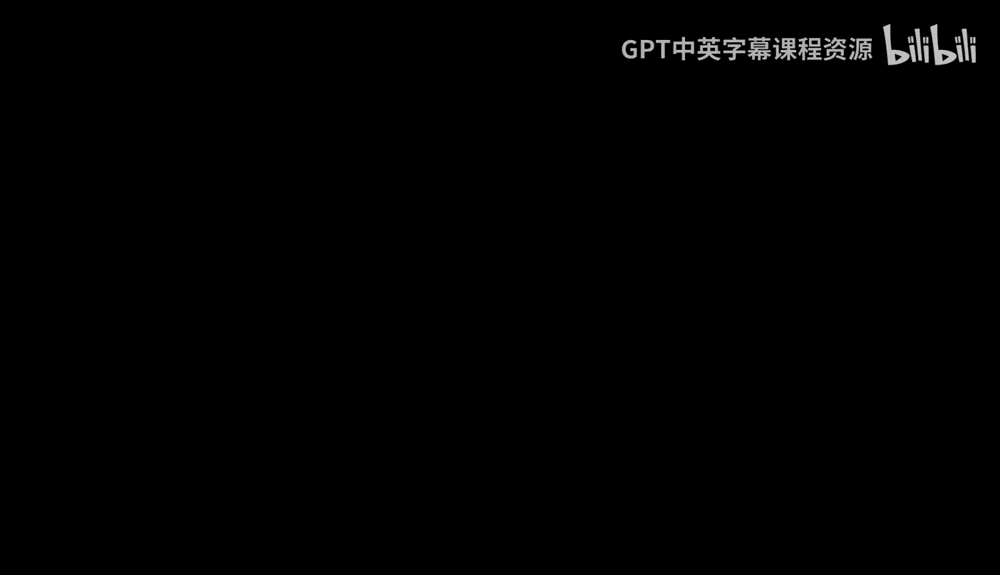
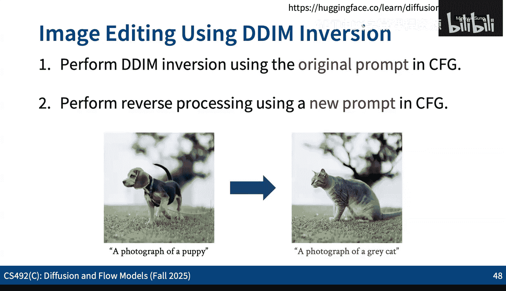
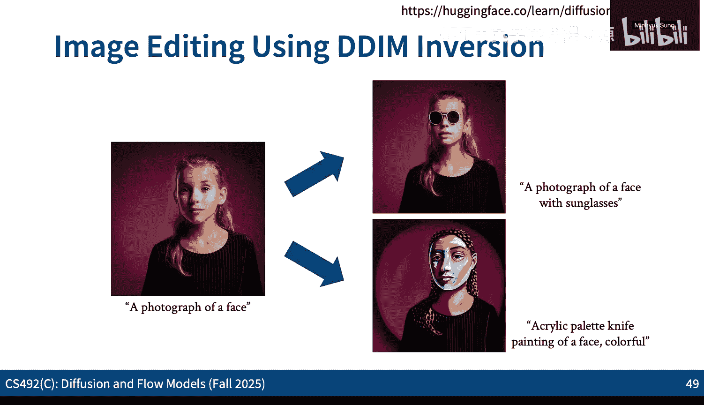
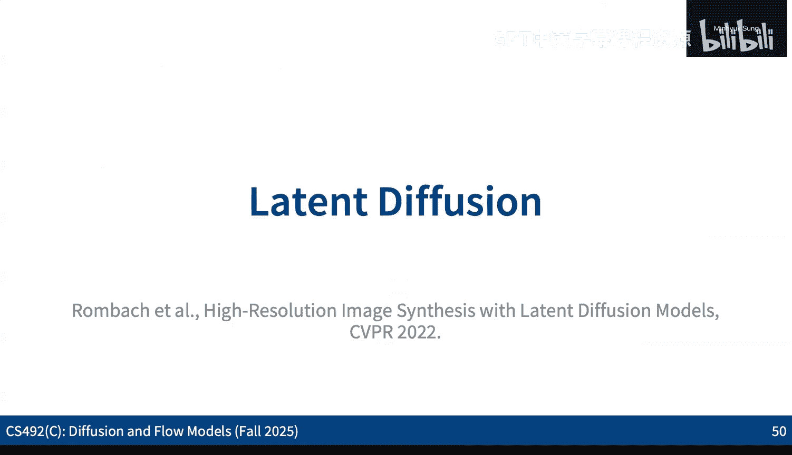
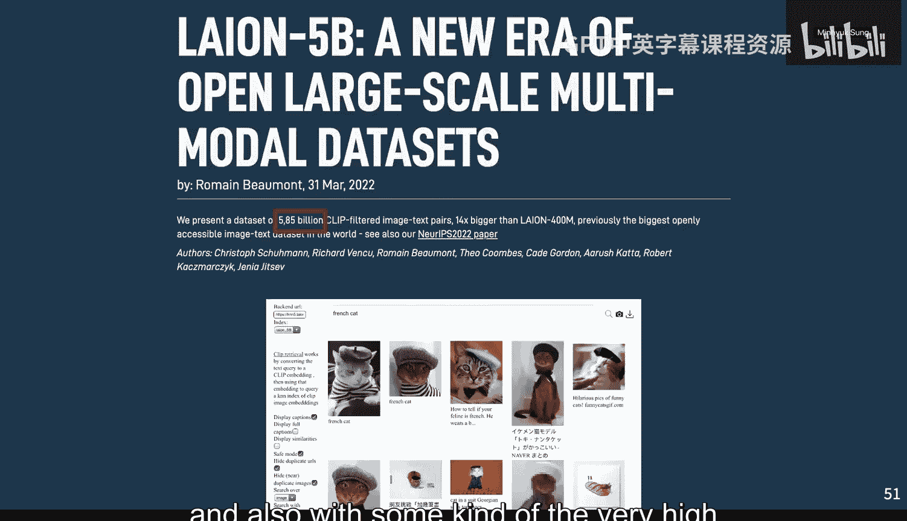
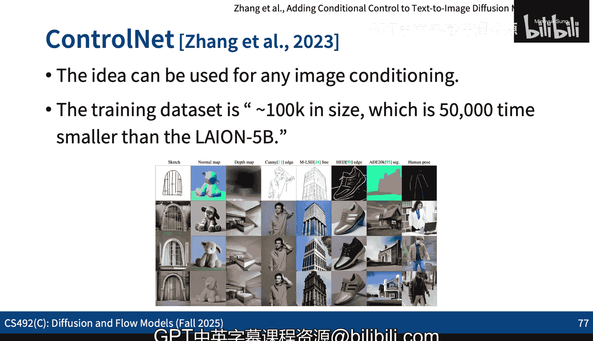
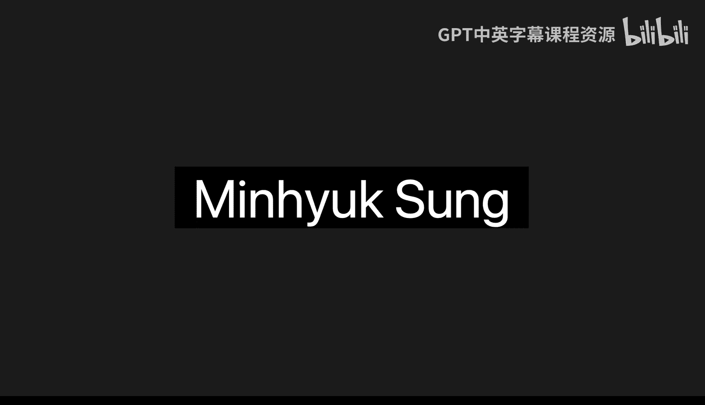

# 扩散与流模型：07：条件生成与潜在扩散

在本节课中，我们将学习如何利用额外的信息（如类别标签或文本描述）来引导扩散模型的生成过程，实现条件生成。我们还将探讨如何通过潜在扩散等技术，高效地训练和应用这些模型。

---

## 条件生成：分类器引导

上一节我们介绍了DDPM和DDIM等基础扩散模型。本节中，我们来看看如何利用数据附带的额外信息来提升生成质量。

例如，在图像生成任务中，我们可能拥有图像的类别标签。分类器引导的核心思想是：我们不只学习图像本身的分布，而是学习图像和类别标签的联合分布。

在扩散模型中，噪声预测器的输出可以解释为数据在中间状态下的**分数函数**（score function）。对于联合分布 \( p(x_t, y) \)，其分数函数可以分解为：

\[
\nabla_{x_t} \log p(x_t, y) = \nabla_{x_t} \log p(x_t) + \nabla_{x_t} \log p(y | x_t)
\]

这意味着，为了在生成过程中融入类别信息 \( y \)，我们可以在预测的噪声中减去一个偏置项，该偏置项是条件概率 \( p(y | x_t) \) 的对数梯度。

以下是实现分类器引导的关键步骤：

1.  **训练一个分类器网络**：该网络以任意噪声数据点 \( x_t \) 为输入，预测其类别标签 \( y \) 的概率 \( p(y | x_t) \)。
2.  **在生成过程中修改噪声**：在反向去噪过程的每一步，使用训练好的分类器计算梯度 \( \nabla_{x_t} \log p(y | x_t) \)，并用它来调整噪声预测：
    \[
    \hat{\epsilon} = \epsilon_\theta(x_t, t) - w \cdot \sigma_t \nabla_{x_t} \log p(y | x_t)
    \]
    其中，\( w \) 是一个权重系数，用于控制条件引导的强度。

通过这种方式，生成过程的轨迹会被引导，使得最终输出的图像更符合给定的类别标签。增大权重 \( w \) 会使输出更贴合条件，但可能会牺牲生成结果的多样性。

---

## 无需分类器的引导

虽然分类器引导有效，但它需要额外训练一个分类器网络。为了简化流程，研究者提出了**分类器自由引导**。

其核心思想是：直接训练一个**条件扩散模型**，该模型的噪声预测器同时接收数据 \( x_t \) 和条件信息 \( c \)（如文本描述）作为输入，即 \( \epsilon_\theta(x_t, t, c) \)。

为了能控制条件引导的强度，我们同时学习条件分数和无条件分数。这可以通过在训练时，以一定概率将条件信息 \( c \) 替换为一个特殊的“空”标签（如 `null`）来实现。

在生成时，我们通过以下公式对条件预测和无条件预测进行插值，来调整引导强度：

\[
\hat{\epsilon}_\theta(x_t, t, c) = \epsilon_\theta(x_t, t, \varnothing) + w \cdot (\epsilon_\theta(x_t, t, c) - \epsilon_\theta(x_t, t, \varnothing))
\]

这里，\( w \) 是引导尺度。当 \( w = 0 \) 时，为无条件生成；\( w > 1 \) 时，会增强条件的影响，使输出更贴合提示词，通常图像质量也更高，但多样性降低。

这种方法无需额外分类器，且条件 \( c \) 可以是任何模态的信息（文本、图像、音频等），因此被 Stable Diffusion 等主流模型广泛采用。其代价是，在生成时需要分别计算一次条件预测和无条件预测，推理时间大约翻倍。

---

## DDIM反转与图像编辑

之前我们介绍过DDIM，其特点是生成过程可以是确定性的（将方差设为零）。这意味着，给定一个初始噪声 \( x_T \)，通过确定性的反向过程，我们总能得到相同的干净图像 \( x_0 \)。

一个有趣的问题是：给定一张图像 \( x_0 \)，我们能找到对应的初始噪声 \( x_T \) 吗？这个过程称为 **DDIM反转**。虽然无法精确计算，但我们可以利用分数函数在相邻时间步相似的假设进行近似。

以下是DDIM反转结合分类器自由引导进行图像编辑的典型流程：

1.  对输入图像 \( x_0 \) 和原始提示词（如“一朵罂粟花照片”）运行DDIM反转，得到近似的初始噪声 \( \tilde{x}_T \)。
2.  以 \( \tilde{x}_T \) 为起点，使用新的提示词（如“一只灰猫的照片”）运行确定性的DDIM生成过程。

这样生成的图像会保留原图的整体结构和布局，但内容会根据新提示词发生变化，从而实现基于文本的图像编辑。

---

## 潜在扩散模型

直接在像素空间训练高分辨率图像的扩散模型计算成本极高。为了提升效率，**潜在扩散模型** 应运而生，其核心思想是在一个低维的潜在空间中进行扩散过程。

以下是潜在扩散模型的工作流程：

1.  **训练一个自编码器**：包括一个编码器 \( E \) 和一个解码器 \( D \)。编码器将高维图像 \( x \) 压缩到低维潜在向量 \( z = E(x) \)，解码器则负责从潜在向量重建图像 \( \tilde{x} = D(z) \)。
2.  **在潜在空间训练扩散模型**：在潜在空间 \( z \) 上，而非原始像素空间 \( x \) 上，训练扩散模型（如U-Net）。噪声预测器 \( \epsilon_\theta(z_t, t, c) \) 的输入是噪声潜在变量 \( z_t \) 和条件 \( c \)（如文本嵌入）。
3.  **生成过程**：先通过潜在扩散模型在潜在空间生成干净的 \( z_0 \)，再通过解码器 \( D \) 将其上采样回像素空间的图像 \( x_0 \)。

这种方法大幅降低了计算和内存开销，使得训练数十亿参数、处理数十亿图像数据集的模型成为可能。Stable Diffusion 就是典型的潜在扩散模型。

---

## 高效微调：ControlNet

当我们想为特定任务（如根据人体姿态图生成人物）训练一个条件扩散模型时，往往缺乏海量的配对数据。**ControlNet** 提供了一种高效的微调方案，可以在少量配对数据上，充分利用预训练扩散模型的知识。

ControlNet的核心思路是“复制并微调”预训练扩散模型（如U-Net）的编码器部分。具体步骤如下：

1.  **复制编码器**：将预训练模型的编码器权重复制一份，作为可训练的条件编码器。
2.  **零卷积连接**：使用权重初始化为零的卷积层（零卷积）将条件编码器的输出连接到预训练模型的解码器。在训练初期，零卷积的输出为零，因此条件信息不影响生成，模型行为与原始无条件模型一致。
3.  **渐进式训练**：随着训练进行，条件编码器和零卷积的权重逐渐更新，开始将条件信息（如边缘图、姿态图）注入到生成过程中。同时，预训练模型的主干网络权重保持冻结或微调，以保留其强大的生成先验。

通过这种方式，ControlNet能够用少量配对数据（如几千对），学习到如何将新的条件模态与强大的预训练生成模型对齐，实现高质量的条件图像生成。

---

## 总结

本节课中我们一起学习了扩散模型条件生成的核心技术。我们首先了解了如何通过**分类器引导**利用额外信息，然后探讨了更实用的**分类器自由引导**方法，它无需额外网络且支持多模态条件。接着，我们学习了结合**DDIM反转**实现图像编辑的技巧。为了应对高分辨率图像生成的计算挑战，我们介绍了在低维**潜在空间**进行扩散的模型。最后，我们探讨了如何使用 **ControlNet** 等架构，在少量数据上高效微调预训练模型，实现定制化的条件生成任务。这些技术构成了当前扩散模型诸多强大应用的基础。