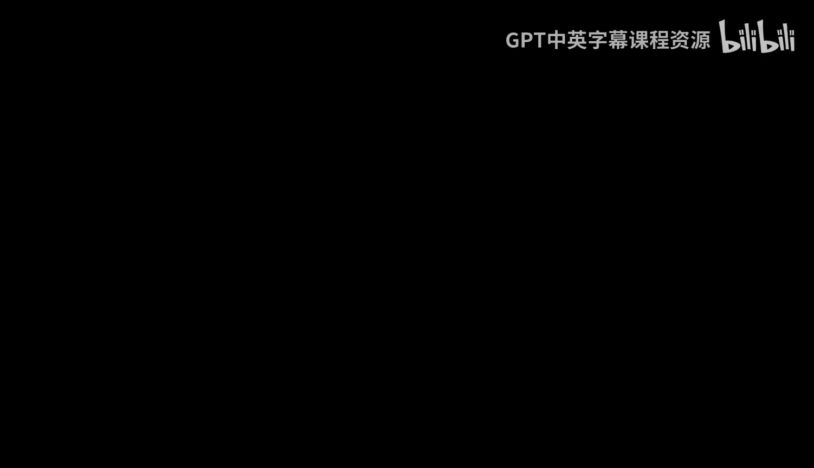
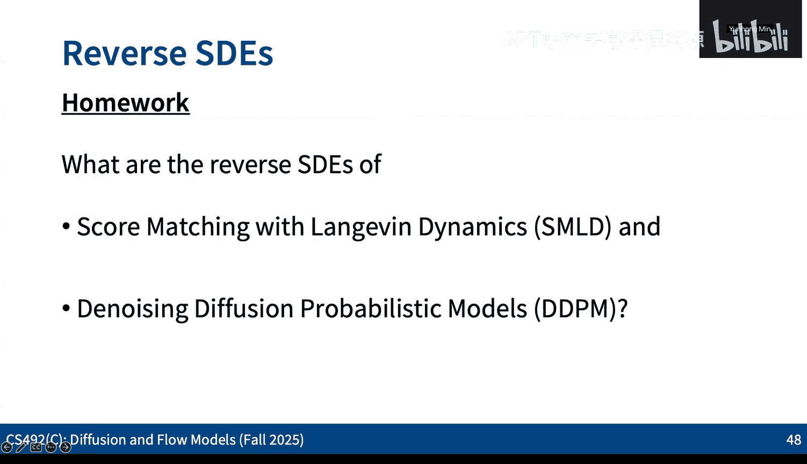

# 扩散与流模型：08：连续时间下的扩散模型



在本节课中，我们将深入探讨扩散模型的理论基础，特别是如何在连续时间域中理解和构建扩散模型。我们将看到，通过将扩散过程表述为随机微分方程，我们可以获得一个更通用、更强大的视角，并最终实现更高效的图像生成。

---

## 概述：从离散到连续

上一节我们介绍了DDPM和SMLD等离散时间扩散模型的基本框架。本节中，我们将视角切换到连续时间域，探讨如何用随机微分方程来描述扩散过程。这种视角不仅能加深我们对模型的理解，还能为后续实现更快速的采样算法奠定基础。

## 前向过程的连续化表述

我们之前看到的扩散模型，其前向过程是在离散时间步上定义的马尔可夫链。例如，在DDPM中，前向转移分布定义为：
```math
q(x_t | x_{t-1}) = \mathcal{N}(x_t; \sqrt{1-\beta_t} x_{t-1}, \beta_t I)
```
而在SMLD中，前向过程是逐步增加高斯噪声。

当我们将时间步的数量推向无穷大时，这些离散过程可以收敛为连续时间的随机过程。这个连续过程可以用一个**随机微分方程** 来描述。

### 随机微分方程简介

一个典型的SDE形式如下：
```math
dx = f(x, t)dt + g(t)dw
```
其中：
*   `dx` 是状态 `x` 的微小变化。
*   `f(x, t)` 是**漂移系数**，决定了 `x` 的平均变化趋势。
*   `g(t)` 是**扩散系数**，决定了注入的随机噪声的强度。
*   `dw` 是**维纳过程**（布朗运动）的增量，它代表了随机扰动。

维纳过程 `w(t)` 具有以下特性：
1.  `w(0) = 0`。
2.  增量 `w(t+Δt) - w(t)` 服从均值为0、方差为 `Δt` 的正态分布。
3.  不同时间区间的增量是相互独立的。
4.  路径是连续函数。

通过求解这个SDE，我们可以得到一条随时间演化的样本轨迹 `x(t)`。在扩散模型的语境下，这个轨迹描述了数据点如何逐渐被噪声破坏。

### 方差爆炸与方差保持SDE

对于之前讨论的两种主要扩散模型，其对应的连续时间SDE如下：

以下是SMLD对应的SDE（方差爆炸型）：
```math
dx = \sqrt{\frac{d[\sigma(t)^2]}{dt}} dw
```
其中 `σ(t)` 是随时间单调递增的噪声标准差函数。此过程没有漂移项，只有不断增大的噪声，因此数据分布的方差会“爆炸式”增长。

以下是DDPM对应的SDE（方差保持型）：
```math
dx = -\frac{1}{2}\beta(t)x dt + \sqrt{\beta(t)} dw
```
此过程包含一个将数据拉向原点的漂移项 `-β(t)x/2`，以及一个注入噪声的扩散项 `√β(t)`。精心设计 `β(t)` 可以使得数据分布的方差在整个过程中保持恒定。

这两种SDE是更一般形式的特例。理解它们是将离散模型与连续理论连接起来的关键。

## 变分扩散模型：一个通用框架

一个自然的问题是：除了上述两种，我们还能定义其他形式的扩散模型吗？答案是肯定的。这引出了**变分扩散模型** 的通用框架。

在这个框架下，前向过程由以下形式的分布定义：
```math
q(x_t | x_0) = \mathcal{N}(x_t; \alpha(t) x_0, \sigma(t)^2 I)
```
其中 `α(t)` 和 `σ(t)` 是时间的函数，分别控制信号和噪声的强度。

定义一个关键量——**信噪比**：
```math
SNR(t) = \alpha(t)^2 / \sigma(t)^2
```
变分扩散模型要求 `SNR(t)` 是随时间**单调递减**的。这意味着随着过程推进，噪声的强度相对于信号不断增强，最终将任何数据分布都转化为标准高斯分布 `N(0, I)`。DDPM和SMLD都是这个框架下的特例。

给定满足条件的 `α(t)` 和 `σ(t)`，我们可以推导出对应的前向SDE。更重要的是，**对于任何前向SDE，都存在一个对应的反向SDE**，用于从噪声中生成数据。

## 反向过程与得分函数

在连续时间视角下，反向生成过程同样由一个SDE描述。一个关键结论是，给定前向SDE：
```math
dx = f(x, t)dt + g(t)dw
```
其对应的反向SDE为：
```math
dx = [f(x, t) - g(t)^2 \nabla_x \log p_t(x)]dt + g(t)d\bar{w}
```
其中 `∇_x log p_t(x)` 就是我们在离散模型中熟悉的**得分函数**，`d\bar{w}` 是反向时间的维纳过程。

这个公式的美妙之处在于，它与离散情况完全一致：只要我们有一个训练好的网络 `s_θ(x, t)` 来预测得分函数，我们就可以通过数值方法求解这个反向SDE，从而从噪声中采样出数据。这建立了离散算法与连续理论之间的桥梁。

## 概率流常微分方程

SDE描述的过程包含随机噪声，因此从同一点出发会产生不同的轨迹。一个深刻的问题是：是否存在一个**确定性**的过程（即常微分方程ODE），能够实现完全相同的边缘分布 `p_t(x)` 的变换？

答案是肯定的。对应于反向SDE，存在一个称为**概率流ODE**的确定性过程：
```math
dx = [f(x, t) - \frac{1}{2}g(t)^2 \nabla_x \log p_t(x)]dt
```
注意，与反向SDE相比，它缺少了随机噪声项 `g(t)d\bar{w}`。

这个ODE的意义在于：
*   它定义了数据空间和隐空间之间**确定性**的双射映射。
*   通过求解这个ODE，我们可以实现从噪声到数据的生成。
*   **最关键的优势**：数值求解ODE的算法（如龙格-库塔法）非常成熟且高效，通常可以用比求解SDE少得多的时间步数获得高精度解。

这意味着，对于一个预训练好的扩散模型（即拥有一个准确的得分预测网络），我们无需重新训练，只需将生成过程从求解SDE改为求解对应的概率流ODE，并采用高效的ODE求解器，就能**大幅加速图像生成速度**。这正是DDIM以及更快的采样算法（如DPM-Solver）背后的核心思想。

## 总结

本节课我们一起学习了扩散模型的连续时间视角。我们首先看到了离散的DDPM和SMLD过程如何对应到连续的随机微分方程。接着，我们介绍了变分扩散模型这一通用框架，其核心是信噪比单调递减的条件。然后，我们探讨了反向生成过程对应的SDE，以及其中得分函数的关键作用。最后，我们揭示了隐藏在SDE背后的确定性过程——概率流ODE，它为实现快速采样提供了理论基础。



通过切换到连续时间视角，我们不仅获得了对扩散模型更统一的理解，更打开了通往高效生成算法的大门。在接下来的课程中，我们将具体探讨如何利用这些理论来实现快速的扩散模型采样。