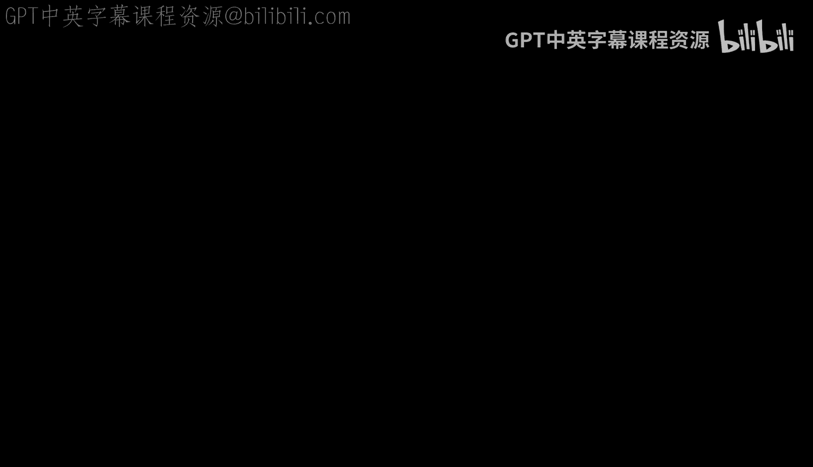
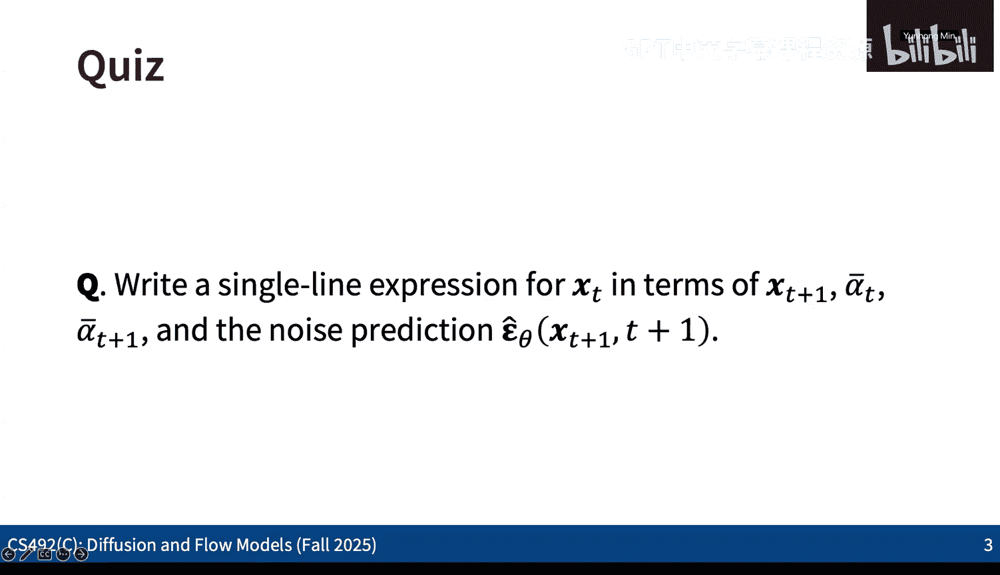
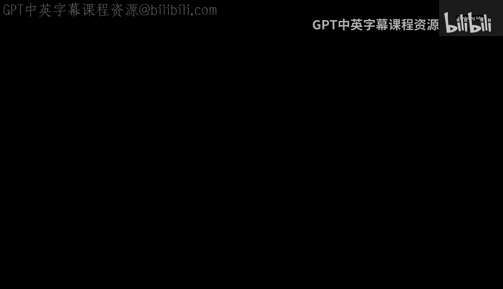
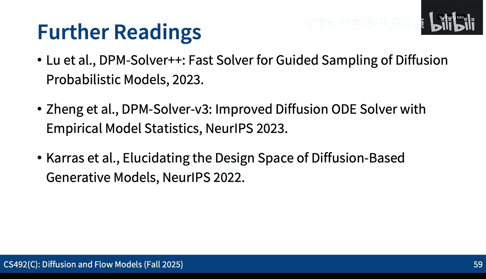

# 扩散与流模型：09：ODE求解器

在本节课中，我们将学习如何将扩散模型的反向生成过程视为一个常微分方程（ODE）的求解问题。我们将看到，通过利用ODE的特定结构，可以设计出比简单离散化更高效的求解器，从而用更少的步骤生成高质量的样本。

---

## 概述与回顾

上一节我们介绍了扩散模型在连续时间域下的随机微分方程（SDE）描述及其对应的概率流ODE（PF-ODE）。本节中，我们将深入探讨如何高效地求解这个ODE。

首先，让我们回顾一下关键概念。扩散模型的前向过程可以描述为一个SDE：
`dX_t = f(X_t, t)dt + g(t)dW_t`
其中 `f` 是漂移项，`g` 是扩散系数。其对应的反向SDE涉及一个分数项。然而，更重要的是，存在一个确定性过程——概率流ODE（PF-ODE），它与反向SDE共享相同的边缘分布。这个ODE的形式为：
`dX_t = [f(X_t, t) - 1/2 * g(t)^2 * ∇_{X_t} log p_t(X_t)] dt`
通过使用噪声预测网络 `ε_θ` 来近似分数项，我们可以将PF-ODE重写为：
`dX_t/dt = f(X_t, t) - 1/2 * g(t)^2 * s_θ(X_t, t)`
其中 `s_θ(X_t, t) ≈ -ε_θ(X_t, t) / σ_t`。对于变分扩散模型（VDM），我们通常用 `α_t` 和 `σ_t` 参数化前向过程，此时PF-ODE可以进一步具体化。

我们的目标是从一个纯噪声样本 `X_T` 出发，通过求解这个ODE，得到数据样本 `X_0`。最朴素的方法是欧拉方法：计算当前点的“速度”（即ODE的右侧），然后沿着该方向移动一小步，重复此过程。然而，这可能需要很多步才能获得准确的结果。我们将探索如何利用ODE本身的结构来设计更高效的求解器。

---

## 半线性ODE与指数积分器

我们面对的PF-ODE具有一种特殊结构。观察其形式：
`dX_t/dt = P(t)X_t + Q(X_t, t)`
其中 `P(t)` 是一个仅与时间相关的系数函数（来自 `f` 项），而 `Q(X_t, t)` 是一个非线性项（涉及神经网络的预测）。这种形式的ODE被称为**一阶半线性ODE**。“半线性”体现在它对 `X_t` 是线性的，但包含一个非线性的附加项 `Q`。

对于这类ODE，存在一种强大的解析工具称为**指数积分器**。它允许我们精确地积分线性部分，而只对非线性部分进行数值近似。

为了理解其原理，让我们先看一个简单的线性ODE例子：
`dX_t/dt = P(t)X_t`
其解析解为：
`X_t = X_s * exp(∫_{s}^{t} P(τ) dτ)`
我们引入一个**积分因子** `μ(t) = exp(-∫_{s}^{t} P(τ) dτ)`。对于半线性ODE `dX_t/dt = P(t)X_t + Q(X_t, t)`，在方程两边乘以 `μ(t)` 并利用乘积法则，可以得到：
`d/dt [μ(t)X_t] = μ(t)Q(X_t, t)`
然后对两边从时间 `s` 到 `t` 积分，并整理，就得到了半线性ODE的解析解公式：
`X_t = (μ_s / μ_t) * X_s + (1 / μ_t) * ∫_{s}^{t} μ_τ Q(X_τ, τ) dτ`
其中 `μ_t = exp(∫_{0}^{t} P(τ) dτ)`。这个公式的意义在于：`X_t` 的解可以表示为初始值的衰减（第一项）加上一个由非线性项 `Q` 驱动的积分（第二项）。

---

## 应用于概率流ODE

现在，我们将指数积分器的思想应用到我们的PF-ODE上。首先，我们需要将PF-ODE写成标准半线性形式。在VDM框架下，经过一些代数运算（特别是引入变量 `λ_t = log(α_t / σ_t)`，即信噪比的对数），PF-ODE可以重写为：
`dX_t/dt = -dλ_t/dt * (σ_t / α_t) * ε_θ(X_t, t)`
这看起来不像 `P(t)X_t + Q(...)` 的形式？实际上，通过更细致的推导（涉及变量替换和积分因子），可以证明其解具有与指数积分器公式相似的结构。最终，从一个时间点 `s` 到另一个时间点 `t` 的解可以表达为：
`X_t = (α_t / α_s) * X_s - α_t * ∫_{λ_s}^{λ_t} e^{-λ} * ε_θ(X_{τ(λ)}, τ(λ)) dλ`
这个公式非常强大：
*   第一项 `(α_t / α_s) * X_s` 是纯线性衰减，可以精确计算。
*   第二项是一个积分，其被积函数包含神经网络预测的噪声 `ε_θ`。这是整个表达式中唯一需要近似处理的部分。

**关键洞察**：DDIM的确定性采样过程，恰好对应于对这个积分项采用**一阶近似**（即假设在从 `s` 到 `t` 的区间内，`ε_θ` 是常数）。将这个常数近似代入上面的积分公式，并进行计算，我们就能精确地恢复出DDIM的更新公式：
`X_s = α_s/α_t * X_t - σ_s * ε_θ(X_t, t)`
这意味着，DDIM可以被理解为概率流ODE的一种一阶数值求解器，但它是一种“聪明”的求解器：它精确处理了线性部分，只对非线性部分做了粗糙近似。

---

## 构建更高效的求解器

既然我们将反向生成视为ODE求解，并且DDIM对应一阶近似，那么一个自然的想法是：使用**更高阶的ODE求解器**来获得更精确的近似，从而在更少的步数内达到相同的生成质量。

以下是构建更高效求解器的思路：

**1. 高阶近似**：
   *   **一阶方法（如DDIM）**：在整个区间 `[t, s]` 内，使用起点 `X_t` 处的噪声预测 `ε_θ(X_t, t)` 作为常数近似。
   *   **二阶方法（如Heun方法）**：
        a. 首先，用一阶方法（欧拉步）计算一个中间点 `X_mid`。
        b. 然后，在起点 `X_t` 和中间点 `X_mid` 分别评估噪声预测。
        c. 最后，用这两个预测值的平均来执行更精确的更新步。
   *   **更高阶方法**：可以使用龙格-库塔等经典ODE求解器，它们通过评估区间内多个点的斜率来获得高精度。

**2. 自适应步长**：
   经典ODE求解器可以根据局部误差估计动态调整步长。在扩散模型上下文中，这意味着可以在轨迹平滑时采用大步长，在复杂区域采用小步长，从而优化总步数。

**优势**：这些方法都**无需重新训练模型**。它们直接利用已训练好的噪声预测网络 `ε_θ`，只是在推理（采样）时改变了更新 `X_t` 的算法。研究表明，使用二阶或三阶求解器，仅用15-20步就能达到DDIM需要1000步才能达到的样本质量，实现了极大的加速。

---

## 总结

本节课中我们一起学习了：
1.  **扩散模型反向过程是一个ODE求解问题**：概率流ODE（PF-ODE）提供了生成过程的确定性描述。
2.  **利用结构设计高效求解器**：PF-ODE具有半线性结构，这允许我们使用指数积分器技术，精确解析线性部分，仅对非线性（神经网络）部分进行数值近似。
3.  **DDIM是特定的一阶求解器**：DDIM的确定性采样公式，恰好对应于对PF-ODE解中积分项的一阶常数近似。
4.  **通向更快的采样**：通过应用更高阶的ODE数值方法（如二阶Heun法），可以在使用相同预训练模型的前提下，用少得多的步数获得高质量样本。这凸显了从连续时间角度理解扩散模型的威力——它不仅能解释现有方法，还能引导我们设计出更好的新方法。

这种将扩散模型与数值ODE理论结合的观点，是当前推动扩散模型高效采样前沿发展的核心思想之一。