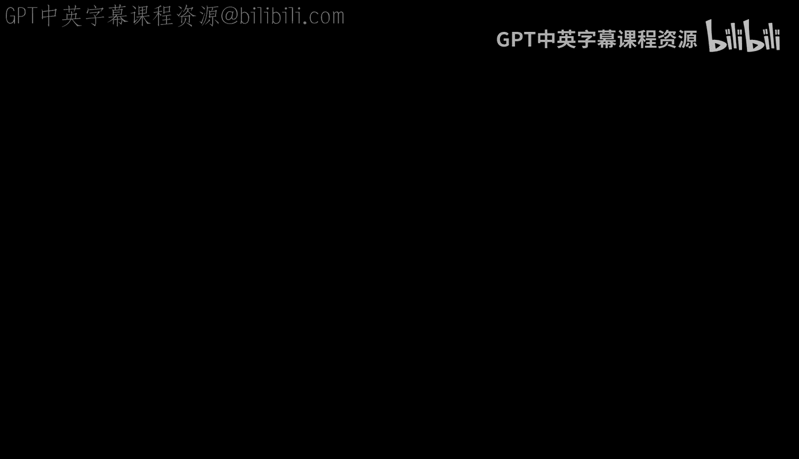
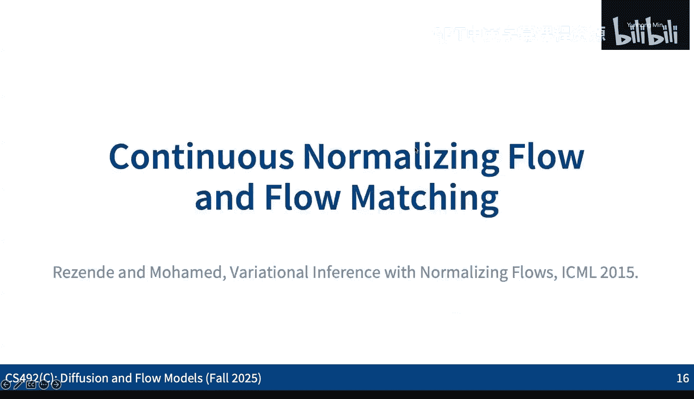
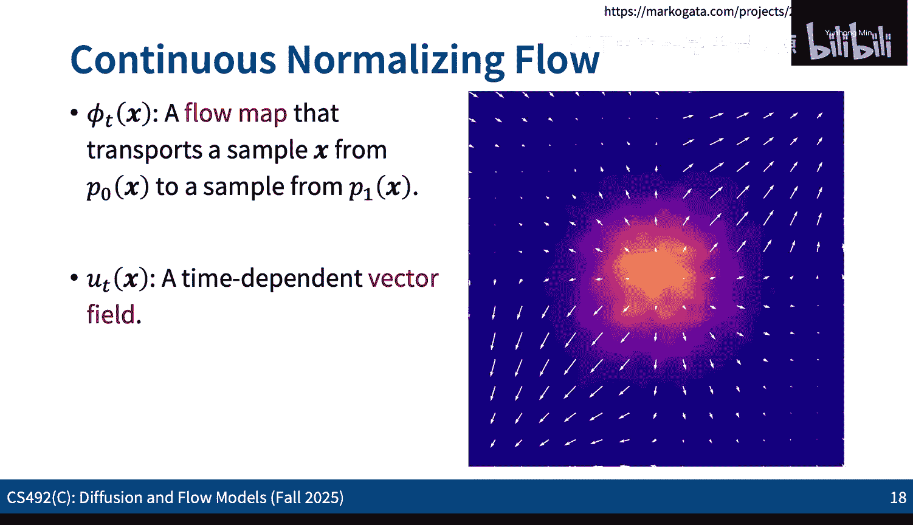
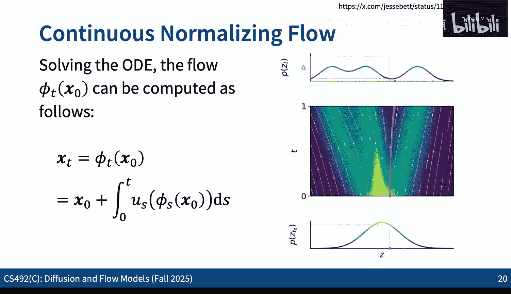
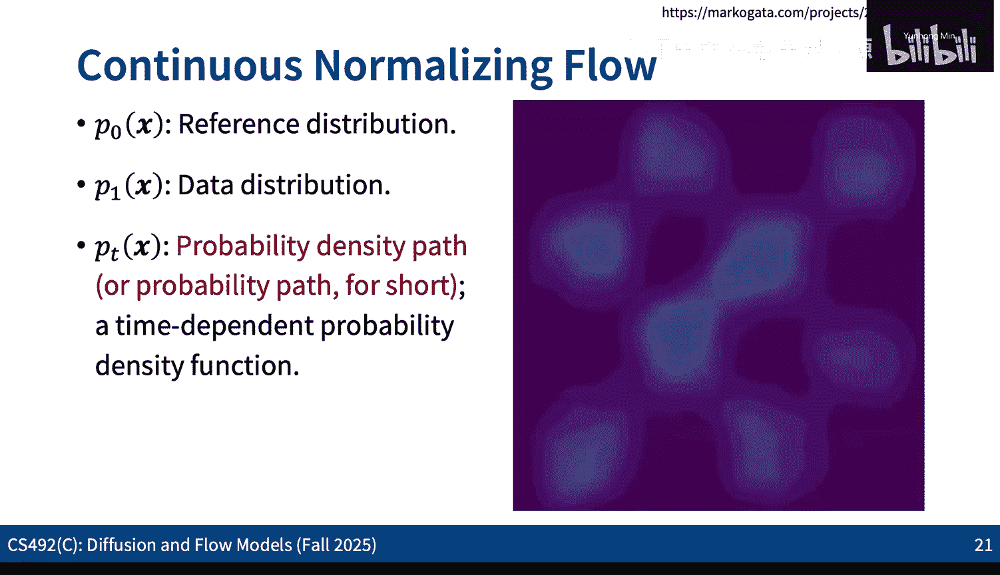
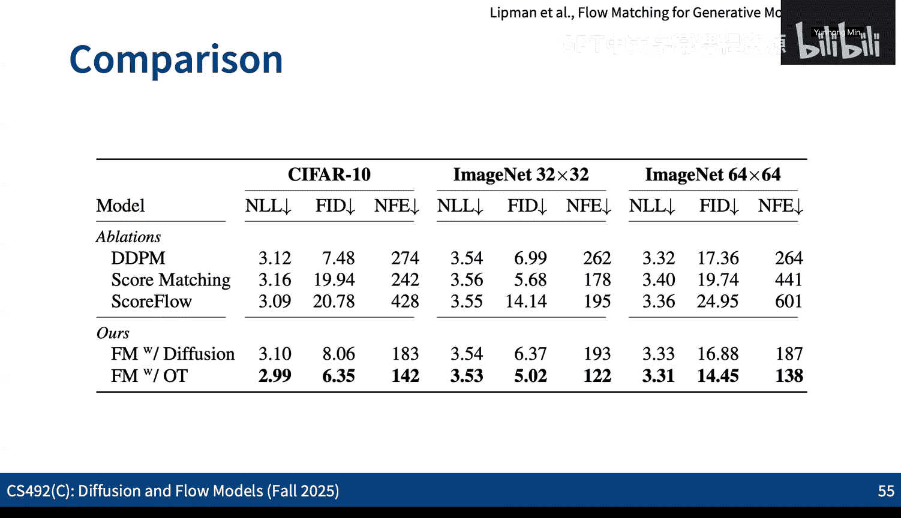

# 扩散和流模型：10：流匹配 1 (Diffusion and Flow Models, Fall 2025, KAIST)

## 概述
在本节课中，我们将学习一种新的生成模型——流匹配。我们将从回顾扩散模型开始，理解其核心思想，然后探讨如何通过定义“流”和“向量场”来构建一个更通用的ODE（常微分方程）框架。我们将看到，流匹配模型虽然源于不同的理论背景，但最终与扩散模型有着深刻的联系，并且为实现更高效的生成提供了新的思路。

## 从扩散模型到ODE框架
上一节我们介绍了扩散模型，从DDPM、DDIM等基于分数的模型开始。我们认识到，扩散模型本质上是在学习一个从数据分布到噪声分布的映射，这个映射过程可以用随机微分方程（SDE）来描述。

具体来说，前向过程和反向过程都可以表示为SDE。特别是，当我们定义前向SDE为特定形式时，反向SDE可以用一个包含分数函数的公式来定义。

我们还发现，存在一个对应的ODE公式，其边缘分布与SDE相同。这意味着，通过求解这个ODE，我们同样可以实现双向映射。这就是扩散模型的基本思想。

在讨论了ODE公式后，我们可以将所有的映射都视为ODE。这就是PF ODE（概率流ODE）。当时我们并没有深入探讨如何从SDE或反向SDE推导出这个公式。如果你对此感兴趣，我强烈推荐你查阅相关论文了解细节。

推导这些公式需要从一个基本方程开始，即**Fokker-Planck方程**。这个方程描述了SDE公式与中间数据点 `X_t` 的概率分布之间的关系。从这个方程出发，我们可以推导出PF ODE的所有内容。我们不会深入所有细节，但请记住这个方程，因为在课程后续部分你会反复看到它。

## 加速扩散生成：ODE求解器与蒸馏
在得到ODE公式后，我们可以根据扩散模型的结构设计专门的ODE求解器。我们之前看到的DPM求解器就是一个例子，它试图为ODE寻找解析解。虽然无法为整个ODE找到完全解析的解，但我们可以尝试对线性部分进行解析积分，并对非线性部分进行近似。

通过这种方式，即使步数较少，我们也能获得更好的结果。DPM求解器有趣的一点是，当对非线性部分采用一阶近似时，它就变得与DDIM完全相同。这解释了为什么DDIM的非随机版本在步数较少时表现更好，因为它本质上是ODE公式的一阶近似。

我们可以进一步采用更高阶的近似来处理非线性部分，从而用更少的步数获得更好的结果。这或许是一些同学尝试减少生成步数的方向。

下图展示了我们从课程一开始就展示的基本思想。扩散模型的优势在于能生成高质量输出且没有模式崩溃问题，而其局限性就在于推理速度慢。

我们上一讲讨论的就是如何用更少的步数生成高质量输出。我们从需要约1000步的DDPM开始，通过DDIM减少到50-200步。当认识到DDIM可以看作是ODE公式的一阶近似，并使用更高阶的求解器后，我们可以将步数进一步减少到10-15步。这是一个从1000步到10步的显著进步。

问题是，我们还能如何进一步改进？如果你观察最近的图像或视频生成模型，会发现它们的生成速度非常快。最新的图像和3D视频生成模型只需要几步（如1、2、5步）。这意味着还有其他的加速方法。

我们之前讨论过的加速想法都可以直接在测试时应用，无需重新训练模型。这是扩散模型一个非常有趣的特点：仅通过改变生成公式，就能实现约100倍的加速。

此外，还有一些想法涉及对预训练模型进行微调，以实现进一步的加速。这类技术通常被称为“蒸馏”。给定一个预训练模型，通过对神经网络进行微调，使其能够实现单步生成。这样，我们只需一次计算就能得到输出。

我们不会深入探讨太多加速技术，但在此提及的原因是，我们今天开始讨论流模型的一个主要动机，也是关于通过微调实现加速。这是一个非常重要的主题，可以进一步减少计算量。

最具代表性的基于微调的加速技术是**一致性模型**。我们不会深入其细节，但其基本思想是：首先计算ODE轨迹，即从某个噪声样本（标准高斯样本）出发，通过ODE求解器得到一个逼真的数据点。这样，我们就得到了一条从标准高斯样本到数据点的轨迹。

在这条轨迹上的每一个点，我们都在进行噪声预测。我们已经知道，噪声预测可以用来计算最终值的期望。实际上，神经网络的作用就是预测最终输出的期望。

一致性模型的基本思想是：对于这条轨迹上的所有点，我们希望早期阶段对最终输出的期望，与后期阶段对最终输出的期望尽可能接近。通过这种“提前预测最终结果”的相对简单的想法，我们可以在步数非常少（甚至一两步）的情况下，仍然生成逼真的结果。这是一个很好的想法。

这类想法的一个共同点是，它们都需要一个预训练好的扩散模型作为起点进行微调。这意味着通过在训练阶段花费更多时间，可以减少测试时的计算量。这就是这些加速技术的基本思想。

即使不了解所有细节，你现在至少可以看到技术发展的脉络：我们从DDPM（1000步）开始，到DDIM（几十步），再到DPM求解器等专用求解器（降至10步），然后是像一致性模型这样的蒸馏技术（降至1或2步）。这为我们探索扩散模型提供了一幅全景图。

## 流匹配：一个全新的视角
然而，还有其他选择。从今天起，我们将讨论一种完全不同的生成模型——**流匹配**。但在讨论完所有内容后，你会发现，尽管流匹配的思想源于完全不同的理论根源，但其最终形式与扩散模型几乎相同。这是一个非常有趣的点，尽管理解两者之间的联系可能有些挑战。

所以，流匹配是另一种实现加速的想法，并且它代表了一种全新的生成模型。我们将开始讨论流模型。

在扩散模型的语境中，我们从前向过程的角度看待时间域。时间 `t` 从数据分布 `X_0` 开始，通过前向扩散过程映射到 `X_T`。即从数据分布 `X_0` 开始，最终到达 `X_T`。这是我们在扩散模型中使用的约定。

问题是，在流匹配的语境中，正如我所说，这是一个全新的模型，源于不同的文献。他们从**生成**的角度来看待时间域。这意味着 `X_t` 从某个已知分布（通常是标准高斯分布）开始，然后被映射到数据分布中的一个样本 `X_1`。

我们需要切换时间方向。之前是从数据分布到高斯分布，现在则是从高斯分布到数据分布。因此，现在 `X_0` 是高斯分布样本，`X_1` 是数据分布样本。我知道这非常容易混淆，但扩散模型的所有资料都遵循前一种约定，而流匹配的所有资料都遵循后一种约定。请务必记住这一点。

所以，基于此，让我们来讨论流匹配的公式。

在流匹配中，我们设定一个参考分布（通常是标准高斯分布）`P_0`，和目标数据分布 `P_1`。

流匹配与扩散模型的一个关键区别在于：扩散模型假设参考分布是标准高斯分布。如果我们将其更改为其他分布，一切都会变得复杂。而流模型的好处是，我们可以让参考分布是任何分布，且公式完全不变。这是流模型非常有趣的一点，可以说它更通用。

无论如何，我们将参考分布设为 `P_0`，目标分布设为 `P_1`。

接着，我们引入一些新术语（其实我们已经见过，只是现在有了名字）。我们将定义一个函数 `π`，称为**流映射**。流映射本质上就是轨迹。从点 `X_0`（参考分布的样本）开始，`π_t(X_0)` 表示在时间步 `t` 时轨迹上的点。我们从 `X_0` 开始，随时间变化到达 `X_1`，`π_t` 就代表了这条轨迹。这里没有随机性，一切都是确定性的，所以这也是一个基于ODE的模型。

这意味着，如果我们确定了起点 `X_0`，那么轨迹上的所有点也就确定了。因此，我们可以定义一个函数来表示它。具体来说，从特定 `X_0` 开始的 `X_t` 记为 `π_t(X_0)`。这是新的记号。

我们还将定义**向量场** `v`，它基于ODE流来定义。你可以看到向量场和流映射是如何关联的。显然，基于向量场定义ODE，就可以计算出每个时间步 `t` 的流映射。这是基本概念。

流映射可以通过基于向量场的ODE公式来定义。显然，轨迹的起点应与 `X_0` 相同。根据定义，当时间 `t` 为0时，它应该就是 `X_0`。如果我们将 `X_0` 一直映射到时间 `t=1`，那么结果应该是数据分布中的一个样本。

轨迹上的每一个点都可以通过从 `X_0` 开始，对向量场 `v` 在时间 `t` 上积分来求解ODE得到。我们有时会滥用记号，用 `X_t` 表示从 `X_0` 出发在时间 `t` 的点。

在扩散模型语境中，我们见过噪声数据点的概率分布。在基于分数的模型中，我们有参考分布和数据分布，以及中间噪声数据点 `X_t` 的概率分布。

你还记得在基于分数的模型中，我们是如何定义中间噪声数据点的数据分布的吗？在朗之万动力学中，我们基本上是对每个数据点样本进行高斯卷积。我们没有这个分布的闭式解，只有数据分布的样本。为了执行朗之万动力学，我们定义中间噪声数据点 `X_t` 的概率分布为每个数据点的高斯卷积。

在流匹配的语境中，我们将给这个概念起个新名字：**概率密度路径**或**概率路径**。这只是一些新术语。

请记住这三样东西：流映射 `π`（可由向量场 `v` 计算）、向量场 `v` 和概率路径 `p_t`。我们将继续讨论这三者。

在基于分数的扩散模型中，我们首先定义概率路径，即通过注入高斯噪声（进行高斯卷积）来定义中间数据点的概率分布。基于此，我们可以公式化前向和反向过程，然后推导出PF ODE，从而从定义的概率路径计算出向量场。

在流匹配中，我们将以相反的方式进行。我们将首先定义向量场和流映射，然后看看概率路径如何基于它们定义。这就是连接所在。

这里，向量场和流映射之间的关系比较直接，流映射可以通过求解向量场的ODE得到。但概率路径与这两者的关系就不那么清晰了。这部分比较复杂，我们不会深入，但正是这个方程（Fokker-Planck方程）再次出现，建立了它们之间的联系。

虽然这个方程看起来很复杂，但好处是，如果我们忽略随机性部分，这个 `F` 函数就可以看作是我们的向量场 `v`。在没有随机性的简化版本中，我们可以看到概率路径（时间步 `t` 的数据点概率分布）与向量场之间存在某种简单的联系。

实际上，这个方程显示了向量场与概率分布之间的关系，是推导PF ODE的关键之一。基于此，通过一些推导，我们可以发现：一旦我们有了向量场 `v`，对于轨迹上的任何数据点，我们都可以计算其对数概率。

现在，向量场可以用来计算在时间步 `t` 每个数据点出现的可能性。关键在于，如果我们能找到这样一个向量场，它能最大化所有数据样本 `X_1` 的对数概率，那么我们就找到了一个好的映射，可以将 `X_0` 映射到 `X_1`。这意味着，这个向量场编码了映射信息。

因此，就像在扩散模型中一样，我们可以尝试用一个神经网络来记忆这个包含映射信息的向量场。对于每个时间步 `t` 的样本 `X_t`，我们可以训练一个神经网络来预测这个“速度”（即向量场）。如果我们拥有向量场的信息，就可以训练神经网络来学习它，从而最大化 `X_1` 的对数概率。然后，基于此，我们可以计算ODE，这将成为我们的生成过程。

这就是我们如何通过直接定义流映射和向量场来定义另一种基于ODE的生成模型的高级思想。

但显然，这里的问题是：我们如何找到这样的向量场？从任何 `X_0` 开始，通过向量场将其发送到 `X_1`，`X_1` 应该是一个逼真的数据点。问题是如何找到能最大化 `X_1` 对数概率的向量场？

一种全局方法是，我们将损失函数定义为上一张幻灯片中看到的对数概率。对于任何数据点 `X_1`，通过沿时间向后运行ODE（反向过程）回到 `X_0`，我们可以用这个公式计算其对数概率。这意味着，从 `X_1` 出发，我们训练一个神经网络，使其向量场能让我们向后走到 `X_0`，并以这种方式计算概率。我们寻找能使这个值最大化的向量场。

这是流匹配的一个可能表述。但问题是，如果我们以这种方式训练向量场（速度预测网络），会有什么问题？你确实可以实现这种方式，但我们应该思考一下。

问题都源于求解ODE。除非ODE具有非常特定的形式，否则以稳定方式求解ODE非常具有挑战性。对于一般形式，ODE求解不仅计算成本高，而且数值上可能不稳定。

如果我们以这种方式训练神经网络，那么每次计算损失函数时都需要求解ODE，并且反向传播必须通过ODE求解器进行。但ODE求解计算成本高且可能数值不稳定。因此，问题在于：我们如何在不使损失函数涉及ODE求解的情况下学习向量场？

这就是基本思想。现在，我们开始看到，我们讨论的这种新生成模型实际上变得与扩散模型略有相似，但解释方式却大不相同。

我们要做的是：我们需要时间步 `t` 的向量场 `v`，但我们将考虑所谓的**条件化**设置：条件概率路径、条件流映射和条件向量场。

这里的条件概率路径意味着，我们假设数据分布是以 `X_1` 为中心、方差非常小的高斯分布。这听起来是不是很熟悉？实际上，这与我们在上一讲中看到的基于分数的模型所做的完全相同。

我们基本上是对数据点 `X_1` 进行某种高斯卷积，为每个时间步定义噪声数据分布。这与扩散模型中的前向跳跃分布完全对应，只是我们改变了时间范围和部分记号。

采用这种条件化设置的原因是，好处在于现在我们的数据分布再次成为高斯分布，而我们已知其闭式解。一旦数据分布有了闭式解，我们就可以推导出流映射和向量场的闭式解。所有计算都变得在数值上更易处理。

在推导出条件化设置的所有内容后，我们将看到如何基于这些条件量来计算边缘概率路径和边缘向量场。这就是基本思路。

所以，当我们看到条件概率路径时，`X_1` 是数据点。给定 `X_1`，时间 `t` 的条件概率路径。你可以将其视为类似于扩散模型中的前向过程。在前向过程中，我们看到了如何对每个数据点 `X_1` 注入具有某种漂移的高斯噪声。这实际上对应于扩散模型中的前向跳跃分布。

我们已经见过很多东西，比如 `VP` 和 `VE` 情况，它们都是这样定义的。这个公式可能看起来与 `VP` 情况大不相同，但原因是时间范围改变了。不过，这确实是我们在扩散模型中见过的东西：前向跳跃分布，即向 `X_1` 添加高斯噪声。

现在我们可以看到流模型和扩散模型之间的一些联系。正如我所说，我们将继续看到这三样东西（流映射、向量场、概率路径）以及它们之间的关系。在条件化设置中，我们也会看到条件流映射、条件向量场和条件概率路径。

在扩散模型的情况下，我们首先定义了这个（概率路径），然后定义了其他所有东西。而在这里，我们将首先定义条件流映射为一个简单的线性函数，然后看看其他东西如何基于它推导出来。

你可以看到我们是如何推广这个想法的：在之前的扩散模型中，我们有一些特定的形式（尤其是高斯卷积或噪声添加），现在我们想扩展范围，首先定义条件流映射，然后基于它找到所有其他东西。

请不要混淆。这是条件化设置。以逼真的数据点 `X_1` 为条件，流映射以起点（通常是高斯分布样本）作为输入。但在流模型中，它不一定需要是高斯分布，而是来自参考分布的样本。我们取的样本以数据点为条件。

从这样的条件化设置来看，如果时间 `t` 为0，输出应该是 `X_0`；如果时间 `t` 为1，输出应该接近 `X_1`。这意味着，虽然我们看到了条件流映射的一般线性形式，但我们对函数 `μ` 和 `σ` 的定义必须满足这些边界条件。

你可以定义任何 `μ` 和 `σ`，但无论你如何定义，当时间 `t` 为0时，输出应为 `X_0`；当时间 `t` 为1时，输出应接近 `X_1`。你需要以这种方式定义这两个函数。

现在你可能想说，这越来越接近你之前见过的某个东西。上次测验的第5题就接近这个。所以，你已经开始看到扩散模型和流匹配之间的一些联系。

通过这种线性函数，你会看到一条从任意 `X_0` 映射到 `X_1` 的直线轨迹。那么，为什么我们要将条件流映射定义为这种简单形式呢？原因在于，一旦我们以这种简单方式定义条件流映射，那么一切都会变得非常简单。

然后，我们可以轻松地定义对应的条件概率路径也为高斯分布。我们在前面的幻灯片中看到了流、向量场和流映射之间的关系，以及向量场和概率路径之间的关系。基于此，如果你推导所有内容，会发现从线性条件流映射出发，给定 `X_1` 的条件概率路径确实变成了简单的高斯形式。

这也非常类似于我们在扩散模型中看到的，对信噪比函数 `α` 和 `σ` 设置某些条件的情况。虽然我们使用了新的记号 `μ` 和 `σ`，但你可以感觉到它们与之前讲座中的函数是相同的。抱歉我们不断使用新记号，因为它们来自不同的文献。

实际上，这些项与评估扩散模型中的项有关。正如我所说，你需要满足边界条件：在时间步0输出应为 `X_0`，在时间步1输出应为 `X_1`。

基于此，让我们验证一下。你可以自己尝试进行合理性检查。给定这种具有边界条件的线性条件流映射，只需代入这些值，看看得到什么。

基于 `μ` 和 `σ` 函数的最简单选择，如果我们写出条件概率路径、条件流和条件向量场，你会得到这个形式。这非常明显，对吧？条件流映射应该是这两点之间的直线插值，形成从 `X_0` 到 `X_1` 的直线轨迹。条件概率路径是那样定义的。向量场被定义为该直线上的向量方向。这很直观