# 扩散模型与应用：11：扩散同步

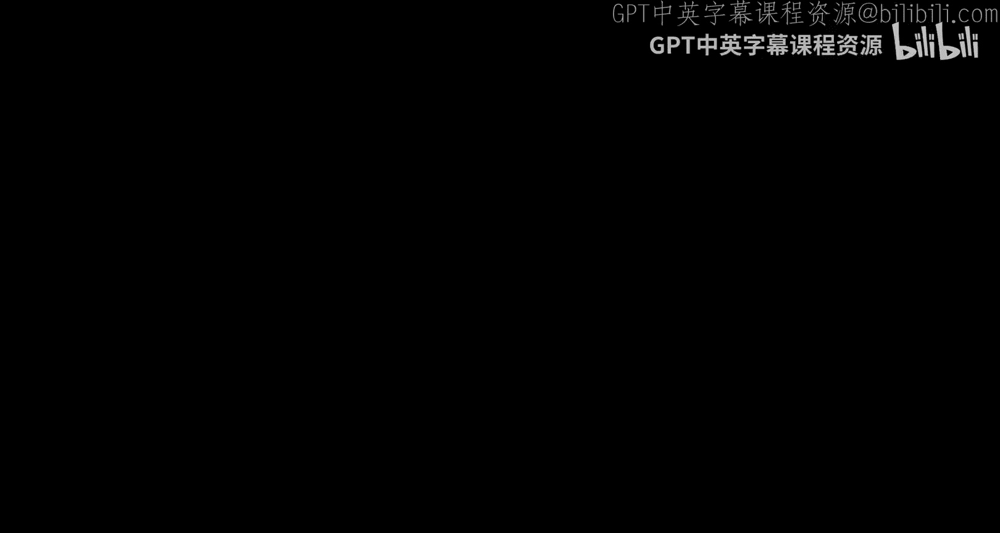

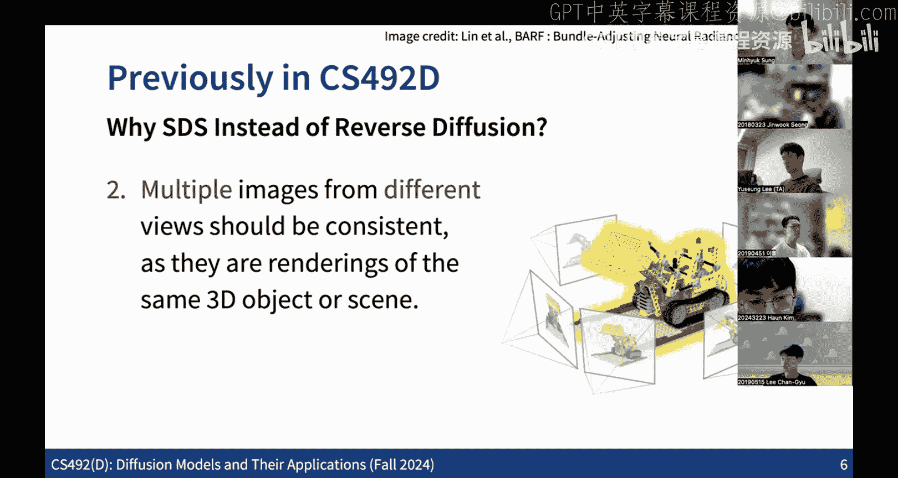

在本节课中，我们将学习如何利用预训练的扩散模型生成超出其原始设计范围的数据，例如全景图像、3D纹理等。我们将重点介绍一种称为“扩散同步”的技术，它通过协调多个实例空间的反向扩散过程来实现这一目标。

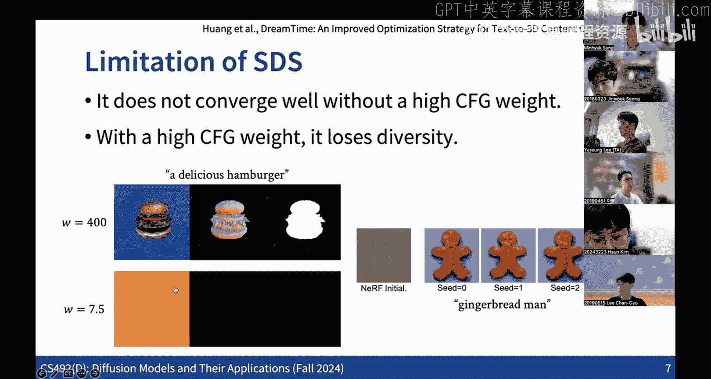

上一节我们介绍了SDS（分数蒸馏采样），它通过反向传播扩散模型的损失函数来生成新类型的数据。本节中，我们将探讨另一种无需训练即可扩展扩散模型能力的方法——扩散同步。

## 核心概念：规范空间与实例空间

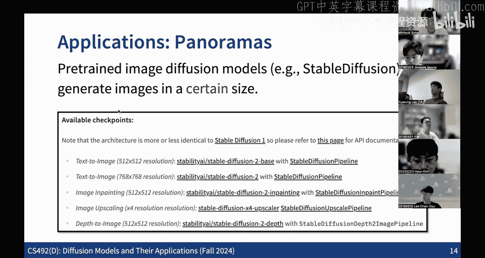

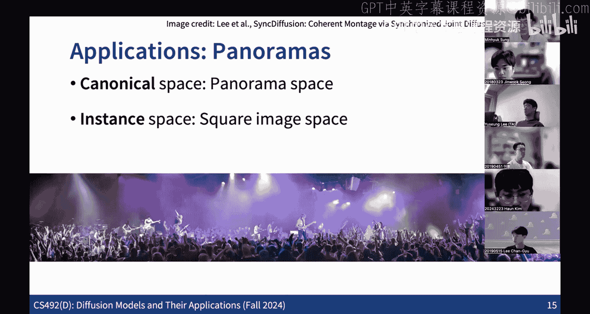

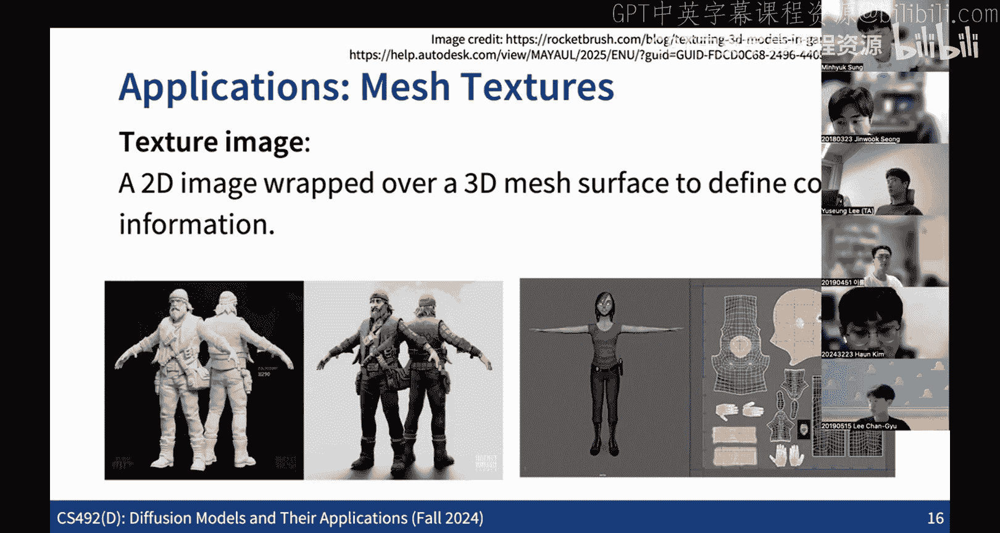

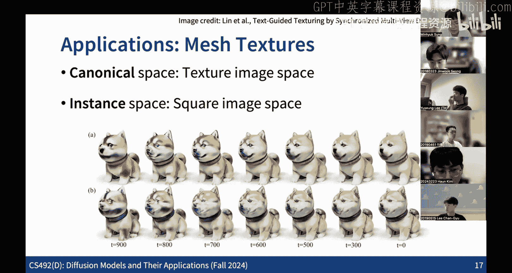

为了理解扩散同步，我们首先需要定义两个关键空间：

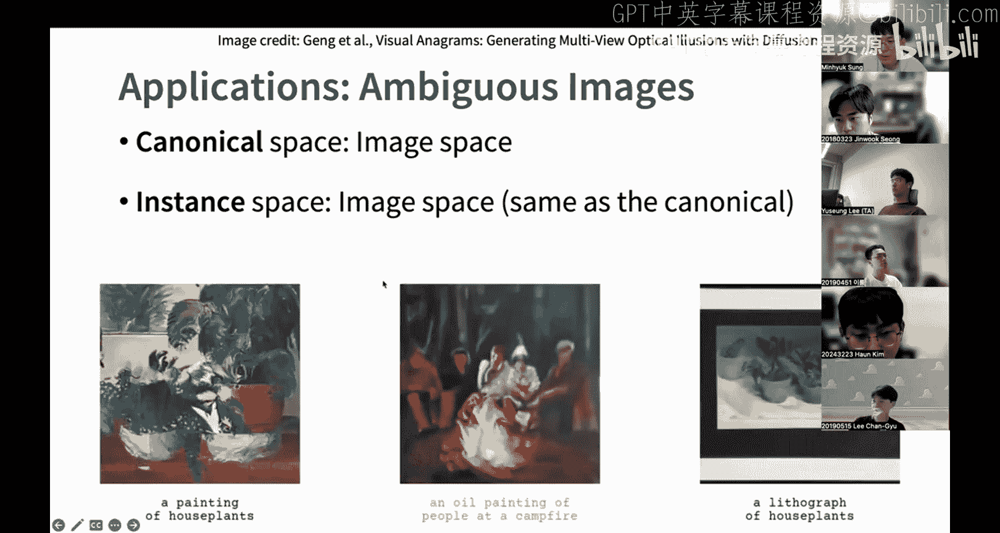

*   **规范空间**：这是我们希望生成最终数据的空间。例如，一张长画布、一个3D模型的纹理贴图或一个全景图像。
*   **实例空间**：这是预训练扩散模型能够直接生成数据的空间。通常是固定尺寸（如512x512）的图像空间。

这两个空间之间存在映射关系：
*   **投影**：从规范空间映射到实例空间的操作（例如，从长画布中裁剪出一小块）。
*   **反投影**：从实例空间映射回规范空间的操作（例如，将小块图像拼贴回长画布）。

以下是几个应用此设置的例子：
*   **全景图像生成**：规范空间是长画布，实例空间是固定尺寸的图像块。
*   **网格纹理生成**：规范空间是包裹在3D模型表面的2D纹理图像，实例空间是从特定视角渲染出的图像。
*   **歧义图像/缩放视频**：规范空间和实例空间可以是同一个图像空间，但通过特定的变换（如像素重排、缩放）相互映射。

## 扩散同步的基本思想

扩散同步的核心思想是：**在多个实例空间上并行运行扩散反向过程，并在规范空间中对中间结果进行同步（例如，取平均）**，以确保最终输出在不同实例间保持一致性和连贯性。

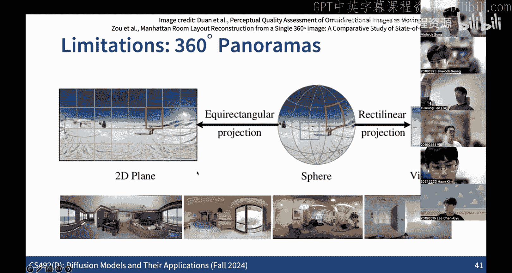

假设我们使用确定性采样（DDIM）。在每一步去噪中，对于每个实例图像，我们计算三个量：
1.  预测的噪声 **ε_t**
2.  预测的干净数据 **x̂_0|t**
3.  采样得到的下一步噪声数据 **x_{t-1}**

最简单的同步方法是：独立为每个实例计算 **x_{t-1}**，然后在规范空间中对所有实例对应的 **x_{t-1}** 在重叠区域进行平均，再将平均后的结果投影回各个实例，继续下一步去噪。

## 为何简单的平均有效？

如果不进行同步，每个实例独立生成图像，最终拼接时会出现明显的不连续和接缝。通过对噪声数据 **x_t** 或去噪路径进行平均，相当于在去噪过程中引入了跨实例的约束，引导所有实例朝着一个在规范空间内连贯一致的结果进化。

实验表明，即使对所有实例使用相同的文本提示词，仅通过平均 **x_{t-1}** 就能生成平滑、连贯的全景图像。更强大的是，这种方法还能用于**场景合成**：为规范空间的不同区域（对应不同的实例）指定不同的文本提示词（例如，“左边是山，右边是海”），通过同步，模型能生成将这些元素自然融合的单一连贯图像。

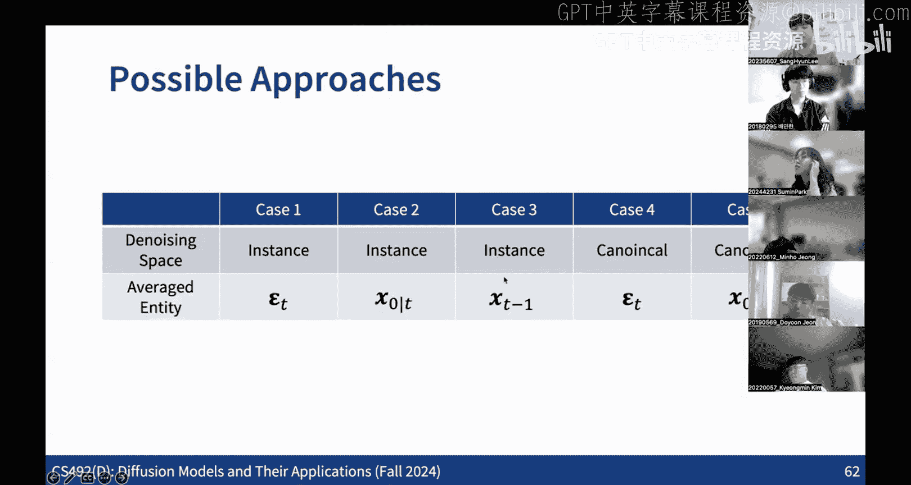

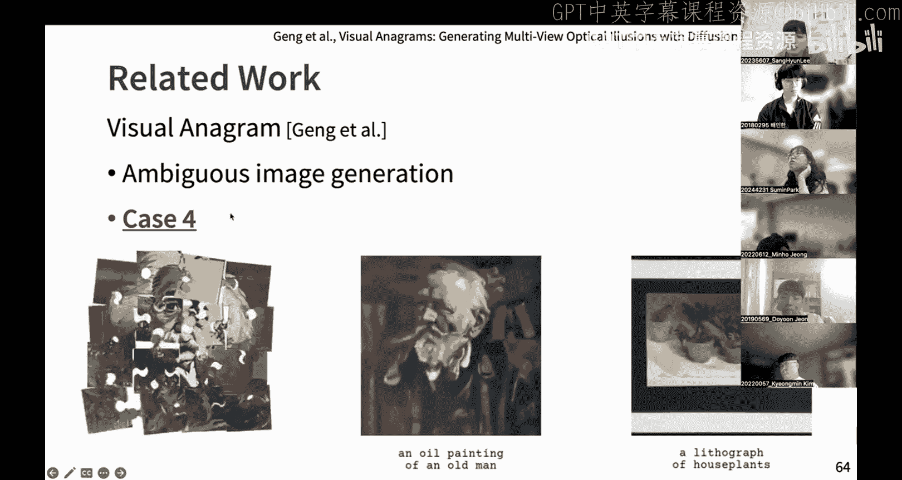

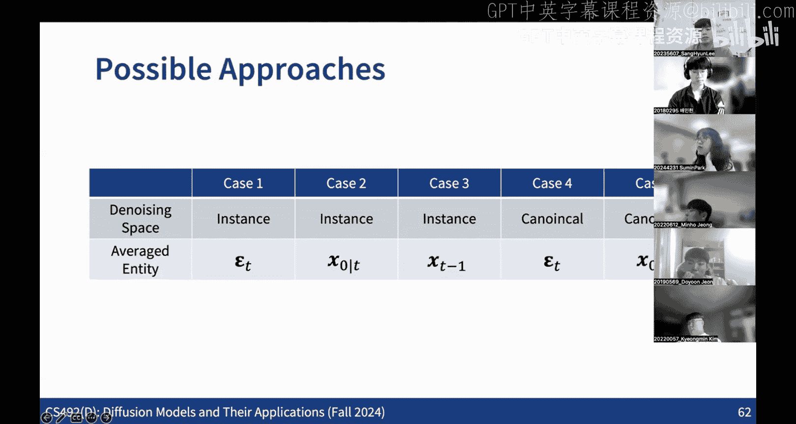

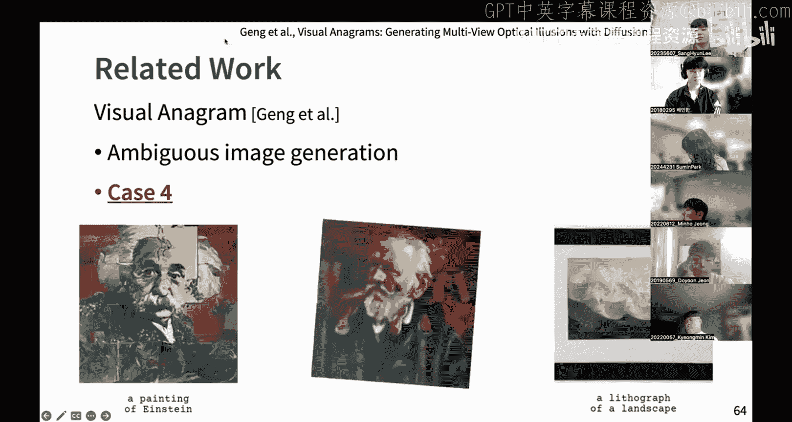

## 同步策略的变体与选择

我们可以在两个维度上改变同步策略：
1.  **在哪个空间执行去噪**：实例空间 或 （通过投影/反投影绕行的）规范空间。
2.  **在规范空间对哪个量进行平均**：**ε_t**、**x̂_0|t** 或 **x_t**。

这理论上产生了多种组合。研究表明：
*   平均 **ε_t**（梯度方向）通常效果不佳，因为它改变了去噪轨迹的方向，可能导致不稳定的输出。
*   平均 **x_t**（噪声数据）效果尚可，但平均后的 **x_t** 可能偏离其应有的分布，导致次优结果。
*   平均 **x̂_0|t**（预测的干净数据）在大多数应用中表现最好，因为它对去噪轨迹的修改最小，主要影响用于采样 **x_{t-1}** 的条件，能在保持真实性的同时实现良好的同步。

## 与SDS及迭代更新方法的比较

*   **SDS**：通过优化损失函数来更新参数（如3D表示）。优点是可以处理没有预定义像素对应关系的复杂映射（如3D渲染），但可能生成颜色偏差、细节模糊的结果，且需要较高的分类器自由引导权重才能收敛。
*   **迭代更新**：顺序生成并填充实例，逐步构建规范空间。实现简单，但难以保证全局一致性，容易在后期无法修正早期错误，产生接缝。
*   **扩散同步**：并行处理所有实例，通过即时通信保证一致性。在具有强条件（如每个视角的深度图）时，能产生非常真实且连贯的输出。但在缺乏强条件时，可能难以完全消除不连续性。

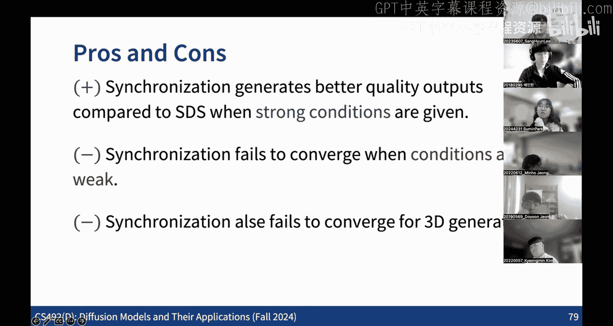

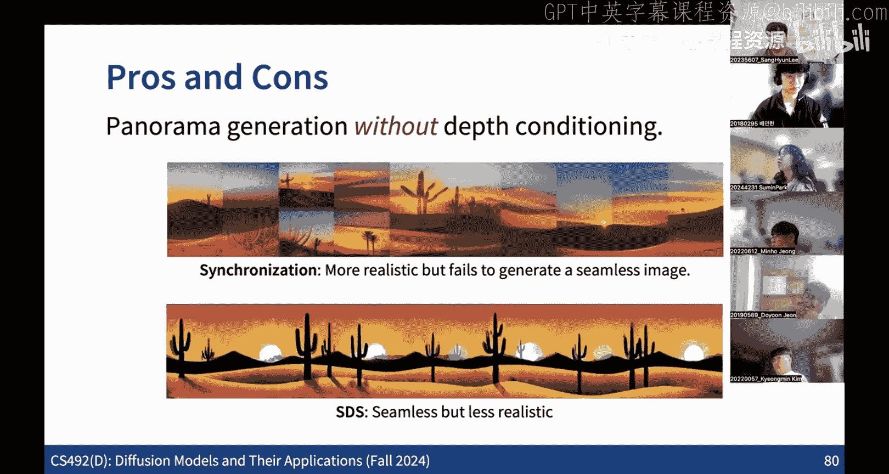

## 通过微调提升同步质量

对于特定类型的规范-实例映射（如固定格式的全景图），我们可以微调预训练的扩散模型，使其更擅长生成此类数据。方法类似于ControlNet：

1.  在原始UNet的每一层前后添加**零卷积层**，这些层的参数初始化为零，从而在训练初期不影响原始模型。
2.  引入**对应感知交叉注意力模块**。该模块利用预定义的像素对应关系（例如，实例A中的像素P对应于实例B中的像素Q），在去噪过程中让不同实例的特征进行通信。查询（Query）来自一个实例的像素，键（Key）和值（Value）来自其对应像素及邻域。
3.  使用较小规模的目标数据（如全景图像对）对新增的参数进行微调。

**优点**：生成质量高，对已知映射类型泛化好。
**缺点**：需要为每种不同的规范-实例映射关系进行专门的微调，计算成本更高，且对训练分布外的提示词或条件可能表现不佳。

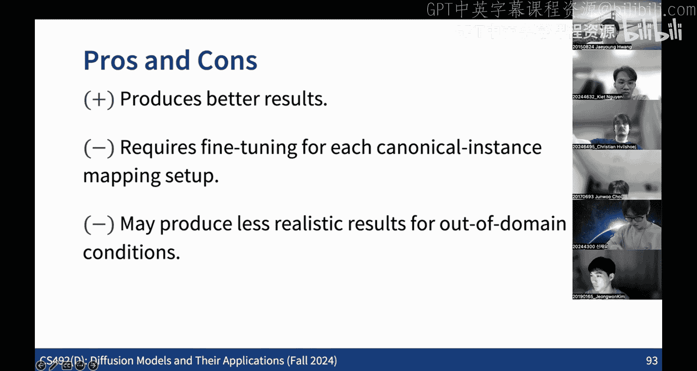

本节课中我们一起学习了扩散同步技术。我们了解了如何通过协调多个实例空间的反向扩散过程，并利用规范空间中的平均操作，使预训练的扩散模型能够生成连贯的全景图像、3D纹理等数据。我们还比较了不同同步策略的优劣，以及扩散同步与SDS、迭代更新方法的区别。最后，我们探讨了通过引入类似ControlNet的结构进行微调，以进一步提升特定任务生成质量的方法。这些技术为我们灵活利用强大但数据受限的预训练扩散模型开辟了道路。