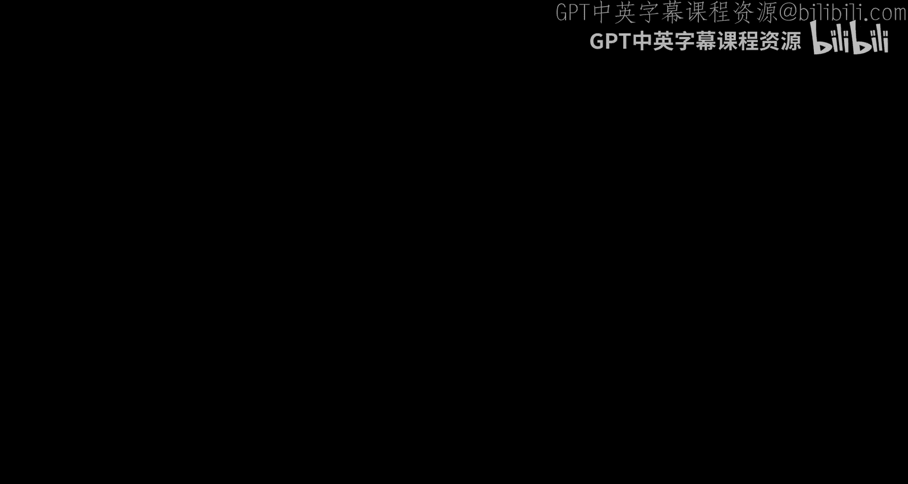
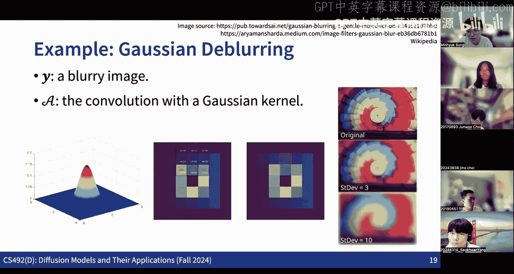
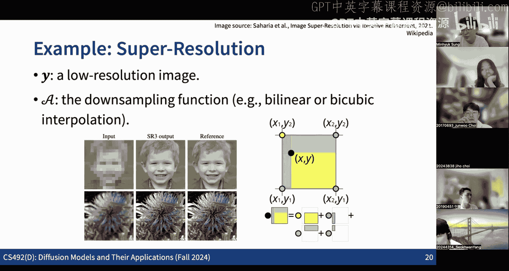
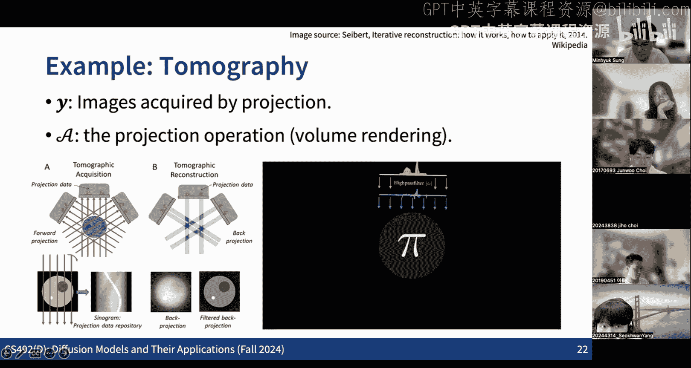
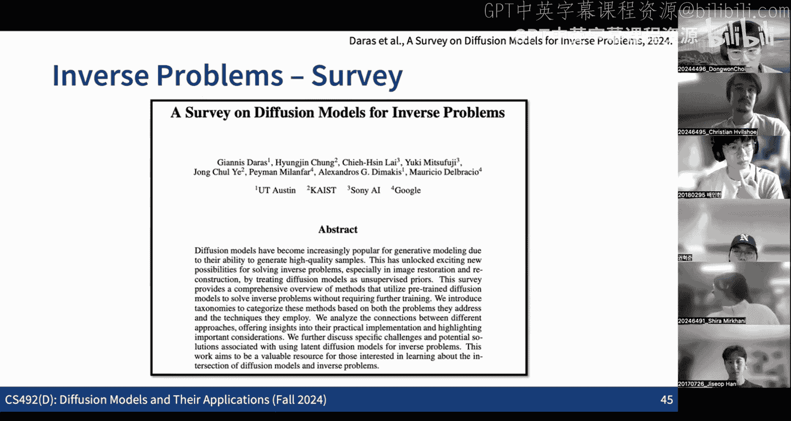

# 扩散模型与应用：12：逆问题 1 (KAIST CS492D, Fall 2024)



在本节课中，我们将学习如何利用预训练的扩散模型来解决逆问题。我们将从回顾条件分布的基础知识开始，逐步推导出无需额外训练即可进行条件生成的核心算法，并理解其背后的数学原理。

---

## 概述与回顾

上一节我们讨论了条件生成的各种方法，如ControlNet和SDEdit。本节中，我们将探讨一个更通用的框架来解决一类被称为“逆问题”的任务。

逆问题是指：我们观测到某个数据 `y`，它是我们想看到的原始数据 `x` 经过一个已知的变换 `A`（可能带有噪声 `z`）后得到的。我们的目标是从观测值 `y` 中恢复出原始数据 `x`。其数学模型可以表示为：
```
y = A(x) + z
```
其中，`z` 通常被建模为高斯噪声。

以下是逆问题的一些常见例子：
*   **图像去模糊**：`y` 是模糊图像，`A` 是模糊核卷积操作。
*   **图像超分辨率**：`y` 是低分辨率图像，`A` 是下采样操作。
*   **图像修复**：`y` 是带掩码（缺失部分）的图像，`A` 是保留已知区域的掩码操作。
*   **计算机断层扫描**：`y` 是2D投影图像，`A` 是射线投影的Radon变换。

解决逆问题的挑战在于，对于给定的 `y`，可能的解 `x` 通常不唯一。因此，我们需要一个能生成既真实（符合数据分布）又满足观测条件 `y` 的样本的模型。

---

## 核心思路：从无条件分数到条件分数



扩散模型的核心是学习数据分布的分数函数（即梯度对数概率）。假设我们有一个预训练的无条件扩散模型，它给出了 `score(xt)`。



现在，我们希望进行以 `y` 为条件的生成，即我们需要 `score(xt | y)`。根据贝叶斯规则，我们可以将其分解：
```
score(xt | y) = score(xt) + score(y | xt)
```
其中，`score(xt)` 是无条件分数，我们的模型已经知道。因此，问题的关键在于计算似然项 `score(y | xt)`。

在之前的课程中，我们学习了两种计算此项的方法：
1.  **分类器引导**：当 `y` 是类别标签时，训练一个分类器 `p(y | xt)`，然后取其梯度的对数。
2.  **无分类器引导**：当 `y` 是任意条件时，修改噪声预测网络的架构，使其能同时预测无条件噪声和有条件噪声，然后进行插值。



然而，这两种方法都需要有 `(条件， 输出)` 配对数据来训练额外的网络。如果我们没有这样的配对数据，或者条件 `A` 是已知的确定性函数（如模糊核），能否仍然计算 `score(y | xt)` 呢？

---

## 伪逆引导扩散模型

答案是肯定的。我们可以在推理阶段，仅利用已知的变换 `A` 和观测值 `y`，通过近似计算来引导生成过程。

首先，我们考虑 `A` 是线性操作（即 `A(x) = Ax`，其中 `A` 是一个矩阵）的情况。我们有以下两个关键分布：
1.  观测似然（假设高斯噪声）：`p(y | x0) = N(y; Ax0, σ²I)`
2.  扩散模型给出的后验近似：我们假设在给定 `xt` 时，`x0` 的分布近似为一个高斯分布，其均值是模型预测的 `x0_hat`（可通过Tweedie公式从预测的噪声得到），方差设为各向同性的 `r²I`，即 `p(x0 | xt) ≈ N(x0; x0_hat, r²I)`。

基于这两个高斯分布，我们可以推导出 `p(y | xt)` 也近似为一个高斯分布。进而，我们可以计算其分数函数 `score(y | xt)`。

经过一系列推导（详见课程测验），我们得到：
```
score(y | xt) ≈ (1 / (σ² + r² A A^T)) * A^T * (y - A * x0_hat)
```
这个公式的含义是：在每一步去噪时，我们计算模型当前预测的 `x0_hat` 通过观测算子 `A` 得到的“伪观测” `A * x0_hat`，然后计算它与真实观测 `y` 之间的差异。将这个差异通过 `A^T` 反向传播，并乘以一个缩放系数，就得到了对无条件分数函数的修正项。这种方法被称为“伪逆引导”。

---

## 简化：基于距离的引导

为了使算法更简单通用，我们可以做一个更强的假设：令近似后验 `p(x0 | xt)` 的方差 `r² → 0`。这意味着我们假设模型在给定 `xt` 时对 `x0` 的预测是确定的（即狄拉克分布）。同时，我们放宽假设，允许 `A` 是非线性函数。

在这种情况下，`score(y | xt)` 的推导可以大大简化。我们最终得到：
```
score(y | xt) ≈ ∇_xt || y - A( x0_hat ) ||²
```
即，**条件分数正比于观测值 `y` 与当前预测 `x0_hat` 经过变换 `A` 后的结果之间L2距离的梯度**。

---

## 算法实现：在去噪过程中添加一行代码

这个简化的形式带来了极其简洁的实现方式。回顾DDPM的去噪单步更新公式：
```
xt-1 = function( xt, predicted_noise_unconditional )
```
其中，`predicted_noise_unconditional` 与无条件分数 `score(xt)` 相关。

现在，为了加入条件 `y` 的引导，我们只需要修改预测的噪声，将其替换为：
```
modified_noise = predicted_noise_unconditional - s * ∇_xt || y - A( x0_hat ) ||²
```
这里 `s` 是一个引导尺度系数，用于控制条件约束的强度。

然后，使用这个 `modified_noise` 去执行标准的去噪更新步骤。从计算图上看，这等价于：
1.  像往常一样运行一步无条件去噪，得到中间样本 `xt-1‘`。
2.  计算梯度项 `grad = ∇_xt || y - A( x0_hat ) ||²`。
3.  得到最终的条件样本：`xt-1 = xt-1‘ - s * grad`。

**因此，解决许多逆问题的核心算法，最终归结为在标准扩散模型推理循环中，添加一行计算并减去上述梯度的代码。**

---

## 总结与展望

本节课中，我们一起学习了如何利用预训练扩散模型解决逆问题。
*   我们首先定义了逆问题，并回顾了计算条件分数的必要性。
*   通过贝叶斯规则和一系列高斯分布假设，我们推导出了在已知前向算子 `A` 时，计算 `score(y | xt)` 的近似方法。
*   最终，我们得到了一个非常简洁实用的算法：**在每一步去噪时，加入一个基于观测约束的L2损失梯度项**，以此来引导生成过程朝向符合观测值 `y` 的解。

这种方法的优势在于无需针对特定任务重新训练模型，实现了“训练一次，处处可用”。但其性能依赖于对 `p(x0 | xt)` 为高斯分布的近似假设。在实际应用中，引导尺度 `s` 的选择、如何处理更复杂的噪声模型等，都是活跃的研究课题。



下节课中，我们将继续探讨不同条件生成方法的适用场景，并为课程项目进行说明。