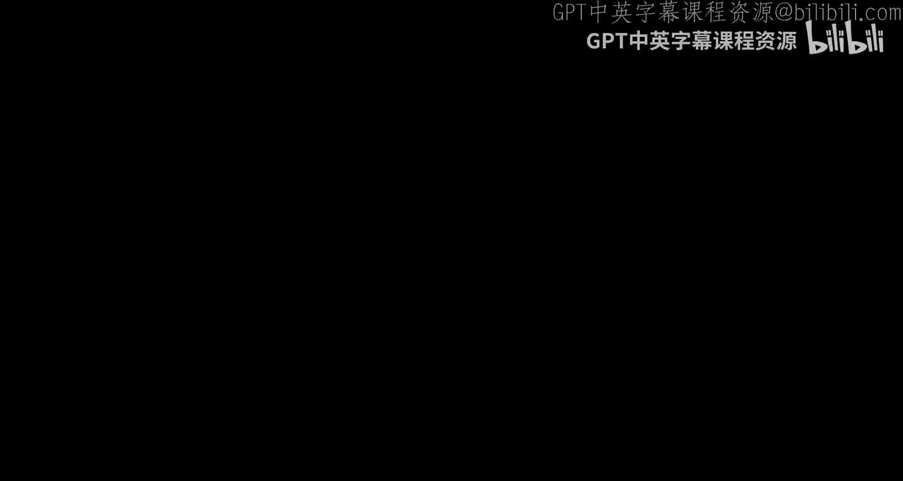
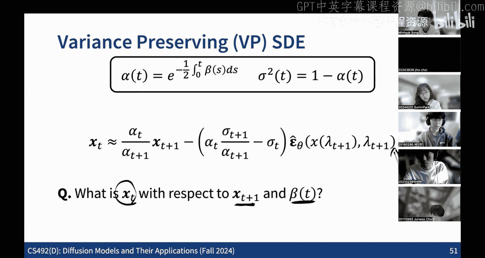
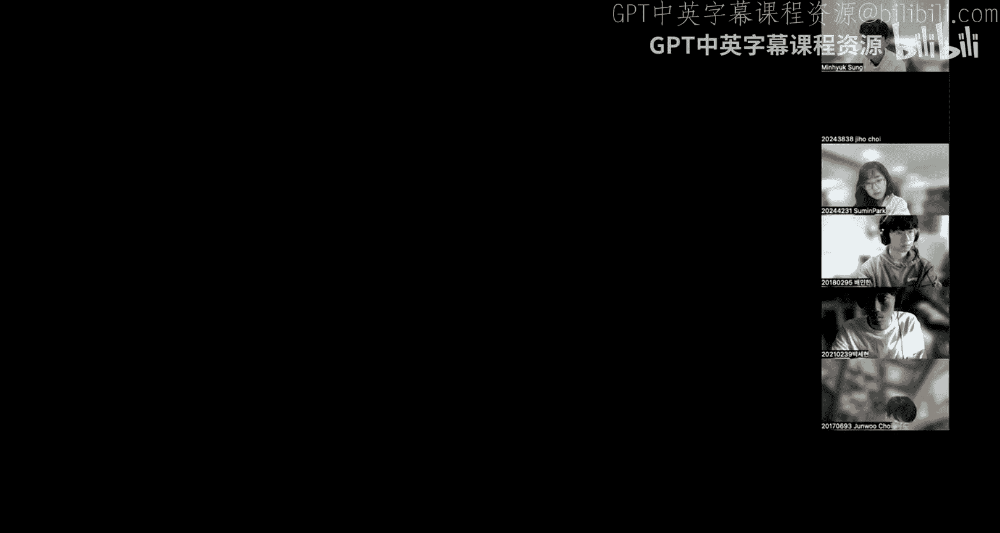
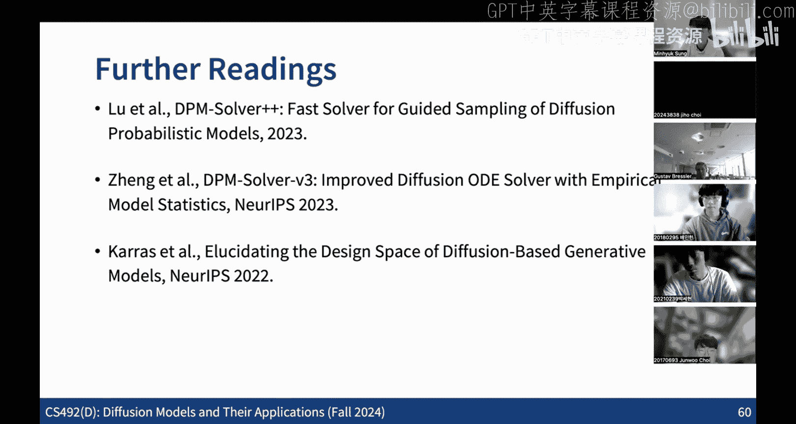
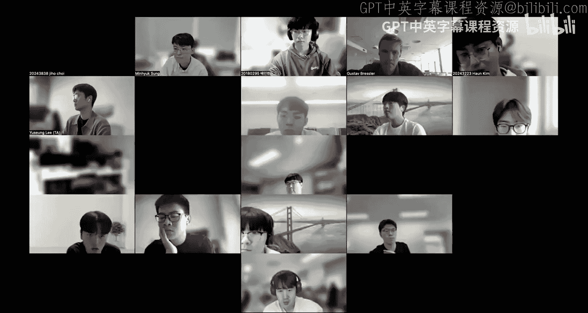

# 扩散模型和应用：14：概率流ODE与DPM-Solver 🧮



在本节课中，我们将要学习如何通过概率流常微分方程（ODE）来加速扩散模型的生成过程。我们将看到，扩散模型的前向和反向过程都可以用随机微分方程（SDE）来描述，并且存在一个对应的确定性ODE，其解具有相同的边缘分布。通过求解这个ODE，我们可以用更少的步骤生成高质量的样本，从而显著减少计算时间。

---

## 从离散到连续：扩散模型的SDE视角

上一节我们介绍了DDPM和DDIM等离散时间扩散模型。本节中，我们来看看如何将它们置于连续的框架下。

扩散模型的一个关键优势是，其前向的加噪过程可以被表述为一个连续的随机微分方程（SDE）。这个SDE的形式如下：

```
dX_t = f(t) * X_t * dt + g(t) * dW_t
```

其中：
*   `X_t` 是时间 `t` 时的数据（一个关于时间的函数）。
*   `f(t)` 是漂移系数。
*   `g(t)` 是扩散系数。
*   `dW_t` 是维纳过程（布朗运动）的微分，它引入了随机性。

维纳过程 `W_t` 具有以下性质：
1.  起始于零：`W_0 = 0`。
2.  增量独立：对于任意时间 `s < t`，增量 `W_t - W_s` 服从均值为0、方差为 `t-s` 的正态分布。
3.  增量独立：不同时间区间的增量是相互独立的。
4.  路径连续：其样本路径在时间上是连续的。

这个SDE描述了一条从干净数据 `X_0` 到纯噪声 `X_T` 的随机轨迹。

---

## 反向过程与概率流ODE

更重要的是，反向的去噪过程也可以用一个SDE来描述，其形式如下：

```
dX_t = [f(t) * X_t - g(t)^2 * ∇ log p_t(X_t)] * dt + g(t) * dW_t
```

其中 `∇ log p_t(X_t)` 是数据在时间 `t` 的得分函数（score function）。这正是我们需要用噪声预测网络 `ε_θ` 去学习或近似的部分。

一个非常关键的发现是：对于描述扩散过程的每一个SDE，都存在一个对应的**常微分方程（ODE）**，称为**概率流ODE**。这个ODE的解，在每一个时间点 `t`，其分布与SDE的解的分布完全相同。这个ODE的形式为：

```
dX_t = [f(t) * X_t - (1/2) * g(t)^2 * ∇ log p_t(X_t)] * dt
```

与反向SDE相比，概率流ODE移除了带有 `dW_t` 的随机项，使其成为一个确定性的方程。这意味着，如果我们从同一个噪声 `X_T` 出发，ODE每次都会给出完全相同的输出轨迹。

对于我们在DDPM中使用的“方差保持”（Variance Preserving）参数化方案，其对应的概率流ODE可以简化为一个更清晰的形式。我们引入一个与信噪比相关的变量 `λ_t = log(α_t / σ_t)`，其中 `α_t` 和 `σ_t` 是定义前向过程的系数。经过变量替换（将时间 `t` 替换为 `λ`），ODE可以写成：

```
dX_λ = ε_θ (X_λ, t(λ)) * dλ
```

这个形式表明，数据 `X` 关于 `λ` 的变化率，直接由噪声预测网络在该点的输出给出。

---

## 如何求解概率流ODE：从理论到实践

现在，我们的目标从“执行多步去噪”变成了“求解一个ODE”。数值分析领域有大量成熟的ODE求解器可供使用。然而，通用求解器可能仍需要较多计算步骤才能获得高精度解。

我们的目标是设计一个专为**此特定ODE形式**优化的求解器，从而用极少的步数（例如10-20步）获得高质量解。这引出了DPM-Solver。

首先，我们回顾一下ODE求解的基础知识。考虑一个一阶半线性ODE：

```
dX_t / dt = P(t) * X_t + Q(X_t, t)
```

其中 `P(t)` 是线性系数，`Q(X_t, t)` 是一个可能非线性的项（在我们的案例中，就是噪声预测网络 `ε_θ`）。

利用**指数积分器**的技巧，这个ODE的解可以表示为：

```
X_t = exp(∫_{s}^{t} P(τ) dτ) * X_s + ∫_{s}^{t} [exp(∫_{τ}^{t} P(r) dr) * Q(X_τ, τ)] dτ
```

这个公式是推导DPM-Solver的基础。它将 `t` 时刻的解 `X_t` 表达为 `s` 时刻的解 `X_s` 加上一个积分项。

---

## DPM-Solver：专为扩散ODE设计的快速求解器

将我们扩散模型的概率流ODE（`dX_λ = ε_θ (X_λ) dλ`）代入上面的解公式，并考虑从步骤 `λ_{n+1}` 到 `λ_n` 的离散更新（反向进行），我们得到：

```
X_{λ_n} = exp(λ_n - λ_{n+1}) * X_{λ_{n+1}} + ∫_{λ_{n+1}}^{λ_n} [exp(λ_n - τ) * ε_θ (X_τ, t(τ))] dτ
```

问题的核心在于计算这个积分项，因为它依赖于未知的 `ε_θ` 在整个积分区间内的值。

以下是DPM-Solver采用的策略：

**一阶近似（DPM-Solver-1）**
最简单的假设是，在小区间 `[λ_{n+1}, λ_n]` 内，噪声预测 `ε_θ` 是常数。我们可以用区间起点 `λ_{n+1}` 处的值 `ε_θ (X_{λ_{n+1}}, t(λ_{n+1}))` 来近似。这样，积分可以解析求出，更新公式变为：

```
X_{λ_n} = (α_n / α_{n+1}) * X_{λ_{n+1}} - σ_n * (exp(λ_n - λ_{n+1}) - 1) * ε_θ (X_{λ_{n+1}}, t(λ_{n+1}))
```

有趣的是，这个一阶近似恰好等价于**DDIM的确定性采样算法**。这解释了为何DDIM能用较少的步数获得不错的结果——它本质上是在用一阶方法求解概率流ODE。





**高阶近似（DPM-Solver-2/3）**
为了用更少的步数获得更高的精度，我们需要更精确地估计积分。DPM-Solver-2采用了二阶近似。思路是：
1.  先将区间 `[λ_{n+1}, λ_n]` 对半分，用一阶近似（欧拉法）计算中点 `λ_{n+0.5}` 的值 `X_{λ_{n+0.5}}`。
2.  利用这个中点值，再次计算噪声预测 `ε_θ (X_{λ_{n+0.5}}, t(λ_{n+0.5}))`。
3.  现在，我们用这个更精确的中点噪声值来重新估计整个区间上的积分（例如使用梯形法则），从而得到更准确的 `X_{λ_n}`。

DPM-Solver-3则使用三阶近似，通过更复杂的多阶段评估来进一步提升精度。这些高阶方法的核心思想是利用函数 `ε_θ` 在多个点的值，来构建对其在积分区间内变化的更好估计。

---

## 总结与展望

本节课中我们一起学习了加速扩散模型生成的核心思想：
1.  **统一视角**：离散扩散模型（DDPM/DDIM）对应着连续时间的随机微分方程（SDE）。
2.  **确定性路径**：每个扩散SDE都有一个对应的概率流ODE，其解具有相同的边缘分布，但路径是确定性的。
3.  **高效求解**：通过分析此ODE的特殊结构，我们可以设计专用的高阶求解器（如DPM-Solver），用极少的评估步骤（10-20步）逼近ODE的解，从而快速生成高质量样本。
4.  **与DDIM的联系**：DDIM的确定性采样算法等价于求解概率流ODE的一阶方法。

这种方法的美妙之处在于，**我们无需重新训练扩散模型**，只需在推理时换用更高效的求解器，就能大幅提升生成速度。这为扩散模型的实际部署和应用打开了大门。





下一节课，我们将介绍另一种加速范式——基于流（Flow）的模型，它通过不同的数学框架来达成快速且高质量的数据生成。