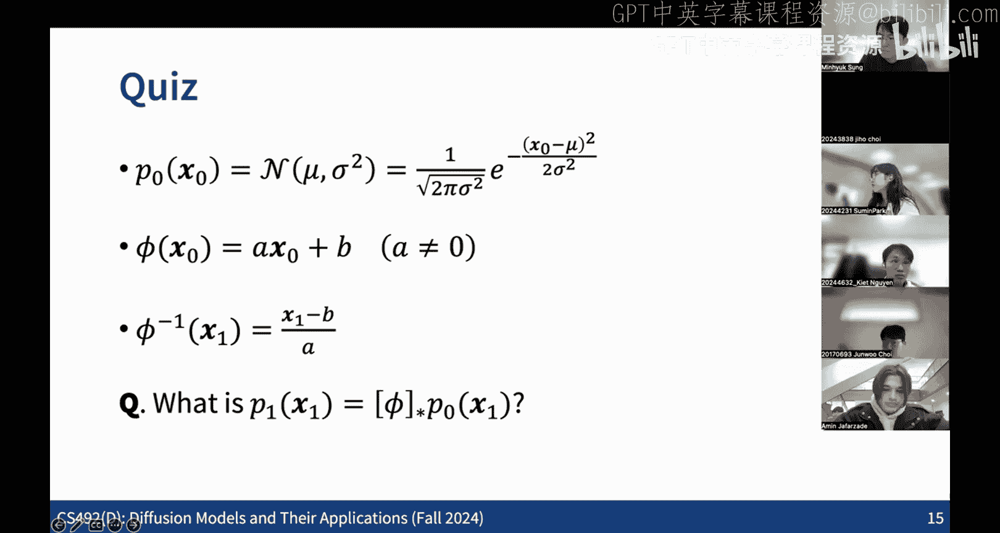
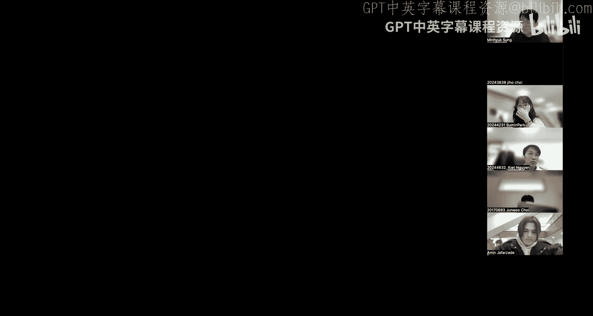
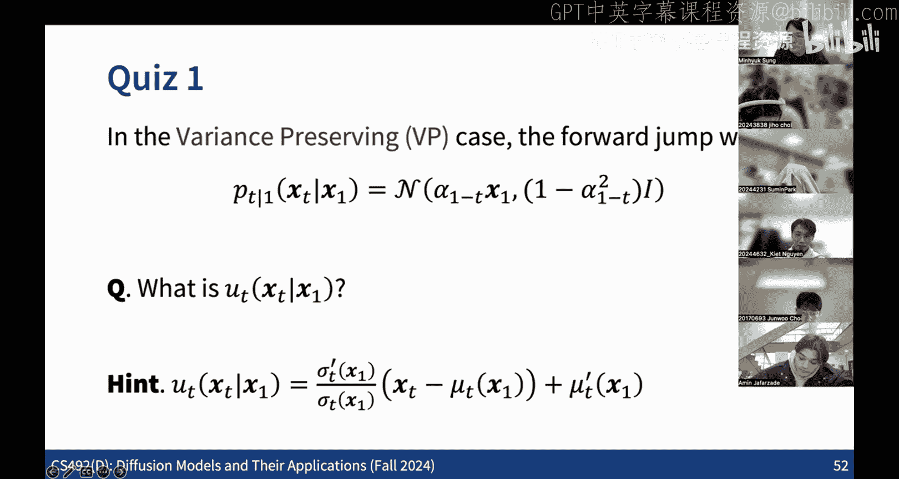
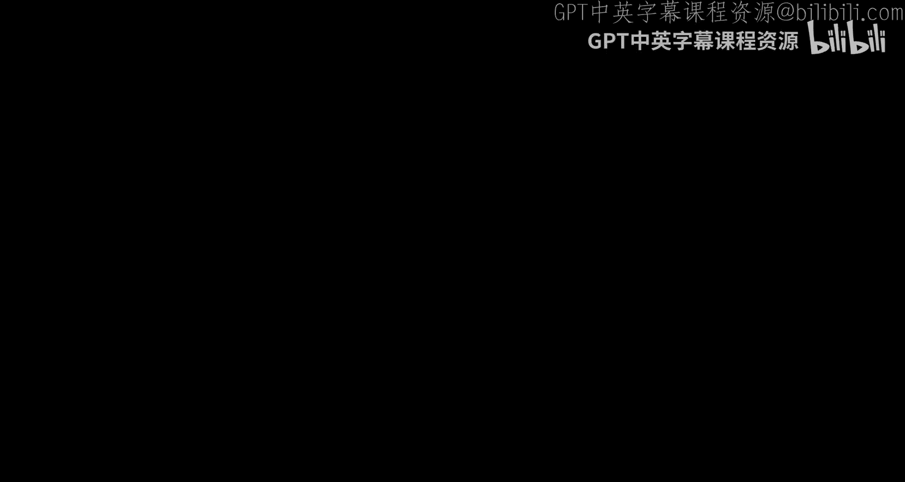
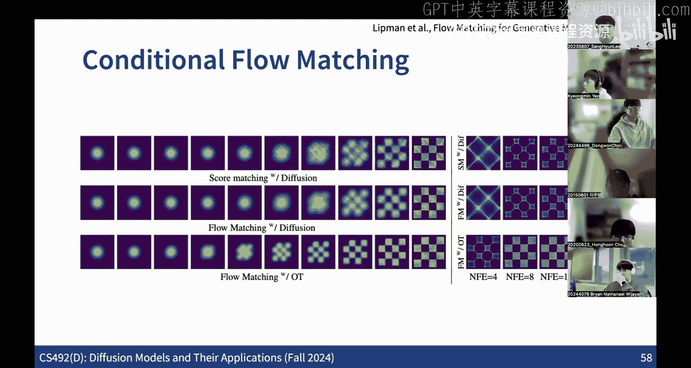

# 扩散模型和应用：15：流匹配模型 1 (Flow Matching 1) 🧪

在本节课中，我们将要学习一种新型的生成模型——流匹配模型。我们将探讨其基本概念、与扩散模型的联系，以及它如何通过更直接的轨迹实现更快的生成过程。

---

## 概述

扩散模型虽然能生成高质量、多样化的样本，但其生成过程涉及大量迭代步骤，导致计算速度较慢。上一节我们介绍了如何将扩散过程转化为常微分方程（ODE）来加速生成。本节中，我们来看看另一种思路：流匹配模型。流匹配模型旨在学习一个向量场，直接映射简单的基础分布到复杂的数据分布，从而可能实现更高效的生成。

---

## 流匹配的基本概念

流匹配模型的核心思想是找到一个可逆的映射函数，将基础分布（如标准高斯分布）直接变换到目标数据分布。

### 推前操作与概率变换

假设我们有一个可逆且连续可微的映射函数 **π**，它将基础分布 **P₀** 映射到数据分布 **P₁**。这个过程称为“推前”操作。

给定一个参考分布 **P₀**（例如标准正态分布），通过映射 **π** 采样，我们可以定义一个新的分布 **P₁**。采样过程是：先从 **P₀** 采样 **x₀**，然后通过 **π** 得到 **x₁ = π(x₀)**。

根据概率密度变换的规则，**P₁** 的概率密度可以通过 **P₀** 和映射 **π** 的雅可比行列式推导出来：

**P₁(x₁) = P₀(π⁻¹(x₁)) * |det J_π⁻¹(x₁)|**

其中，**J_π⁻¹** 是逆映射 **π⁻¹** 的雅可比矩阵，其行列式的绝对值衡量了映射引起的局部体积变化。

### 一个简单的例子：线性变换

考虑一个简单的线性映射：**π(x) = a * x**，其中 **a** 是一个正常数。其逆映射为 **π⁻¹(x) = x / a**。雅可比行列式为 **1/a**。

如果 **P₀** 是均值为 **μ**、方差为 **σ²** 的高斯分布，那么变换后的分布 **P₁** 将是均值为 **aμ**、方差为 **a²σ²** 的高斯分布。这符合高斯分布的线性变换性质。

---

## 从离散映射到连续流

直接学习一个复杂的全局映射函数 **π** 是困难的。一个更实用的方法是将映射分解为一系列简单的、可逆的变换序列。

### 构建变换序列

假设我们有一系列时间步 **t₀, t₁, ..., t_N**。在每个小时间间隔内，我们定义一个简单的更新：
**x_{t+Δt} = x_t + v_t * Δt**

其中，**v_t** 可以看作是在点 **x_t** 处的“速度”向量。当时间间隔 **Δt** 趋近于0时，这一系列离散更新就趋近于一个由常微分方程描述的连续流：

**dx_t / dt = v(x_t, t)**

这个ODE描述了一个向量场 **v**，它定义了从 **x₀** 到 **x₁** 的连续轨迹。通过求解这个ODE，我们可以从基础分布 **P₀** 的样本 **x₀** 出发，积分得到数据分布 **P₁** 的样本 **x₁**。

### 概率流的演化

向量场 **v(x,t)** 不仅决定了样本点的轨迹，也决定了概率分布 **p_t(x)** 随时间的演化。这种关系由连续性方程（或Fokker-Planck方程在扩散项为零时的特例）描述：

**∂p_t(x) / ∂t = -∇ · (p_t(x) * v(x, t))**

这个方程建立了向量场 **v** 和概率分布流 **p_t** 之间的直接联系。

---

## 条件流匹配：一个实用的训练框架

直接学习边际向量场 **v(x,t)** 是困难的，因为我们没有其真实值作为监督信号。条件流匹配提供了一个巧妙的解决方案。

### 核心思想

我们不直接学习边际分布 **p_t(x)** 对应的向量场，而是引入一个容易构造的条件分布 **p_t(x | x₁)**。这里 **x₁** 是来自真实数据分布的一个样本。

我们要求这个条件分布满足：
*   当 **t=0** 时，**p₀(x | x₁) = p₀(x)**，即基础分布（如标准高斯）。
*   当 **t=1** 时，**p₁(x | x₁)** 是一个以 **x₁** 为中心的尖锐分布（例如方差极小的正态分布）。

一个自然的选择是使用高斯分布：
**p_t(x | x₁) = N( x | μ_t(x₁), σ_t²(x₁) )**
其中，均值函数 **μ_t** 和方差函数 **σ_t²** 需要满足上述边界条件。

### 从条件场到边际场

关键结论是：在一定的条件下，**基于真实条件向量场的回归损失，等价于基于我们想要求的边际向量场的回归损失**。

这意味着，我们可以通过以下步骤训练一个神经网络 **v_θ(x, t)** 来近似边际向量场：
1.  从数据集中采样一个真实数据点 **x₁ ~ P₁**。
2.  从基础分布采样一个点 **x₀ ~ P₀**。
3.  利用我们定义的条件流映射（例如，基于 **μ_t, σ_t** 的线性插值），将 **x₀** 推前到对应时间 **t** 的条件样本点 **x_t**。
4.  计算在该 **x_t** 和 **x₁** 下的**真实条件向量场** **u_t(x_t | x₁)**（这个值可以根据我们选择的 **μ_t, σ_t** 解析地计算出来）。
5.  训练神经网络 **v_θ** 去匹配这个条件向量场：**L(θ) = E[ || v_θ(x_t, t) - u_t(x_t | x₁) ||² ]**

通过这种方式，我们无需知道边际向量场的真实值，就能训练模型。

---

## 与扩散模型的联系

流匹配框架具有很强的灵活性。特别地，我们可以选择扩散模型中使用的**前向扩散分布**作为这里的条件分布 **p_t(x | x₁)**。

例如，在方差保持型扩散模型中，前向分布是：
**p_t(x | x₁) = N( x | √(1-β_t) x₁, β_t I )**

如果我们将其适配到流匹配的记号（时间从0到1，且 **x₁** 是数据点），并计算对应的条件向量场 **u_t**，会发现其训练目标与扩散模型中的噪声预测目标在数学形式上紧密相关。这揭示了两种模型之间深刻的内在联系。

然而，流匹配不局限于扩散模型的前向路径。我们可以设计更简单、更直接的条件路径（例如线性插值路径），从而在潜在空间中产生更笔直的轨迹。更笔直的轨迹意味着在求解生成ODE时，可以用更少的步数获得更准确的结果，从而实现快速生成。

---

## 总结

本节课中我们一起学习了流匹配模型的基本原理。我们从学习一个直接的映射函数出发，引出了通过向量场定义连续概率流的思想。为了解决训练中边际向量场未知的难题，我们介绍了条件流匹配这一核心框架，它允许我们通过易于计算的条件向量场来训练模型。最后，我们看到了流匹配与扩散模型之间的深刻联系，并指出流匹配通过设计更优的概率流路径，有望实现比传统扩散模型更高效的生成。下一节我们将继续探讨流匹配的进阶概念及其对生成式AI领域的影响。