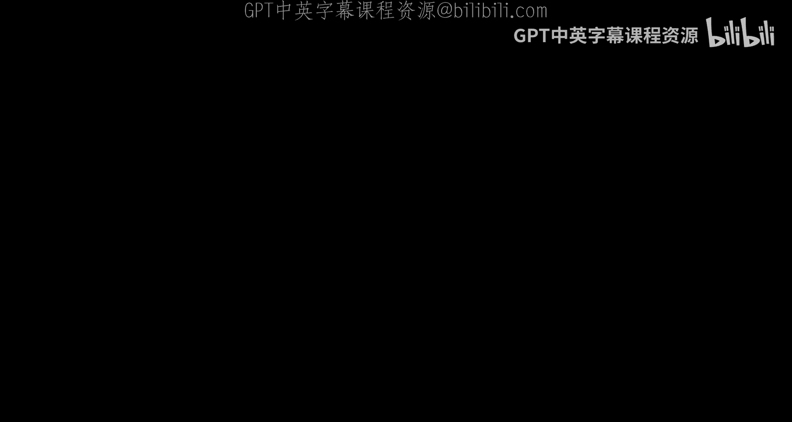
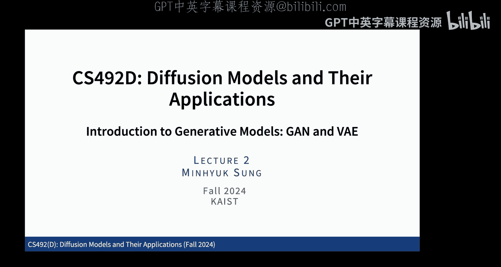
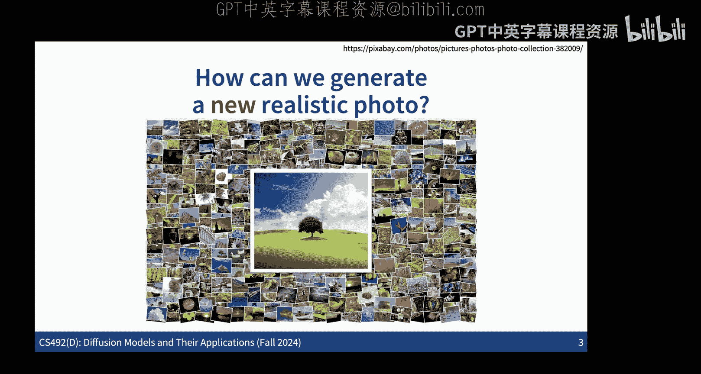
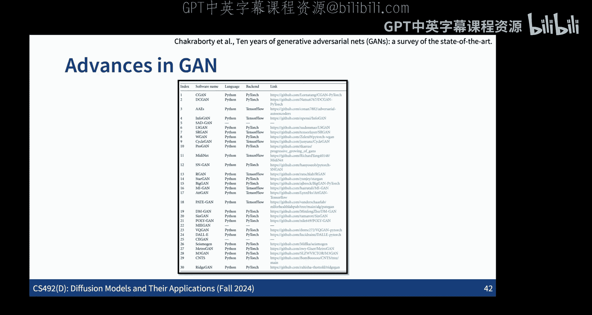
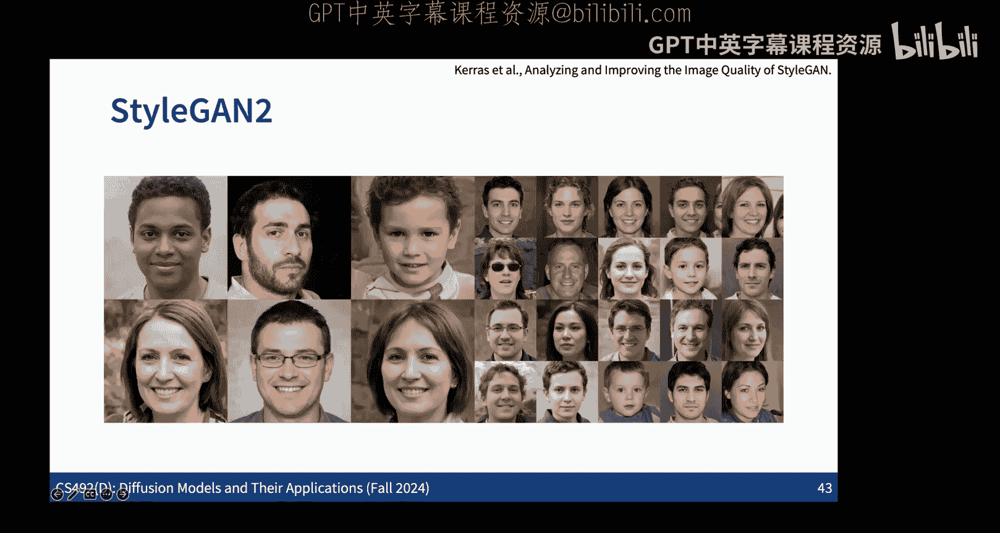
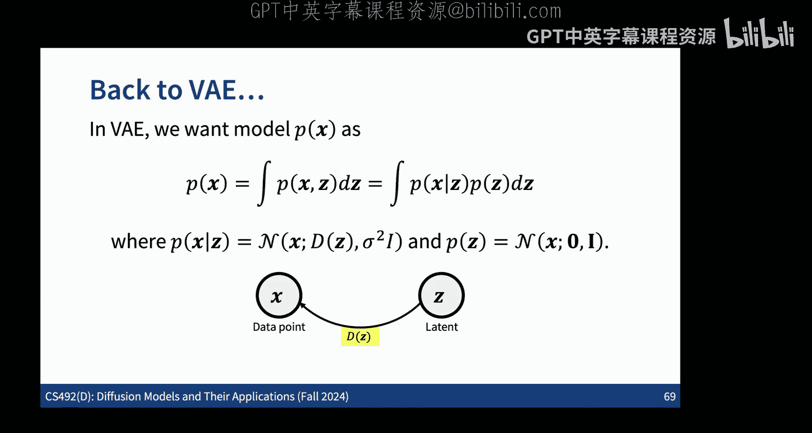
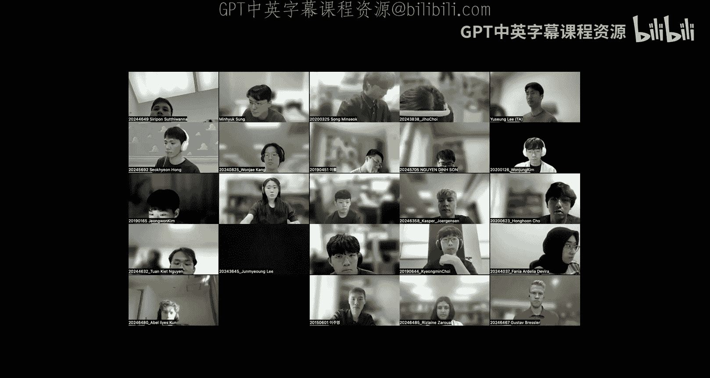

# 扩散模型和应用：02：生成模型简介：GAN与VAE 🎨

在本节课中，我们将学习生成模型的基本概念，特别是生成对抗网络和变分自编码器。我们将从统计学的角度理解如何从数据分布中生成新样本，并探讨这两种经典生成模型的核心思想与工作原理。

## 概述

生成模型的主要目标是生成新的数据。例如，假设我们从互联网上收集了数十亿张真实图像。我们的目标是构建一个能够生成看起来像真实照片的新图像的框架。这听起来很困难，因此我们先从一个更简单的案例开始思考。

## 从简单案例到核心问题

假设我们有一个二维空间中的点集。给定这个点集，如果我们被要求从中选取一个看起来像数据点的新点，人类可以轻松完成。但如何让算法或机器完成这个任务呢？

在本课程中，我们将从统计学的视角来看待这个问题。我们将数据点视为从某个潜在的概率分布中采样得到的样本。那么，问题就变成了：当我们只有从某个未知分布中采样的许多样本时，如何再采样一个新的数据点？

## 已知分布下的采样

如果我们知道数据分布的概率密度函数，采样就会变得非常简单。让我们回顾一些统计学基础知识。

对于离散概率分布，例如掷骰子，我们有六个可能的结果及其对应的概率。最简单的采样想法是构建累积分布函数。我们累积这些概率值，得到一个从0开始、最终达到1的图形。然后，我们从0到1的均匀分布中采样一个值，看这个值落在累积概率的哪个区间，从而确定采样的结果。这种方法称为**逆变换采样**，它也可以轻松扩展到连续情况。

在连续情况下，我们通过积分PDF来计算累积分布函数。然后，我们从0到1的均匀分布中采样，并使用CDF的逆函数将该值映射回可能的x值。这就是给定概率分布函数时的基本采样思想。

一个潜在的缺点是，要基于此方法采样，我们需要能够计算CDF的逆函数。在某些特殊情况下，我们可以得到CDF逆函数的解析形式，从而直接应用此方法。但对于大多数情况，这可能很困难。

另一种方法是**拒绝采样**。当我们无法推导给定PDF的CDF逆函数时，可以使用一个代理分布。我们从一个易于采样的代理分布中采样，然后根据目标PDF的值决定是接受还是拒绝该样本。

许多数据分布，不仅是向量，还包括许多真实数据，都将是高斯分布。对于正态分布，我们知道如何轻松地将任意正态分布映射为标准正态分布。这意味着，如果我们想从任意正态分布中采样大量样本，我们只需要一个标准正态分布的采样器，然后将这些点映射到目标正态分布的数据点。

## 将图像生成视为高维采样

现在，让我们将生成图像的问题与上述概念联系起来。假设我们有一个图像集合，每张图像是分辨率为256x256的RGB图像。那么，每张图像实际上是一个维度为256x256x3的向量。这意味着，我们可以将图像集合视为这个非常高维空间中的一组点。

因此，从给定集合生成图像的问题就变成了：我们有一个高维空间中的点集，需要以某种方式捕获该空间中的数据分布，并从该分布中采样。

## 生成模型的核心范式

我们将看到，生成模型所做的就是：将数据集合视为某个维度空间中的一些数据点的集合，然后捕获这种数据分布并从中采样。

关键问题是：我们只有样本，但不知道确切的底层分布。我们没有任何底层概率密度函数的解析形式，唯一的信息是已知从该特定分布中采样的样本集合。

因此，对于所有生成模型，无论是GAN、VAE还是扩散模型，我们基本上要做的是：由于我们不知道给定数据分布的概率密度函数的精确形式，我们将从一个简单的分布开始，这个分布我们可以轻松采样。一个典型的简单分布候选者是标准正态分布，因为我们知道如何从中采样。

然后，我们将有一个从这种简单分布到数据分布的映射。生成过程就变成了两个步骤：首先从简单分布（即标准正态分布）中采样，然后将该样本映射到数据分布中的一个数据点。

在术语上，我们将这个简单分布称为**潜在分布**。这不是真实的数据分布，而是一个我们将映射到真实数据分布的代理分布。从潜在分布中采样的一个样本将被称为**潜在变量**。

整个过程基本上是从潜在分布到数据点的映射。问题在于：我们如何获得这种映射？这就是神经网络发挥作用的地方。我们将使用神经网络来实现从潜在变量到数据点的映射。如何训练这个神经网络映射，正是我们将在生成模型中讨论的核心内容。

## 自编码器的启示

自编码器的目的是构建一个可以压缩给定输入数据的神经网络。基本思想是：我们将输入数据映射到某种潜在变量，然后可以将其重建回输入数据。我们基本上是将输入数据映射到潜在变量，然后将其恢复为原始数据，并检查重建的数据是否与输入数据相同。

我们在这个潜在空间中使用低得多的维度，因此我们正在进行某种压缩，同时这个低维空间中的潜在变量也可以恢复为原始数据点。

我们已经看到了这种将给定数据映射到某种潜在变量集合的例子。我们将利用这种相同的数据映射思想来训练生成模型。

实际上，我们这里需要的不是编码器，而仅仅是解码器。如果我们有一个好的解码器，那么我们可以从潜在分布中采样，并将其映射到某种真实数据。

你可以想象这个过程：我们从标准正态分布中采样，并使用解码器将其映射到一个真实数据点。

但这里出现了一个问题：我们如何训练解码器？当你将潜在变量映射到一个数据点时，它应该是数据分布中某个合理的、真实的数据点。你如何保证从潜在空间映射的点成为给定数据分布中一个合理的数据点？

这是生成模型中的一个重大问题，我们将在本课程中看到的所有思想都将为我们提供如何设计和解决这个问题的思路。

## 生成对抗网络

在深入扩散模型之前，我们将简要讨论两种基本思想：GAN和VAE。首先，让我们看看GAN。

GAN的基本思想是让两个神经网络相互竞争。一个是**生成器**，它从潜在分布（如标准正态分布）中采样，并映射生成一张合成图像。另一个是**判别器**，它接收真实图像或生成器合成的图像，并分类该图像是真实的还是伪造的。

我们希望生成器能生成非常逼真的图像，以至于判别器难以区分。通过这种竞争，我们希望生成器能够生成看起来非常像真实图像的伪造图像。

GAN的损失函数结合了最小化和最大化。从判别器的角度来看，我们希望最大化整个表达式，这意味着我们希望增加真实图像的概率，并降低合成图像的概率。从生成器的角度来看，我们需要最小化整个表达式，这实际上意味着我们正在增加伪造图像被判别为真实的概率。

你可以清楚地看到判别器和生成器之间的这种竞争关系：一个试图最大化某个量，另一个试图最小化同一个量。

在训练过程中，如果一切顺利，生成器将提高伪造图像的质量，使其变得非常逼真，难以与真实图像区分。然而，解决这种极小极大优化问题非常困难，训练GAN存在许多失败案例。

一个典型的失败案例是判别器在开始时变得非常强大，可以轻松区分真实和伪造图像。当判别器在训练过程中占据主导地位时，生成器无法得到改进，训练无法收敛。

另一个典型的失败行为是**模式崩溃**。生成器没有捕获整个数据分布，而是崩溃到某个特定模式，只生成非常相似的样本。

尽管存在挑战，但在扩散模型兴起之前，GAN一直是生成模型领域的主导方法。大约五年前，GAN生成的图像质量已经非常高。扩散模型兴起的原因在于它提供了比GAN框架更好的质量，并且在训练更简单、收敛更快更容易方面具有许多优势。

## 变分自编码器

VAE的基本思想是：如何在不解决极小极大问题的情况下构建生成模型？GAN的所有问题都源于我们正在解决一个优化难题。

在VAE中，我们将从潜在分布到数据分布的映射表示为从条件分布中采样。为了简化，我们也将这个条件分布建模为另一个高斯分布，其均值由解码器输出，并具有某个固定方差。

我们在这里做的改变是：现在我们将从潜在变量到数据点的映射视为从条件分布中采样的过程。

核心问题是我们不知道真实的后验分布。我们不知道给定数据x时潜在变量z的条件分布。如果没有这个信息，我们无法直接计算我们想要最大化的边际概率P(x)。

VAE的整个想法是，我们无法直接计算这个概率P(x)，但我们可以计算它的一个下界。我们不是直接计算P(x)，而是计算这个下界，并尽可能最大化它。如果我们最大化这个下界，那么结果就是我们也在最大化概率P(x)。

我们引入一个代理分布q(z|x)来近似真实但未知的后验分布p(z|x)。这个下界被称为**证据下界**。

通过一些推导，ELBO可以分解为两项：
1.  **重构项**：期望最大化给定潜在变量z时数据x的对数概率。这鼓励解码器从潜在变量很好地重建数据。
2.  **正则化项**：是代理分布q(z|x)与先验分布p(z)（通常是标准正态分布）之间的KL散度的负值。最小化这个KL散度意味着让学习的潜在分布接近简单的先验分布。

因此，VAE的训练目标是最大化ELBO，这等价于同时最大化数据重构的似然，并最小化学习到的潜在分布与简单先验分布之间的差异。

## 总结

本节课我们一起学习了生成模型的基本概念。我们从统计学角度理解了数据生成的核心是学习并采样于一个潜在分布。我们探讨了两种经典的生成模型：生成对抗网络通过对抗训练让生成器和判别器竞争以提升生成质量；变分自编码器通过最大化证据下界来学习数据的潜在表示并实现生成。这两种模型为后续理解更现代的扩散模型奠定了重要的理论基础。在下节课中，我们将看到这些思想如何引出了扩散模型的诞生。