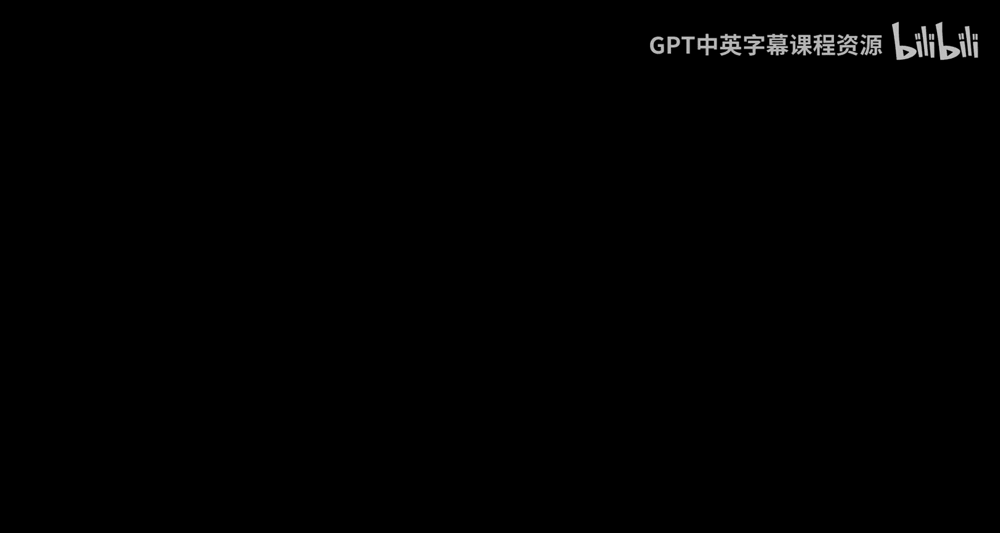
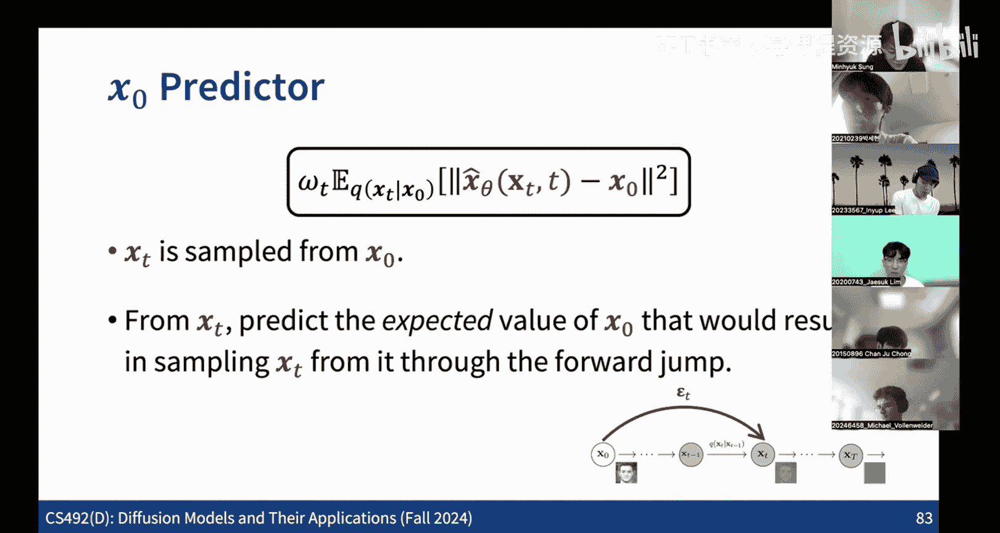
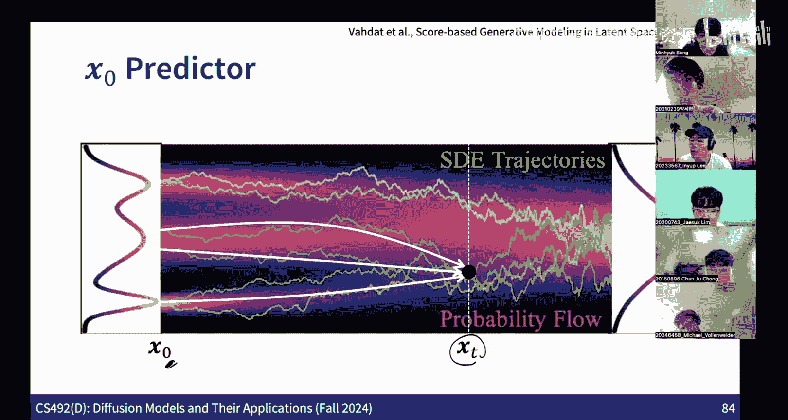
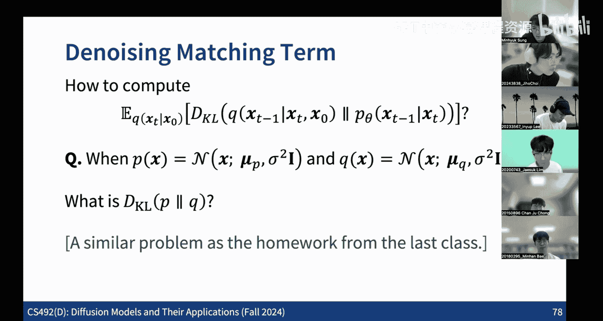

# 扩散模型与应用：03：去噪扩散概率模型

在本节课中，我们将学习去噪扩散概率模型的基本思想。我们将从回顾变分自编码器开始，逐步引入扩散模型的核心概念，并理解其如何通过一个逐步添加和去除噪声的过程来生成数据。

上一节我们讨论了变分自编码器的基本思想，本节中我们来看看如何将其思想扩展到更复杂的生成模型——扩散模型。

## 回顾：生成模型的基本框架

所有生成模型的核心思想是相似的：我们不是直接从复杂的数据分布中采样，而是从一个简单的潜在分布（通常是标准正态分布）中采样，然后通过一个神经网络（生成器或解码器）将其映射到数据分布。

**公式**：`z ~ p(z), x = G(z)`

这里的挑战在于如何保证这个映射能生成逼真的数据点。在GAN中，我们引入判别器网络进行对抗训练。在VAE中，我们引入编码器网络来学习后验分布的近似。

## 变分自编码器的局限与改进

VAE通过优化证据下界来训练模型。ELBO可以分解为两项：

**公式**：`ELBO = E[log p(x|z)] - D_KL(q(z|x) || p(z))`

第一项是重构损失，第二项是KL散度，用于使近似后验分布 `q(z|x)` 接近先验分布 `p(z)`（标准正态分布）。

VAE的一个主要局限是，我们假设近似后验分布 `q(z|x)` 是高斯分布。然而，真实的后验分布可能复杂得多，这导致近似不准确，进而影响生成质量。

一个改进思路是使用更复杂的分布来近似后验。接下来，我们将探讨一种使用**层次化潜在变量**的方法。

## 层次化变分自编码器

我们不再使用单个潜在变量 `z`，而是引入一系列潜在变量 `x1, x2, ..., xT`。生成过程变为一个序列：

**公式**：`p(x0, x1, ..., xT) = p(xT) ∏ p(x_{t-1} | x_t)`

我们假设这个过程是**马尔可夫过程**，即每个状态只依赖于前一个状态：`p(x_t | x_{t-1}, ..., x0) = p(x_t | x_{t-1})`。

这种层次化结构允许后验分布 `q(x1, ..., xT | x0)` 变得更加复杂和富有表现力，从而可能更好地匹配真实后验。

## 扩散模型：一种特殊的层次化VAE

扩散模型可以看作是一种具有特殊约束的层次化VAE。它有两个关键特性：
1.  潜在空间的维度与数据空间维度相同。
2.  前向过程（编码过程）的分布是预先定义好的，而不是通过学习得到的。

我们重新定义术语：
*   **前向过程**：从数据 `x0` 逐步添加噪声，得到 `x1, x2, ..., xT`。这是一个固定的、预先定义的马尔可夫链。
*   **反向过程**：从噪声 `xT` 逐步去噪，恢复出数据 `x0`。这是一个需要学习的马尔可夫链。

### 前向过程

前向过程的每一步都向数据中添加一点高斯噪声：

**公式**：`q(x_t | x_{t-1}) = N(x_t; √(1-β_t) * x_{t-1}, β_t * I)`

其中 `β_t` 是一个预先定义的小正数，称为噪声调度。它通常随着 `t` 增大而增大，意味着越往后添加的噪声越多。

一个重要的性质是，由于每一步都是高斯分布，我们可以直接计算从 `x0` 到任意中间步骤 `xt` 的分布，而无需逐步采样：

**公式**：`q(x_t | x0) = N(x_t; √(ᾱ_t) * x0, (1 - ᾱ_t) * I)`
其中 `α_t = 1 - β_t`, `ᾱ_t = ∏_{s=1}^{t} α_s`

当 `T` 足够大且 `ᾱ_T` 接近0时，`xT` 的分布将接近标准正态分布 `N(0, I)`。这使得先验匹配项 `D_KL(q(x_T|x0) || p(x_T))` 在精心设计的前向过程下接近于零。

### 反向过程与训练目标

反向过程需要学习，我们同样用高斯分布来参数化每一步：

**公式**：`p_θ(x_{t-1} | x_t) = N(x_{t-1}; μ_θ(x_t, t), Σ_θ(x_t, t))`

我们的训练目标是最大化ELBO。经过推导，ELBO的负值可以分解为以下几项（忽略常数）：
1.  重构损失。
2.  先验匹配损失（如前所述，接近于零）。
3.  去噪匹配损失。

核心在于最小化**去噪匹配损失**。它衡量的是学习到的反向分布 `p_θ(x_{t-1} | x_t)` 与前向过程的后验分布 `q(x_{t-1} | x_t, x0)` 之间的差异。

可以证明，对于给定的 `x0` 和 `xt`，前向后验分布 `q(x_{t-1} | x_t, x0)` 也是一个高斯分布，其均值是 `x0` 和 `xt` 的线性组合。

因此，去噪匹配损失（两个高斯分布之间的KL散度）简化为最小化它们均值之间的差异：

**公式**：`L_t = E || μ_θ(x_t, t) - μ̃(x_t, x0) ||^2`

其中 `μ̃` 是真实后验分布的均值。

### 简化目标：预测噪声

我们可以对损失函数进行重新参数化。回忆一下，`xt` 可以通过 `x0` 和一个噪声 `ε` 得到：`xt = √(ᾱ_t) * x0 + √(1-ᾱ_t) * ε`。

因此，预测后验均值 `μ̃` 等价于预测原始数据 `x0`，也等价于预测所添加的噪声 `ε`。一种常见且简单的参数化方式是让神经网络直接预测噪声：

**公式**：`L_t^{simple} = E_{x0, ε, t} || ε_θ(√(ᾱ_t) * x0 + √(1-ᾱ_t) * ε, t) - ε ||^2`

以下是训练扩散模型的基本步骤：
1.  从数据集中随机选择一个样本 `x0`。
2.  随机选择一个时间步 `t`（1 到 T 之间）。
3.  从标准正态分布中采样噪声 `ε`。
4.  计算加噪后的样本 `xt`。
5.  让神经网络 `ε_θ` 根据 `xt` 和 `t` 预测所添加的噪声。
6.  计算预测噪声与真实噪声 `ε` 之间的均方误差，并以此更新网络参数。

### 生成过程

训练完成后，生成新样本的过程（反向过程）如下：
1.  从标准正态分布中采样 `xT`。
2.  对于 `t = T, T-1, ..., 1`：
    *   使用网络 `ε_θ` 预测当前 `xt` 中的噪声。
    *   根据公式计算 `x_{t-1}` 的均值（该公式涉及 `xt`、预测的噪声 `ε_θ` 和调度参数）。
    *   从以该均值为中心的高斯分布中采样 `x_{t-1}`（也可以直接取均值，即确定性生成）。
3.  最终得到生成样本 `x0`。

## 总结

本节课中我们一起学习了去噪扩散概率模型的核心原理。我们从VAE的局限性出发，引入了层次化潜在变量的概念。扩散模型作为一种特殊的层次化VAE，其特点是固定了前向加噪过程，并专注于学习反向的去噪过程。通过将复杂的生成任务分解为一系列简单的去噪步骤，扩散模型能够生成高质量的数据。其训练目标被简化为让神经网络预测在任意时间步添加到数据中的噪声，这是一个稳定且易于优化的目标。