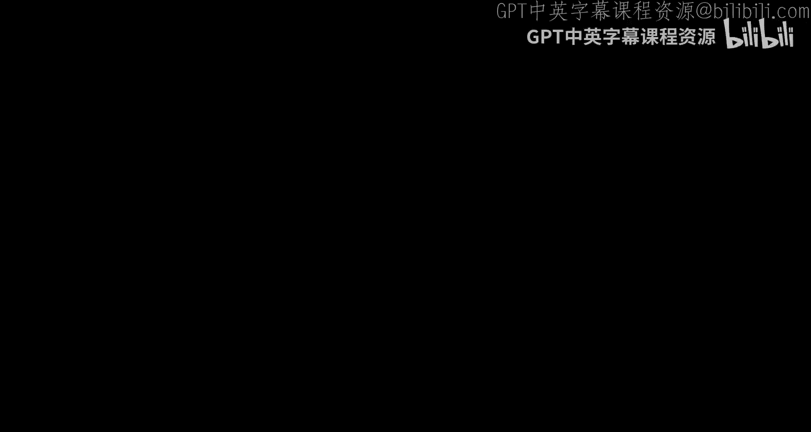
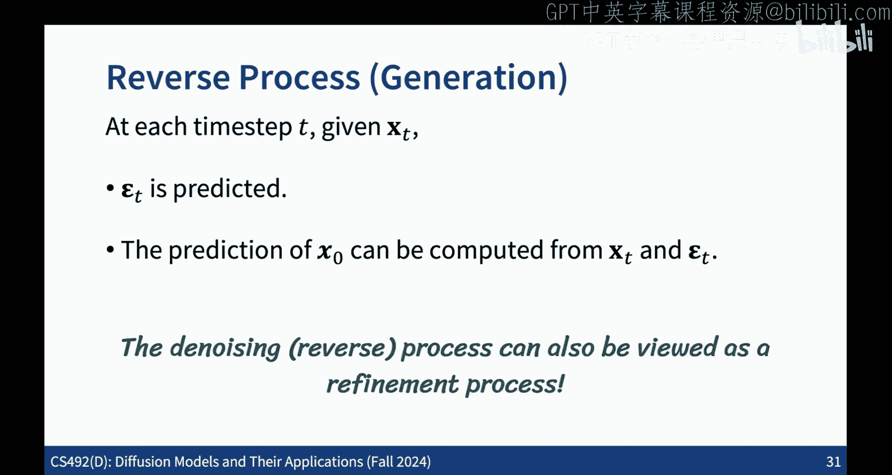
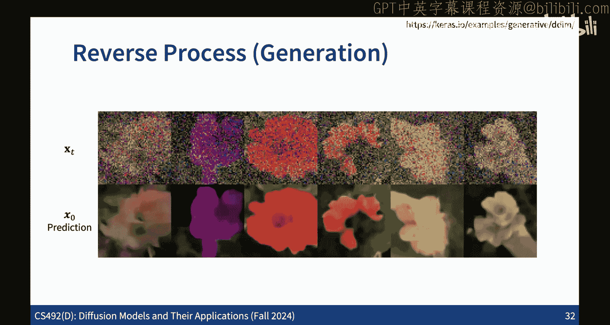
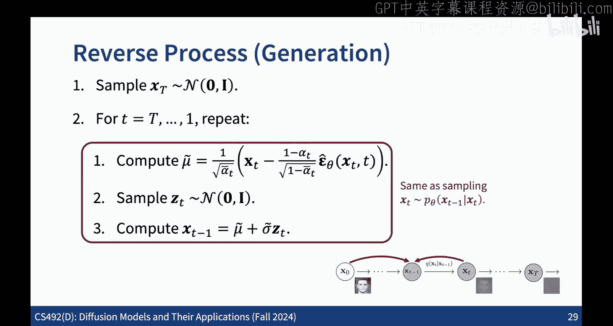
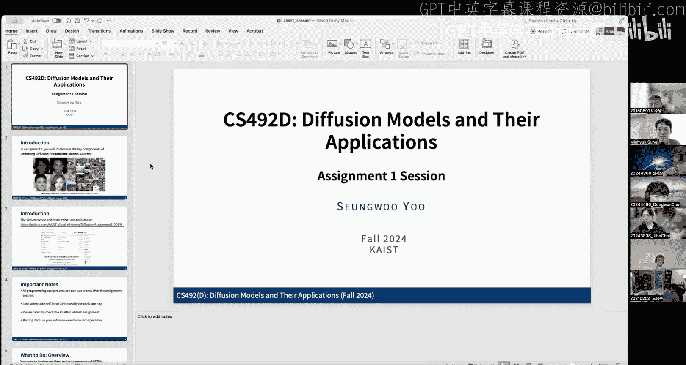
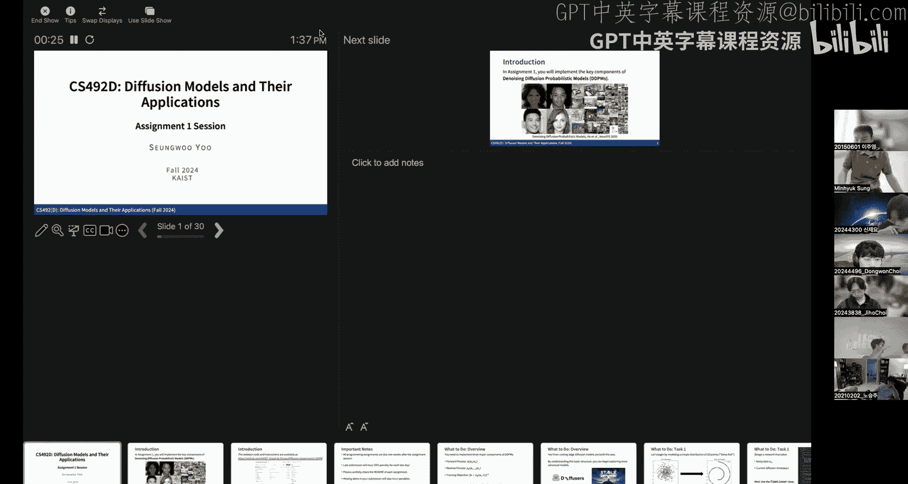
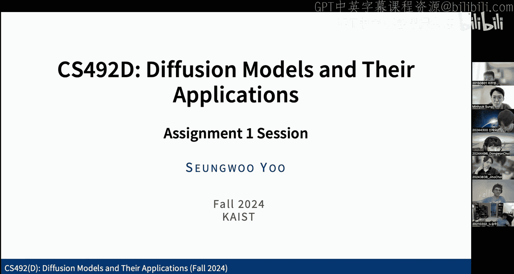

# 扩散模型和应用：04：去噪扩散概率模型 (DDPM) 实现详解 🧠

在本节课中，我们将学习如何具体实现去噪扩散概率模型。上一节我们详细推导了DDPM的数学公式，本节中我们来看看如何将这些理论转化为简洁的代码。你会发现，尽管推导过程复杂，但模型的实现却出人意料地简单。

## 核心概念回顾 🔄

我们首先回顾一下生成模型的基本思想。所有生成模型的核心都是学习数据分布 \( p(x) \)。由于无法直接从数据分布中采样，我们学习一个从潜在分布 \( p(z) \) 到数据分布的映射，这个映射称为似然函数，通常由解码器或逆向过程表示。

扩散模型有几个关键特征：
1.  **序列化过程**：无论是前向过程还是逆向过程，都涉及一系列潜在变量的序列映射。
2.  **预定义前向过程**：前向扩散过程是预先定义好的，我们不需要学习它，只需要学习逆向过程。
3.  **维度一致**：所有潜在变量与输入数据保持相同的维度，没有进行降维。

对于DDPM，我们还有更具体的设定：
*   **马尔可夫性**：每个时间步的潜在变量 \( x_t \) 只依赖于前一个时间步的 \( x_{t-1} \)，而不依赖于更早的状态（如 \( x_0 \)）。
*   **前向过程定义**：前向转移分布被定义为高斯形式：\( q(x_t | x_{t-1}) = \mathcal{N}(x_t; \sqrt{1-\beta_t} x_{t-1}, \beta_t I) \)。其中 \( \beta_t \) 是随时间变化的方差参数。
*   **小方差设计**：将 \( \beta_t \) 设置为很小的值，可以保证逆向步骤也能用高斯分布很好地建模。

## 关键条件分布 📊

为了实现DDPM，需要记住三个核心的条件分布公式。

以下是三个核心的条件分布：
1.  **前向单步**：\( q(x_t | x_{t-1}) = \mathcal{N}(x_t; \sqrt{1-\beta_t} x_{t-1}, \beta_t I) \)
2.  **前向跳跃**：\( q(x_t | x_0) = \mathcal{N}(x_t; \sqrt{\bar{\alpha}_t} x_0, (1-\bar{\alpha}_t)I) \)，其中 \( \bar{\alpha}_t = \prod_{s=1}^{t} (1-\beta_s) \)
3.  **后验分布**：\( q(x_{t-1} | x_t, x_0) = \mathcal{N}(x_{t-1}; \tilde{\mu}_t(x_t, x_0), \tilde{\beta}_t I) \)

其中，后验分布的均值 \( \tilde{\mu}_t \) 是 \( x_t \) 和 \( x_0 \) 的线性组合。更重要的是，由于 \( x_t \) 可以通过 \( x_0 \) 和一个标准高斯噪声 \( \epsilon_t \) 采样得到（\( x_t = \sqrt{\bar{\alpha}_t} x_0 + \sqrt{1-\bar{\alpha}_t} \epsilon_t \)），我们可以用预测 \( \epsilon_t \) 来代替预测 \( x_0 \)，从而计算均值。

\( x_t \)、\( x_0 \) 和 \( \epsilon_t \) 三者之间存在线性关系，知道其中任意两个，就可以计算出第三个。这个关系在训练网络时会非常有用。

## 损失函数与训练目标 🎯

上一节我们推导出，DDPM的训练最终可以简化为最小化一个去噪匹配项。具体来说，我们需要最小化 \( q(x_{t-1} | x_t, x_0) \) 和要学习的逆向分布 \( p_\theta(x_{t-1} | x_t) \) 之间的KL散度。

经过推导，这个KL散度可以简化为一个简单的L2损失。关键在于如何参数化 \( p_\theta(x_{t-1} | x_t) \)。我们已知其方差可以固定，只需要预测其均值。这里有三种等价的参数化方式：

以下是三种可选的参数化策略：
1.  **直接预测均值**：让神经网络 \( \mu_\theta(x_t, t) \) 直接输出分布的均值。
2.  **预测原始数据 \( x_0 \)**：让神经网络 \( f_\theta(x_t, t) \) 预测 \( x_0 \)，然后通过公式计算出均值。
3.  **预测噪声 \( \epsilon \)**：让神经网络 \( \epsilon_\theta(x_t, t) \) 预测噪声 \( \epsilon_t \)，然后通过公式计算出均值或 \( x_0 \)。

在实践中，预测噪声 \( \epsilon \) 是最常用的方法。因为 \( \epsilon_t \) 采样自标准正态分布，其均值为0，方差为1，这种良好的归一化特性有助于神经网络训练的稳定性和性能。

## 训练算法 🏋️

基于预测噪声 \( \epsilon \) 的策略，训练过程变得非常简洁。

以下是DDPM的训练步骤：
1.  从真实数据分布中采样一个数据样本 \( x_0 \)。
2.  从均匀分布 \( \{1, ..., T\} \) 中随机采样一个时间步 \( t \)。
3.  从标准正态分布采样一个噪声 \( \epsilon \sim \mathcal{N}(0, I) \)。
4.  根据公式 \( x_t = \sqrt{\bar{\alpha}_t} x_0 + \sqrt{1-\bar{\alpha}_t} \epsilon \) 计算加噪后的数据 \( x_t \)。
5.  将 \( x_t \) 和 \( t \) 输入神经网络 \( \epsilon_\theta \)，得到预测的噪声 \( \epsilon_\theta(x_t, t) \)。
6.  计算简单的均方误差损失：\( L = || \epsilon - \epsilon_\theta(x_t, t) ||^2 \)。
7.  反向传播更新网络参数 \( \theta \)。

这个过程可以理解为：网络学习根据当前噪声数据 \( x_t \) 和时间 \( t \)，猜测当初是添加了什么样的噪声 \( \epsilon \) 才得到 \( x_t \) 的。它不是在记忆单一的映射，而是在最小化所有可能情况的期望损失。

## 采样生成过程 🎨

训练好噪声预测网络 \( \epsilon_\theta \) 后，我们可以进行采样来生成新数据。

以下是逆向采样生成新数据的步骤：
1.  从标准正态分布采样初始噪声：\( x_T \sim \mathcal{N}(0, I) \)。
2.  从 \( t = T \) 到 \( t = 1 \) 进行循环：
    a. 如果 \( t > 1 \)，采样一个随机噪声 \( z \sim \mathcal{N}(0, I) \)；如果 \( t = 1 \)，则令 \( z = 0 \)。
    b. 使用网络预测噪声：\( \epsilon_t = \epsilon_\theta(x_t, t) \)。
    c. 计算均值 \( \mu_\theta(x_t, t) \)（利用预测的 \( \epsilon_t \) 和 \( x_t \) 通过公式计算）。
    d. 根据公式计算前一步的数据：\( x_{t-1} = \mu_\theta(x_t, t) + \sigma_t z \)，其中 \( \sigma_t \) 是推导出的方差。
3.  循环结束后，得到生成的样本 \( x_0 \)。

有趣的是，在每一步计算 \( \mu_\theta \) 时，我们实际上也能同步计算出一个对最终 \( x_0 \) 的预测估计。因此，整个逆向过程也可以被看作是对原始数据 \( x_0 \) 的一个逐步去噪和细化的过程。从纯噪声开始，每一步都得到一个更清晰的、对最终结果的估计。

## 总结 📝

本节课中我们一起学习了DDPM的具体实现方法。我们回顾了其核心数学公式，重点介绍了三种等价的参数化方式，并详细阐述了最常用的预测噪声 \( \epsilon \) 的训练算法。该算法出人意料地简洁，仅需采样数据、时间步和噪声，然后通过一个L2损失进行训练。采样过程则是一个从噪声开始，逐步使用训练好的网络去噪的序列化过程。尽管理论推导复杂，但DDPM的实现却非常直观和简单，这是其强大魅力之一。在接下来的课程中，我们将探讨如何加速这一过程以及其他扩散模型的变体。