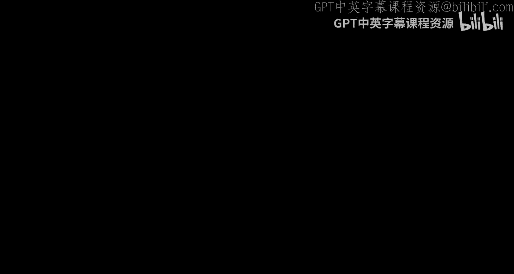
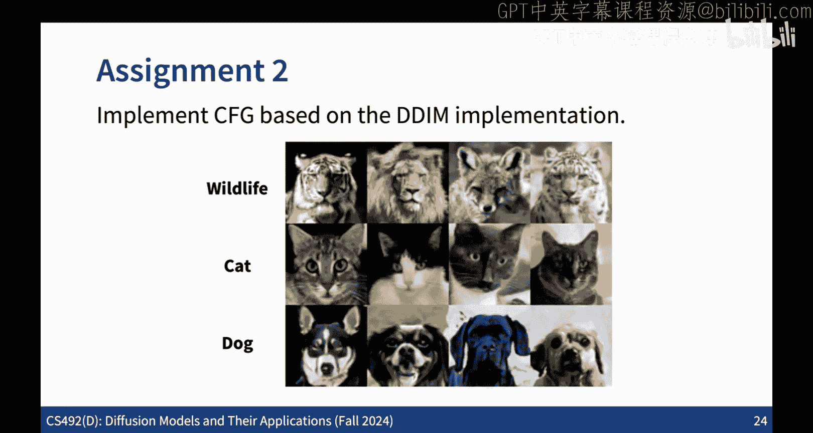
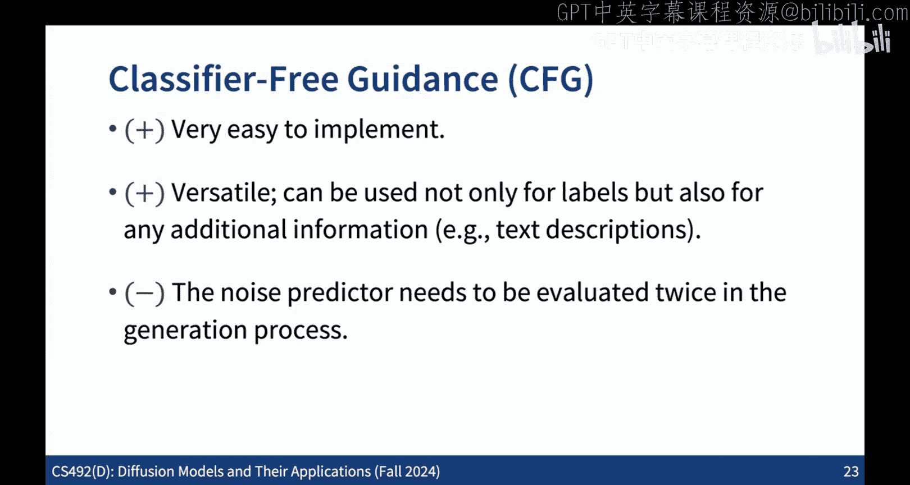
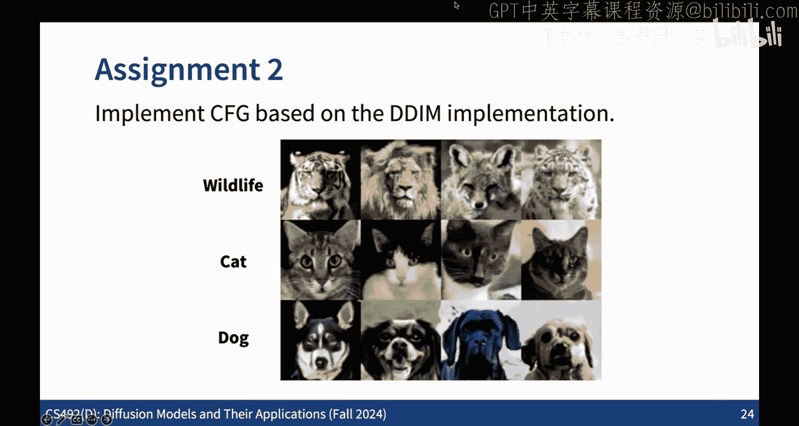

# 扩散模型与应用：06：去噪扩散隐式模型 (DDIM) 第二部分



在本节课中，我们将继续学习去噪扩散隐式模型 (DDIM)。我们将深入探讨DDIM与DDPM的关系，理解其核心公式的变化，并了解如何通过调整方差来控制生成过程。最后，我们将简要介绍条件生成的概念，为后续课程做铺垫。

## DDIM 核心概念回顾

上一节我们介绍了DDIM的基本思想，本节中我们来看看其具体实现细节。DDIM本质上是DDPM的泛化。令人惊讶的是，尽管我们在前向过程中做了许多改变，但最终我们无需做太多额外工作。我们甚至可以直接使用DDPM训练好的噪声预测器来运行DDIM的反向过程。

DDPM和DDIM的反向过程基本相同，唯一的区别在于从 `X_t` 和预测的 `x_0` 采样 `X_{t-1}` 时，其后验分布不同。在DDPM中，给定每个噪声数据点 `X_t`，我们首先通过噪声预测得到当前步骤对 `x_0` 的最佳预测，这通常会得到一个有些模糊的输出图像。基于此，我们计算该分布似然的均值，并从中采样。

在DDIM中，我们进行的是类似的操作，也使用相同类型的分布进行反向过程。唯一改变的是高斯分布的均值和方差。

## DDIM 的均值和方差

以下是DDIM中计算的关键变化。我们仍然可以从 `X_t` 和预测的噪声 `ε` 计算出 `x_0` 的预测值。

**预测 `x_0` 的公式：**
```
x_0_pred = (X_t - sqrt(1 - α_bar_t) * ε_pred) / sqrt(α_bar_t)
```

**DDIM反向过程的均值公式：**
```
mean = sqrt(α_bar_{t-1}) * x_0_pred + sqrt(1 - α_bar_{t-1} - σ_t^2) * ε_pred
```

**DDIM反向过程的采样公式：**
```
X_{t-1} = mean + σ_t * z, 其中 z ~ N(0, I)
```

可以看到，与DDPM相比，我们基本上只改变了计算均值的一行代码，并引入了一个新的方差参数 `σ_t`。

我建议你尝试自己推导这些公式，理解它们是如何从 `X_t` 和 `ε` 的关系中得出的。在DDPM中，我们可以直接用 `X_t` 和 `ε` 计算均值，在DDIM中也可以做同样的事，只是均值计算变得稍微复杂一些，但核心仍是利用 `X_t` 和噪声预测来计算。

## DDIM 与 DDPM 的关系及随机性控制

正如我们上次讨论的，DDIM是DDPM的泛化。如果我们设定方差为特定形式，DDPM就成为DDIM的一个特例。更重要的是，DDIM允许我们控制生成过程的随机性。

通过设定方差 `σ_t`，我们可以在完全随机和完全确定之间进行调节。

*   **当 `σ_t = 0` 时**：反向过程变为**确定性**过程。一旦从先验分布中采样出初始噪声 `X_T`，最终生成的 `x_0` 也就确定了。这就在 `X_T` 和 `x_0` 之间建立了一种确定的映射关系。
*   **当 `σ_t` 取最大值时**：反向过程具有**完全的随机性**。方差的最大值为 `sqrt(1 - α_bar_{t-1})`。如果设定的 `σ_t` 大于此值，则公式无效。

因此，通过调整 `σ_t`，我们可以控制生成过程的随机程度。

## 加速采样与质量权衡

扩散模型的一个缺点是需要在反向过程中进行多步迭代去噪，计算成本高。一种加速思路是减少反向过程的步数（例如从1000步减少到10步）。然而，步数减少通常会导致生成质量下降，输出会偏离学习到的数据分布。

一个有趣的经验观察是，在DDIM的框架下，尤其是当方差较小（即过程更确定）时，减少步数导致的质量下降问题会得到缓解。虽然这更多是经验性发现，但你可以通过实验来验证这一点。

以下是实践中观察到的结果摘要：

*   随着时间步数减少，生成图像的质量通常会下降（FID分数升高，分数越高表示质量越差）。
*   在DDPM（高随机性）中，减少步数会导致FID显著升高。
*   在DDIM（低随机性或确定性）中，即使将步数减少到10步，FID的上升也不那么显著，有时在100步时甚至能获得更好的结果。

## 课程作业关联与总结

本节课中我们一起学习了DDIM的核心内容，以下是总结：

1.  **DDIM是DDPM的泛化**：DDPM是DDIM的一个特例。
2.  **无需重新训练**：DDIM最大的优点是可以直接使用DDPM预训练好的噪声预测器，无需额外训练。
3.  **可控的随机性**：通过方差参数 `σ_t`，可以控制反向过程从完全随机到完全确定。
4.  **加速潜力**：在确定性或低随机性设置下，减少采样步数对生成质量的负面影响较小。

对于课程作业，第二项作业的核心就是将你在第一项作业中实现的DDPM代码修改为DDIM。这意味着你需要先完成DDPM的作业。此外，DDPM和DDIM的代码将在后续作业中继续使用，因此构建一个良好的代码基础非常重要。

## 条件生成简介

接下来，我们将把讨论重点从基础模型转向更多应用。我们将探讨如何使扩散模型进行**条件生成**，即根据特定输入（如类别标签、文本描述、草图等）生成图像，而不仅仅是随机生成。

一个简单而强大的方法是**分类器无关引导**。其核心思想是训练一个既能处理有条件输入也能处理无条件输入的噪声预测网络。

**实现思路：**
*   对于有条件情况，向网络输入噪声图像 `X_t` 和条件 `c`（如图像标签）。
*   对于无条件情况，向网络输入噪声图像 `X_t` 和一个特殊的“空条件”（例如标签0）。
*   在推理时，通过**外推**有条件预测和无条件预测的噪声，来增强条件控制的效果。


**噪声外推公式：**
```
ε_pred = ε_pred_cond + w * (ε_pred_cond - ε_pred_uncond)
```
其中 `w` 是一个引导尺度。当 `w = 0` 时，直接使用有条件预测；增大 `w` 值可以增强条件的影响，使输出更符合给定条件。



这种方法的优点是实现简单，适用于任何类型的条件（文本、图像、音频等）。缺点是每次反向过程需要运行网络两次（一次有条件，一次无条件），增加了计算时间。

在第二项作业中，你们将扩展DDIM实现，加入这种条件生成机制，以根据“野生动物”、“猫”、“狗”三类标签生成对应的图像。





本节课中，我们深入探讨了DDIM的实现细节、其与DDPM的关系、以及通过控制方差来调节随机性的方法。我们还简要介绍了条件生成的基本概念。从下周开始，我们将深入探讨扩散模型在各种条件下的应用场景。