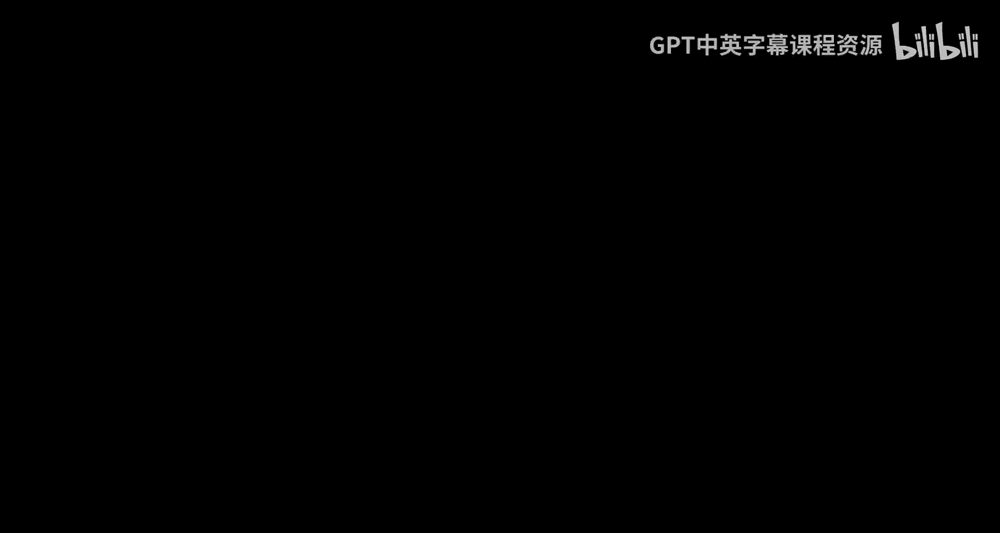
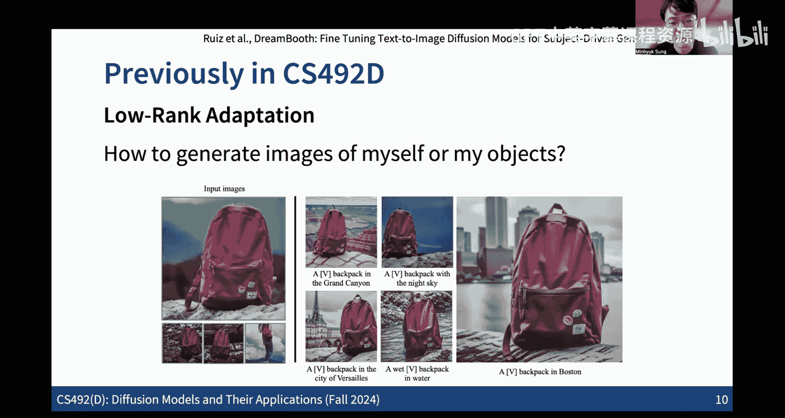
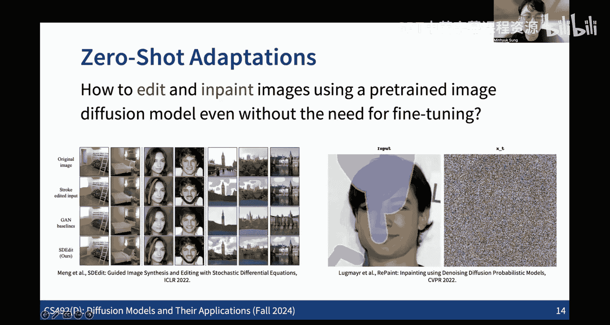
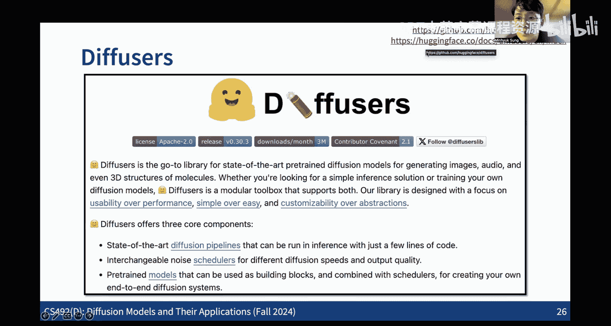

# 扩散模型和应用：08：零样本应用

在本节课中，我们将学习如何利用预训练的扩散模型，在不进行任何微调的情况下，完成图像编辑和修复等任务。我们将探讨两种核心方法：一种是通过简单的加噪和去噪过程实现图像编辑，另一种是通过巧妙结合前向和反向过程实现图像修复。

## 概述

上一节我们讨论了如何利用预训练扩散模型进行条件生成和编辑，例如通过分类器引导或分类器自由引导等方法。本节中，我们将看看如何在不修改模型参数的情况下，直接利用预训练扩散模型进行零样本应用，如图像编辑和修复。

## 图像编辑：简单加噪与去噪

以下是实现图像编辑的核心思想：对输入图像添加少量噪声，然后运行反向去噪过程，从而将略微不真实的图像映射回接近真实的数据点。

*   **核心公式**：给定输入图像 `x0`，我们首先运行前向过程 `t` 步，得到带噪图像 `xt`。然后，我们从 `xt` 开始运行反向去噪过程，得到输出图像 `x0'`。
*   **时间步长 `t` 的作用**：`t` 的大小控制着编辑的强度。
    *   **`t` 较大**：添加更多噪声，输出图像会更真实，但也可能与原始输入差异较大。
    *   **`t` 较小**：添加较少噪声，输出图像更接近原始输入，但可能仍保留一些不真实感。
*   **实践方法**：通过调整 `t`，我们可以在输出图像的“真实性”和“对原始输入的忠实度”之间取得平衡。这是一种非常实用的启发式方法，虽然没有严格的理论保证，但通常效果良好。

## 图像修复：结合前向与反向过程

图像修复的任务是：给定一张图像和一个遮罩（指定需要填充的区域），生成遮罩区域（前景）的新内容，同时保持非遮罩区域（背景）的原始内容不变。

以下是实现图像修复的核心算法思路：

1.  **初始化**：从纯高斯噪声 `xT` 开始反向过程。
2.  **迭代去噪**：对于每个时间步 `t` 从 `T` 到 `1`：
    *   **前景区域**：对当前噪声图像 `xt` 运行一步标准反向去噪，得到 `xt-1_foreground`。这负责生成遮罩内的新内容。
    *   **背景区域**：对原始输入图像 `x0` 运行前向过程至第 `t-1` 步，得到 `xt-1_background`。这确保了背景区域的信息得以保留。
    *   **图像合成**：使用遮罩 `M` 将两部分合成，得到下一时间步的完整图像：
        `xt-1 = M * xt-1_foreground + (1 - M) * xt-1_background`
3.  **重复**：重复步骤2，直到得到最终输出图像 `x0`。

这种方法通过在每个时间步将背景区域“锚定”在原始输入上，巧妙地保证了背景不变。然而，由于合成步骤可能引入不连续性，有时会导致失败案例。一种改进策略是“重绘”，即如果结果不理想，可以回到更早的时间步重新开始过程。

## 总结

本节课我们一起学习了两种利用预训练扩散模型进行零样本应用的方法。第一种是简单的加噪-去噪编辑，通过控制噪声强度来平衡真实性与一致性。第二种是更复杂的修复算法，它通过在每个去噪步骤中结合前向过程（固定背景）和反向过程（生成前景），实现了在保持部分图像不变的同时填充新内容。这些方法展示了扩散模型在无需额外训练的情况下，所具备的强大而灵活的生成与编辑能力。