# 扩散模型和应用：09：DDIM反转与分数蒸馏采样

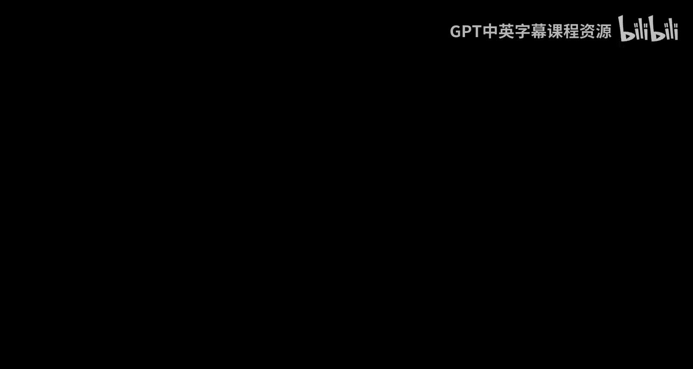

在本节课中，我们将要学习两个核心概念：DDIM反转和分数蒸馏采样。首先，我们将详细探讨DDIM反转的原理及其在图像编辑中的应用。随后，我们将转向一个更重要的主题——分数蒸馏采样，这是一种利用预训练图像扩散模型的知识来生成其他模态数据（如3D模型）的强大技术。

---

## DDIM反转

上一节我们介绍了DDIM采样过程，本节中我们来看看如何实现其逆过程，即DDIM反转。

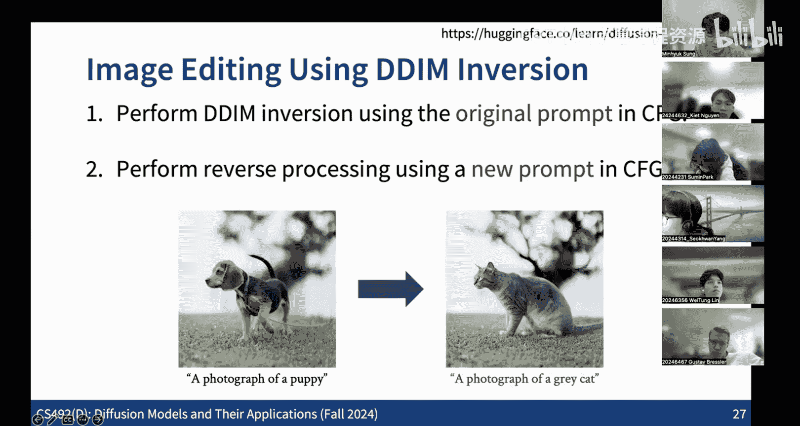

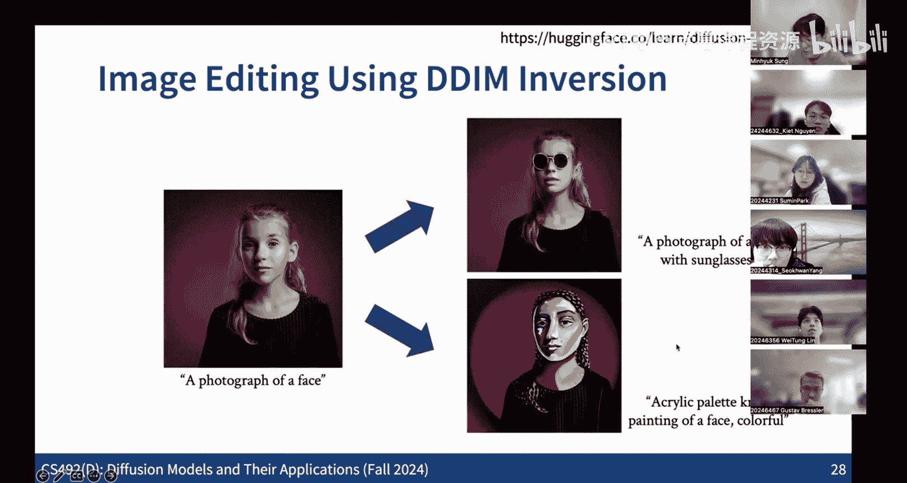

DDIM的确定性采样过程可以表示为从噪声图像 \(X_T\) 到干净图像 \(X_0\) 的固定映射。其核心公式如下：

首先，通过噪声预测网络 \(\epsilon_\theta\) 预测 \(X_0\)：
\[
\hat{x}_0^{(t)} = \frac{x_t - \sqrt{1 - \bar{\alpha}_t} \cdot \epsilon_\theta(x_t, t)}{\sqrt{\bar{\alpha}_t}}
\]
然后，在方差 \(\sigma_t = 0\) 的确定性情况下，直接计算 \(X_{t-1}\)：
\[
x_{t-1} = \sqrt{\bar{\alpha}_{t-1}} \hat{x}_0^{(t)} + \sqrt{1 - \bar{\alpha}_{t-1}} \cdot \epsilon_\theta(x_t, t)
\]

DDIM反转的目标是找到这个映射的逆：给定一张原始图像 \(X_0\)，寻找一个初始噪声 \(X_T\)，使得从该噪声出发的DDIM采样过程能精确地重建出 \(X_0\)。

一个简单有效的近似方法是，当时间步间隔很小时，我们可以用前向差分来近似反向过程。具体而言，我们利用 \(X_t\) 到 \(X_{t-1}\) 的公式，通过将 \(t-1\) 替换为 \(t+1\) 来近似 \(X_{t+1}\) 与 \(X_t\) 的差异。这样，我们就可以从 \(X_0\) 开始，逐步计算出 \(X_1, X_2, ..., X_T\)。

以下是实现高质量DDIM反转的关键点：
*   **时间步间隔**：此近似方法在时间步间隔很小时效果良好。如果减少总采样步数（即增大步长），重建质量会下降。
*   **应用**：DDIM反转的主要应用是**图像编辑**。通过使用描述原图的提示词进行反转得到潜在噪声 \(X_T\)，然后在去噪生成时改用新的提示词，就能在保持原图结构的基础上生成符合新描述的图像，而无需对网络进行微调。

然而，一个实际问题是，为了获得显著的编辑效果，我们通常需要使用较高的分类器引导权重。但直接用高权重进行反转和重建会导致输出图像与原图差异过大。

为了解决这个问题，研究者提出了**空文本反转**技术。其核心思想是：
1.  用低引导权重（如 \(w=1\)）对输入图像进行DDIM反转，得到一系列高质量的潜在变量 \(z^*\)。
2.  用高引导权重（如 \(w=7.5\)）进行生成时，通过优化一个**空文本嵌入向量**，使得高权重下的潜在轨迹与第一步得到的 \(z^*\) 尽可能接近。
3.  这样就能在使用高权重获得强编辑能力的同时，保持良好的图像重建保真度。需要注意的是，这个空文本嵌入需要对每张输入图像单独优化。

---

## 分数蒸馏采样

之前我们讨论的都是基于图像数据的扩散模型。本节我们将探索如何利用预训练的大规模图像扩散模型，来生成其训练数据中不存在或稀缺的其他类型数据，例如3D模型。

### 动机与背景

生成高质量、多样化的3D模型面临的主要挑战是缺乏大规模、多样化的3D数据集。相比之下，图文对数据集（如LAION-5B）规模巨大，涵盖了极其丰富的视觉概念。

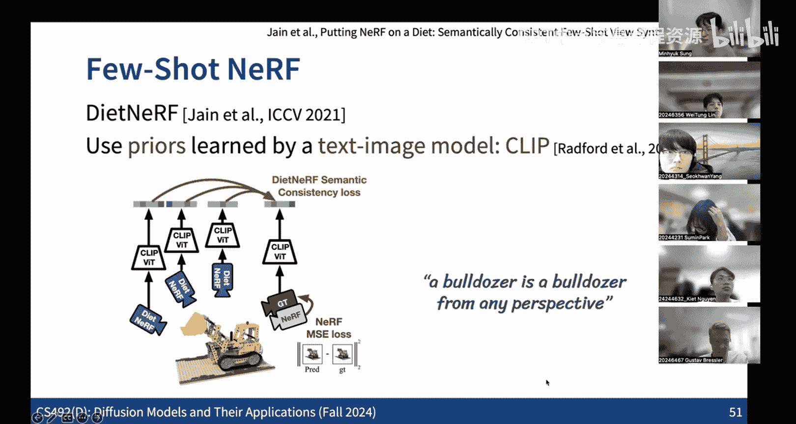

于是，一个核心问题产生了：**我们能否从已训练好的大规模图像扩散模型中“蒸馏”出知识，用于生成3D内容？** 这就是分数蒸馏采样 的核心思想。

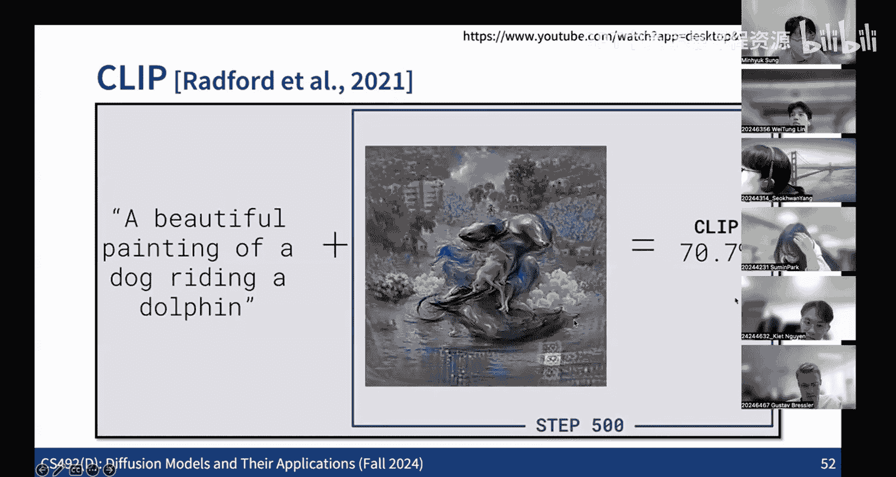

在深入SDS之前，我们需要了解基于多视图图像的3D重建基本流程：
1.  选择一个3D表示（如NeRF隐式表示或高斯泼溅显式表示）。
2.  定义一个可微的渲染函数 \(R\)，能将3D表示 \(\theta\) 从特定视角 \(c\) 渲染成2D图像 \(I = R(\theta, c)\)。
3.  通过优化3D表示参数 \(\theta\)，使得渲染图像与给定真实图像之间的差异（如L2损失）最小化。

当输入图像很少甚至没有时，我们需要引入额外的先验知识。早期工作使用CLIP模型，通过最小化渲染图像与文本提示在CLIP空间中的距离来引导3D生成。但CLIP只是一个判别器，而扩散模型是更强大的生成器。

### SDS核心思想

SDS的关键在于，**将扩散模型的训练损失函数转化为一个衡量“渲染图像是否符合文本描述”的判别信号**。

回顾扩散模型的训练损失（去噪分数匹配）：
\[
\mathcal{L}_{\text{DSM}} = \mathbb{E}_{t, \epsilon} \left[ \| \epsilon - \epsilon_\theta(x_t, t, y) \|^2 \right]
\]
其中 \(x_t = \sqrt{\bar{\alpha}_t} x_0 + \sqrt{1 - \bar{\alpha}_t} \epsilon\)。

对于一个训练好的扩散模型，真实图像 \(x_0\) 的损失应接近零，而不真实的图像损失会较大。因此，这个损失值本身可以作为一个对齐度量。

在SDS中，我们将渲染图像 \(I = R(\theta, c)\) 视为 \(x_0\)。流程如下：
1.  从当前3D表示 \(\theta\) 渲染一张图像 \(I\)。
2.  随机采样一个时间步 \(t\) 和噪声 \(\epsilon\)，对 \(I\) 加噪得到 \(I_t\)。
3.  用噪声预测网络 \(\epsilon_\theta\) 预测噪声，并计算损失 \(\mathcal{L}_{\text{SDS}}\)。
4.  最关键的一步：计算损失相对于3D参数 \(\theta\) 的梯度来更新 \(\theta\)。梯度公式近似为：
    \[
    \nabla_\theta \mathcal{L}_{\text{SDS}} \approx \mathbb{E}_{t, \epsilon, c} \left[ w(t) (\epsilon_\theta(I_t, t, y) - \epsilon) \frac{\partial I}{\partial \theta} \right]
    \]
    其中，为了节省内存，实践中通常会忽略噪声预测网络 \(\epsilon_\theta\) 对 \(I_t\) 的雅可比矩阵计算，这被证明是有效的近似。

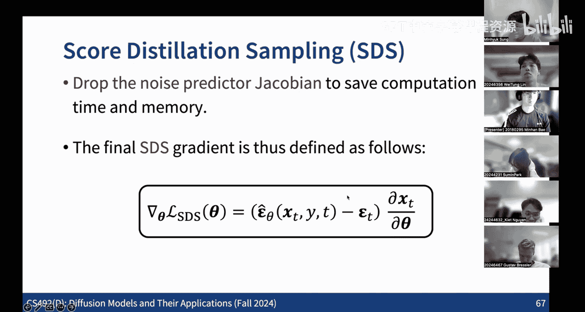

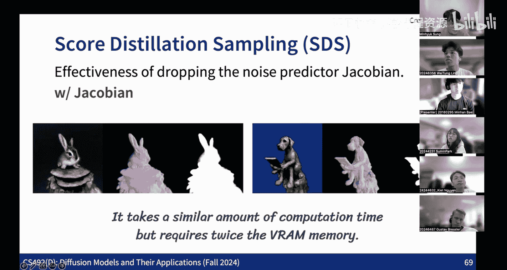

通过迭代这个过程，SDS利用预训练图像扩散模型提供的“分数”（即去噪方向）作为监督信号，引导3D表示 \(\theta\) 逐渐变成一个符合文本提示 \(y\) 的、从各个视角看都合理的3D资产。

### 应用与局限

SDS的思想具有通用性，可应用于任何能通过可微渲染映射到图像的数据生成任务，例如：
*   3D形状生成
*   材质与光照生成
*   3D动态生成
*   参数化图像（如SVG）生成

然而，SDS也存在一些局限性：
1.  **多面脸问题**：由于仅依赖2D图像先验，缺乏3D几何一致性约束，生成的物体可能在不同的视角下出现多个不相关的特征（如一个松鼠身上有多张脸）。
2.  **收敛性与多样性权衡**：使用较低的引导权重可能导致优化困难，生成空场景；提高权重有助于收敛，但会损失输出多样性。
3.  **优化效率**：SDS优化通常需要大量迭代，计算成本较高。

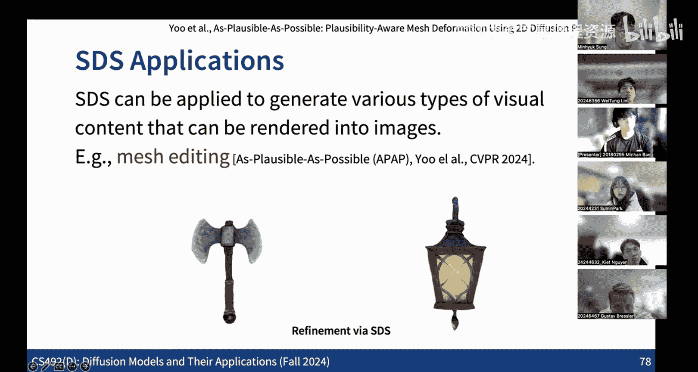

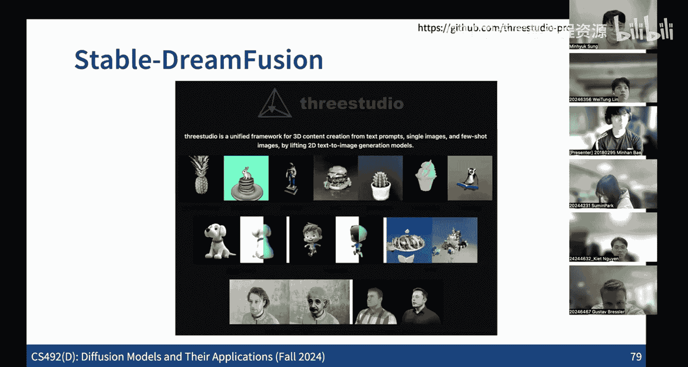

针对这些局限，后续研究提出了许多改进方案，例如在优化过程中同时微调扩散模型本身，或者将SDS与扩散模型的逆过程更明确地联系起来。

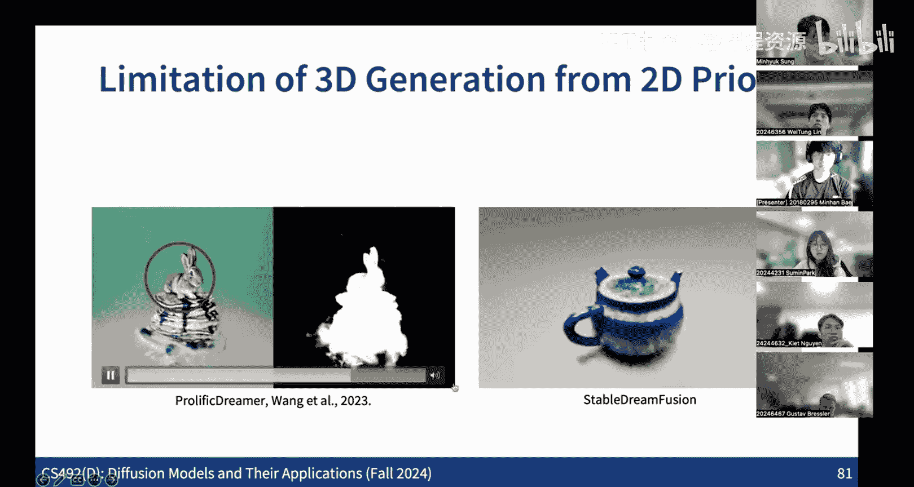

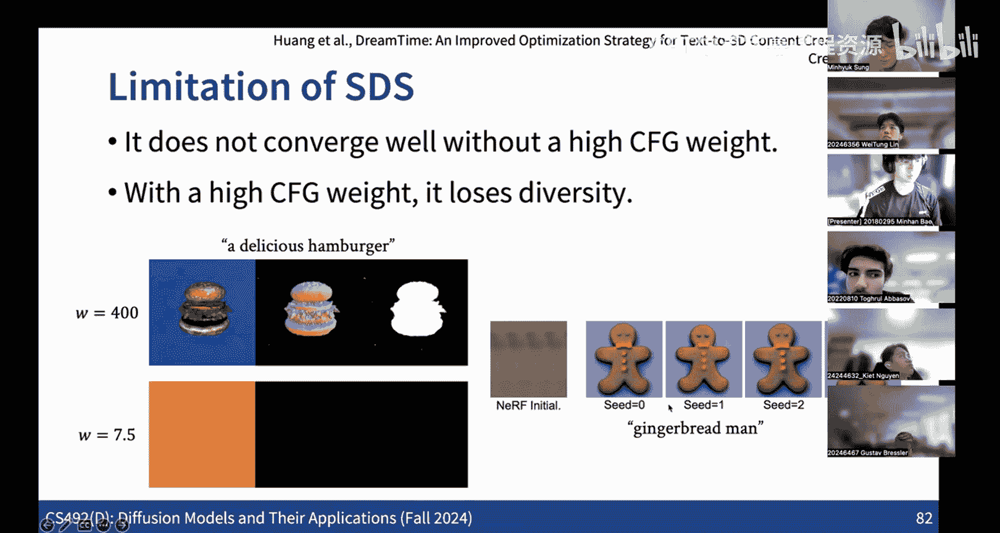

---

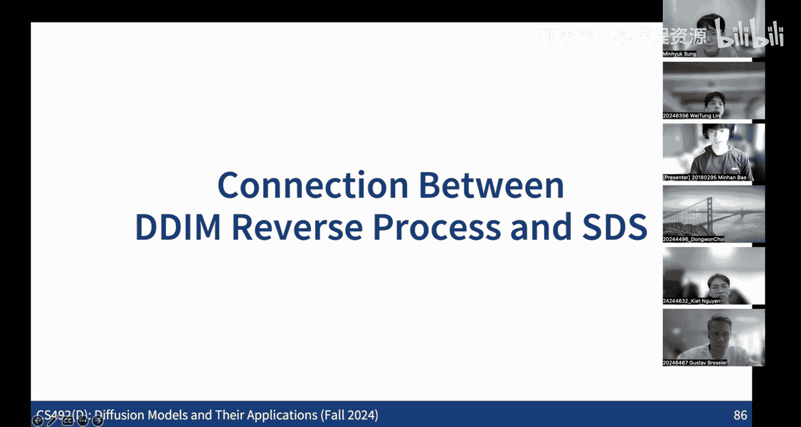

本节课中我们一起学习了DDIM反转和分数蒸馏采样。DDIM反转通过寻找图像到噪声的逆映射，实现了基于文本的零样本图像编辑。分数蒸馏采样则是一种巧妙的“知识蒸馏”方法，它利用大规模预训练图像扩散模型作为强大的2D先验，来指导3D等其他模态内容的生成，从而克服了特定领域数据稀缺的难题。这两种技术都极大地扩展了扩散模型的应用边界。