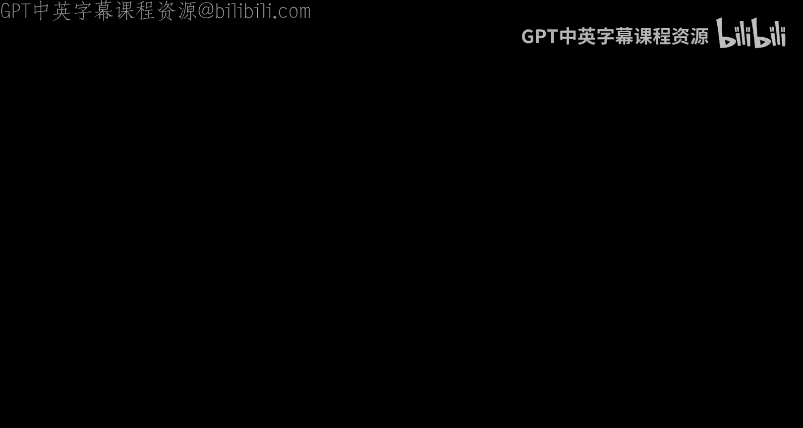
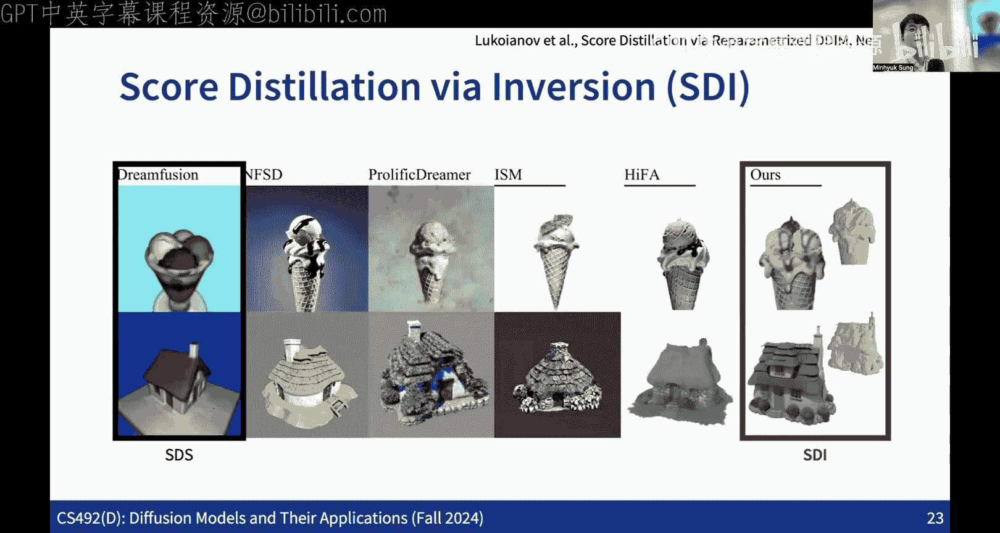
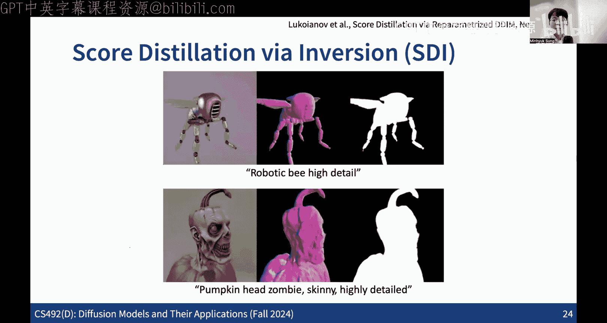
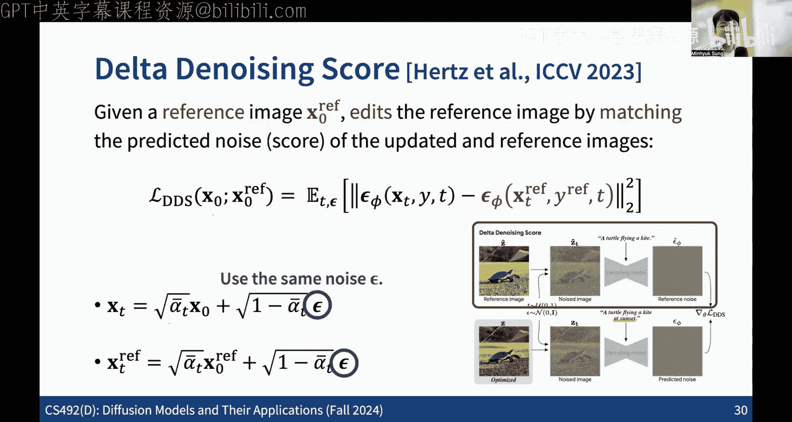
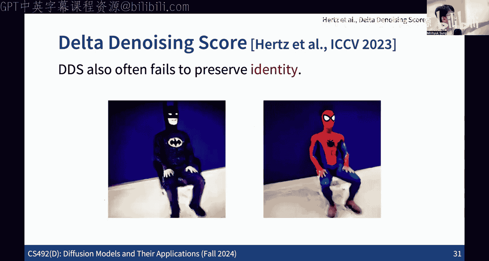
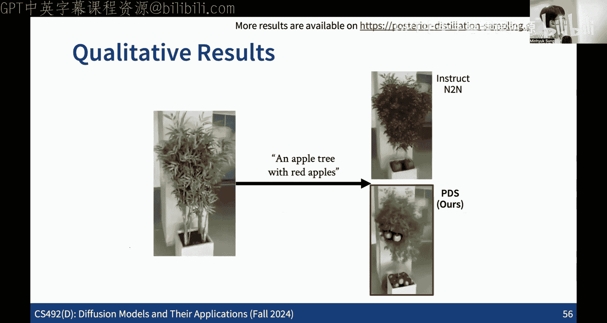
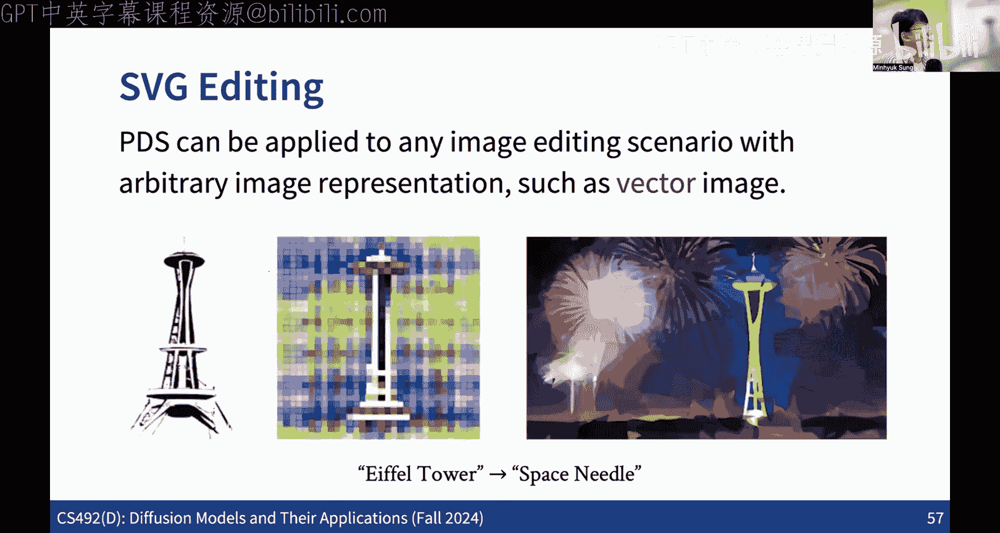
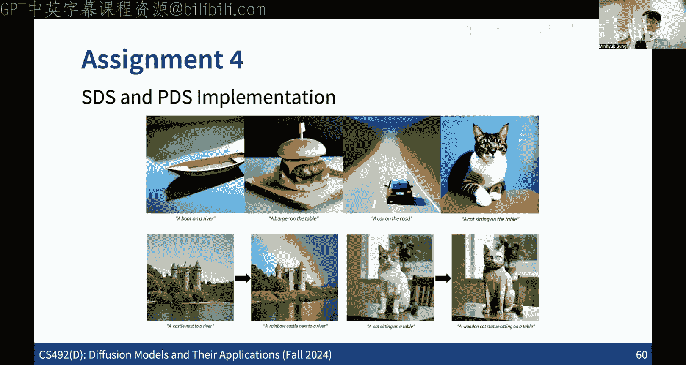
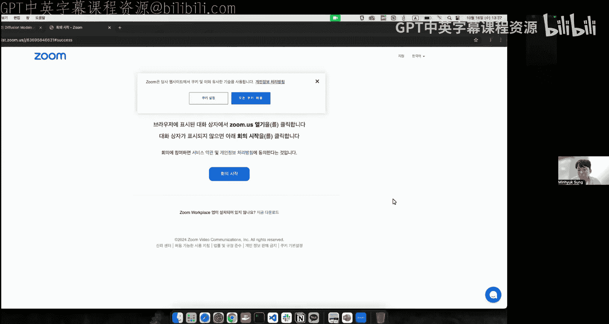
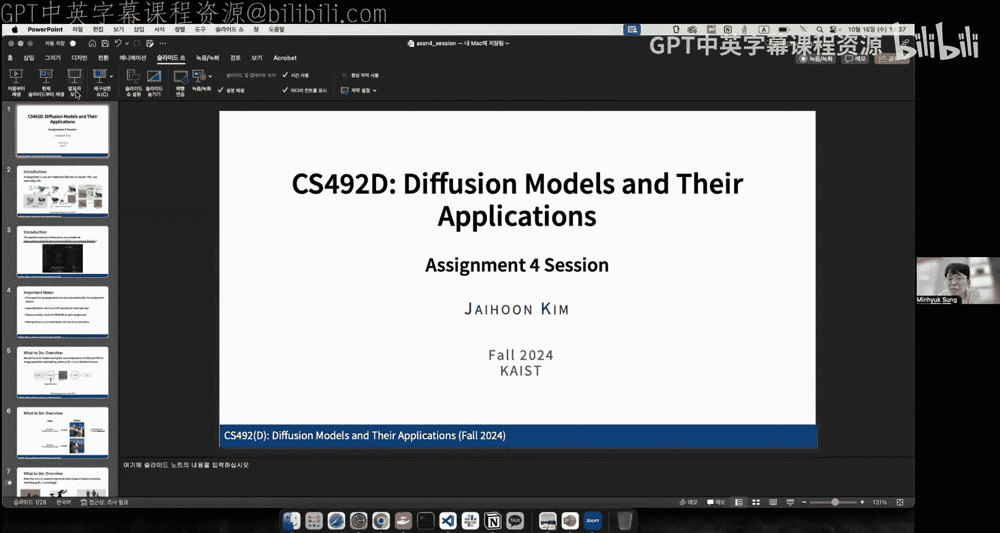

# 扩散模型和应用：10：分数蒸馏采样 2 (Score Distillation Sampling 2)

## 概述

在本节课中，我们将深入探讨分数蒸馏采样（SDS）的核心思想，并分析其与扩散模型标准去噪过程之间的联系。我们将看到，SDS本质上是一种特殊的去噪过程，并探讨如何通过改进SDS框架来实现更高质量的3D生成和图像编辑任务。

---

## SDS的基本思想回顾

上一节我们介绍了SDS的基本概念，本节中我们来看看它与标准去噪过程的具体联系。

SDS的基本思想是利用预训练扩散模型的损失函数，来优化那些本身不是图像、但可以通过可微渲染函数映射为图像的数据（例如3D模型）。其核心是定义一个损失函数，用于衡量渲染图像与给定文本提示之间的对齐程度。

虽然损失函数看起来复杂，但其思路非常直接：我们有一个3D物体的渲染函数 **G**，通过它得到渲染图像 **x**，然后利用扩散模型的噪声预测网络来评估该图像与目标文本的一致性。具体公式如下：

**L_SDS = E_t, ε [ w(t) * || ε_φ(x_t, y, t) - ε ||^2 ]**

其中，**x_t** 是添加噪声后的渲染图像，**ε_φ** 是噪声预测网络，**ε** 是实际添加的高斯噪声，**y** 是文本提示。

通过这种简单的思想，我们可以生成非常精美的3D形状。一个实现上的细节是，我们通常会忽略噪声预测网络对输入 **x** 的雅可比矩阵，以降低计算成本。

---

## SDS与去噪过程的联系

我们之前讨论过，扩散模型通过反向去噪过程生成图像。那么，SDS看起来与此不同，它们之间究竟有何关联呢？

让我们回顾一下DDIM采样器的公式。给定噪声图像 **x_t**，去噪一步得到 **x_{t-1}** 的过程如下：

**x_{t-1} = sqrt(α_{t-1}) * x̂_0 + sqrt(1 - α_{t-1} - σ_t^2) * ε_φ(x_t, t) + σ_t * z_t**

其中，**x̂_0** 是当前步预测的干净图像，**z_t** 是额外采样的高斯噪声，**σ_t** 控制方差。

现在，考虑一个极端情况：我们使用**最大方差**，即设置 **σ_t = sqrt(1 - α_t)**。此时，公式简化为：

**x_{t-1} = sqrt(α_{t-1}) * x̂_0 + sqrt(1 - α_{t-1}) * z_t**

在这个设定下，我们不需要计算中间项，而是直接基于预测的 **x̂_0** 和采样的噪声 **z_t** 来得到 **x_{t-1}**。

SDS所做的是，将每一步预测的 **x̂_0** 信息，通过梯度下降编码到一个代理变量（例如3D场景参数 **θ**）中。然后，在下一步，我们再次通过渲染函数 **G** 从这个代理变量得到新的 **x̂_0**。这个过程可以看作是：

1.  从当前 **θ** 渲染得到图像，并预测其去噪后的结果 **x̂_0**。
2.  将这个预测信息通过梯度更新反馈到 **θ**。
3.  更新后的 **θ** 被再次渲染，用于下一步。

因此，SDS可以视为一种特殊的去噪过程，其特点是：
*   使用了最大方差的DDIM采样变体。
*   不是直接使用预测的 **x̂_0** 进行下一步，而是将其信息更新到一个外部代理表示（如3D参数）中。
*   时间步 **t** 是随机采样的，而非顺序递减。

唯一的细微差别在于损失函数的形式，但可以证明，最小化SDS损失与最小化上述最大方差去噪过程中的噪声预测误差在尺度上是等价的。

---

## 改进SDS：向标准去噪过程靠拢

既然SDS与去噪过程存在联系，一个自然的问题是：能否通过修改SDS，使其更接近标准的确定性去噪过程，从而获得更好的结果？

我们可以考虑两个修改方向：
1.  **使用顺序时间步**：将随机采样时间步改为从大到小顺序递减。
2.  **使用零方差（确定性采样）**：将方差 **σ_t** 设为0，使过程变为确定性。

然而，直接应用这些修改会遇到问题。关键在于SDS的视角是从 **x̂_0**（即代理变量 **θ** 的渲染结果）出发，而非从 **x_t** 出发。在3D生成中，我们每次迭代都会改变渲染视角（相机位置），因此我们无法像标准去噪过程那样维护一个连贯的 **x_t** 序列。如果我们使用零方差，公式中需要用到 **x_t**，但这在视角变化时是无法计算的。

解决方案是引入**反演（Inversion）**过程。对于当前代理变量 **θ** 渲染得到的图像，我们可以通过扩散模型的前向过程，计算出其在任意时间步 **t** 对应的噪声图像 **x_t**。这样，我们就有了计算确定性去噪步骤所需的 **x_t**。尽管这增加了计算成本，但可以使SDS过程更接近原始的DDIM确定性采样，通常能产生更逼真的3D结果。

---

## 从生成到编辑：扩展SDS框架

之前我们主要关注使用SDS进行生成（从零创建3D内容）。现在，我们来看看如何将其应用于**编辑**任务，即在保留输入内容大部分信息的前提下，根据新提示进行修改。

一个简单的想法是：直接从输入图像开始运行SDS优化。但结果往往是生成一个完全符合新提示的全新图像，几乎不保留原图信息。

以下是几种改进的编辑方法：

### Delta Denoising Score (DDS)

DDS的核心思想不是将预测噪声与随机噪声比较，而是与参考图像（待编辑的原图）的预测噪声比较。

具体来说：
*   对**生成图像**和**参考图像**添加相同的噪声，得到各自的噪声版本。
*   用噪声预测网络分别预测两者应去除的噪声。
*   损失函数变为最小化这两个预测噪声之间的差异。

这样，优化过程会驱使生成结果向新提示靠近，同时其去噪路径与参考图像的去噪路径保持相似，有助于保留原图结构。但这种方法的效果有时不稳定。

### 渐进式3D场景替换

对于3D场景编辑，一个更工程化的方法是：
1.  使用多视角图像重建初始3D场景。
2.  利用2D图像编辑模型（如图像到图像的扩散模型）逐一修改这些输入图像。
3.  用修改后的图像集更新3D场景表示。
4.  重复此过程。

这种方法能有效改变外观（如颜色、纹理），但难以进行需要几何结构大变动的编辑（如改变姿势）。

### 基于轨迹的编辑（PDS）

为了进行更大程度的编辑，我们需要控制去噪的**轨迹**。在DDPM中，轨迹由每一步采样到的噪声 **z_t** 决定。

PDS的改进在于，其损失函数不仅比较预测噪声（**ε**），还比较了决定轨迹的噪声 **z_t**。通过同时约束去噪路径和最终结果，PDS能在改变对象类别或属性的同时，更好地保留输入图像的细节和多样性。

用一个2D点分布的类比来说明：
*   **SDS**：将所有红点都移动到同一个蓝点，失去多样性。
*   **DDS**：将红点移动到不同的蓝点，但变化可能过大。
*   **PDS**：将红点移动到不同的蓝点，同时尽可能保持每个点的原始位置信息，实现最小程度但有效的改变。

通过调整损失函数中不同项的权重，可以控制编辑的强度和保真度。

---

## 总结

本节课中我们一起学习了：
1.  **SDS与去噪过程的内在联系**：SDS可视为一种使用最大方差、并通过外部代理变量迭代更新信息的特殊去噪过程。
2.  **改进SDS的方向**：通过引入反演过程和顺序时间步，可以使SDS更接近确定性去噪，提升生成质量。
3.  **SDS在编辑任务上的扩展**：从简单的DDS到控制去噪轨迹的PDS，这些方法通过修改损失函数，实现了在遵循新指令的同时，尽可能保留原始内容信息的目标。

分数蒸馏采样的思想非常强大，其应用不仅限于3D生成，还可以扩展到矢量图形、音频、视频等任何可以映射到扩散模型所处理域的数据类型。理解其与核心去噪过程的关系，有助于我们更好地掌握和改进这一技术。