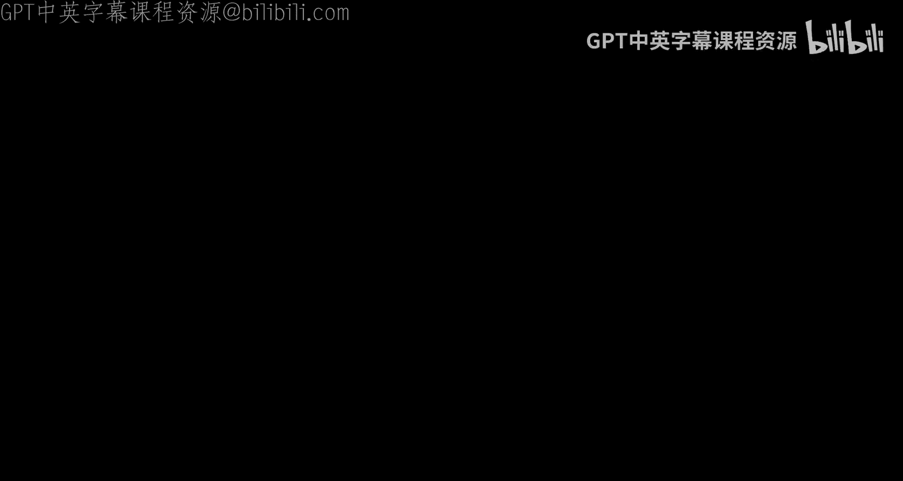
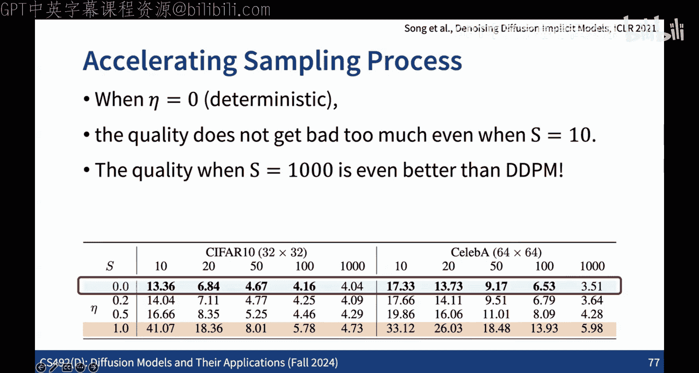

# 扩散模型和应用：05：去噪扩散隐式模型 1

## 概述
在本节课中，我们将首先简要回顾去噪扩散概率模型（DDPM）的核心概念，然后探讨扩散模型与基于分数的生成模型（Score-based Models）之间的联系。最后，我们将引入一种新的模型——去噪扩散隐式模型（DDIM），并讨论其如何通过非马尔可夫过程实现更高效的采样。

---

## DDPM 回顾

上一周我们讨论了扩散模型的基本思想。扩散模型的关键特征在于，我们同时定义了前向过程和反向过程，并且前向过程是一个预定义的过程，而非学习得到的。我们逐步向数据中添加噪声，同时增加高斯分布的方差。这是 DDPM 的核心特征。

一旦我们以这种方式定义了前向转移分布，我们就可以推导出两个条件分布。第一个是后验分布，用于直接从数据点 **x₀** 采样 **xₜ**。第二个是反向条件分布，用于在给定 **xₜ** 和 **x₀** 的条件下采样 **xₜ₋₁**。这两个分布都被定义为高斯分布。

我们之前介绍了 **εₜ**，这是一个用于从 **x₀** 采样 **xₜ** 的特定噪声。这个特定后验分布的均值不仅可以由 **xₜ** 和 **x₀** 推导，也可以由 **xₜ** 和 **εₜ** 推导。

训练神经网络的目标是匹配这个似然分布与之前幻灯片中的分布。为此，有三种不同的训练神经网络的方式：
*   第一种是直接预测这个分布的均值。
*   第二种是预测原始数据点 **x₀**，然后利用 **xₜ** 和预测的 **x₀** 计算均值。
*   第三种是预测噪声 **εₜ**，然后利用 **xₜ** 和预测的 **εₜ** 计算均值。

有趣的是，无论我们使用哪种预测器，其损失函数都源自证据下界（ELBO）的推导，并最终简化为一种非常简单的 **L₂** 损失函数。这是 DDPM 和扩散模型的一个关键优势，即我们拥有非常简单的训练损失函数。

在第一次作业中，目标是实现噪声预测器。理论上，这三种预测器是等价的，但在实践中，性能可能存在差异。因此，建议尝试将预测器切换为 **x₀** 预测器或均值预测器，以观察实际效果。

损失函数是时间 **t**、**x₀** 和从特定后验分布采样的 **xₜ** 的期望值。在训练神经网络时，我们通过最小化这个特定的损失函数来进行反向传播。

在生成阶段，过程也很简单。我们从先验分布（标准高斯分布）开始采样，然后随时间推移，根据似然分布的变分形式进行采样，通过复制噪声预测得到的均值并采样 **xₜ**。

---

## 快速测验

在之前的幻灯片中，我们看到了如何从给定的 **xₜ** 和预测的噪声 **ε** 计算似然分布的均值。那么，我们是否也能从给定的 **xₜ** 和预测的噪声 **ε** 计算 **x₀** 的预测值呢？

答案是肯定的。公式如下：

**x₀ = (xₜ - √(1 - ᾱₜ) * ε) / √ᾱₜ**

如果你不确定如何推导这个公式，建议回顾 DDPM 的幻灯片细节。这些公式将在后续所有课程中反复出现。

---

## 去噪过程的可视化

去噪过程可以这样理解：在每一步，我们有一个带噪声的数据点 **xₜ**。给定这个点，我们预测噪声 **ε**。基于此，我们首先预测 **x₀**，这是从带噪声数据点 **xₜ** 对最终数据点的最佳预测。我们并非严格采用这个预测值，而是利用这个信息来计算似然分布的均值，并采样 **xₜ₋₁**，重复此过程。

我们可以看到，这个过程定义了我们对 **x₀** 随时间变化的预测。正如在前一讲中看到的，**x₀** 的预测会通过这种去噪过程逐渐改进。在作业一中，逐步可视化 **x₀** 的预测会很有趣。

---

## 关于扩散模型实用性的思考

在进入下一个主题之前，一个重要的问题是：当我们拥有数十亿张互联网图像时，如何训练扩散模型？另一个问题是，如果我们真的拥有如此大规模的图像，是否还需要使用扩散模型生成数据？也许我们可以直接从训练数据中采样一张图像。

拥有生成模型的一个优势是，我们不需要存储所有的数十亿张图像。我们训练的噪声预测器编码了整个数据分布的信息，这意味着神经网络压缩了所有图像的信息到其参数中。这在效率和存储方面有优势。

此外，我们的模型能够生成训练数据中并不完全存在但依然逼真的图像。这意味着我们无需复制训练数据中的图像，从而可以保护隐私或避免版权问题。

从下周开始，我们将讨论条件设置，如文本到图像生成。对于这类条件设置，直接使用训练数据中的样本将变成一个检索问题。相比之下，条件生成模型在根据给定条件轻松生成新数据点方面更为高效。

然而，这也表明，根据应用场景的不同，有时可能不需要训练生成模型，直接使用给定数据集中的样本解决检索问题可能更好。这是一个重要的考量点。

---

## 基于分数的模型

现在让我们转向基于分数的模型。在讨论这些模型之前，需要明确“分数”（score）在统计学中的含义。这里的分数指的是数据对数似然函数关于数据点的梯度。如果我们有一个数据点的概率密度函数（PDF），取其对数后再对数据点求梯度，就得到了分数。我们将在此后的讨论中使用这个定义。

我们将首先看看如何计算这个特定概率分布（即前向跳跃的后验分布）的分数。其次，我们将看到这个分数如何与我们神经网络预测的噪声相关联。

实际上，我们可以直接计算这个分数，因为我们知道该分布具有高斯分布的形式。给定高斯分布的定义，我们可以直接计算其对数概率的梯度，然后发现分数具有以下形式。从我们对 **εₜ** 的定义（用于从 **x₀** 采样 **xₜ** 的噪声）可以看出，这个特定分布的分数函数实际上与噪声相同，只是按一个缩放向量进行了缩放。

需要记住这个分布分数与 **εₜ** 之间的关系。实际上，我们在 DDPM 中训练噪声预测器，现在可以将其解释为预测这个分数函数，或者说是预测后验分布的缩放因子。我们虽然没有显式地包含这个缩放因子，但预测 **εₜ** 本质上等同于预测这个概率分布的分数（乘以缩放向量）。

我们也可以通过 Tweedie 公式推导出相同的公式。Tweedie 公式表明，如果我们有一个高斯分布，但不知道其均值，只知道其方差和一些从该分布采样的样本，那么我们可以通过一个涉及分数函数的公式来计算均值的期望值。由此，我们可以推导出相同的公式，显示分数函数与 **εₜ** 之间的关系。这表明噪声预测与预测此后验分布的分数是相同的。

---

## 朗之万动力学

那么，为什么我们要关心这个分数函数呢？回忆一下第二讲的内容，如果我们掌握了关于分布概率密度函数的信息，就可以从中采样。有趣的是，即使没有明确的概率分布信息，仅使用分数函数，我们仍然可以直接从给定分布中采样数据点。这种技术称为朗之万动力学，它源自物理学。

朗之万动力学的基本思想很简单。我们从一个先验分布（通常是标准高斯分布）中采样一些数据点。然后，我们迭代以下过程：对于每个数据点，我们添加一个分数乘以某个步长 **s**，并添加一个标准高斯噪声作为扰动。可以保证的是，当这个分数的权重趋近于零，并且你无限次迭代此过程时，数据点将收敛到原始数据分布中的一个点。

这是一种非常有趣的方法，使我们即使在没有概率分布信息，只有分数函数的情况下也能采样数据点。你可以看到，这实际上与 DDPM 的反向过程相似，但我们可以更清楚地看到两者之间的联系。

这个动画展示了数据点如何随时间移动。最初，点在空间中几乎是均匀采样的。随着时间的推移，点会向某些高密度区域移动。权重 **s** 可以随时间变化，也可以使用常数。

---

## 分数预测网络的训练

为了融入数据分布的信息，我们可以训练一个神经网络来预测这个分数。一种方法是训练一个分数预测网络，其损失函数是某种 **L₂** 损失，通过从数据分布中采样点来计算期望值。我们可以看到，这与噪声预测网络相似。

这里的问题是，我们如何精确计算这个分数？假设我们只有数据分布的样本，而不知道数据分布的确切信息。在这种情况下，我们无法直接计算这个分数。因此，我们需要对数据分布进行轻微的扰动。

假设我们有一个原始数据分布 **q(x₀)**。我们将其近似为高斯的混合分布。这意味着我们不是直接取 **q(x₀)** 作为高斯分布，而是用某个高斯噪声轻微扰动每个 **x₀**，从而创建一个略微损坏的分布。

我们可以很容易地从这种修改后的分布中采样。简单的方法是从 **x₀** 中采样（即取我们拥有的任何随机样本），然后添加一个扰动。这样我们就从 **q(xₜ)** 中采样了。

现在，我们使用这种略微修改的分布来训练分数预测网络。经过一些推导后，我们可以看到，这变得与预测这种条件分布或后验分布的噪声完全相同。现在我们可以看到，训练这个分数预测网络与训练噪声预测网络是相同的。

---

## 扰动方差的选择

接下来的问题是，我们如何选择扰动的方差？如果我们有一个非常小的方差，优势是我们不会过多地破坏分布，得到的分布接近原始数据分布。但一个缺点是，由于损失函数的形式，如果数据分布在某些区域密度高，在某些区域密度低，那么我们将只有很少的样本来自低密度区域。这意味着我们对这些区域的分数预测不会很准确。

为了避免这个问题，我们可以简单地增加方差，从而在空间上获得更模糊、更均匀的分布。这样，我们可以避免出现低密度区域，从而在低密度区域获得更准确的分数预测。但显然，这样做的缺点是会有更多的扰动，我们预测的分数可能不接近原始数据分布的分数。

因此，我们面临一个权衡：如果扰动方差小，分数预测在高密度区域更准确，但在低密度区域准确性下降；如果增加扰动方差，分数预测在低密度区域更准确，但在高密度区域准确性下降。

我们通常的解决方案是随时间变化方差。在朗之万动力学过程中，我们可以从高方差开始，以便在低密度区域也能获得良好的预测。几步之后，样本会更集中在高密度区域，此时我们需要在高密度区域有更好的分数预测，因此我们随时间减小方差。这种关键技术称为退火朗之万动力学，即我们逐渐减小扰动的方差，从高扰动开始，过渡到低扰动。

实际上，这与我们在 DDPM 反向过程中所做的完全相同。在 DDPM 的反向过程中，我们从高扰动方差开始，逐渐降低到低扰动方差。而前向过程则相反，逐渐增加噪声。你可以看到，这与 DDPM 的前向过程完全相同。

因此，在朗之万动力学开始时，我们从大的 **σ** 开始，以便能在整个空间预测分数，使样本能够接近高密度区域。一旦样本接近高密度区域，我们希望在这些高密度区域获得分数预测，于是我们逐渐减小 **σₜ**（扰动的方差）。

现在我们需要预测多个扰动方差下的分数，这意味着我们需要预测不同时间 **t** 的分数。这恰好与 DDPM 中噪声预测器的损失函数相同。因此，我们可以看到，基于退火朗之万动力学的分数模型与我们在 DDPM 中所做的完全相同。这意味着 DDPM 的反向过程可以被解释为学习退火朗之万动力学的过程。

---

## 与随机微分方程的联系

另一个问题是，我们需要进行多少次迭代？正如在朗之万动力学的幻灯片中看到的，随着我们减小权重或分数并多次重复相同过程，我们会得到对原始数据分布更好的近似。这意味着在 DDPM 中，时间步越多，生成质量越好。

如果我们有无限次迭代，那么这个过程就变成了在连续时间域中运行。在连续时间域中运行这种朗之万动力学过程，实际上等同于求解一个随机微分方程（SDE）。DDPM 实际上可以视为 SDE 公式在时间域上的离散化。这意味着我们可以通过直接演化 SDE 公式来近似前向和反向过程。我们将在期中考试后的课程中讨论这一点。

---

## 去噪扩散隐式模型（DDIM）的动机

现在，我们来看另一种扩散模型——去噪扩散隐式模型（DDIM）。其主要动机如下：我们已经看到了几种不同类型的生成模型，如归一化流（NF）、变分自编码器（VAE）和生成对抗网络（GAN）。扩散模型的一个优点是能够产生高质量样本且不存在模式崩溃问题。但其缺点是生成时间要长得多，因为我们需要迭代噪声预测多次（通常为1000步），这非常慢。

因此，DDIM 的动机是：如何加速反向过程，从而更快地生成样本，同时仍保持良好的输出质量。

---

## 非马尔可夫过程

DDIM 的关键特征之一是它不使用马尔可夫过程。DDPM 的一个关键特征是定义了前向和反向过程，并且特别是马尔可夫过程。现在的问题是：我们能否创建非马尔可夫的前向和反向过程？

在 DDPM 中，前向过程是这样定义的：我们从 **x₀** 开始，从 **x₀** 采样 **x₁**，再从 **x₁** 采样 **x₂**，以此类推，使用预定义的前向转移分布。

现在，我们将切换到这个前向过程。如你所见，这不是一个马尔可夫过程，而是一种略微奇怪的过程：我们首先从 **x₀** 采样 **x_T**（这是我们想要看到的输出），然后以相反的顺序采样所有中间潜在变量 **xₜ**，即从 **xₜ** 和 **x₀** 两者中采样 **xₜ₋₁**。即使对于前向过程，采样也变成了反向的方式：从 **x_T** 开始，从 **xₜ** 和 **x₀** 两者中采样每个 **xₜ₋₁**。

这就是我们的新前向过程，由这个特定的条件分布（在给定 **xₜ** 和 **x₀** 的条件下采样 **xₜ₋₁**）定义。

那么，问题仍然是我们应该如何定义这个特定的分布？正如我们目前所做的，我们将使用高斯分布。我们将这个特定的条件分布定义为另一个高斯分布，其均值是这两个条件的线性函数。

现在，我们有了这两个条件，通过某种权重和常数项构成线性函数。我们可以定义线性函数 **μₜ₋₁**，但我们也需要定义权重 **ω₀**、**ωₜ** 和偏差 **b**。定义这个特定条件分布可以有多种方式，但我们将以某种方式定义它，以确保这种分布与 DDPM 中的分布保持一致。

这是 DDIM 的核心思想。在 DDPM 中，我们从 **x₀** 到 **xₜ** 的后验分布被定义为高斯形式。DDIM 的基本思想是，在切换前向过程的同时，我们将以能够保持此后验分布不变的方式来定义这个分布。

我们使用归纳法的思想。假设从 **x₀** 到 **xₜ** 的后验分布是按此定义的，那么我们应该如何定义这三个参数，使得 **xₜ₋₁** 的后验分布也按此方式定义？如果我们能为时间步 **t** 定义这三个参数，那么通过归纳法，我们可以假设对于所有时间步 **t**，前向跳跃分布都按此高斯形式定义。

我们需要看到这个条件分布与 **xₜ** 和 **xₜ₋₁** 的两个后验分布之间的联系。通过边缘化，我们可以看到 **xₜ₋₁** 的分布现在被定义为此形式。这不过是简单的边缘化。

利用这两个关键事实——边缘化的形式和此处高斯分布的形式——我们可以用 **ω₀**、**ωₜ** 和 **b** 来描述 **xₜ₋₁** 的后验分布。由此，我们可以根据已有的其他参数来定义这三个参数。

如果我们以此形式定义这个条件分布，那么我们可以看到前向跳跃的分布与 DDPM 保持一致。这是一个有趣的效果。基本上，如果我们以这种特定形式定义从 **xₜ** 和 **x₀** 采样 **xₜ₋₁** 的分布，那么无论此处的方差如何，这种后验分布的特殊形式都保证了前向跳跃的分布与 DDPM 相同。

DDPM 和 DDIM 的区别在于：在 DDPM 中，我们定义了前向转移分布（从 **xₜ₋₁** 采样 **xₜ**），并基于此推导出这两个后验分布。而在 DDIM 中，我们不定义默认的前向转移分布，而是首先定义这个分布（从 **xₜ** 和 **x₀** 采样 **xₜ₋₁**），并基于此推导前向跳跃分布和前向转移分布。

有趣的是，如果我们以此形式定义这个分布，那么前向跳跃分布与 DDPM 保持一致。此外，我们可以为此处的方差设置任何值，这意味着我们也可以将方差设为零。

如果我们设方差为零，这意味着我们每次都只是对均值进行采样，没有添加任何随机性。这可以使反向过程成为确定性过程。

---

## DDIM 的训练与采样

即使我们以这种方式改变前向过程，损失函数仍然与 DDPM 相同。这意味着我们仍然可以尝试学习这个似然分布的变分形式，同时最小化相同的损失函数。我们将预测均值、**x₀** 或噪声。

问题是，我们是否可以使用相同的噪声预测网络？答案是肯定的。在 DDPM 中，**σₜ** 是预定义的。现在，我们可以考虑任意改变 **σₜ**。这是 DDIM 的一个有趣部分。

在 DDIM 中，我们仍然可以通过运行相同类型的似然分布变分形式来运行反向过程，甚至训练此分布参数的损失函数也是相同的。

关键在于，当我们改变前向和反向过程时，我们可以使用相同的噪声预测器、均值预测器或 **x₀** 预测器。这是一个非常有趣的事实：即使我们从 DDPM 切换到 DDIM，我们仍然可以使用为 DDPM 训练的噪声预测器，并直接应用于 DDIM 的反向过程。这意味着无论我们想使用 DDPM 还是 DDIM，我们都可以使用相同的、通过之前幻灯片中的损失函数训练的噪声预测器。

在 DDPM 的反向过程中，前向过程是这样的：这个从 **xₜ** 和 **x₀** 采样 **xₜ₋₁** 的条件分布以此形式定义。训练的目标是使似然分布与此条件分布匹配。这意味着你从此处获得噪声预测器，得到 **x₀** 的最佳预测，然后基于 **xₜ** 和 **x₀** 计算此分布的均值，并据此从特定的高斯分布中采样。

现在我们将其切换为 DDIM 的分布。我们为相同的分布使用另一个条件分布。然后，使用相同的噪声预测网络，获得 **x₀** 的预测，计算此分布的均值，