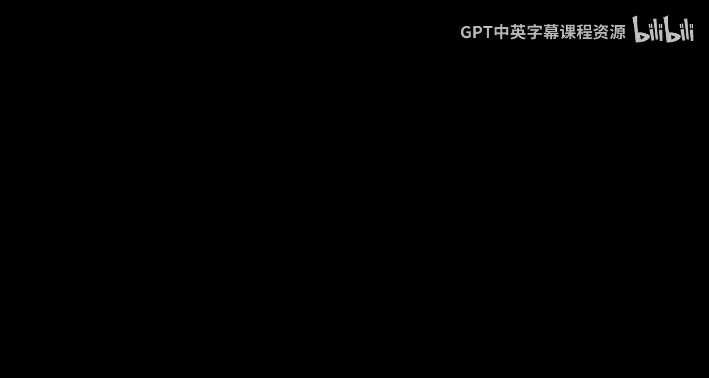
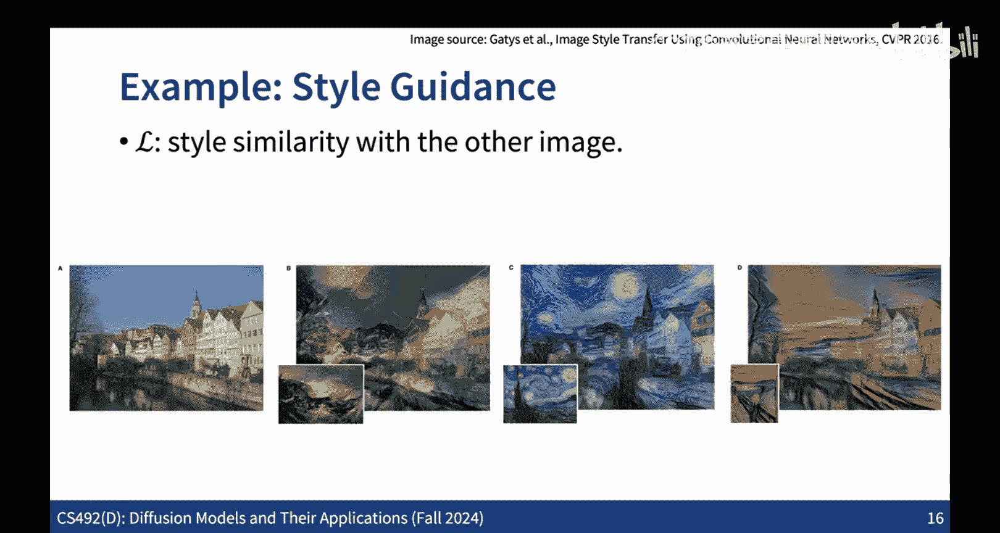
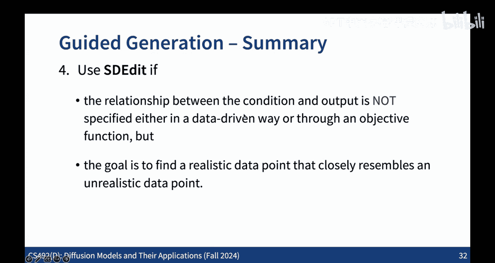
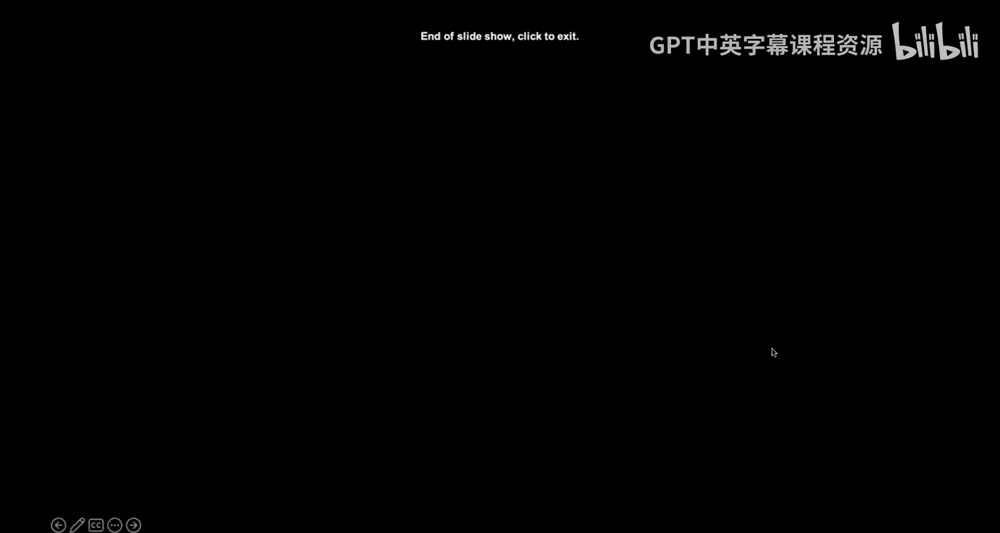
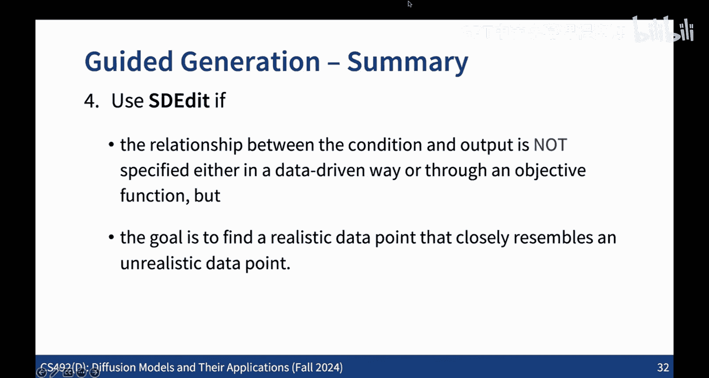

# 扩散模型和应用：13：逆问题 2



## 概述
在本节课中，我们将继续学习如何利用扩散模型解决逆问题。我们将回顾核心思想，并探讨如何在不进行额外训练的情况下，通过引导生成过程来满足特定约束条件。我们还将了解如何将这一思想推广到风格迁移等更广泛的应用中。

## 逆问题回顾与核心思想
上一节我们介绍了逆问题的基本概念。逆问题通常描述为：给定一个观测值 **y**，我们希望生成一个输出 **x**，使得它们满足关系 **y = A(x)**。在许多情况下，**A** 是一个线性函数，例如图像去模糊、超分辨率或图像修复。

当函数 **A** 不可逆时，可能存在多个 **x** 都能满足 **y = A(x)**。我们的目标是生成一个符合此约束的、高质量的数据点 **x**。

扩散模型的核心是学习数据分布的无条件分数（score）。对于逆问题，我们需要的是条件分布 **p(x_t | y)** 的分数。根据贝叶斯规则，这个条件分数可以分解为无条件分数和一个似然项分数之和：

**∇ log p(x_t | y) = ∇ log p(x_t) + ∇ log p(y | x_t)**

我们已从预训练的噪声预测网络中获得了无条件分数 **∇ log p(x_t)**。因此，关键是如何计算似然项 **∇ log p(y | x_t)**。

## 无需训练的解决方案：建立桥梁
我们通常无法直接获得 **p(y | x_t)**。然而，根据逆问题的定义，我们知道 **x_0** 和 **y** 之间的关系，即 **p(y | x_0)**。例如，在去模糊问题中，这描述了清晰图像与模糊图像之间的退化模型。

因此，我们需要一座“桥梁”来连接已知的 **p(y | x_0)** 和所需的 **p(y | x_t)**。这座桥梁就是反向扩散过程的性质：**p(x_0 | x_t)**，即在给定噪声图像 **x_t** 的条件下，干净图像 **x_0** 的分布。

通过结合 **p(y | x_0)** 和 **p(x_0 | x_t)**，我们可以近似得到 **p(y | x_t)**。虽然我们无法精确知道 **p(x_0 | x_t)** 的完整分布，但我们可以利用扩散模型预测的 **x_0** 的期望值（即去噪后的图像）来近似它。

经过推导和简化（例如假设 **p(x_0 | x_t)** 的方差为零），最终的引导项变得非常简单。它本质上是在每一步去噪过程中，添加一个基于观测约束的梯度项。

## 算法实现：简洁而强大
以下是实现逆问题求解的核心步骤，它非常简洁：



1.  运行标准去噪过程（如DDPM或DDIM），从噪声 **x_T** 开始。
2.  在每一步 **t**，通过噪声预测网络得到去噪后的估计 **\hat{x}_0**。
3.  计算观测约束的损失，例如 **L = ||y - A(\hat{x}_0)||^2**。
4.  计算该损失对当前噪声图像 **x_t** 的梯度 **∇_{x_t} L**。
5.  将缩放后的梯度项添加到标准的去噪更新步骤中。

**代码描述的核心更新步骤：**
```python
# 标准去噪步骤
pred_noise = model(x_t, t)
x_t_denoised = update_function(x_t, pred_noise, t) # 例如 DDIM 更新

# 计算引导梯度
x0_estimate = estimate_x0_from_xt(x_t, pred_noise) # 从 x_t 估计 x0
loss = constraint_loss(y, A(x0_estimate)) # 例如 L2 损失
guidance = gradient_scale * torch.autograd.grad(loss, x_t)[0]

# 引导后的去噪步骤
x_t_next = x_t_denoised - guidance
```
可以看到，这仅仅是在标准扩散采样循环中增加了一行梯度计算和添加操作。这种简洁性正是扩散模型在解决逆问题时的强大之处：**一个预训练的无条件扩散模型，配合不同的引导函数，就能解决多种不同的任务**（如超分、修复、上色等），而无需为每个任务重新训练模型。

## 思想的推广：超越逆问题
上述基于梯度引导的思想可以推广到更广泛的条件生成任务中，只要我们能定义一个可微的目标函数 **L**。

一个典型的应用是**风格迁移**。我们的目标是将一张内容图片的风格转换为另一张风格图片的风格，同时保留内容图片的结构。

以下是实现风格迁移的一种思路：

1.  **定义风格损失**：利用预训练的神经网络（如VGG）提取图像特征。风格损失通常计算为生成图像与风格图像在特定层特征图的Gram矩阵之间的差异。
2.  **运行反向扩散（Inversion）**：将内容图像通过扩散过程加噪，得到其对应的噪声潜变量。
3.  **运行引导生成**：从该噪声潜变量开始，运行去噪过程。在每一步，计算生成图像与目标风格之间的风格损失 **L_style**。
4.  **梯度引导**：计算风格损失对当前噪声图像 **x_t** 的梯度，并将其作为引导项添加到去噪更新中。

通过这种方式，去噪过程的轨迹会被引导，使得最终生成的图像既保留原始内容的结构，又匹配目标风格的特征。

## 不同条件生成技术的对比与选择
我们已经学习了多种条件生成技术，包括ControlNet、分类器引导（Classifier Guidance）、分类器无引导（Classifier-Free Guidance）和基于分数引导的方法（如用于逆问题的GPS）。选择哪种技术取决于具体应用场景：

以下是不同技术适用场景的简要对比：

*   **ControlNet**：
    *   **需要充足的配对训练数据**（输入-输出对，如草图-真实图像）。
    *   条件与输出**模态相同**（如图像到图像）。
    *   条件与输出在**空间上大致对齐**（像素级对应关系强）。
    *   **优点**：控制精确，生成质量高。
*   **分类器引导 / 分类器无引导 (CFG)**：
    *   条件与输出**模态可以不同**（如文本到图像、音频到图像）。
    *   **不需要严格的空间对齐**。
    *   通常需要**一定量的条件-输出对数据**来微调模型（对于CFG，是将条件作为额外输入进行训练）。
    *   **优点**：非常灵活，是文本到图像等任务的基石。
*   **基于分数引导的方法 (如GPS)**：
    *   **不需要任何配对训练数据**。
    *   条件约束通过一个**可微的目标函数 L** 来定义（如逆问题中的`||y-A(x)||`，风格迁移中的风格损失）。
    *   **优点**：无需训练，极度灵活，适用于任何能定义成损失函数的约束。
    *   **限制**：目标函数必须可微；可能需要仔细调整引导强度。

## 总结
本节课我们一起深入探讨了利用扩散模型解决逆问题及更广泛条件生成任务的方法。核心在于，通过贝叶斯规则将条件生成分数分解为无条件分数和约束似然项，并利用梯度引导在去噪过程中满足约束。





我们看到了如何通过添加简单的梯度项来实现这一目标，这使得一个预训练模型能通过“即插即用”的引导解决多种问题。我们还学习了如何将这一框架推广到风格迁移等任务，并对比了不同条件生成技术的适用场景。



这种无需额外训练、通过引导利用基础模型能力的范式，是扩散模型区别于GAN和VAE的强大优势之一，为可控内容生成打开了广阔的大门。下一周，我们将转向如何加速扩散模型的生成过程。