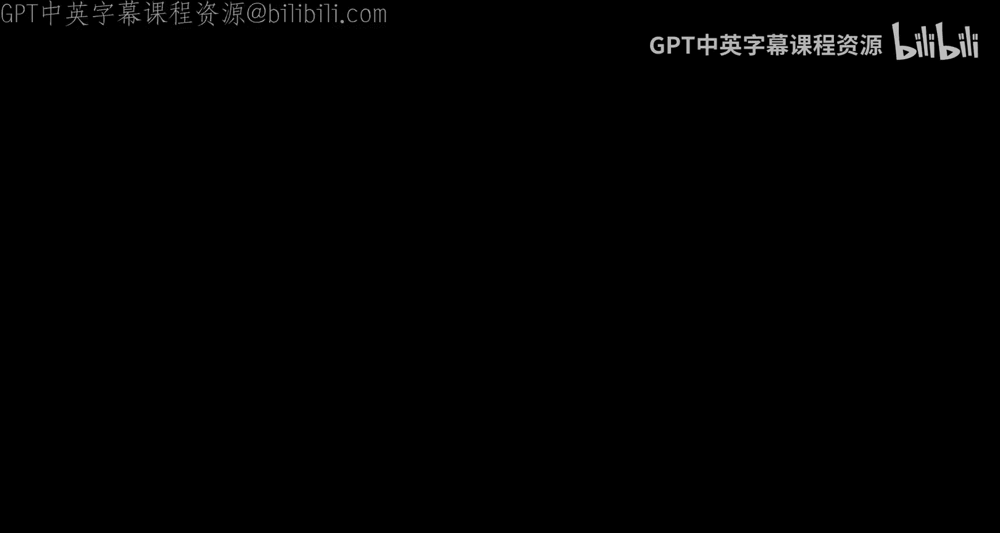
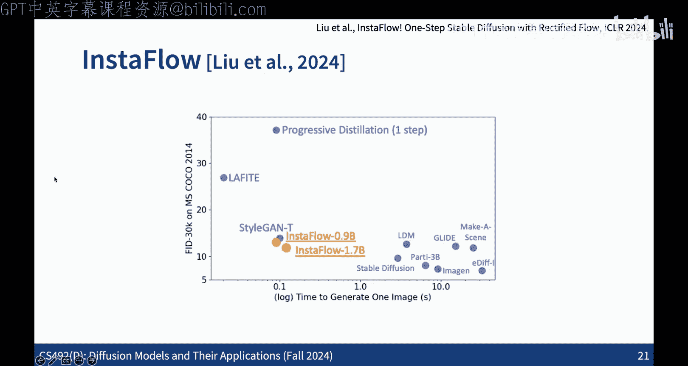
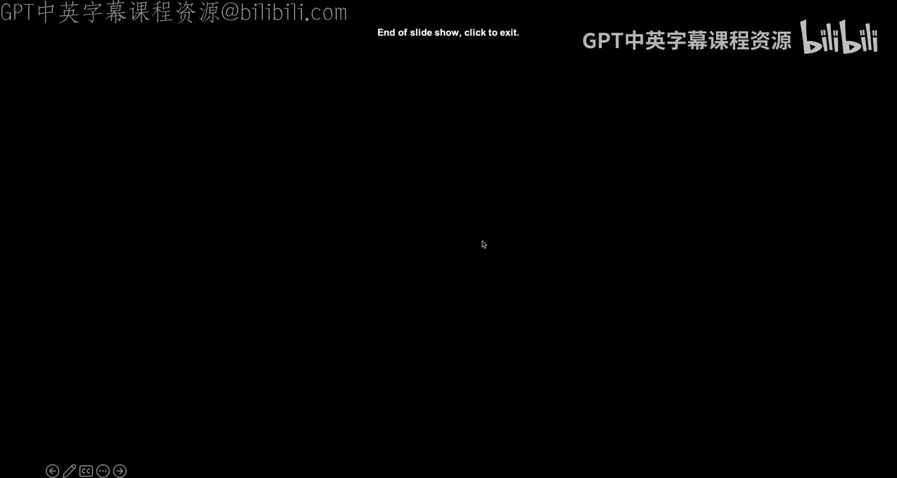

# 扩散模型和应用：16：流匹配（二）🚀

在本节课中，我们将深入探讨流匹配模型的核心思想、实现细节，并将其与之前学习的扩散模型进行比较。我们将看到，经过一系列数学推导后，流匹配的训练过程可以变得非常简洁高效。

## 概述

上一节我们介绍了流匹配的基本概念，包括概率路径、流映射和向量场。本节中，我们将具体分析如何推导出流匹配的损失函数，理解其简洁形式的由来，并探讨流匹配模型相较于扩散模型的优势与潜在应用。

## 流匹配的目标回顾

我们的目标是学习一个生成模型。具体而言，我们希望找到一个映射函数 **π**，它能将基础分布 **P₀**（通常是标准正态分布）映射到我们想要学习的数据分布 **P₁**。

**π: P₀ → P₁**

采样过程可以看作：首先从 **P₀** 中采样 **x₀**，然后通过映射函数 **π** 得到属于 **P₁** 的样本 **x₁**。这个通过映射函数“推动”分布的过程，称为**推前操作**。

为了实现这一目标，我们引入了**流映射**和**速度场**的概念。给定流映射 **φₜ**，我们定义其关于时间的导数为速度场 **vₜ**。概率路径 **pₜ** 随时间的演化与速度场 **vₜ** 通过连续性方程关联：

**∂pₜ(x)/∂t = -∇·(pₜ(x) vₜ(x))**

流匹配的核心问题在于：如果我们已经知道了将 **P₀** 映射到 **P₁** 的向量场 **vₜ**，那么我们就不需要训练神经网络了。因此，关键是如何在不知道真实向量场的情况下，训练一个神经网络来学习这个映射。

## 条件向量场的引入

为了解决上述问题，我们不再直接考虑未知的真实向量场，而是转而考虑**以数据样本 x₁ 为条件的条件向量场 vₜ(x | x₁)**。

这样做的好处是，原始的回归损失函数可以转化为一个期望形式类似但更易处理的损失函数。接下来的问题是：我们应该选择何种形式的条件向量场？

上一节我们讨论了一种特定的选择，即定义条件概率路径 **pₜ(x | x₁)** 为一个高斯分布，其均值和方差是时间 **t** 的函数：

**pₜ(x | x₁) = N(x | μₜ(x₁), σₜ(x₁)²)**

基于这个概率路径的定义，我们可以推导出对应的流映射 **φₜ(x | x₁)**，进而通过对流映射求导得到条件向量场 **vₜ(x | x₁)**。

对于均值和方差函数，我们选择了最简单的线性形式：
*   **μₜ(x₁) = t x₁**
*   **σₜ(x₁)² = 1 - (1 - σ_min) t**，其中 **σ_min** 是一个极小的正数。

以下是基于上述定义推导出的关键结果：

*   **条件概率路径**：`pₜ(x | x₁) = N(x | t x₁, (1 - (1 - σ_min)t) I)`
*   **条件流映射**：`φₜ(x | x₁) = (1 - (1 - σ_min)t) x₀ + t x₁`
*   **条件向量场**：`vₜ(φₜ(x | x₁) | x₁) = (x₁ - (1 - σ_min)x₀) / (1 - (1 - σ_min)t)`

当 **σ_min** 接近于0时，上述公式可以进一步简化。最终，流映射和向量场呈现出极其简洁的形式：

*   **简化流映射**：`φₜ(x | x₁) = (1 - t) x₀ + t x₁`
*   **简化向量场**：`vₜ(φₜ(x | x₁) | x₁) = x₁ - x₀`

这意味着，流映射简化为 **x₀** 和 **x₁** 之间的**线性插值**，而对应的向量场简化为从 **x₀** 指向 **x₁** 的**固定向量**。

## 简化的训练目标

经过所有复杂的推导，流匹配的训练过程变得非常简单。回顾我们想要最小化的损失函数：

**L_FM(θ) = E_{t, p₁(x₁), p₀(x₀)} [ || v_θ(φₜ(x₀ | x₁), t) - vₜ(φₜ(x₀ | x₁) | x₁) ||² ]**

将我们推导出的简化向量场代入，损失函数变为：

**L_FM(θ) = E_{t, p₁(x₁), p₀(x₀)} [ || v_θ( (1-t)x₀ + t x₁, t ) - (x₁ - x₀) ||² ]**

以下是训练一个流匹配模型的具体步骤：

1.  从数据分布 **p₁** 中采样一个数据点 **x₁**。
2.  从基础分布 **p₀**（标准正态分布）中采样一个点 **x₀**。
3.  在时间区间 `[0, 1]` 内均匀采样一个时间步 **t**。
4.  计算插值点 **x_t = (1 - t) x₀ + t x₁**。
5.  计算目标向量 **v_target = x₁ - x₀**。
6.  将 **x_t** 和 **t** 输入神经网络 **v_θ**，得到预测的向量 **v_pred**。
7.  计算预测向量与目标向量之间的均方误差作为损失，并更新网络参数。

可以看到，这与扩散模型的训练有相似之处（都采样 **x_t** 并预测一个量），但也有关键区别：扩散模型只采样 **x₁**，通过加噪得到 **x_t**，并预测所加的噪声；而流匹配同时采样 **x₀** 和 **x₁**，通过插值得到 **x_t**，并预测从 **x₀** 指向 **x₁** 的向量。

## 流匹配的优势：更直的轨迹

一个自然的问题是：既然扩散模型效果很好，为什么还需要流匹配？

流匹配模型的一个有趣特性是，它倾向于学习到**更笔直**的轨迹。想象一下，如果随机连接 **x₀** 和 **x₁**，轨迹可能会相互交叉。但流匹配训练出的轨迹会避免这种交叉。

这种笔直的轨迹带来了一个巨大优势：在生成（推理）阶段，求解常微分方程（ODE）变得非常容易。因为轨迹很直，所以只需要很少的步数（甚至**单步**）就能以较高的精度从 **x₀** 走到 **x₁**，从而极大加速生成过程。

有一种称为**递归流匹配**的技术可以进一步拉直轨迹：
1.  首先，训练一个流匹配模型 **M₁**。
2.  然后，使用 **M₁** 来生成 **（x₀, x₁）** 样本对（即从 **M₁** 的生成过程中采集配对）。
3.  用这些新的样本对训练第二个流匹配模型 **M₂**。
4.  重复此过程。

随着递归次数的增加，轨迹会变得越来越直，生成所需的步数可以进一步减少，甚至在单步生成时也能获得高质量结果。

## 与扩散模型的结合：知识蒸馏

流匹配的另一个强大应用是作为**知识蒸馏**的工具，加速已有的扩散模型（如Stable Diffusion）。

具体思路如下：
1.  从一个预训练好的扩散模型中，采样大量的 **（x₀, x₁）** 样本对（即噪声-图像对）。
2.  使用这些样本对来训练一个流匹配模型。
3.  这个新的流匹配模型继承了扩散模型的生成能力，但由于其笔直的轨迹，可以用少得多的步数进行生成。

这样做虽然可能无法超越原始扩散模型的峰值质量，但能在轻微牺牲质量的情况下，实现数十倍甚至上百倍的生成速度提升。这对于需要实时或低成本生成的应用场景至关重要。

## 潜在局限

当然，流匹配（尤其是用于蒸馏时）也有其局限：
*   **训练成本**：蒸馏过程需要从原始扩散模型中采样大量数据对，这本身需要计算资源。
*   **引导生成**：扩散模型迭代去噪过程的优势在于便于进行**引导生成**（如Classifier-Free Guidance, 条件控制）。在单步生成的流匹配模型中，实现类似的精细控制更具挑战性。

## 总结

本节课我们一起深入学习了流匹配模型。我们从回顾流匹配的基本目标出发，通过引入条件概率路径和条件向量场，逐步推导出了极其简洁的训练损失函数。我们发现，流匹配的核心在于学习从噪声指向数据的向量场，这最终简化为预测两点之间的方向向量。

我们探讨了流匹配模型倾向于产生笔直轨迹的特性，以及如何通过递归训练进一步优化这一点。更重要的是，我们分析了流匹配如何与扩散模型结合，通过知识蒸馏技术，将慢速但高质量的扩散模型转化为快速且仍保持不错质量的生成模型，这在实际应用中具有重要价值。最后，我们也简要讨论了该方法的潜在局限性。