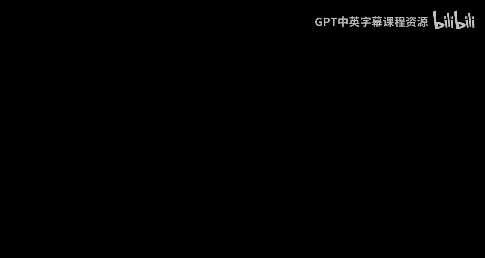
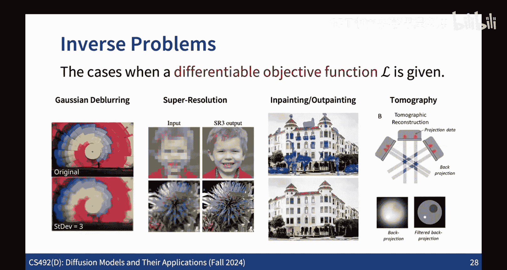
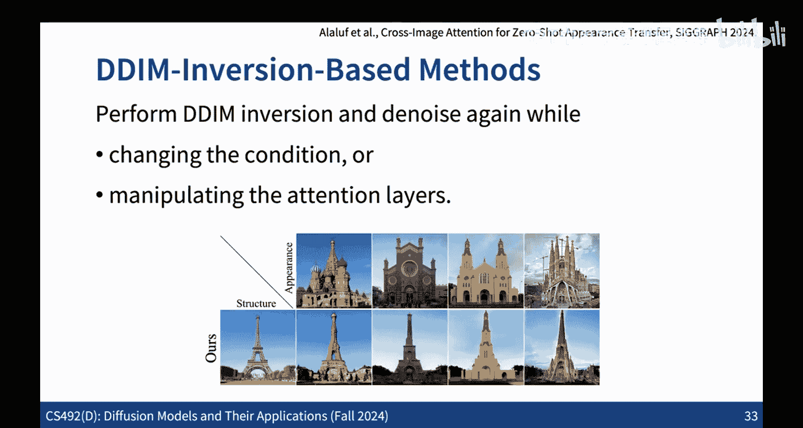
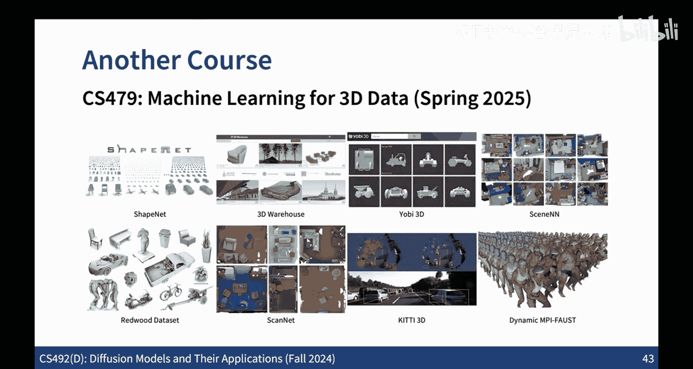
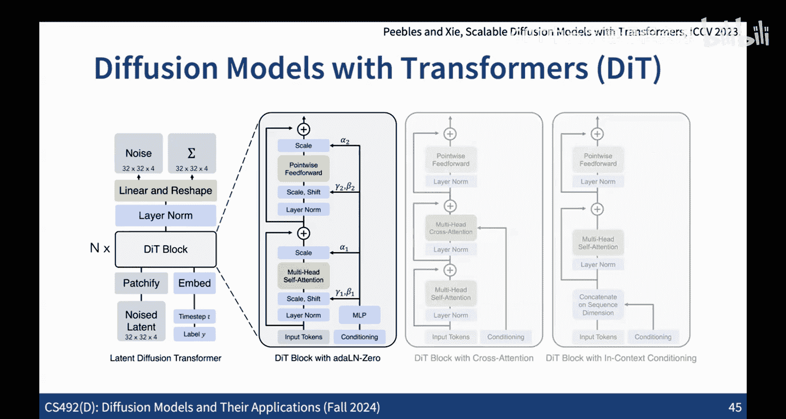
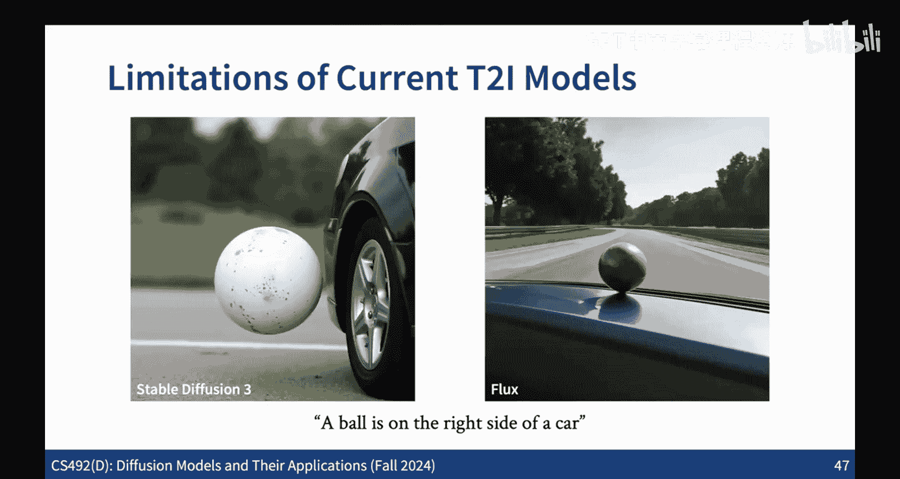
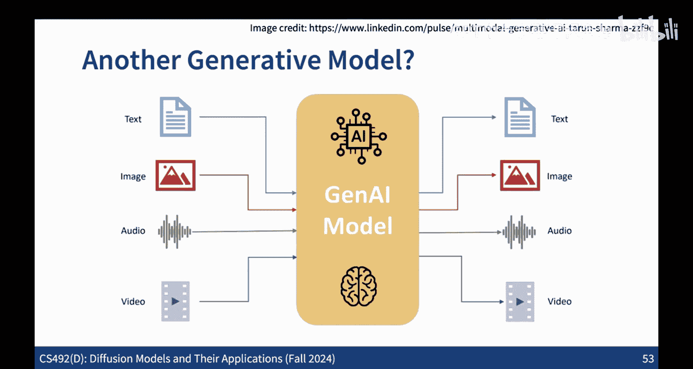
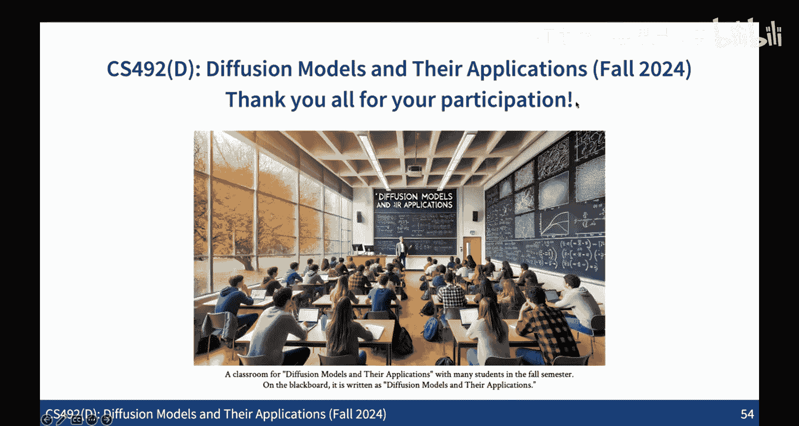

# 扩散模型和应用：16：课程总结  📚

在本节课中，我们将回顾整个课程的核心内容，总结扩散模型的基础原理、关键变体、加速方法以及多样化的应用场景。我们还将探讨该领域的当前局限性与未来发展方向。

## 课程内容概述

到目前为止，我们讨论了关于扩散模型的许多内容。我们将简要回顾所讨论的内容。可以看到，我们讨论的内容可以分为关于扩散模型的一些基础理论，以及如何应用这些模型。扩散模型不仅用于生成，还有许多其他应用。我们讨论了基础理论和应用。

我们以扩散模型的基础知识开始了课程。扩散模型的基本思想是什么？

## 扩散模型的基本思想 🧠

扩散模型的基本思想是，基于数据分布中现有样本的信息，对某种现实数据点进行去噪采样。对于所有扩散模型，基本思想是学习从基础分布到数据分布的某种映射。

由于我们不知道数据分布的解析形式，我们从某个基础分布（通常是简单的标准高斯分布）中采样，然后将其映射到数据分布中的一个数据点。这是我们在这门课中讨论的所有类型扩散模型的基本思想。

这里的核心问题是，如何根据数据分布的样本来学习这种映射。为此，我们讨论了一些重要的思想。

## 生成模型的核心思想 🤖

基本思想是使用生成对抗网络（GAN）的思想。GAN和所有基础模型以及扩散模型的关键点在于，如何保证从基础分布到数据分布的映射确实能映射到一个现实的数据点。保证这一点的基本思想是使用**对抗训练**，即联合训练解码过程（从基础分布到数据的映射）和一个判别器（用于判别映射输出是真实数据点还是虚假数据点）。通过联合训练生成器和判别器，我们可以确保映射能真正映射到现实数据点。

另一个重要思想是变分自编码器（VAE）。VAE不仅训练生成器（即解码器），也训练编码器，将数据分布中的所有数据点编码到基础分布中。通过以这种方式提升映射的双向性，我们可以有效地最小化证据下界（ELBO）损失函数。这就是VAE的基本思想。

此外，扩散模型将编码和解码过程设计为**顺序过程**。编码过程将数据点映射到基础分布中的样本，而反向过程则是扩散模型中的去噪过程。

## 扩散模型的工作原理 ⏳

在扩散模型中，前向过程是数据损坏过程。我们逐渐向数据点添加噪声，最终得到近乎纯粹的高斯噪声。反向过程则相反，是对标准高斯随机样本进行去噪，使其能够连接到某种现实的数据点。

扩散模型有一些优点。其特点是能够生成**高质量**和**多样化**的输出。扩散模型的缺点是速度慢，因为它涉及多次采样步骤。然而，这种特性对于许多应用也可能有用，正如我们讨论过的应用，例如实现、创建条件模型、进行个性化以及知识蒸馏。与其他类型的生成模型相比，扩散模型在某些方面具有优势。

实际上，有多种方法可以构建扩散模型。这取决于我们如何定义前向跳跃分布 `p(xt | x0)`，即给定 `x0` 时 `xt` 的条件分布。根据不同的定义，我们可以定义不同类型的扩散模型。构建扩散模型的唯一条件是定义随时间变化的方差，例如 `β_t` 随时间单调递减。

我们特别讨论了两类定义的扩散模型。第一个模型是**方差保持（Variance Preserving）** 情况，即DDPM案例。为此，我们特别设计了具有特定形式的整个转移分布，其中有一个随时间增加的参数 `β_t`。另一个选项是定义**方差爆炸（Variance Exploding）** 情况，即SDE案例。这是定义整个转移分布为特定形式的另一种情况。

我们的讨论主要聚焦于DDPM案例。基于这种前向过程的定义，我们可以考虑或训练某种噪声预测网络。

## 训练与采样过程 🔄

扩散模型基本上就是训练某种噪声预测网络。为此，我们可以随机采样一个数据点，通过在此处采样某种噪声来进行前向跳跃，然后以它们能够记住给定 `XT` 时我们所添加的噪声量的方式，训练我们的噪声预测网络。这就是训练过程。

然后，采样方式必须与从条件分布 `p(XT | X0)` 中采样的方式相同。基于此，反向过程涉及多个步骤：我们首先预测此处的噪声，基于此我们进行某种预测，得到 `x0` 的最终输出（由 `x0_hat_t` 表示），然后基于此我们计算这个特定条件分布 `p(X_{t-1} | X_t, X0_hat)` 的均值，接着我们采样某种不同的噪声，并最终采样 `X_{t-1}`。这就是扩散模型生成的典型过程。

我们还讨论了关于我们预测的噪声的一些特性。基本上，此处噪声的含义是，噪声特定对应于**分数（score）**，即对数概率的梯度。通过拥有这种噪声信息，我们还可以在其他方面做一些事情，例如进行引导生成。

此外，每次我们做的是，给定某个数据点 `X_t`，我们基本上也得到了最终输出 `x0_hat_t` 的期望值。`x0_hat_t` 可以基于公式推导出来。

因此，基本上从反向过程中我们可以看到，当我们拥有数据点 `X_T` 时，这也可以被视为定义了 `X` 的期望值，假设是 `X0` 随时间的一种细化。通过进行这种多步细化，我们可以得到更好、更现实的输出。

## 扩散模型的扩展 🚀

我们还讨论了将DDPM扩展到更一般的扩散情况。为此，我们基本上定义了条件分布 `p(X_{t-1} | X_t, X0_hat)`，同时在此控制随机性。这就是DDIM的思想。

基本上，DDPM可以被视为DDIM的一种特殊情况。拥有DDIM模型的好处是，现在我们可以以确定性的方式估计反向过程。当方差为零时，意味着一旦采样了噪声的标准差 `σ_t`，就可以直接映射到 `x0` 的最终输出，无需任何随机性。这就是DDIM的零方差情况。我们可以看到，这种确定性采样可以用更少的步骤产生更高质量的样本。原因在于，这种确定性采样可以被视为用某种一阶离散化来求解反向时间的常微分方程（ODE）。这也瞬间启发了DPO。

对于模型基础，我们预见的是，实际上这些扩散模型的形式在这个空间中是相关的。它们本质上就像是在求解随机微分方程（SDE）。前向过程和反向过程可以用不同类型的SDE操作来表示。

这里还有一点是，对于每个SDE（前向过程和反向过程），我们也可以找到对应的ODE公式。这意味着现在我们可以通过求解相应的ODE公式来运行生成过程。

这就是**一致性模型（Consistency Models）** 的基本思想。我们为此定义了一个专门的模型，用于这个反向扩散ODE，这样我们也可以用更少的步骤创建一些现实的数据点。这是一个有趣的想法，显然不需要对扩散模型进行任何重新训练或定义，只需将现有高效模型关于反向过程的想法进行转换，我们就能在保持输出良好质量的同时减少计算时间。

在减少反向过程计算时间方面，我们讨论的另一个想法是**流匹配（Flow Matching）**，它基本上是利用了基于流模型的思想。对于流匹配模型，我们能做的是，给定一个预训练的扩散模型，我们采样标准高斯分布样本和数据点的配对。给定这种 `(x, x_T)` 配对，我们训练另一个流匹配模型。这种新的生成模型提供了更直接的投影，当我们求解ODE公式时，我们也可以用更少的步骤快速找到现实的数据点。

## 应用概览 🛠️

以上是我们讨论的与扩散模型相关的主要思想，特别是扩散模型的一些特性。扩散模型的缺点是生成需要大量时间。因此，我们也讨论了一些关于如何加速这种生成过程的想法。

在应用方面，我们也讨论了许多想法。

### 处理高维数据

一个快速的问题是，当你处理高维数据时，如果想生成某种高维数据，一个基本想法是结合扩散模型。对于这类情况，我们可以考虑先进行某种降维或使用自编码器，将数据点映射到潜空间，然后在潜空间中调整我们的扩散模型。这是一个非常实用的想法，我们可以为某种高维数据生成高质量的数据。

### 个性化

我们还讨论了**LoRA**的思想，它基本上是为特定的图像集个性化一个预训练的扩散模型。例如，我想微调某个图像扩散模型，使其能生成与我相关的不同图像。我们如何实现这种个性化？为此，我们也讨论了一种非常实用的想法，即创建另一种可训练的分支，也就是LoRA适配器。我们让少量参数被调整或训练，同时冻结主分支。这是一个非常实用的想法，我们可以为某种预训练的扩散模型添加风格化。

### 条件生成

关于条件扩散模型，即创建条件生成模型，基本思想是**分类器无关引导（Classifier-Free Guidance）**。它使用同一个网络学习条件噪声和无条件噪声，然后结合这两种噪声来进行条件生成。

这个简单的想法，在学习无条件噪声的同时引入某种新条件，对于任何类型的条件都非常有效。无论条件是文本、图像、音频还是任何类型的数据模式，其方法都是为这种条件数据训练一个编码器，并学习这种条件噪声和无条件噪声。

具体来说，如果条件数据和输出数据的模态相同，那么我们可以考虑利用噪声预测器的编码器。我们特别讨论了**ControlNet**的思想，它用于图像条件图像生成的情况。对于那些输出是图像且条件也是图像的情况，我们基本上利用噪声预测器的编码器，现在使用相同的编码器对条件进行编码，同时添加一些可训练的、类似零初始化的卷积组件到神经网络中，以便这些层的特征有所不同。

这些是基于训练或微调思想来创建条件生成的一些方法。

问题是，我们能否在不进行任何定义明确的训练的情况下进行条件生成？在没有训练数据的情况下，你还能进行某种条件生成或引导生成吗？

对于这类情况，我们也可以考虑使用其他技术。

## 无需训练的条件生成技术 🧪

我们讨论的第一个技术是，当条件被定义为某种**可微分的目标函数**时。对于这类可以定义可微分目标函数的情况，我们可以考虑使用可以解决逆问题的技术，例如**去噪扩散后验采样（DDPS）** 和**投影梯度下降（PGD）**。

对于其他情况，我们讨论了一堆想法，如**RePaint**以及一些基于推理的技术。

对于逆问题，实际上我们也讨论了一些实际应用，这些情况我们可以定义目标函数的梯度，例如去模糊、超分辨率、图像修复和断层扫描。对于这些情况，我们可以有效地定义一个损失函数。有趣的是，这里的关键在于我们计算用于去噪过程的分数的一个偏移量，这个偏移量可以用该目标函数的梯度来近似，而该梯度是根据某个预测输出计算的。经过一些线性化推导，我们可以说，实际上这种引导生成可以很容易地实现，只需简单地将我们作为输入给出的目标函数进行反向传播即可。

在风格迁移结束时，这就是这个想法的原因。

但在我们无法定义某种目标函数的情况下，我们可以考虑其他技术，特别是**RePaint**技术，它是专门为图像修复情况设计的。当我们想在数据点中创建某个前景区域，同时保持背景区域时，我们可以考虑结合去噪前景图像和去噪部分背景图像，然后一起运行去噪反向过程。这是图像修复情况的一个简单想法。

此外，对于寻找接近某个受损输入数据点的现实数据点的情况，我们可以简单地考虑运行一点前向过程和反向过程，使用少量的时间步，以便从不现实的数据点中找到现实的数据点。

另一个想法是使用**Prompt-to-Prompt**。我们能做的是运行DDPM的嵌入过程，然后在改变条件（如改变提示词）的同时运行生成过程，并进行注意力层的操作。这是我们讨论过的主题，特别是在多样化文本到图像生成中。

这些基本上是如何利用扩散模型进行条件生成的一些例子。

## 跨模态与应用扩展 🌉

我们讨论的另一个主题是，如何利用某种预训练的扩散模型处理其他类型的数据或其他模态的数据。我们主要关注生成不同类型的视觉内容，如3D模型、矢量图像、检测器等。

其基本思想是，当我们生成某种类型的视觉内容时，这些内容可以从特定视角渲染成某种图像，而这种渲染可以公式化为某种可微分方程。

给定这种可微分渲染方程，我们能做的基本上就是应用一种称为**分数蒸馏采样（Score Distillation Sampling, SDS）** 的技术。它基本上就是将某种视觉内容渲染到特定视图，然后向渲染图像添加一些噪声，从某个受损数据点预测噪声，然后使用与训练扩散模型相同的损失函数，通过渲染函数一直反向传播到视觉内容。

另一种处理时序数据的方法是运行某种去噪过程，从多个视角出发，同时在潜变量级别同步输出。通过预测每一步的 `X`，我们同步不同视角的去噪过程，然后我们可以在生成过程中得到更一致的输出。

这些是我们首先讨论的一些内容。我们讨论了相当多的内容，包括模型的基础和应用。

## 未来方向与开放问题 🔮

实际上，这是一个真正不断发展的领域，我们也看到了许多研究正在推进这里的每一项内容。实际上，这门课中有很多内容我们未能涵盖，有很多重要的想法我们未能讨论。我们可以在此简要看到的一些重要想法是，实际上为什么我们讨论一致性模型和使用基于流的模型的思想。实际上，有许多技术试图减少去噪过程中的步骤数。确实有一些著名的技术，如**渐进式蒸馏（Progressive Distillation）** 和**一致性模型（Consistency Models）**。这些是使用师生模型的技术，我们制作某种协同蒸馏模型，可以用更少的步骤运行某种去噪过程。这些是关于如何减少生成过程步骤数的一些有趣想法。

另一件事是，虽然我们讨论了一些思想，基本上是将给定的基础分布映射到数据分布，例如将标准正态分布映射到数据分布，但实际上有一些技术可以直接在两个不同的数据分布之间进行映射。这种技术称为**流形学习中的流形穿梭（Manifold Shuffling）**。这类技术可以应用于某些应用，如图像翻译。我们基本上直接获取特定分布（如夜间图像）中的一些数据，然后映射到白天图像中的相应图像。基本上是在没有标准正态分布的情况下直接映射两个不同的分布。这是另一种我们在这个课程中未能讨论的技术分支。

此外，虽然我们讨论了视觉内容的类型以及如何使用预训练的图像扩散模型生成它们，但我们未能讨论这些事情的更多细节。例如，我们讨论了像3D生成这样的应用，但我们未能讨论这些数据如何表示的任何细节。对于这类数据，有很多表示问题。如果你对3D表示特别感兴趣，我明年春季也将教授一门关于3D表示的课程，如果你对这些细节（如3D表示）更感兴趣，可以参加这门课。

## 当前局限性与模型架构演进 🏗️

在我们结束这门课之前，实际上有很多重要的思考，是关于扩散模型未来的一些问题。

一个重要的问题可能是，我们通常使用一些扩散模型，基本上是图像扩散模型，我们使用U-Net架构进行噪声预测。但U-Net架构真的是架构的最佳选择吗？或者是否应该考虑其他类型的架构来训练图像去噪网络？

许多先前的图像扩散模型版本都是基于U-Net架构开发的。最近，我们也开始看到一些新模型，特别是图像扩散模型，还有视频模型，它们通常使用Transformer架构。正如你所料，在提高输出质量方面，我们也看到了一些甚至更大的改进。

拥有Transformer架构的一个好处是，由于我们可以将图像尺寸的信息输入到等效的嵌入中，好处是现在我们可以生成任意2D尺寸的图像。这些都是使用基于Transformer的扩散模型生成的输出。你可以看到，这也是一个有趣的改进，现在我们可以以随机的方式控制扩散模型中的图像尺寸。

这些结果看起来非常好，不仅在输出质量方面，而且在图像遵循给定文本描述的程度方面。可以看到，仅凭文本描述就生成了图像，并且输出不仅在图像质量方面非常好，而且在清晰遵循某种给定的文本指令方面也非常好。

这看起来真的很好，好像图像生成问题已经解决了。但实际上，当前版本的图像扩散模型仍然有很多局限性。

当前扩散模型一个非常著名的局限性是，它实际上对文本没有很好的理解。正如你在这里看到的失败案例，给定的文本是“蓝色方块在红色方块的右边”，但蓝色方块真的在红色方块的右边吗？没有。这是当前版本扩散模型的一个著名失败案例，它对这些空间关系没有任何理解。

我甚至不知道这是因为训练数据的问题（没有很多关于空间排列描述的图像-文本对），还是文本编码器的问题。对于那些众所周知的图像生成模型，它们通常使用某种预训练的文本编码器，而这种预训练的文本编码器可能不具备理解空间排列的能力。我不知道，但我的意思是，对于许多文本到图像模型来说，这是众所周知的局限性。

实际上，不止这些，还有很多其他情况。

这里的问题是，我们如何为这些失败案例改进文本到图像模块？

实际上，关于如何有效改进不仅是扩散模型，还有GAN和VAE等许多基础模型，有很多讨论。

改进许多基础模型的一个著名想法是使用**基于人类反馈的强化学习（RLHF）**。众所周知，GPT的最新版本通过采用人类反馈和强化学习微调得到了改进。这种技术也可以应用于扩散模型，以更好地与给定的文本描述或其他类型的条件对齐。

在改进某些大型生成模型方面，仍然有很多研究正在进行。

## 文本生成与多模态模型的思考 💬

另一个问题可能是，说到GPT，实际上此刻我们看到的一个有趣现象是，当我们讨论扩散模型时，我们知道扩散模型基本上是当前图像生成的最佳选择。那么文本生成呢？我猜每个人可能都在使用GPT。许多作业的标题和内容我们知道，实际上那些标题和内容并没有使用扩散模型，而是设计为某种自回归模型，基本上使用某种注意力机制。

自回归模型可以被视为序列生成的最佳选择。其思想是，我们逐个生成标记，给定迄今为止生成的某些标记，预测下一个标记。这种下一个标记的生成实际上是通过训练某种分类网络来完成的。

在这种情况下，所有标记都定义在某种离散空间中，而不是连续空间，所有数据点都是某种序列数据，它们基于我们迄今为止的内容以顺序方式进行生成。这种数据标准对于文本生成非常有效。

那么，对于许多其他数据类型，选择哪种模型最佳呢？是扩散模型、自回归模型还是其他？

我认为，对于许多不同类型的数据，这个讨论仍在进行中。

一个有趣的例子可能是图（Graph）。我们也看到了许多关于图生成的研究，比如结构生成之类的事情。我们也可以考虑使用扩散模型或自回归模型。我们可以通过将某种结构转换为节点序列来查看某种图，但将图转换为某种序列存在一些问题，我们可以在那里运行某种扩散模型。但显然，图不像图像那样是规则结构的数据，也不是序列数据。对于这类数据，我认为目前还没有明确的最佳选择。但这些天我们看到更多使用扩散模型进行图生成的研究工作。

但也有很多其他方法，特别是为不同基础设施制作扩散模型。

关于视频，实际上视频也是一种非常有趣的数据类型，因为每一帧基本上都是图像，所以看起来扩散模型可能是最佳选择。或者实际上，帧序列基本上是顺序数据，这意味着它们也可以被视为某种自回归模型。实际上，有一些尝试甚至整合了扩散模型和自回归模型，我们考虑两种时间轴。

对于每一个，你可以考虑噪声的时间轴，这是我们考虑扩散模型的典型时间。但当你看到整个事物时，我们也可以考虑视频的时间轴。所以有两种不同类型的时间轴。

对于这类情况，运行扩散模型可能会通过噪声时间轴传播信息，而自回归模型可能会通过视频时间轴传播信息。有一些尝试将这种传播同时运行在两个轴上，以整合这两种类型。

但正如你所见，根据数据类型，扩散模型可能不是最佳选择，在制作生成模型方面可能仍然有许多其他选择。

## 总结与展望 🌟

那么最后一个问题可能是，现在我们也在看到许多多模态数据，生成式AI模型也是同时接受图像和文本作为输入的情况。如果你考虑