# 扩散模型与应用：18：嘉宾讲座1 - Or Patashnik - 注意力层的威力 🧠

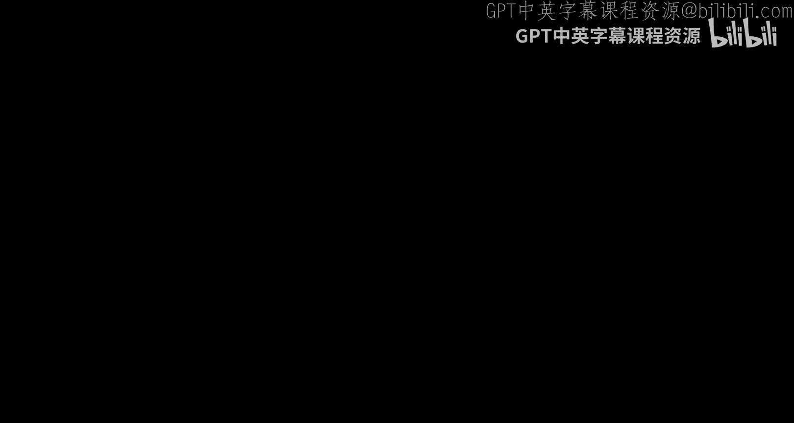

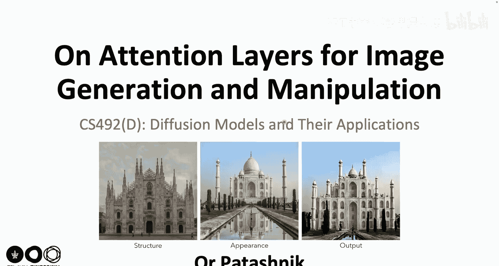

在本节课中，我们将学习注意力机制在扩散模型，特别是图像生成与编辑任务中的核心作用。我们将探讨自注意力与交叉注意力的工作原理，并了解如何利用它们实现语义对应、外观迁移、一致性生成和图像分割等高级应用。

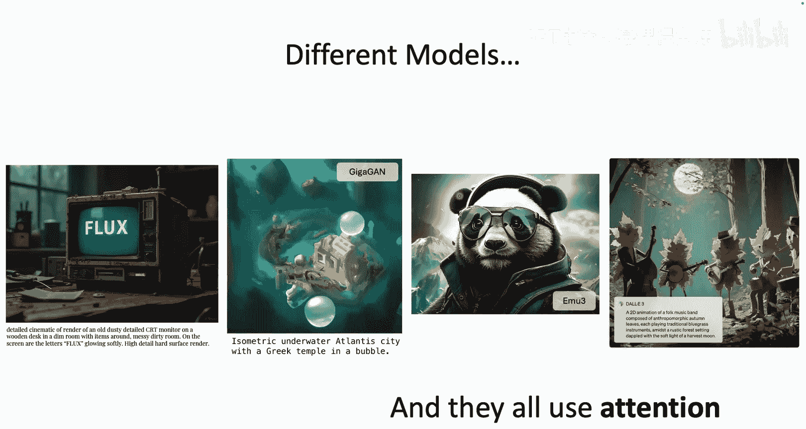

---

## 自注意力机制

上一节我们介绍了讲座的背景，本节中我们来看看自注意力机制的基本原理。

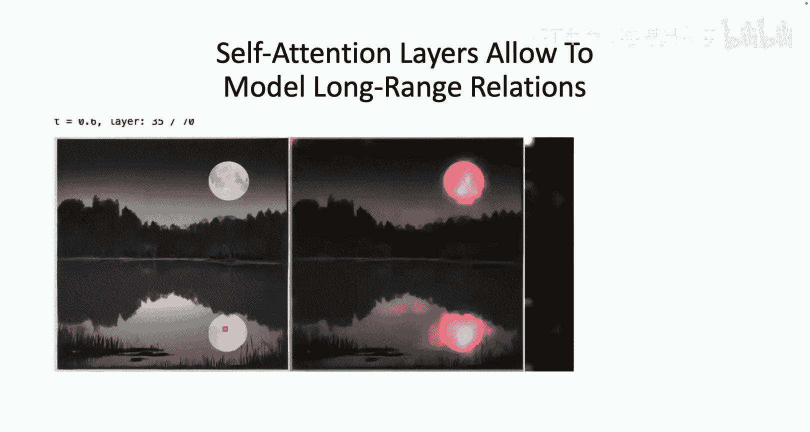

自注意力层的输入是生成图像的特征图。首先，我们将这些特征投影为三个组件：查询（Queries）、键（Keys）和值（Values）。每个组件都有其特定作用。

**公式**：注意力图的计算通常表示为：
`Attention(Q, K, V) = softmax(QK^T / sqrt(d_k)) V`
其中，`Q` 是查询，`K` 是键，`V` 是值，`d_k` 是键的维度。

查询与键相乘（实际上是内积运算，用于衡量相似度），为每个查询生成一个注意力图。注意力图显示了与该查询语义最相似的键的位置。

例如，对于熊图像中腿部的一个查询点，其注意力图会高亮显示熊的所有腿部区域，因为这些区域在语义上最相似。

得到注意力图后，我们将其与值相乘。输出特征图中的每个特征，都是值的一个加权和，权重由对应的注意力图决定。

自注意力层的一个强大之处在于建模长距离关系。例如，在一幅“湖面倒映月亮”的图像中，月亮倒影处的查询点，其注意力图会同时高亮倒影本身和天空中的月亮。如果仅使用卷积层，则需要极大的感受野才能准确建模这种反射关系，而注意力层则能轻松实现。

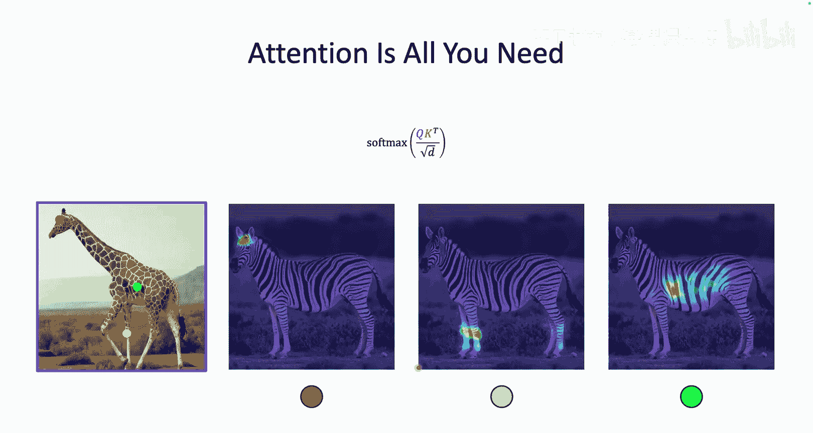

---

## 交叉注意力机制

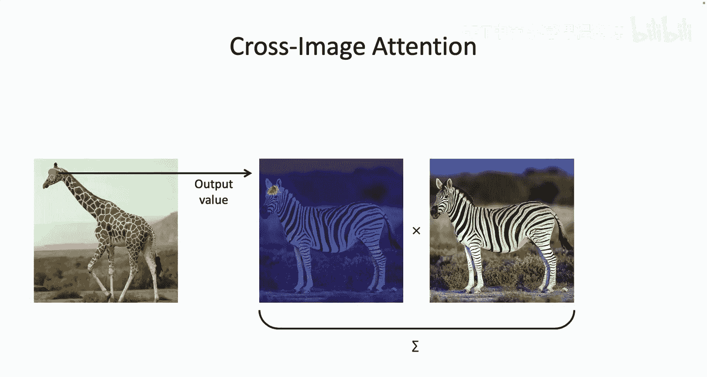

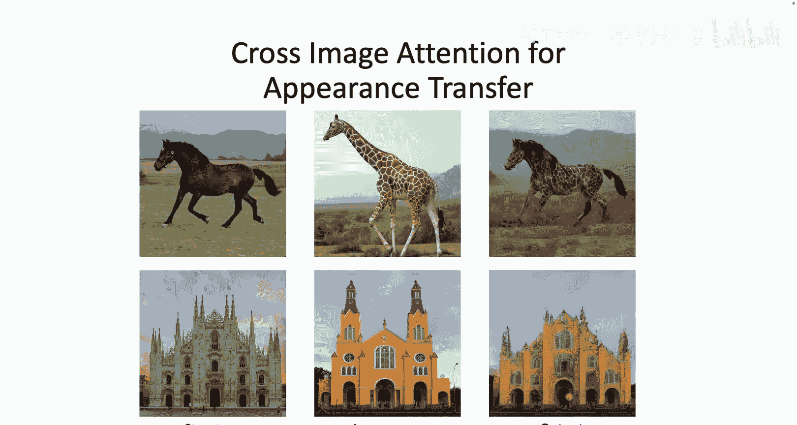

理解了自注意力后，我们来看看交叉注意力机制，它在文生图模型中连接文本和图像。

交叉注意力有两个输入：生成图像的特征和输入文本的嵌入向量。在交叉注意力中，图像特征被投影为查询，而文本嵌入则被投影为键和值。

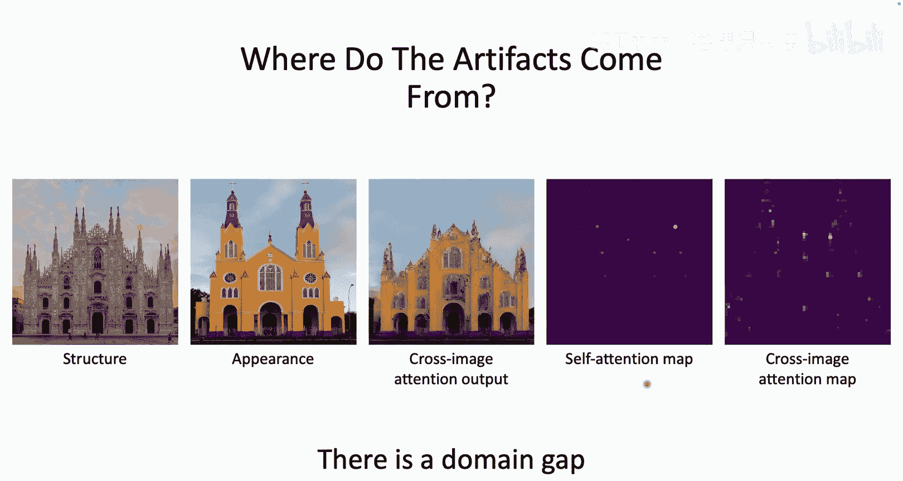

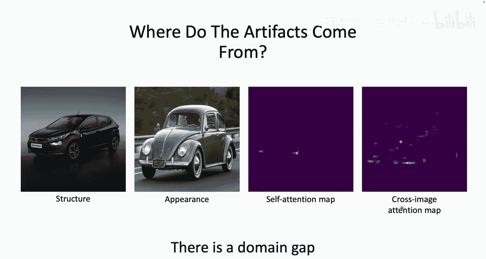

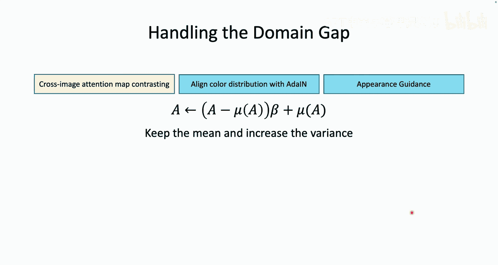

与自注意力类似，每个图像查询会与所有文本键计算相似度，生成一个注意力向量。该向量指明了与该图像区域最语义相似的文本词。

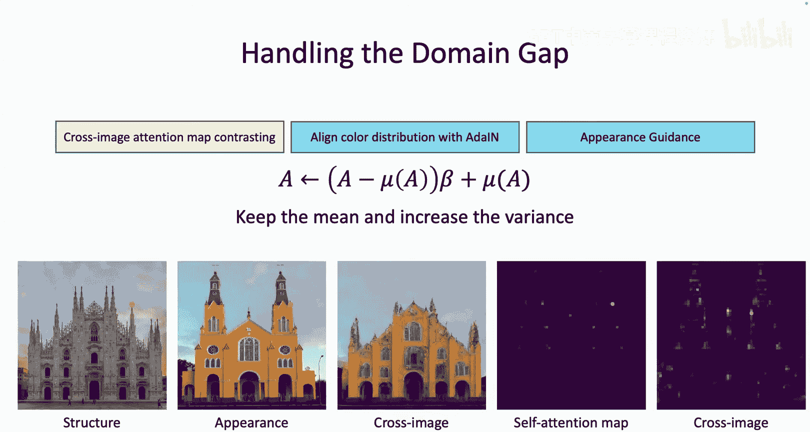

例如，对于提示词“a kitten and a puppy”，图像中小猫身上的一个点，其注意力会主要集中在“kitten”这个词上。

然后，注意力向量与文本值相乘，输出特征成为文本值的加权和。这确保了图像生成过程受到文本语义的引导。

观察交叉注意力图的另一种有效方式是“转置”视角：对于每个文本词（键），我们可以查看哪些图像像素（查询）最受该词影响。这有助于理解模型如何将文本概念分配到图像空间。

---

## 语义对应与外观迁移

注意力层编码了丰富的语义信息，这一特性可以用于实现图像间的语义对应和外观迁移。

以下是利用注意力实现外观迁移的相关工作列表：
*   **StyleCLIP**： 使用文本引导进行图像编辑。
*   **Diffusion-Based Image Translation**： 基于扩散模型的图像翻译。
*   **Prompt-to-Prompt**： 通过编辑注意力图实现图像编辑。

让我们回到自注意力机制。如果我们计算斑马图像中三个点（头部、腿部、身体）的自注意力图，会发现每个点主要关注自身语义相似的区域（如腿部点关注所有腿部）。

现在进行一个关键实验：**跨图像注意力**。我们取长颈鹿图像的查询和斑马图像的键来计算注意力图。结果显示，长颈鹿头部的查询会关注斑马的头部，腿部的查询会关注斑马的腿部。这证明了语义信息在不同图像间是共享的。

基于此，我们可以实现**外观迁移**任务：给定结构图像和外观图像，目标是将外观图像的外观语义地迁移到结构图像上。

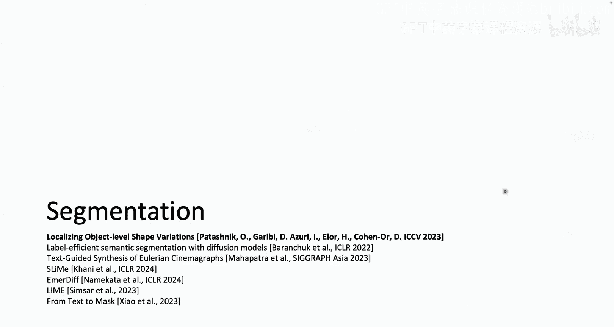

**核心思想**：在生成结构图像的去噪过程中，用跨图像注意力层替换自注意力层。具体来说，查询来自正在生成的结构图像，而键和值来自外观图像。

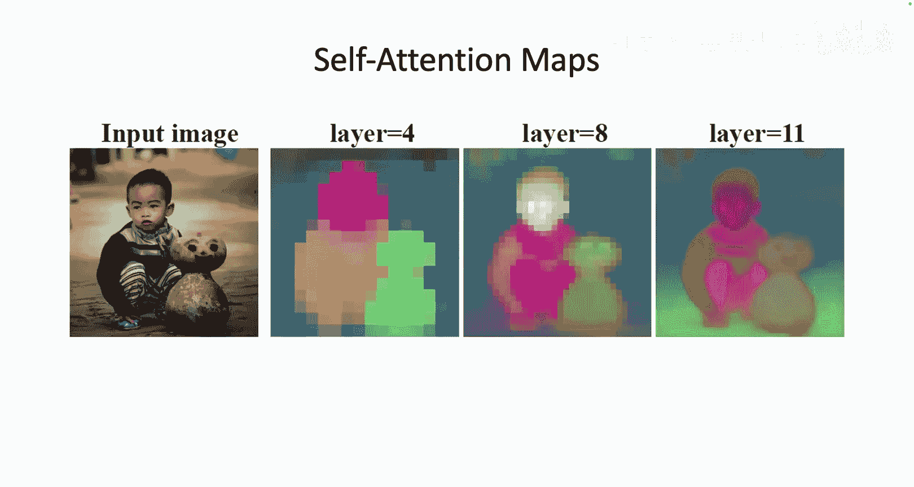

**工作原理**：以长颈鹿头部的一个点为例，其输出特征将是斑马头部值的加权平均。这正是我们希望迁移到长颈鹿头部的外观信息。

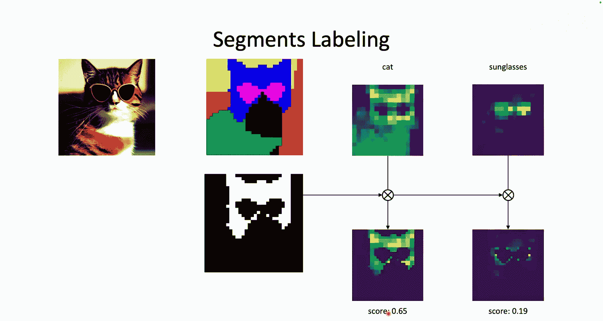

然而，直接应用会产生伪影，因为存在**域差距**：来自不同外观图像的特征直接组合存在挑战。通过应用对比度操作、AdaIN层匹配统计量以及“外观引导”等技术，可以弥合这一差距，显著改善结果。

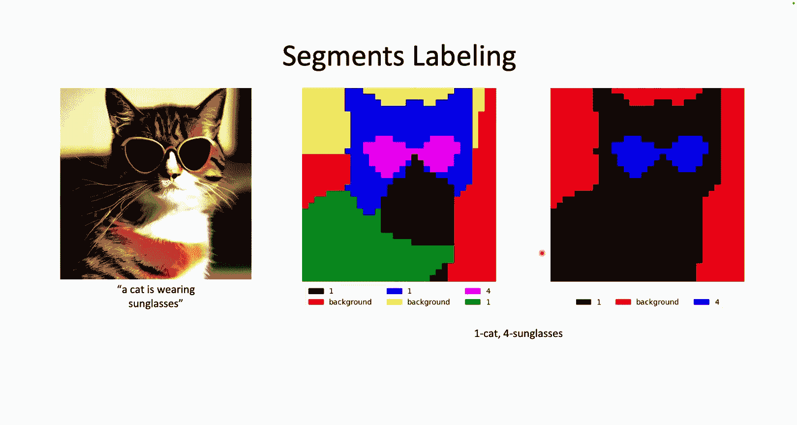

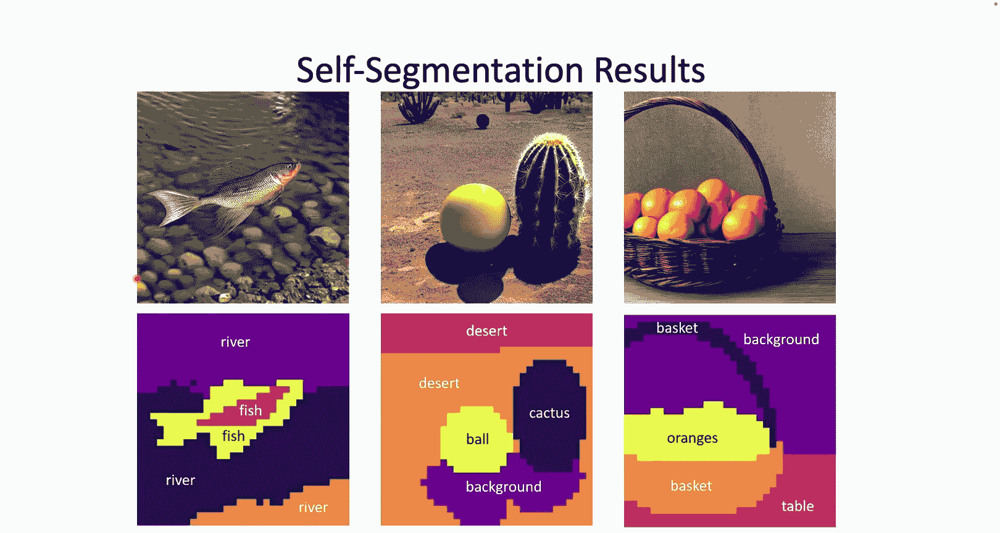

**方法流程总结**：
1.  将结构图像和外观图像分别反演到噪声空间 `z_T`。
2.  启动两个并行的去噪分支：一个用于外观图像（标准去噪），一个用于目标图像。
3.  在目标图像的去噪过程中，于模型的多个层用跨图像注意力层替换自注意力层（查询来自目标图像，键和值来自外观图像）。
4.  （可选）引入第三个分支（仅对结构图像去噪）以实现外观引导，类似于分类器无关引导。

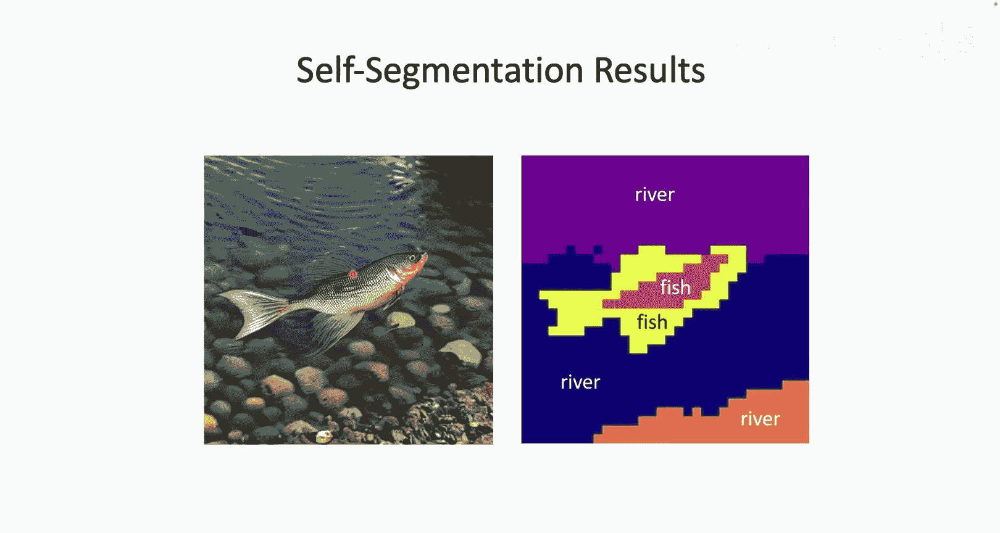

这种方法不仅适用于动物，也适用于车辆、建筑等，能够迁移高级外观特征（如车灯样式、建筑纹理），而不仅仅是颜色。

---

## 一致性生成

注意力层实现的语义对应还能用于生成具有一致性的图像序列，例如统一风格或多视角下的同一主体。

**风格一致性生成**：目标是生成一系列具有共同风格（如黑白高对比度标识风格）的不同主体图像（如玩具火车、玩具飞机）。仅使用提示词生成，风格可能不统一。

**解决方案**：共享不同图像间的特征。具体做法是，在生成目标图像时，将其键和值与参考风格图像的键和值进行拼接。这样，目标图像既能获得参考风格，又能保留自身内容特征。此方法也可通过图像反演应用于真实图像。

**内容一致性生成（连贯故事）**：目标是在不同场景中生成同一个角色（如一位戴帽子的老人），用于故事叙述。仅用提示词无法保证角色一致性。

**解决方案**：
1.  在主体掩码区域内跨图像共享注意力。
2.  使用基于注意力特征的DFT方法在不同图像间建立显式对应关系，并进行特征注入。
3.  使用随机丢弃机制来鼓励多样性，防止所有图像过于雷同。

---

## 图像分割

注意力图还能以无监督的方式为生成图像提供语义分割。

**方法**：对于正在生成的图像，在特定层和时间步堆叠自注意力图，并对每个像素的 `h x w` 维特征向量进行聚类（如K-means），即可得到语义分割区域。

**分割区域标注**：结合交叉注意力图，可以为每个分割区域分配标签。计算每个分割区域与各个文本词交叉注意力图的重叠程度，重叠最高的词即为该区域的标签。

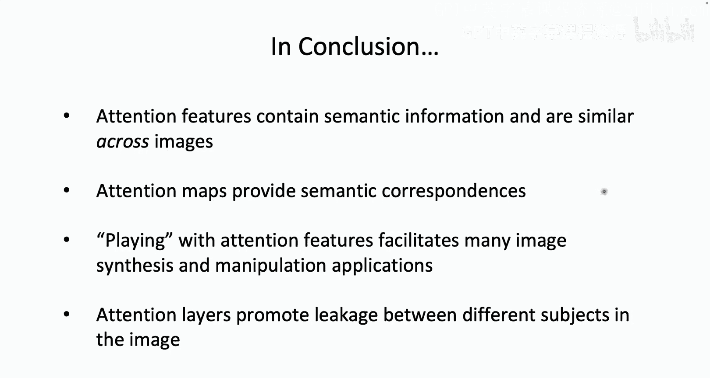

**优势**：
1.  **免费且无需监督**：模型并非为分割而训练。
2.  **生成感知**：模型“知道”它想生成什么。例如，对于一条鱼，即使鱼鳍在图像中不明显，模型也能凭借其生成意图将其准确分割出来，这有时优于像SAM这样的通用分割模型。
3.  **便于图像编辑**：准确的语义分割是进行精细图像编辑（如背景替换、局部修改）的重要基础。

---

## 图像编辑与注意力泄漏问题

注意力操作是许多图像编辑方法的核心。例如，在“提示词到提示词”编辑中，通过保留或注入原始图像的注意力图，可以在改变提示词（如将“自行车”改为“汽车”）时，最大限度地保持原图的结构。

然而，注意力层也存在一个根本性问题：**注意力泄漏**。当尝试在同一图像中生成多个语义相似的主体时（如“长颈鹿和斑马”），由于它们的查询在语义上相似，会相互关注并共享值，导致特征混合，最终生成奇怪的杂交体或数量错误的主体。

**泄漏根源**：
1.  **自注意力泄漏**：一个主体（如螃蟹）的腿部查询会关注另一个主体（如青蛙）的腿部。
2.  **交叉注意力泄漏**：相似主体（如小猫和小狗）的查询本身相似，当与相同的文本键相乘时，会产生相似的注意力向量，从而导致文本值在两个主体间泄漏。

泄漏会在模型的多个层和多个去噪步骤中累积，使得查询分布完全混合，生成失败。

**现有解决方案与局限**：
*   **布局引导**：通过优化噪声 `z_T`，约束每个主体的注意力仅集中在其对应的边界框内。但这可能将查询推离自然分布，导致图像质量下降。
*   **有界注意力（Be Yourself）**：核心思想是限制注意力，使每个主体只受自身特征影响，而不受图像中其他主体影响。这能产生更接近自然分布的特征和更准确的生成结果。

尽管像Flux这样的新模型在解决多主体生成问题上有所改进，但注意力泄漏这一根本问题仍然存在，尤其是在提示词更复杂时。这提示我们，注意力层并非专为生成任务设计，未来可能需要探索更适合生成模型的架构或机制。

---

## 总结与展望

本节课中我们一起学习了注意力层在扩散模型中的核心作用：

1.  **注意力特征包含语义信息**：这些信息不仅在同一图像内有效，还能跨图像共享，从而实现了外观迁移和一致性生成等应用。
2.  **注意力图提供免费语义对应**：这为许多图像处理和生成任务打开了大门。
3.  **操作注意力便于图像合成与操控**：已有大量工作基于此，但仍有广阔的应用探索空间。
4.  **注意力泄漏是根本挑战**：当前注意力层在生成多个相似主体时存在缺陷，未来需要设计更适用于生成任务的机制。

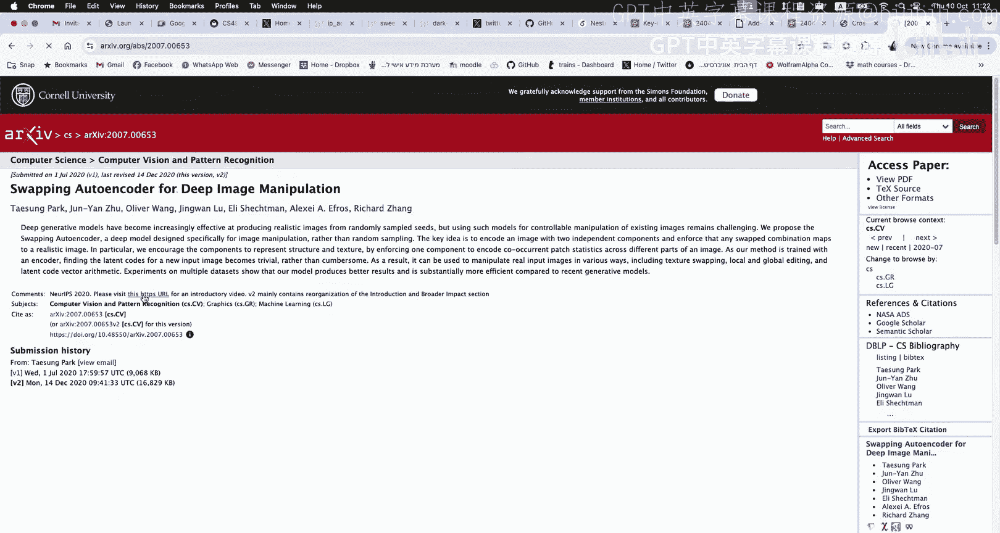

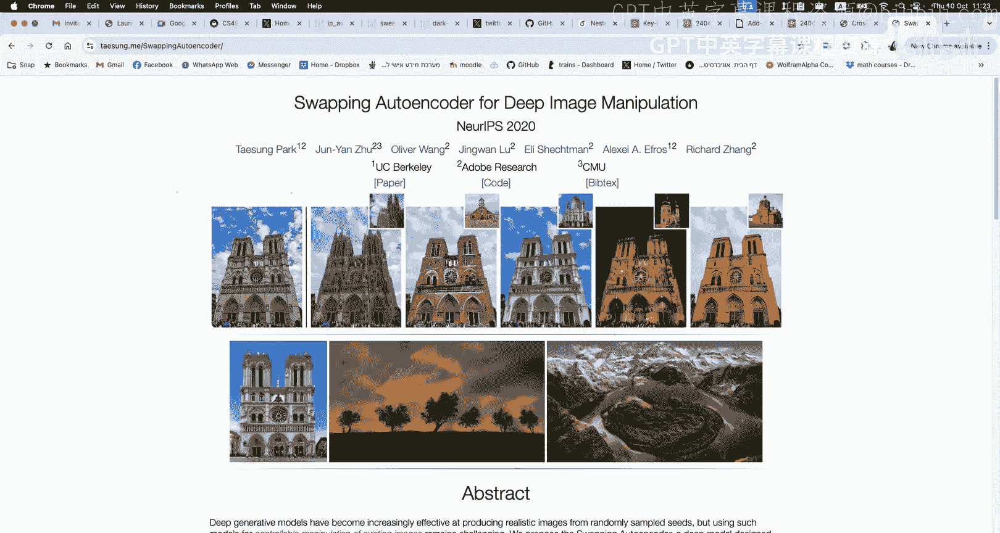

注意力层是连接语义与生成的强大桥梁，深入理解其原理对于推动扩散模型的发展和应用至关重要。